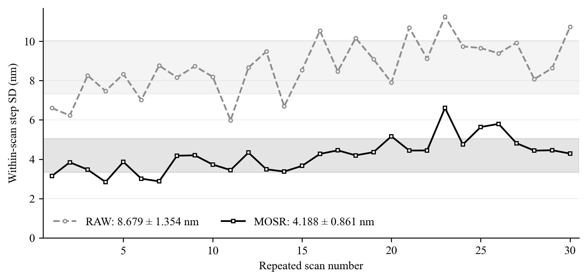

# 九顆柱體平均位移與中位數位移比較

本報告回應口試委員對九顆柱體位移彙整方式的建議。主要分析改為九個二維位移向量的算術平均，再投影至固定移動方向；既有中位數結果作敏感度比較。

平均數版本的RAW與MOSR掃描內步距合併標準差分別為 **8.780826 nm** 與 **4.272773 nm**，降低 **51.340%**。MOSR仍在 **30/30** 次掃描中改善，逐次改善範圍為 **34.610%–67.157%**。相鄰位移的PI平均絕對差為 **6.969175 nm** 與 **3.598341 nm**，降低 **48.368%**。

因此，主要結論維持，但論文應使用新數字；不得沿用中位數版本的52.3%步距改善與51.0%相鄰PI平均絕對差改善。

## 固定資料與舊結果重現

使用正式30次掃描、每次31張、固定九顆的保存LSC圓心，共每方法8370筆圓心。逐筆讀取的圓心與既有完整紀錄相同；原始PI回授檔、圓心、輪廓與固定設定共154個檔案核對通過。沒有重新擬合光學LSC、改動輪廓、重新推論MOSR或調整資料。

尺度為0.1725 μm/pixel，固定移動方向為u=(−0.9998766245119538, 0.015707824629190823)。PI使用同一影格對的Y方向回授差。原中位數相鄰與相對起點共3600筆位移均重現，最大差為3.55e-15 μm，屬浮點讀寫尾位。

## 計算定義

令r為掃描、j為位置、k為柱體；c為保存圓心。相鄰步距的九顆位移向量為Δc(r,j,k)=c(r,j,k)−c(r,j−1,k)。

新方法：m_mean(r,j)=(1/9)Σ_k Δc(r,j,k)，d_mean(r,j)=172.5 uᵀm_mean(r,j)，單位nm。

舊方法：m_median(r,j)=[median_k Δc_x, median_k Δc_y]，d_median(r,j)=172.5 uᵀm_median(r,j)。此處是分量中位數，並非九個投影值的中位數。

每次掃描的主要值為s_r=√[Σ_j(d(r,j)−d̄_r)²/29]，30次合併值為s_pooled=√mean_r(s_r²)。不以900步直接混算，不除以√30。30個s_r的算術平均與其樣本標準差另列。

相對起點使用c(r,j,k)−c(r,0,k)直接計算。平均與投影都是線性運算，因此平均版本的逐步累加與直接相對起點在本資料內相差小於2×10⁻¹¹ nm；主要輸出仍保存直接相對起點結果。這個等價關係不適用於分量中位數。

## 相鄰步距全部摘要

| 方法 | 九顆彙整 | 合併SD nm | 30個SD平均 nm | 30個SD之SD nm | PI MAE nm | PI RMSE nm | PI有號偏差 nm | PI最大絕對差 nm |
| --- | --- | --- | --- | --- | --- | --- | --- | --- |
| RAW | mean | 8.780826 | 8.679308 | 1.354120 | 6.969175 | 8.771685 | 1.390872 | 30.549132 |
| MOSR | mean | 4.272773 | 4.188101 | 0.860870 | 3.598341 | 4.460082 | 1.422603 | 15.167376 |
| RAW | median | 10.199758 | 10.061695 | 1.701125 | 8.166620 | 10.266092 | 1.834932 | 39.299200 |
| MOSR | median | 4.864821 | 4.753797 | 1.051058 | 4.002692 | 5.026773 | 1.410976 | 22.264439 |

每點為一次掃描30步的樣本SD；水平灰帶是30個s_r的算術平均±這30個數值的樣本SD，並非每點的估計區間。

## 全部30次掃描

| 掃描 | RAW平均版SD | MOSR平均版SD | RAW中位版SD | MOSR中位版SD | 平均版MOSR降低% |
| --- | --- | --- | --- | --- | --- |
| 1 | 6.602953 | 3.151172 | 7.673786 | 3.848346 | 52.276323 |
| 2 | 6.225155 | 3.845292 | 7.419405 | 3.665054 | 38.229780 |
| 3 | 8.257505 | 3.474002 | 9.653318 | 3.616307 | 57.929159 |
| 4 | 7.468022 | 2.845980 | 9.000257 | 3.377203 | 61.891119 |
| 5 | 8.327802 | 3.867806 | 9.665428 | 3.921500 | 53.555497 |
| 6 | 7.011638 | 3.014675 | 7.659357 | 4.036928 | 57.004694 |
| 7 | 8.763339 | 2.878126 | 9.506103 | 4.067940 | 67.157200 |
| 8 | 8.160012 | 4.180996 | 9.832487 | 4.422821 | 48.762375 |
| 9 | 8.729261 | 4.200882 | 9.318423 | 4.491446 | 51.875860 |
| 10 | 8.189514 | 3.730735 | 9.929030 | 3.882162 | 54.444974 |
| 11 | 5.982622 | 3.450057 | 7.353788 | 3.515973 | 42.332022 |
| 12 | 8.657750 | 4.338983 | 9.246503 | 4.807692 | 49.883246 |
| 13 | 9.471204 | 3.491124 | 10.802784 | 3.906009 | 63.139594 |
| 14 | 6.690367 | 3.374819 | 6.952348 | 3.643570 | 49.557047 |
| 15 | 8.539434 | 3.664305 | 8.905560 | 4.230138 | 57.089603 |
| 16 | 10.524278 | 4.271780 | 11.457155 | 4.060178 | 59.410234 |
| 17 | 8.468906 | 4.452755 | 10.900367 | 5.498878 | 47.422307 |
| 18 | 10.158209 | 4.198253 | 11.368474 | 4.409009 | 58.671325 |
| 19 | 9.084437 | 4.360330 | 10.276689 | 4.599307 | 52.002201 |
| 20 | 7.900441 | 5.166129 | 9.896010 | 5.417411 | 34.609614 |
| 21 | 10.688958 | 4.443514 | 10.901541 | 5.100712 | 58.428938 |
| 22 | 9.108723 | 4.447721 | 11.101913 | 5.383024 | 51.170758 |
| 23 | 11.249564 | 6.607171 | 13.782461 | 6.989032 | 41.267315 |
| 24 | 9.735333 | 4.748561 | 12.266395 | 6.901149 | 51.223442 |
| 25 | 9.650411 | 5.637888 | 12.391840 | 6.345370 | 41.578775 |
| 26 | 9.383373 | 5.797186 | 10.314117 | 6.510709 | 38.218527 |
| 27 | 9.918666 | 4.816147 | 10.644130 | 6.290474 | 51.443602 |
| 28 | 8.071683 | 4.439381 | 10.597998 | 5.010363 | 45.000556 |
| 29 | 8.630867 | 4.458475 | 9.484928 | 5.273691 | 48.342678 |
| 30 | 10.728815 | 4.288792 | 13.548245 | 5.391519 | 60.025480 |

## 相對起點與終點

| 方法 | 九顆彙整 | 相對起點MAE nm | RMSE nm | 有號偏差 nm | 最大絕對差 nm |
| --- | --- | --- | --- | --- | --- |
| RAW | mean | 18.404898 | 23.393315 | 6.449733 | 80.008683 |
| MOSR | mean | 17.873942 | 23.076918 | 8.471074 | 71.804152 |
| RAW | median | 19.080973 | 24.295058 | 6.429397 | 83.263940 |
| MOSR | median | 18.002019 | 23.334787 | 8.576711 | 74.748385 |

| 方法 | 九顆彙整 | 終點PI MAE nm | 終點RMSE nm | 終點有號偏差 nm | 終點最大絕對差 nm | 終點誤差跨掃描SD nm |
| --- | --- | --- | --- | --- | --- | --- |
| RAW | median | 40.892288 | 43.857796 | 40.892288 | 75.880352 | 16.124314 |
| RAW | mean | 41.726164 | 44.524453 | 41.726164 | 80.008683 | 15.801161 |
| MOSR | median | 42.842101 | 45.003611 | 42.842101 | 74.748385 | 14.015242 |
| MOSR | mean | 42.678094 | 44.676612 | 42.678094 | 71.804152 | 13.438749 |

平均版本的終點平均有號差為RAW +41.726 nm、MOSR +42.678 nm。短步改善不能延伸解讀為終點偏差同步改善。

## 完整掃描配對區間

抽樣單位是整趟掃描，兩方法使用相同30個掃描抽樣名單；20000次，固定種子20261002。九顆、900步及輪廓方向不作獨立重複實驗。差值為MOSR減RAW。

| 指標 | MOSR−RAW nm | 95%下界 nm | 95%上界 nm |
| --- | --- | --- | --- |
| 掃描內合併SD | -4.508054 | -4.883137 | -4.133483 |
| 相鄰PI MAE | -3.370834 | -3.709509 | -3.033402 |
| 起點相對PI MAE | -0.530957 | -1.148898 | 0.090299 |
| 終點有號PI差 | 0.951929 | -1.769198 | 3.631155 |

## 平均與中位數差異來自哪裡

RAW改用平均後，30/30次掃描的SD降低；0/30次增加。以下列出SD改變幅度最大的五次掃描，不因此排除任何資料。

| 掃描 | RAW檔案中的趟次ID | 中位數SD nm | 平均數SD nm | 平均−中位數SD nm |
| --- | --- | --- | --- | --- |
| 30 | 005143_XY_0 | 13.548245 | 10.728815 | -2.819430 |
| 25 | 004822_XY_0 | 12.391840 | 9.650411 | -2.741429 |
| 23 | 004715_XY_0 | 13.782461 | 11.249564 | -2.532897 |
| 24 | 004747_XY_0 | 12.266395 | 9.735333 | -2.531061 |
| 28 | 005038_XY_0 | 10.597998 | 8.071683 | -2.526315 |

MOSR改用平均後，28/30次掃描的SD降低；2/30次增加。以下列出SD改變幅度最大的五次掃描，不因此排除任何資料。

| 掃描 | RAW檔案中的趟次ID | 中位數SD nm | 平均數SD nm | 平均−中位數SD nm |
| --- | --- | --- | --- | --- |
| 24 | 004747_XY_0 | 6.901149 | 4.748561 | -2.152588 |
| 27 | 005007_XY_0 | 6.290474 | 4.816147 | -1.474327 |
| 7 | 003412_XY_0 | 4.067940 | 2.878126 | -1.189814 |
| 30 | 005143_XY_0 | 5.391519 | 4.288792 | -1.102726 |
| 17 | 004318_XY_0 | 5.498878 | 4.452755 | -1.046123 |

每一步中，第k顆對「平均位移−分量中位位移」的貢獻定義為(d_k−d_median)/9；九顆貢獻加總恰等於兩種彙整結果之差。另計算暫時不納入一顆時平均值的變化，只作影響分析，正式結果仍用全部九顆。

| 方法 | 柱體 | 平均絕對貢獻 nm | 平均有號貢獻 nm | 暫不納入該顆時的平均絕對變化 nm |
| --- | --- | --- | --- | --- |
| RAW | 1 | 1.947796 | -0.060619 | 2.254211 |
| RAW | 2 | 1.895561 | -0.061286 | 2.218048 |
| RAW | 3 | 1.980510 | -0.008404 | 2.316131 |
| RAW | 4 | 1.855718 | -0.089791 | 2.167196 |
| RAW | 5 | 1.869419 | -0.047911 | 2.168239 |
| RAW | 6 | 1.853418 | -0.046321 | 2.137707 |
| RAW | 7 | 1.925633 | -0.085118 | 2.210823 |
| RAW | 8 | 1.903905 | -0.042857 | 2.238418 |
| RAW | 9 | 1.932126 | -0.001753 | 2.271975 |
| MOSR | 1 | 0.724807 | -0.002749 | 0.837491 |
| MOSR | 2 | 0.729624 | 0.023701 | 0.836801 |
| MOSR | 3 | 0.725626 | 0.001771 | 0.851046 |
| MOSR | 4 | 0.697759 | -0.044384 | 0.802937 |
| MOSR | 5 | 0.740511 | -0.004526 | 0.859928 |
| MOSR | 6 | 0.670573 | 0.018497 | 0.803174 |
| MOSR | 7 | 0.670928 | -0.017261 | 0.782088 |
| MOSR | 8 | 0.705599 | 0.007414 | 0.819217 |
| MOSR | 9 | 0.673920 | 0.029164 | 0.798387 |

RAW九顆的平均絕對貢獻約1.85–1.98 nm，MOSR約0.67–0.74 nm，沒有單一柱體獨占差異。RAW的最大平均貢獻來自第3顆，MOSR來自第5顆；這些名次只是本批影響大小，不能據此斷定物體有污染、缺陷或量測錯誤。

| 方法 | 掃描 | 步 | 平均−中位數 nm | 九顆沿方向SD nm | 九顆範圍 nm |
| --- | --- | --- | --- | --- | --- |
| RAW | 24 | 19 | 22.896277 | 36.276083 | 101.880562 |
| RAW | 26 | 12 | -21.669577 | 33.680349 | 87.601936 |
| RAW | 28 | 15 | -20.526311 | 33.109283 | 91.178293 |
| RAW | 25 | 26 | -18.522649 | 30.646165 | 77.556333 |
| RAW | 26 | 13 | 18.180647 | 39.270904 | 98.826454 |
| RAW | 18 | 20 | 17.827120 | 29.793229 | 79.918606 |
| RAW | 25 | 30 | 17.414600 | 38.695268 | 113.212616 |
| RAW | 30 | 30 | -16.700882 | 32.573521 | 86.823506 |
| RAW | 23 | 2 | -15.528190 | 22.404943 | 58.896283 |
| RAW | 23 | 18 | 15.394799 | 37.259741 | 121.957591 |
| RAW | 2 | 21 | -15.133341 | 23.671823 | 56.609429 |
| RAW | 29 | 22 | -14.701753 | 29.571360 | 89.203148 |

## 同一步九顆的離散與分布診斷

沿方向與垂直方向分別計算九顆位移的樣本SD；二維離散量為√[Σ_k‖Δc_k−平均Δc‖²/(9−1)]×172.5。合併先對900個步驟的變異數取平均，再開根號。這些值描述同一步九顆的分散，不是主要的單次掃描30步SD。

| 方法 | 沿方向離散 nm | 垂直方向離散 nm | 二維離散 nm | 含診斷旗標步數/900 | 旗標觀測數/8100 | |偏態|中位數 | |偏態|>1的步數 |
| --- | --- | --- | --- | --- | --- | --- | --- |
| RAW | 23.812959 | 23.802812 | 33.669435 | 145 | 211 | 0.456456 | 154 |
| MOSR | 8.963582 | 9.182832 | 12.832389 | 135 | 199 | 0.453908 | 145 |

診斷旗標為同一步九顆的|d_k−median(d)|/[1.4826 MAD(d)]>3.5。每一步只有九顆，這個旗標與樣本偏態都不等於已證明的壞點或常態性檢定；它們亦不是互相獨立的8100次實驗。全部旗標點都保留。

資料並非完全沒有偏態或較遠的讀值，因此不宜以「完全無離群」作為使用平均數的理由。較直接的依據是：研究欲估計固定九顆的共同平移，算術平均保留全部位移向量資訊；在同一保存資料上，平均版本的主要SD及PI MAE均較低，而且MOSR相對RAW的30/30改善不依賴彙整選擇。中位數作為對較大偏離值較不敏感的補充，兩者均完整報告。

平均數版本也不意味尺寸或完整輪廓變得更準確。此次未改圓心、半徑或邊界點，輪廓重複性、直徑重複性及SEM尺寸／輪廓比較維持原數值，後續外部模型以相同規則比較。

## 可用於論文的敘述

為依一致的向量定義估計固定九顆柱體之共同平移，本研究先逐顆計算指定影格對的LSC圓心差，再對九個二維位移向量取算術平均，最後投影至預先固定的移動方向。全部柱體與步距均納入分析，並以分量中位數作敏感度比較。平均彙整下，RAW與MOSR之掃描內步距合併標準差分別為8.781 nm與4.273 nm，降低51.3%，且30次掃描均改善；各次改善為34.6%至67.2%。相鄰位移相對PI回授的平均絕對差由6.969 nm降至3.598 nm，降低48.4%。兩種彙整方式均支持MOSR改善本批資料的短步量測表現，惟改善百分比與絕對數值應依平均版本更新。

## 可重算資料

data/提供全部30次掃描、7200筆彙整位移（兩方法×兩彙整×兩位移定義×900）、16200筆逐顆相鄰位移、逐步九顆離散、逐顆影響、終點摘要與完整掃描配對區間。任何旗標或暫不納入單顆的結果均只屬診斷；主分析使用全30次、全九顆、全30步。
