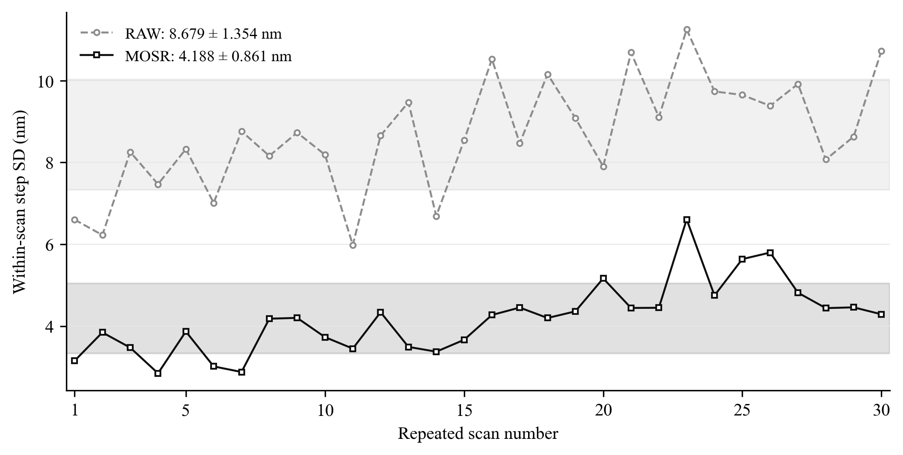
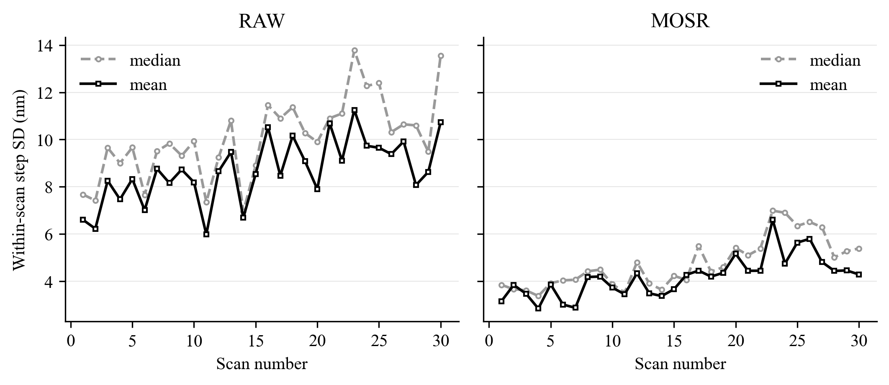
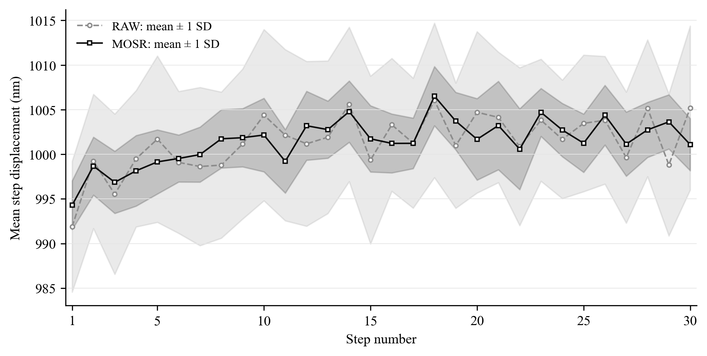
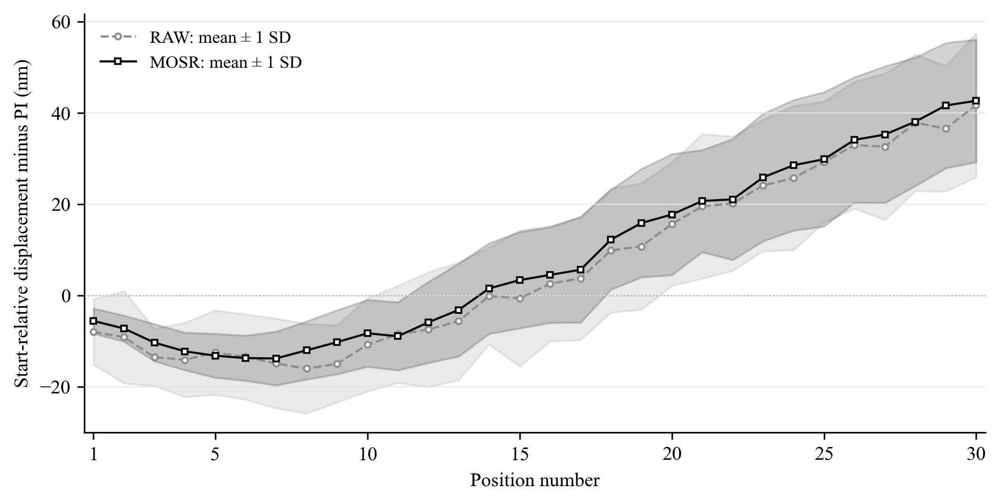
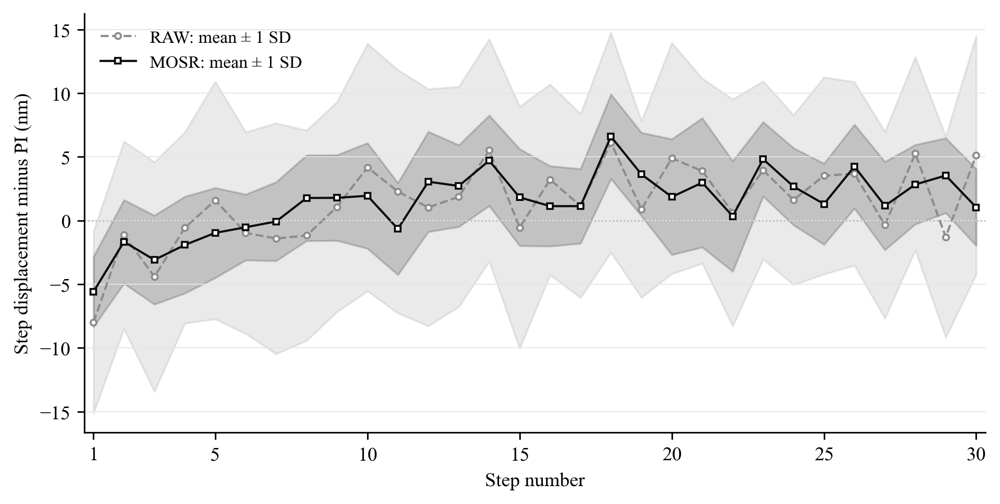

# MOSR論文修改交接：九顆平均位移之完整驗證結果

日期：2026-10-05。此份是可獨立閱讀的第一部分交接；全部數字已由同一批保存量測資料重算，不需等待外部模型訓練。

## 給網頁版對話的修改指令

請先完整閱讀本文件與我同時提供的最新版論文，再修改原論文。這次只將九顆柱體位移的彙整從「x、y分量中位數」改成「九個二維位移向量的算術平均，再投影至固定方向」，並一致更新相關公式、摘要、研究貢獻、表格、圖說、討論與結論。依下列位置對照核查原文，不要只替換百分比。

使用RAW與MOSR名稱，不放內部開發編號。模型、訓練、PSF校正、影像重建、圓心與輪廓量測方式、尺度、方向、PI回授、物件對應、所有30次掃描與九顆柱體均維持原設定。本次沒有新模型結果、沒有重新訓練或重建MOSR，也沒有重新擬合RAW/MOSR的LSC。

相對起點PI平均絕對差的95%配對區間已跨零，請改為「點估計略降，但尚不能確認改善」，不能沿用舊版的肯定結論。約30 μm終點的平均有號差也沒有改善證據。輪廓與尺寸數字並不因位移彙整改變；MOSR的SEM直徑差仍比RAW大，必須保留。不要將重複性改善寫成已證明絕對準確度或完整量測不確定度降低。

圖表採簡單研討會／論文格式與灰階。請用附件的新圖替換對應舊圖，保留各圖統計量與灰帶定義。最後提供修改後論文，以及逐處修改對照表，核查全文的數字、公式、圖說與結論是否一致。

## 閱讀順序與本次範圍

本文件依序包含完整驗證分析、三張主圖與圖說、前6／後24趟分析、30位置完整摘要、未變動結果、論文修改位置與可直接使用文字。data資料夾是完整數據；verification資料夾保存已核對的圓心與PI陣列及可獨立重算的程式。只上傳本MD與論文即可理解結果；要實際替換圖，請同時提供ZIP解壓後的figures或個別PNG／PDF。

來源論文為《MOSR_論文_格式與正式用語校訂版_20261004.pdf》，共144個PDF頁；對照表使用原論文印刷頁碼，括號內為PDF頁。來源檔案識別及數據檔案雜湊保存於verification，原論文檔案未被改寫。

---

## 統一公式與符號（可供論文排版）

r=1,…,30為掃描，j=1,…,30為相鄰步或相對起點之非零位置，k=1,…,9為固定柱體。c_(r,j,k)是保存的二維LSC圓心，單位pixel；a=j−1為相鄰步，a=0為直接相對起點。

Δc̄_(r,j;a) = (1/9) Σ_(k=1)^9 [c_(r,j,k) − c_(r,a,k)]

d_(r,j;a) = 172.5 uᵀ Δc̄_(r,j;a)　[nm]

p_(r,j;a) = 1000 [PI_Y(r,j) − PI_Y(r,a)]　[nm]

e_(r,j;a) = d_(r,j;a) − p_(r,j;a)　[nm]

d̄_r = (1/30) Σ_(j=1)^30 d_(r,j;j−1)

s_r = sqrt{ (1/29) Σ_(j=1)^30 [d_(r,j;j−1) − d̄_r]² }

s_pooled = sqrt{ (1/30) Σ_(r=1)^30 s_r² }

MAE = (1/900) Σ_r Σ_j |e_(r,j;a)|；RMSE = sqrt{(1/900) Σ_r Σ_j e_(r,j;a)²}；有號偏差 = (1/900) Σ_r Σ_j e_(r,j;a)；最大絕對差 = max_(r,j)|e_(r,j;a)|。

約30 μm終點摘要只取j=30，因此MAE、RMSE與偏差分母為30；終點跨趟SD分母29。各位置跨趟均值μ_j=(1/30)Σ_r d_(r,j;a)，SD_j=sqrt{(1/29)Σ_r[d_(r,j;a)−μ_j]²}；PI誤差灰帶以e代d同樣計算。主要s_r針對量得步距d，不是PI差e的SD；二者不可偷換。

降低率=100×(1−MOSR指標/RAW指標)。逐次降低率使用各趟s_r；合併降低率使用s_pooled，而不是30個降低率的平均。比較方向一律MOSR−RAW，對非負誤差或波動指標，負差值代表降低；有號偏差需另看距零遠近。
## 九顆柱體平均位移與中位數位移比較

本報告回應口試委員對九顆柱體位移彙整方式的建議。主要分析改為九個二維位移向量的算術平均，再投影至固定移動方向；既有中位數結果作敏感度比較。

平均數版本的RAW與MOSR掃描內步距合併標準差分別為 **8.780826 nm** 與 **4.272773 nm**，降低 **51.340%**。MOSR仍在 **30/30** 次掃描中改善，逐次改善範圍為 **34.610%–67.157%**。相鄰位移的PI平均絕對差為 **6.969175 nm** 與 **3.598341 nm**，降低 **48.368%**。

因此，主要結論維持，但論文應使用新數字；不得沿用中位數版本的52.3%步距改善與51.0%相鄰PI平均絕對差改善。

## 固定資料與舊結果重現

使用正式30次掃描、每次31張、固定九顆的保存LSC圓心，共每方法8370筆圓心。逐筆讀取的圓心與既有完整紀錄相同；原始PI回授檔、圓心、輪廓與固定設定共154個檔案核對通過。沒有重新擬合光學LSC、改動輪廓、重新推論MOSR或調整資料。

尺度為0.1725 μm/pixel，固定移動方向為u=(−0.9998766245119538, 0.015707824629190823)。PI使用同一影格對的Y方向回授差。原中位數相鄰與相對起點共3600筆位移均重現，最大差為3.55e-15 μm，屬浮點讀寫尾位。

## 計算定義

令r為掃描、j為位置、k為柱體；c為保存圓心。相鄰步距的九顆位移向量為Δc(r,j,k)=c(r,j,k)−c(r,j−1,k)。

新方法：m_mean(r,j)=(1/9)Σ_k Δc(r,j,k)，d_mean(r,j)=172.5 uᵀm_mean(r,j)，單位nm。

舊方法：m_median(r,j)=[median_k Δc_x, median_k Δc_y]，d_median(r,j)=172.5 uᵀm_median(r,j)。此處是分量中位數，並非九個投影值的中位數。

每次掃描的主要值為s_r=√[Σ_j(d(r,j)−d̄_r)²/29]，30次合併值為s_pooled=√mean_r(s_r²)。不以900步直接混算，不除以√30。30個s_r的算術平均與其樣本標準差另列。

相對起點使用c(r,j,k)−c(r,0,k)直接計算。平均與投影都是線性運算，因此平均版本的逐步累加與直接相對起點在本資料內相差小於2×10⁻¹¹ nm；主要輸出仍保存直接相對起點結果。這個等價關係不適用於分量中位數。

## 相鄰步距全部摘要

| 方法 | 九顆彙整 | 合併SD nm | 30個SD平均 nm | 30個SD之SD nm | PI MAE nm | PI RMSE nm | PI有號偏差 nm | PI最大絕對差 nm |
| --- | --- | --- | --- | --- | --- | --- | --- | --- |
| RAW | mean | 8.780826 | 8.679308 | 1.354120 | 6.969175 | 8.771685 | 1.390872 | 30.549132 |
| MOSR | mean | 4.272773 | 4.188101 | 0.860870 | 3.598341 | 4.460082 | 1.422603 | 15.167376 |
| RAW | median | 10.199758 | 10.061695 | 1.701125 | 8.166620 | 10.266092 | 1.834932 | 39.299200 |
| MOSR | median | 4.864821 | 4.753797 | 1.051058 | 4.002692 | 5.026773 | 1.410976 | 22.264439 |

每點為一次掃描30步的樣本SD；水平灰帶是30個s_r的算術平均±這30個數值的樣本SD，並非每點的估計區間。

## 全部30次掃描

| 掃描 | RAW平均版SD | MOSR平均版SD | RAW中位版SD | MOSR中位版SD | 平均版MOSR降低% |
| --- | --- | --- | --- | --- | --- |
| 1 | 6.602953 | 3.151172 | 7.673786 | 3.848346 | 52.276323 |
| 2 | 6.225155 | 3.845292 | 7.419405 | 3.665054 | 38.229780 |
| 3 | 8.257505 | 3.474002 | 9.653318 | 3.616307 | 57.929159 |
| 4 | 7.468022 | 2.845980 | 9.000257 | 3.377203 | 61.891119 |
| 5 | 8.327802 | 3.867806 | 9.665428 | 3.921500 | 53.555497 |
| 6 | 7.011638 | 3.014675 | 7.659357 | 4.036928 | 57.004694 |
| 7 | 8.763339 | 2.878126 | 9.506103 | 4.067940 | 67.157200 |
| 8 | 8.160012 | 4.180996 | 9.832487 | 4.422821 | 48.762375 |
| 9 | 8.729261 | 4.200882 | 9.318423 | 4.491446 | 51.875860 |
| 10 | 8.189514 | 3.730735 | 9.929030 | 3.882162 | 54.444974 |
| 11 | 5.982622 | 3.450057 | 7.353788 | 3.515973 | 42.332022 |
| 12 | 8.657750 | 4.338983 | 9.246503 | 4.807692 | 49.883246 |
| 13 | 9.471204 | 3.491124 | 10.802784 | 3.906009 | 63.139594 |
| 14 | 6.690367 | 3.374819 | 6.952348 | 3.643570 | 49.557047 |
| 15 | 8.539434 | 3.664305 | 8.905560 | 4.230138 | 57.089603 |
| 16 | 10.524278 | 4.271780 | 11.457155 | 4.060178 | 59.410234 |
| 17 | 8.468906 | 4.452755 | 10.900367 | 5.498878 | 47.422307 |
| 18 | 10.158209 | 4.198253 | 11.368474 | 4.409009 | 58.671325 |
| 19 | 9.084437 | 4.360330 | 10.276689 | 4.599307 | 52.002201 |
| 20 | 7.900441 | 5.166129 | 9.896010 | 5.417411 | 34.609614 |
| 21 | 10.688958 | 4.443514 | 10.901541 | 5.100712 | 58.428938 |
| 22 | 9.108723 | 4.447721 | 11.101913 | 5.383024 | 51.170758 |
| 23 | 11.249564 | 6.607171 | 13.782461 | 6.989032 | 41.267315 |
| 24 | 9.735333 | 4.748561 | 12.266395 | 6.901149 | 51.223442 |
| 25 | 9.650411 | 5.637888 | 12.391840 | 6.345370 | 41.578775 |
| 26 | 9.383373 | 5.797186 | 10.314117 | 6.510709 | 38.218527 |
| 27 | 9.918666 | 4.816147 | 10.644130 | 6.290474 | 51.443602 |
| 28 | 8.071683 | 4.439381 | 10.597998 | 5.010363 | 45.000556 |
| 29 | 8.630867 | 4.458475 | 9.484928 | 5.273691 | 48.342678 |
| 30 | 10.728815 | 4.288792 | 13.548245 | 5.391519 | 60.025480 |

## 相對起點與終點

| 方法 | 九顆彙整 | 相對起點MAE nm | RMSE nm | 有號偏差 nm | 最大絕對差 nm |
| --- | --- | --- | --- | --- | --- |
| RAW | mean | 18.404898 | 23.393315 | 6.449733 | 80.008683 |
| MOSR | mean | 17.873942 | 23.076918 | 8.471074 | 71.804152 |
| RAW | median | 19.080973 | 24.295058 | 6.429397 | 83.263940 |
| MOSR | median | 18.002019 | 23.334787 | 8.576711 | 74.748385 |

| 方法 | 九顆彙整 | 終點PI MAE nm | 終點RMSE nm | 終點有號偏差 nm | 終點最大絕對差 nm | 終點誤差跨掃描SD nm |
| --- | --- | --- | --- | --- | --- | --- |
| RAW | median | 40.892288 | 43.857796 | 40.892288 | 75.880352 | 16.124314 |
| RAW | mean | 41.726164 | 44.524453 | 41.726164 | 80.008683 | 15.801161 |
| MOSR | median | 42.842101 | 45.003611 | 42.842101 | 74.748385 | 14.015242 |
| MOSR | mean | 42.678094 | 44.676612 | 42.678094 | 71.804152 | 13.438749 |

平均版本的終點平均有號差為RAW +41.726 nm、MOSR +42.678 nm。短步改善不能延伸解讀為終點偏差同步改善。

## 完整掃描配對區間

抽樣單位是整趟掃描，兩方法使用相同30個掃描抽樣名單；20000次，固定種子20261002。九顆、900步及輪廓方向不作獨立重複實驗。差值為MOSR減RAW。

| 指標 | MOSR−RAW nm | 95%下界 nm | 95%上界 nm |
| --- | --- | --- | --- |
| 掃描內合併SD | -4.508054 | -4.883137 | -4.133483 |
| 相鄰PI MAE | -3.370834 | -3.709509 | -3.033402 |
| 起點相對PI MAE | -0.530957 | -1.148898 | 0.090299 |
| 終點有號PI差 | 0.951929 | -1.769198 | 3.631155 |

## 平均與中位數差異來自哪裡

RAW改用平均後，30/30次掃描的SD降低；0/30次增加。以下列出SD改變幅度最大的五次掃描，不因此排除任何資料。

| 掃描 | RAW檔案中的趟次ID | 中位數SD nm | 平均數SD nm | 平均−中位數SD nm |
| --- | --- | --- | --- | --- |
| 30 | 005143_XY_0 | 13.548245 | 10.728815 | -2.819430 |
| 25 | 004822_XY_0 | 12.391840 | 9.650411 | -2.741429 |
| 23 | 004715_XY_0 | 13.782461 | 11.249564 | -2.532897 |
| 24 | 004747_XY_0 | 12.266395 | 9.735333 | -2.531061 |
| 28 | 005038_XY_0 | 10.597998 | 8.071683 | -2.526315 |

MOSR改用平均後，28/30次掃描的SD降低；2/30次增加。以下列出SD改變幅度最大的五次掃描，不因此排除任何資料。

| 掃描 | RAW檔案中的趟次ID | 中位數SD nm | 平均數SD nm | 平均−中位數SD nm |
| --- | --- | --- | --- | --- |
| 24 | 004747_XY_0 | 6.901149 | 4.748561 | -2.152588 |
| 27 | 005007_XY_0 | 6.290474 | 4.816147 | -1.474327 |
| 7 | 003412_XY_0 | 4.067940 | 2.878126 | -1.189814 |
| 30 | 005143_XY_0 | 5.391519 | 4.288792 | -1.102726 |
| 17 | 004318_XY_0 | 5.498878 | 4.452755 | -1.046123 |

每一步中，第k顆對「平均位移−分量中位位移」的貢獻定義為(d_k−d_median)/9；九顆貢獻加總恰等於兩種彙整結果之差。另計算暫時不納入一顆時平均值的變化，只作影響分析，正式結果仍用全部九顆。

| 方法 | 柱體 | 平均絕對貢獻 nm | 平均有號貢獻 nm | 暫不納入該顆時的平均絕對變化 nm |
| --- | --- | --- | --- | --- |
| RAW | 1 | 1.947796 | -0.060619 | 2.254211 |
| RAW | 2 | 1.895561 | -0.061286 | 2.218048 |
| RAW | 3 | 1.980510 | -0.008404 | 2.316131 |
| RAW | 4 | 1.855718 | -0.089791 | 2.167196 |
| RAW | 5 | 1.869419 | -0.047911 | 2.168239 |
| RAW | 6 | 1.853418 | -0.046321 | 2.137707 |
| RAW | 7 | 1.925633 | -0.085118 | 2.210823 |
| RAW | 8 | 1.903905 | -0.042857 | 2.238418 |
| RAW | 9 | 1.932126 | -0.001753 | 2.271975 |
| MOSR | 1 | 0.724807 | -0.002749 | 0.837491 |
| MOSR | 2 | 0.729624 | 0.023701 | 0.836801 |
| MOSR | 3 | 0.725626 | 0.001771 | 0.851046 |
| MOSR | 4 | 0.697759 | -0.044384 | 0.802937 |
| MOSR | 5 | 0.740511 | -0.004526 | 0.859928 |
| MOSR | 6 | 0.670573 | 0.018497 | 0.803174 |
| MOSR | 7 | 0.670928 | -0.017261 | 0.782088 |
| MOSR | 8 | 0.705599 | 0.007414 | 0.819217 |
| MOSR | 9 | 0.673920 | 0.029164 | 0.798387 |

RAW九顆的平均絕對貢獻約1.85–1.98 nm，MOSR約0.67–0.74 nm，沒有單一柱體獨占差異。RAW的最大平均貢獻來自第3顆，MOSR來自第5顆；這些名次只是本批影響大小，不能據此斷定物體有污染、缺陷或量測錯誤。

| 方法 | 掃描 | 步 | 平均−中位數 nm | 九顆沿方向SD nm | 九顆範圍 nm |
| --- | --- | --- | --- | --- | --- |
| RAW | 24 | 19 | 22.896277 | 36.276083 | 101.880562 |
| RAW | 26 | 12 | -21.669577 | 33.680349 | 87.601936 |
| RAW | 28 | 15 | -20.526311 | 33.109283 | 91.178293 |
| RAW | 25 | 26 | -18.522649 | 30.646165 | 77.556333 |
| RAW | 26 | 13 | 18.180647 | 39.270904 | 98.826454 |
| RAW | 18 | 20 | 17.827120 | 29.793229 | 79.918606 |
| RAW | 25 | 30 | 17.414600 | 38.695268 | 113.212616 |
| RAW | 30 | 30 | -16.700882 | 32.573521 | 86.823506 |
| RAW | 23 | 2 | -15.528190 | 22.404943 | 58.896283 |
| RAW | 23 | 18 | 15.394799 | 37.259741 | 121.957591 |
| RAW | 2 | 21 | -15.133341 | 23.671823 | 56.609429 |
| RAW | 29 | 22 | -14.701753 | 29.571360 | 89.203148 |

## 同一步九顆的離散與分布診斷

沿方向與垂直方向分別計算九顆位移的樣本SD；二維離散量為√[Σ_k‖Δc_k−平均Δc‖²/(9−1)]×172.5。合併先對900個步驟的變異數取平均，再開根號。這些值描述同一步九顆的分散，不是主要的單次掃描30步SD。

| 方法 | 沿方向離散 nm | 垂直方向離散 nm | 二維離散 nm | 含診斷旗標步數/900 | 旗標觀測數/8100 | 絕對偏態中位數 | 絕對偏態>1的步數 |
| --- | --- | --- | --- | --- | --- | --- | --- |
| RAW | 23.812959 | 23.802812 | 33.669435 | 145 | 211 | 0.456456 | 154 |
| MOSR | 8.963582 | 9.182832 | 12.832389 | 135 | 199 | 0.453908 | 145 |

診斷旗標為同一步九顆的|d_k−median(d)|/[1.4826 MAD(d)]>3.5。每一步只有九顆，這個旗標與樣本偏態都不等於已證明的壞點或常態性檢定；它們亦不是互相獨立的8100次實驗。全部旗標點都保留。

資料並非完全沒有偏態或較遠的讀值，因此不宜以「完全無離群」作為使用平均數的理由。較直接的依據是：研究欲估計固定九顆的共同平移，算術平均保留全部位移向量資訊；在同一保存資料上，平均版本的主要SD及PI MAE均較低，而且MOSR相對RAW的30/30改善不依賴彙整選擇。中位數作為對較大偏離值較不敏感的補充，兩者均完整報告。

平均數版本也不意味尺寸或完整輪廓變得更準確。此次未改圓心、半徑或邊界點，輪廓重複性、直徑重複性及SEM尺寸／輪廓比較維持原數值，此份文件只處理已完成的RAW／MOSR平均數重算。

## 可用於論文的敘述

為依一致的向量定義估計固定九顆柱體之共同平移，本研究先逐顆計算指定影格對的LSC圓心差，再對九個二維位移向量取算術平均，最後投影至預先固定的移動方向。全部柱體與步距均納入分析，並以分量中位數作敏感度比較。平均彙整下，RAW與MOSR之掃描內步距合併標準差分別為8.781 nm與4.273 nm，降低51.3%，且30次掃描均改善；各次改善為34.6%至67.2%。相鄰位移相對PI回授的平均絕對差由6.969 nm降至3.598 nm，降低48.4%。兩種彙整方式均支持MOSR改善本批資料的短步量測表現，惟改善百分比與絕對數值應依平均版本更新。

## 可重算資料

data/提供全部30次掃描、7200筆彙整位移（兩方法×兩彙整×兩位移定義×900）、16200筆逐顆相鄰位移、逐步九顆離散、逐顆影響、終點摘要與完整掃描配對區間。任何旗標或暫不納入單顆的結果均只屬診斷；主分析使用全30次、全九顆、全30步。

## 新主圖與可直接使用的圖說

### 圖6-12：每趟30步的波動

圖6-12　RAW與MOSR於30次重複掃描之掃描內步距樣本標準差。每趟先計算30個相鄰影格間的九顆平均位移，再以分母29求該趟標準差。水平灰帶分別為30個單趟標準差的算術平均±其樣本標準差：RAW為8.679±1.354 nm，MOSR為4.188±0.861 nm。此灰帶描述趟次間的變動，不是每點的信賴區間。主要合併標準差另為8.781與4.273 nm，兩者不可混用。

### 圖6-13：同一步跨30次重拍

圖6-13　每一步影像位移於30次掃描之平均±1個樣本標準差。每趟的單步位移先取固定九顆二維位移向量之平均，再投影至固定方向。橫軸為步數，線為同一步跨30趟的平均位移，灰帶為平均±樣本SD，並非標準誤或95%區間。圖6-12描述趟內步距波動，本圖描述同一步在不同趟之重拍分散，兩者不可互換。此圖並未把每步強制設成1000 nm。

### 圖6-14：長距離與PI的差

圖6-14　各位置相對起點的影像位移與對應PI回授差之平均±1個樣本標準差。每趟以當前與起點的九顆圓心差向量直接平均及投影，再扣同一影格對PI_Y回授差；跨30趟計算平均與樣本SD。零位置的位移與PI差依定義均為零，本圖畫其後30位置。正值表示影像量得位移大於PI回授。算術平均版本的直接相對起點與逐步位移累加等價；圖說不可再寫成分量中位數累加。此處SD是扣PI後誤差的跨趟散布，不是單趟30步SD。

### 補充圖：單步PI差

補充圖　各相鄰步之影像位移減PI回授差，線與灰帶分別為跨30次掃描之平均與±1個樣本SD。只作單步偏差分布補充，不替代PI MAE或掃描內波動主指標。

所有圖提供300 dpi PNG、SVG及PDF；敏感度補充圖提供PNG及SVG。圖上只有RAW與MOSR名稱，沒有彩色線條。

## 前6／後24次掃描敏感度（平均向量版）

| 掃描範圍 | 掃描數 | RAW合併SD nm | RAW PI MAE nm | MOSR合併SD nm | MOSR PI MAE nm | 合併SD降低% |
| --- | --- | --- | --- | --- | --- | --- |
| 1–6 | 6 | 7.357815 | 5.745358 | 3.389509 | 2.978304 | 53.933209 |
| 7–30 | 24 | 9.101883 | 7.275129 | 4.466379 | 3.753350 | 50.929069 |

兩組使用同一計算方式，完整保留。前6趟及後24趟均顯示MOSR的合併單趟波動較低；不能因此刪除後24趟或將其解讀為另一次獨立樣品驗證。

## 30位置完整摘要（每列均跨30趟）

### 相鄰步距

| 位置／步 | RAW位移平均 nm | RAW位移SD nm | MOSR位移平均 nm | MOSR位移SD nm | RAW PI差平均 nm | RAW PI差SD nm | MOSR PI差平均 nm | MOSR PI差SD nm |
| --- | --- | --- | --- | --- | --- | --- | --- | --- |
| 1 | 991.889586 | 7.333190 | 994.298056 | 2.731552 | -7.989742 | 7.158242 | -5.581272 | 2.764994 |
| 2 | 999.202631 | 7.518346 | 998.673407 | 3.247527 | -1.132935 | 7.357567 | -1.662159 | 3.281021 |
| 3 | 995.531376 | 8.979105 | 996.858554 | 3.482469 | -4.412422 | 9.014671 | -3.085244 | 3.492050 |
| 4 | 999.498995 | 7.639813 | 998.145860 | 3.953200 | -0.558606 | 7.504899 | -1.911741 | 3.796350 |
| 5 | 1001.695190 | 9.317497 | 999.145992 | 3.593598 | 1.587233 | 9.321833 | -0.961965 | 3.533627 |
| 6 | 999.089210 | 7.950751 | 999.529361 | 2.634238 | -0.964705 | 7.916843 | -0.524554 | 2.582669 |
| 7 | 998.626435 | 8.864600 | 999.965947 | 3.083570 | -1.407005 | 9.060163 | -0.067494 | 3.093246 |
| 8 | 998.785883 | 8.186427 | 1001.731228 | 3.272136 | -1.171522 | 8.256819 | 1.773824 | 3.364234 |
| 9 | 1001.149464 | 8.407454 | 1001.857488 | 3.264641 | 1.080546 | 8.246639 | 1.788570 | 3.361736 |
| 10 | 1004.387033 | 9.594781 | 1002.156160 | 4.121373 | 4.178242 | 9.712133 | 1.947369 | 4.146687 |
| 11 | 1002.141235 | 9.592553 | 999.208599 | 3.556204 | 2.284150 | 9.550376 | -0.648486 | 3.607128 |
| 12 | 1001.172049 | 9.232980 | 1003.195851 | 3.861672 | 1.029009 | 9.303295 | 3.052811 | 3.932664 |
| 13 | 1001.911258 | 8.551079 | 1002.760865 | 3.203671 | 1.870575 | 8.645759 | 2.720182 | 3.207083 |
| 14 | 1005.591363 | 8.646370 | 1004.781245 | 3.435519 | 5.519130 | 8.726218 | 4.709011 | 3.555083 |
| 15 | 999.358578 | 9.401638 | 1001.730117 | 3.713246 | -0.547965 | 9.505700 | 1.823574 | 3.799625 |
| 16 | 1003.301121 | 7.443472 | 1001.216972 | 3.300862 | 3.220634 | 7.482260 | 1.136485 | 3.151426 |
| 17 | 1001.247813 | 7.280273 | 1001.224063 | 2.831688 | 1.157537 | 7.220399 | 1.133786 | 2.926889 |
| 18 | 1006.042331 | 8.654201 | 1006.511630 | 3.317550 | 6.128021 | 8.625901 | 6.597320 | 3.323462 |
| 19 | 1000.969495 | 7.016001 | 1003.716224 | 3.221420 | 0.890292 | 6.929858 | 3.637020 | 3.268989 |
| 20 | 1004.703156 | 9.043102 | 1001.672920 | 4.568053 | 4.890202 | 9.073252 | 1.859967 | 4.541411 |
| 21 | 1004.137464 | 7.314490 | 1003.222338 | 4.954406 | 3.894718 | 7.259313 | 2.979591 | 5.072795 |
| 22 | 1000.854128 | 8.844322 | 1000.569777 | 4.529406 | 0.625115 | 8.905204 | 0.340764 | 4.337204 |
| 23 | 1003.819904 | 6.835474 | 1004.691851 | 2.686869 | 3.952021 | 6.992145 | 4.823968 | 2.921455 |
| 24 | 1001.674687 | 6.640650 | 1002.716461 | 2.984764 | 1.628407 | 6.665889 | 2.670181 | 3.027979 |
| 25 | 1003.463118 | 7.653056 | 1001.241369 | 3.267841 | 3.523768 | 7.736789 | 1.302019 | 3.181988 |
| 26 | 1003.814201 | 7.154345 | 1004.380409 | 3.345263 | 3.683225 | 7.208597 | 4.249432 | 3.291186 |
| 27 | 999.630103 | 7.345000 | 1001.137720 | 3.593468 | -0.351193 | 7.325431 | 1.156423 | 3.462726 |
| 28 | 1005.159640 | 7.663752 | 1002.736330 | 3.088999 | 5.261243 | 7.592916 | 2.837933 | 3.115511 |
| 29 | 998.809964 | 7.956030 | 1003.632618 | 3.040153 | -1.284269 | 7.897443 | 3.538385 | 2.942348 |
| 30 | 1005.185695 | 9.190435 | 1001.085626 | 2.919719 | 5.142462 | 9.366591 | 1.042392 | 3.008858 |

### 直接相對起點

| 位置／步 | RAW位移平均 nm | RAW位移SD nm | MOSR位移平均 nm | MOSR位移SD nm | RAW PI差平均 nm | RAW PI差SD nm | MOSR PI差平均 nm | MOSR PI差SD nm |
| --- | --- | --- | --- | --- | --- | --- | --- | --- |
| 1 | 991.889586 | 7.333190 | 994.298056 | 2.731552 | -7.989742 | 7.158242 | -5.581272 | 2.764994 |
| 2 | 1991.092217 | 10.081680 | 1992.971463 | 2.923571 | -9.122677 | 10.124214 | -7.243431 | 2.857450 |
| 3 | 2986.623593 | 6.218705 | 2989.830017 | 4.111446 | -13.535099 | 6.270671 | -10.328675 | 4.083381 |
| 4 | 3986.122588 | 8.243700 | 3987.975877 | 4.286923 | -14.093705 | 8.149867 | -12.240416 | 4.119536 |
| 5 | 4987.817778 | 9.295859 | 4987.121868 | 4.997111 | -12.506471 | 9.254825 | -13.202381 | 4.820595 |
| 6 | 5986.906987 | 9.307605 | 5986.651229 | 5.044820 | -13.471177 | 9.340451 | -13.726935 | 4.962861 |
| 7 | 6985.533423 | 9.701624 | 6986.617176 | 5.919602 | -14.878182 | 9.856394 | -13.794429 | 5.898476 |
| 8 | 7984.319305 | 9.782292 | 7988.348404 | 6.348089 | -16.049704 | 9.824100 | -12.020605 | 6.375501 |
| 9 | 8985.468769 | 8.444590 | 8990.205892 | 6.952756 | -14.969158 | 8.464495 | -10.232035 | 7.020575 |
| 10 | 9989.855803 | 10.129098 | 9992.362052 | 7.352325 | -10.790916 | 10.218583 | -8.284666 | 7.331989 |
| 11 | 10991.997038 | 10.773213 | 10991.570652 | 7.469049 | -8.506766 | 10.656658 | -8.933152 | 7.476827 |
| 12 | 11993.169087 | 12.536557 | 11994.766503 | 8.818517 | -7.477757 | 12.584774 | -5.880341 | 8.894536 |
| 13 | 12995.080345 | 12.878125 | 12997.527368 | 10.199348 | -5.607182 | 12.870522 | -3.160159 | 10.187616 |
| 14 | 14000.671708 | 10.515119 | 14002.308613 | 9.921941 | -0.088052 | 10.639625 | 1.548853 | 9.930435 |
| 15 | 15000.030286 | 14.948371 | 15004.038730 | 10.615325 | -0.636017 | 14.922243 | 3.372427 | 10.569763 |
| 16 | 16003.331407 | 12.760783 | 16005.255702 | 10.556894 | 2.584617 | 12.645683 | 4.508912 | 10.490259 |
| 17 | 17004.579221 | 13.509579 | 17006.479765 | 11.417477 | 3.742154 | 13.497212 | 5.642698 | 11.578788 |
| 18 | 18010.621551 | 13.523259 | 18012.991394 | 10.891977 | 9.870174 | 13.612602 | 12.240017 | 10.956629 |
| 19 | 19011.591046 | 13.740952 | 19016.707618 | 11.846643 | 10.760466 | 13.861469 | 15.877038 | 11.893631 |
| 20 | 20016.294202 | 13.519270 | 20018.380538 | 13.321061 | 15.650669 | 13.525867 | 17.737004 | 13.261719 |
| 21 | 21020.431666 | 15.748117 | 21021.602876 | 11.089170 | 19.545386 | 15.845708 | 20.716596 | 11.199152 |
| 22 | 22021.285795 | 14.773390 | 22022.172654 | 13.405815 | 20.170501 | 14.707049 | 21.057360 | 13.280909 |
| 23 | 23025.105699 | 14.677010 | 23026.864505 | 14.075205 | 24.122522 | 14.418776 | 25.881328 | 13.967216 |
| 24 | 24026.780386 | 15.851924 | 24029.580965 | 14.402920 | 25.750929 | 15.820608 | 28.551508 | 14.321801 |
| 25 | 25030.243504 | 13.301995 | 25030.822335 | 14.734346 | 29.274697 | 13.294635 | 29.853528 | 14.732682 |
| 26 | 26034.057705 | 13.858271 | 26035.202744 | 13.670529 | 32.957922 | 13.923993 | 34.102960 | 13.779490 |
| 27 | 27033.687809 | 16.010657 | 27036.340464 | 15.011559 | 32.606728 | 16.037429 | 35.259383 | 14.973267 |
| 28 | 28038.847448 | 15.005435 | 28039.076794 | 14.151939 | 37.867971 | 14.966514 | 38.097317 | 14.091797 |
| 29 | 29037.657412 | 13.758509 | 29042.709412 | 13.775091 | 36.583702 | 13.778144 | 41.635701 | 13.733176 |
| 30 | 30042.843108 | 15.660263 | 30043.795037 | 13.456567 | 41.726164 | 15.801161 | 42.678094 | 13.438749 |
## 未因平均數彙整改變的幾何結果

| 指標（nm） | RAW | MOSR | 判讀 |
| --- | ---: | ---: | --- |
| 平均直徑 | 2799.620660 | 2834.017939 | MOSR平均大34.397279 nm |
| 直徑重複量測SD | 32.750251 | 13.251720 | 重複性改善 |
| 完整輪廓重複量測SD | 63.758024 | 18.599990 | 重複性改善約70.8% |
| 去平均半徑之形狀SD | 61.666738 | 17.400551 | 描述去尺寸後之形狀重複性 |
| SEM工作表平均逐顆直徑絕對差 | 169.883278 | 204.280557 | MOSR較大，不是尺寸更準 |
| SEM輪廓點參照平均逐顆直徑絕對差 | 185.182117 | 219.579396 | MOSR較大 |

直徑SD先在同一位置、同一顆物體跨30次掃描求樣本SD，再合併31位置及九顆之方差。完整輪廓先以保存LSC圓心平移對齊，將64個邊界點插值至720固定方向，在同一位置／物件／方向跨30趟求SD，再合併；不自由旋轉、縮放或配準。去尺寸形狀則先各自扣除輪廓平均半徑。SEM直徑差先對每顆的30×31個光學直徑平均，再與對應SEM直徑比較，最後平均九顆絕對差。

SEM工作表的平均直徑2629.737382 nm，SEM輪廓點參照為2614.438543 nm，兩種讀法相差15.298839 nm，不可混用。此處沿用已核對的原幾何結果，本次只重算位移，不重做SEM擬合或校正。

## 統計判讀與限制

所有配對區間取完整掃描為抽樣單位，20000次重抽樣，固定種子20261002，相同掃描名單同時用於RAW與MOSR。逐次SD降低34.6%至67.2%是本批30趟觀察到的範圍；合併降低率95%區間48.40%至54.26%是全掃描重抽樣的估計區間，兩者不可混用。圖的±1SD又是另一個描述量。

30趟來自同批同時段，可能存在時間漂移；整趟重抽樣保留趟內相依，但仍假設趟次可交換。前6／後24趟作預先已有的敏感度分析，不能事後據此捨棄某一組。區間不含完整PI誤差預算、像素尺度校準不確定度、SEM參照誤差或跨樣品變異。PI相符程度可作準度相關參照，但不是已建立完整絕對真值。900步、九顆物件或720方向不能充當900／8100／更多次獨立重拍。

## 論文逐處修改位置

### 最新版論文修改對照表

本文對照提供的《MOSR 論文格式與正式用語校訂版》：共144個PDF頁，正文131頁。以下以論文印刷頁碼為主，括號內為PDF頁。原論文檔案未修改。

本次只修改九顆位移彙整與其結果；不新增尚未完成的外部模型比較。

## 一、九顆位移公式與方法敘述

| 原位置 | 應修改內容 | 理由 |
| --- | --- | --- |
| 第4.7.4節，p.64（PDF77） | 將九顆x、y分量中位數改為九個二維圓心差向量之算術平均，再投影至固定方向 | 平均向量為新主要彙整定義 |
| 式（4-15）前的Δc定義 | 補明Δc=(1/9)Σ_k[c(r,j,k)−c(r,a,k)] | 有號PI差公式與單位仍相同；改變的是輸入位移向量 |
| 第4.7.4節相對起點敘述 | 保留直接以第j張對第0張計算；補充算術平均與投影的線性，使直接相對起點與逐步累計等價 | 舊分量中位數不具此等價關係 |
| 第4.7.5節，式（4-16）、（4-17a,b） | MAE及樣本SD／合併SD公式保留，全部位移數值改用平均向量 | 每次掃描30步、分母29及30次合併定義不變 |
| 圖6-7(d)，p.102（PDF115） | 將Componentwise median → axis projection改為Mean of nine displacement vectors → axis projection | 方法示意須與新算法一致 |
| 第5.4.5節及表5-18 | 補明九顆平均向量、共同方向及相同資料的彙整規則 | 交代所有方法使用相同後續量測 |

可加入下列定義，k=1,…,9；a=j−1為相鄰步距，a=0為相對起點：

Δc̄(r,j;a) = (1/9) Σ_k [c(r,j,k)−c(r,a,k)]

d(r,j;a) = 172.5 uᵀΔc̄(r,j;a) [nm]

e(r,j;a) = d(r,j;a)−1000[PI_Y(r,j)−PI_Y(r,a)] [nm]

固定u=(−0.9998766245119538, 0.015707824629190823)，尺度0.1725 μm/pixel。所有九顆、步距與掃描均保留；未重擬合RAW/MOSR圓心或改輪廓。

## 二、已確認須更新的主要數字

| 指標 | 舊RAW／MOSR，中位數 | 新RAW／MOSR，平均向量 | 新結果 |
| --- | --- | --- | --- |
| 掃描內步距合併SD nm | 10.200／4.865 | 8.781／4.273 | 降低51.34%，30/30次改善 |
| 30個單次SD算術平均 nm | 10.062／4.754 | 8.679／4.188 | 另作分布摘要，不替代合併SD |
| 30個單次SD之樣本SD nm | 1.701／1.051 | 1.354／0.861 | 描述不同掃描間的變動 |
| 單次SD範圍 nm | 6.952–13.782／3.377–6.989 | 5.983–11.250／2.846–6.607 | 原範圍須替換 |
| 各次SD降低範圍 | 36.9%–64.6% | 34.6%–67.2% | 重拍提供的實際範圍 |
| 合併SD降低率95%區間 | 49.67%–55.04% | 48.40%–54.26% | 全掃描配對重抽樣 |
| 相鄰PI MAE nm | 8.167／4.003 | 6.969／3.598 | 降低48.37% |
| 相鄰PI RMSE nm | 10.266／5.027 | 8.772／4.460 | 降低49.15% |
| 相鄰有號PI差 nm | +1.835／+1.411 | +1.391／+1.423 | 平均有號差不能與MAE互換 |
| 相鄰最大絕對PI差 nm | 39.299／22.264 | 30.549／15.167 | 更新最大差 |
| 相對起點PI MAE nm | 19.081／18.002 | 18.405／17.874 | 降低2.88%，差值區間跨零 |
| 終點平均有號PI差 nm | +40.892／+42.842 | +41.726／+42.678 | 差值區間跨零 |
| 終點量得位移之跨掃描SD nm | 16.026／14.049 | 15.660／13.457 | 終點摘要；不是單次30步SD |
| 終點PI誤差之跨掃描SD nm | 16.124／14.015 | 15.801／13.439 | 先扣PI後的誤差摘要 |

掃描內SD差值MOSR−RAW為−4.508054 nm，95%區間−4.883137至−4.133483 nm；相鄰PI MAE差值為−3.370834 nm，95%區間−3.709509至−3.033402 nm。兩個主要位移指標均降低。

相對起點MAE差值為−0.530957 nm，95%區間−1.148898至+0.090299 nm；終點有號差值為+0.951929 nm，95%區間−1.769198至+3.631155 nm。**相對起點MAE的原肯定改善敘述必須修改：平均版本的區間已跨零。**

## 三、最新版論文須替換的圖、表與文字

| 位置 | 修改方式 |
| --- | --- |
| 中文摘要p.i（PDF3）、英文摘要p.ii（PDF4） | 主SD改8.781→4.273 nm、降低51.3%；PI MAE改6.969→3.598 nm、降低48.4%。保留30/30改善 |
| 第1.3節研究貢獻p.3（PDF16） | 位移改善52.3%改51.3%；保留輪廓改善70.8%，不能由彙整修改推成輪廓也重新變好 |
| 第6.2.5節p.107–110（PDF120–123） | 按平均向量版完整替換步距圖、逐次範圍、PI差值及起點／終點判讀 |
| 圖6-12與表6-4，p.108（PDF121） | 使用figures/Fig6_12_within_scan_SD及data/paired_30_scan_comparison；圖例8.679±1.354、4.188±0.861 nm；表內合併值8.781、4.273 nm |
| 表6-5，p.109（PDF122） | 使用平均版全掃描配對區間；起點相對MAE列須註明區間跨零 |
| 圖6-13，p.109（PDF122） | 由平均版每一步跨30次掃描均值±1SD重新繪製；不是標準誤或95%區間 |
| 表6-6，p.110（PDF123） | 平均向量版合併SD：前6次RAW／MOSR為7.358／3.390 nm，後24次為9.102／4.466 nm；不能沿用中位數版8.566／3.751與10.569／5.106 nm |
| 圖6-14，p.110（PDF123） | 平均版直接相對起點位移扣各趟PI，再計算跨掃描平均±1SD；改寫中位數累計相關圖說 |
| 第6.2.8節綜合討論p.114（PDF127） | 改用51.3%及48.4%，並更新起點相對MAE不確定的判讀 |
| 第7.1、7.3節與表7-1，p.115–116（PDF128–129） | 同步所有新位移數字、逐次範圍與區間 |

輪廓／尺寸原數據仍為RAW／MOSR：完整輪廓SD 63.758／18.600 nm、直徑SD 32.750／13.252 nm、去平均半徑形狀SD 61.667／17.401 nm；SEM工作表平均逐顆直徑差169.883／204.281 nm。這些量不使用九顆位移平均，不能因此次彙整改動而修改。

## 可直接使用的摘要、結果與結論文字

### 中文摘要與研究貢獻的數據句

在30次重複掃描中，以固定九顆柱體之平均位移向量彙整後，RAW與MOSR的掃描內步距合併標準差分別為8.781 nm與4.273 nm，降低51.3%，全部30次掃描均改善，逐次降低範圍為34.6%至67.2%。相鄰位移相對PI回授的平均絕對差由6.969 nm降至3.598 nm，降低48.4%。完整輪廓重複量測標準差仍由63.758 nm降至18.600 nm；惟SEM平均直徑差較大，尺寸準度未同步改善。

### 英文摘要的對應數據句

Across 30 repeated scans, displacement was aggregated by averaging the two-dimensional displacement vectors of nine fixed pillars and projecting the mean vector onto the fixed motion direction. The pooled within-scan step standard deviation decreased from 8.781 nm for RAW to 4.273 nm for MOSR (51.3%). All 30 scans improved, with individual reductions ranging from 34.6% to 67.2%. The mean absolute difference between adjacent image displacements and PI feedback decreased from 6.969 nm to 3.598 nm (48.4%). These results support improved short-step repeatability and agreement with PI feedback for this dataset, without establishing improved absolute dimensional accuracy or reduced long-distance bias.

### 長距離討論與結論

相對起點位移之PI平均絕對差由18.405 nm變為17.874 nm，點估計降低2.9%，但MOSR減RAW差值的95%完整掃描配對估計區間為−1.149至+0.090 nm，跨越零。約30 μm終點的平均有號PI差由+41.726 nm變為+42.678 nm，其差值區間亦跨越零。因此，本批資料的主要位移效益為掃描內步距穩定性與相鄰位移對PI回授的相符程度；不能將短步改善直接延伸為長距離偏差或絕對尺寸準度的確定改善。

## 修改後全文檢查清單

1. 九顆位移主公式使用向量平均；分量中位數僅留在敏感度分析或歷史對照。
2. 摘要、英文摘要、貢獻、主結果、結論的位移SD均為8.781／4.273 nm、降低51.3%；相鄰PI MAE均為6.969／3.598 nm、降低48.4%。
3. 全部30趟、每趟30步、九顆與930張保留，不因診斷旗標刪除資料。
4. 區分單趟SD、合併SD、30個SD之平均±SD、同一步跨趟SD、PI誤差SD；不以標準誤或900步混算取代。
5. 相對起點改善區間跨零；終點偏差不宣稱改善；尺寸與SEM不利結果保留。
6. 圖6-12至6-14、表6-4至6-6及表7-1數字、圖說與正文章節一致。這次不加入未完成外部模型排名，也不修改模型或PSF。
7. 表內至少保留3位小數，百分比正文通常1位，原始CSV保存完整精度。最終文字修改以原論文實際排版與公式編號為準。

## 附件資料索引

| 檔案 | 資料列數 |
| --- | --- |
| aggregation_summary.csv | 8 |
| all_aggregated_displacements.csv | 7200 |
| all_pillar_displacements.csv | 16200 |
| distribution_diagnostics.csv | 2 |
| endpoint_summary.csv | 4 |
| mean_first6_last24_summary.csv | 2 |
| mean_median_paired_intervals.csv | 36 |
| nine_pillar_dispersion.csv | 1800 |
| paired_30_scan_comparison.csv | 30 |
| per_scan_metrics.csv | 240 |
| per_step_across_scan_statistics.csv | 240 |
| pillar_influence_diagnostics.csv | 18 |

aggregation=mean為主要版本，median為敏感度版本；kind=adjacent為相鄰影格，start為當前對起點。所有_nm欄位單位為nm；dx_px、dy_px為像素；百分比是0至100尺度。mean_median_paired_intervals.csv中MSE欄位及其差值／區間單位為nm²，不能標成nm或誤認RMSE。diagnostic旗標與leave_one_out為補充檢查，不是主分析刪點規則。

all_aggregated_displacements.csv共7200列，涵蓋兩方法×兩彙整×兩位移定義×900；其中主要mean版本3600列，每方法1800列。all_pillar_displacements.csv共16200列，為兩方法×30趟×30步×九顆，均是相鄰位移。per_scan_metrics.csv每方法／彙整／位移定義有30趟摘要；start的within_scan_sd留空，因不以相對起點曲線之散布代替主單趟步距波動。per_step_across_scan_statistics.csv每組30列，用於新圖6-13與6-14。
