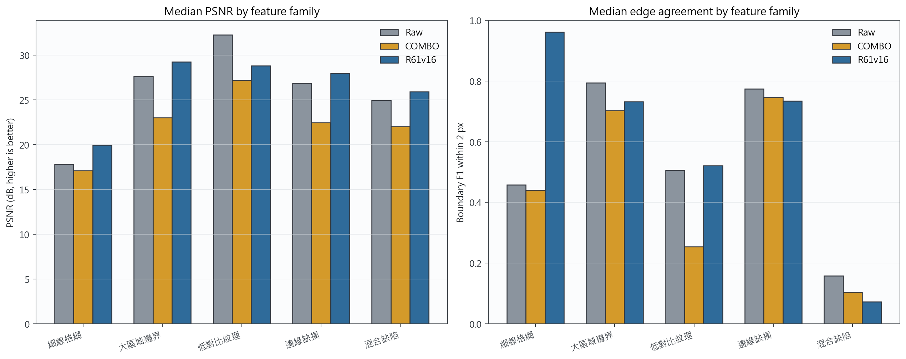
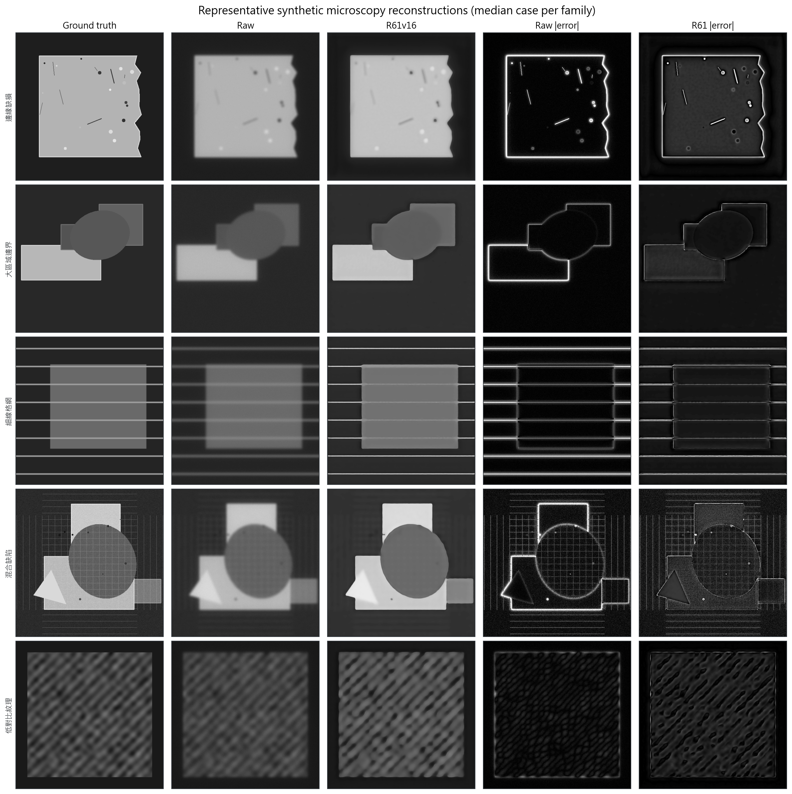
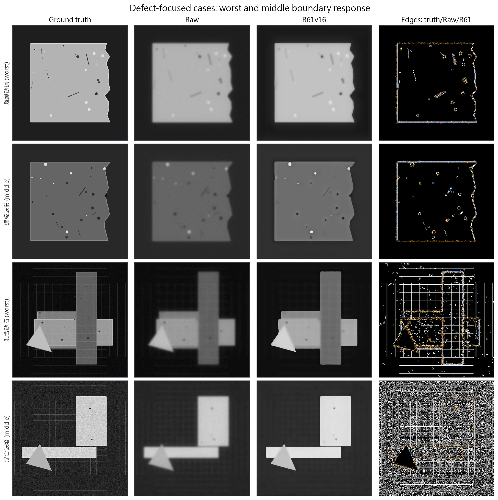
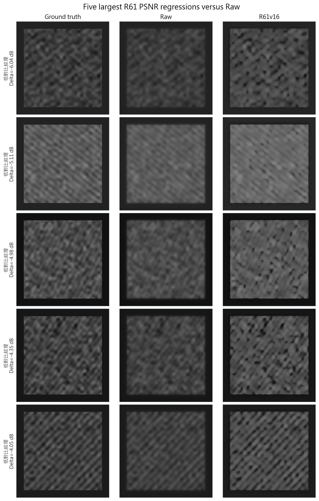
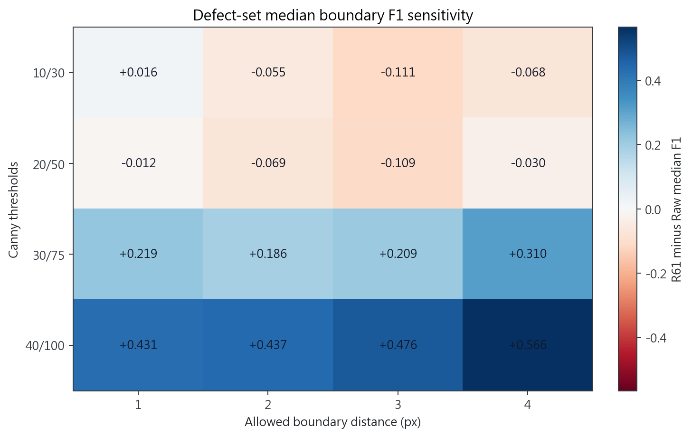

# R71：R61 合成顯微缺陷泛化測試

## 技術摘要

**結論：未通過這輪合成顯微泛化測試。** 本輪使用 100 張沒有出現在 R61 訓練資料中的合成顯微影像，其中 40 張是邊緣缺損與混合缺陷核心組。主要比較是同一張模糊輸入在重建前後，誰更接近已知的乾淨影像。

- 全部影像的 PSNR 中位數由 26.88 dB 變為 27.13 dB；每張影像配對後的中位改善為 +0.29 dB，54% 影像改善。
- 全部影像的 SSIM 中位數由 0.868 變為 0.935；99% 影像改善。
- 缺陷核心組的輪廓 F1 中位改善為 -0.057，18% 影像改善；細節相關性中位改善為 +0.396。
- 輪廓失分的主因不是亂生假邊，而是漏掉淡邊：缺陷組的輪廓精確度由 0.826 升到 0.984，但找回率由 0.484 降到 0.339。
- 後續 R72 已改用 ACM 比較 20 張有明確封閉外框的邊緣缺損影像：R61 的主要外框在 19/20 張改善，但周長與細部鋸齒誤差增加。因此本段輪廓 F1 應解讀為「淡邊是否留下」，不是完整形狀是否準確。
- 五類一致性：未通過。退步類別：邊緣缺損、大區域邊界、混合缺陷、低對比紋理

## 五類影像的結果

下表列出各類別的中位數。PSNR 與輪廓 F1 都是越高越好；COMBO 只作為同一測試集上的舊基準參考，不參與 R61 是否改善 Raw 的主要判定。

| 類別 | Raw PSNR | COMBO PSNR | R61 PSNR | Raw 輪廓 F1 | COMBO 輪廓 F1 | R61 輪廓 F1 |
|---|---:|---:|---:|---:|---:|---:|
| 細線格網 | 17.83 | 17.11 | 19.99 | 0.458 | 0.441 | 0.962 |
| 大區域邊界 | 27.65 | 23.05 | 29.25 | 0.794 | 0.703 | 0.732 |
| 低對比紋理 | 32.29 | 27.19 | 28.82 | 0.506 | 0.254 | 0.521 |
| 邊緣缺損 | 26.89 | 22.46 | 27.98 | 0.774 | 0.746 | 0.734 |
| 混合缺陷 | 24.98 | 22.02 | 25.94 | 0.158 | 0.104 | 0.072 |

## 實際重建影像

每一列是該類別中最接近其中位表現的案例，因此不是刻意挑最好看的影像。最後兩欄顯示與乾淨答案的絕對差異。

## 缺陷核心組與失敗案例

缺陷核心組固定由「邊緣缺損」和「混合缺陷」組成，共 40 張。下圖同時顯示每類的中間案例和最差輪廓案例；白色是正確輪廓、橘色是 Raw、藍色是 R61。

為避免整體平均掩蓋局部失敗，另列出 R61 相對 Raw 退步最大的五張影像。

輪廓判定另外改用 4 組強弱門檻與 1–4 像素容許距離，共 16 種設定。R61 在其中 9/16 種設定的缺陷組輪廓 F1 中位數高於 Raw，因此主要輪廓結論會受設定影響：重視強邊時 R61 多半較好，連淡邊也要求找回時則多半較差。這表示不能只用單一輪廓門檻宣稱模型全面成功或全面失敗。

## ACM 完整輪廓追蹤驗證

R72 針對其中 20 張有單一封閉、不規則外框的邊緣缺損影像，改用與先前 SEM 比較同類的 ACM 做完整形狀驗證。只允許平移、不縮放也不旋轉後，R61 的輪廓重疊率由 Raw 的 0.9902 提升到 0.9920，平均邊界距離由 0.757px 降到 0.541px，兩項都是 19/20 張改善；三組預先固定的 ACM 設定也都保持正向結果。

但 R61 的周長誤差由 1.85% 增加到 6.55%，圓整程度誤差也由 0.033 增加到 0.081。合併兩種測試後，正確結論是：**R61 讓主要外框位置更準，但淡邊與細小鋸齒仍可能被平滑掉。** 完整結果見 [R72 ACM 報告](../../R72_R61SyntheticDefectACMContourValidation/reports/R72_RESULTS_TW.md)。

## 資料與評分定義

- 測試資料：R40 過去保留的 unseen 合成顯微驗證組，五類各 20 張，總共 100 張，影像大小 512×512。
- 正確答案：每張模糊來源都有像素對齊的乾淨合成影像；不需要額外估計縮放或位置。
- 缺陷核心組：邊緣缺損與混合缺陷兩類，共 40 張。
- 影像相似度：PSNR、SSIM 與平均絕對誤差。
- 形狀與細節：允許 2 像素誤差的輪廓 F1、正確輪廓附近的誤差，以及去除低頻背景後的細節相關性。
- 統計單位：每張獨立生成的影像；所有比較都在同一張影像內做 Raw 對 R61 配對。

## 方法與資料隔離

R61 使用正式的 best-tradeoff 模型及與真實樣品測試相同的 PSF 關閉設定。測試前檢查了 R61 的 20,296 組訓練清單，沒有引用這批 R40 顯微資料的路徑；另外對所有 200 個測試檔案，以及訓練集中尺寸相同的 1,400 個檔案做完整內容比對，沒有任何完全相同的影像。

判定門檻在重建前固定：整體 PSNR 與 SSIM 至少 70% 影像改善，缺陷核心組的輪廓 F1 與細節相關性至少 60% 改善，而且改善幅度的 95% 範圍下限必須高於零；五個類別的 PSNR 與輪廓 F1 中位數都不能退步。

## 限制與可靠度

這是一個跨資料產生器、跨模糊條件的合成壓力測試，能檢查 R61 是否保留未見過的格網、紋理、缺角、刮痕與混合結構。它的優點是正確答案完全已知；限制是合成模糊不等於新的真實顯微拍攝，因此不能單獨證明所有真實樣品都能泛化。

## 下一步

1. 將本輪失敗最多的類別轉成新的真實拍攝清單，優先補拍相同形狀特徵。
2. 若 R61 在某類出現固定退步，下一輪只補該缺陷族，不重新大範圍訓練。
3. 最終基準升級仍應同時要求真實 SEM 輪廓、真實多位置影像與位移量測都通過。

## 仍待回答的問題

- 合成測試中的退步類別，在新的真實 HS100MG 位置是否也會發生？
- 模糊程度與亮度進一步改變時，R61 的失效邊界在哪裡？
