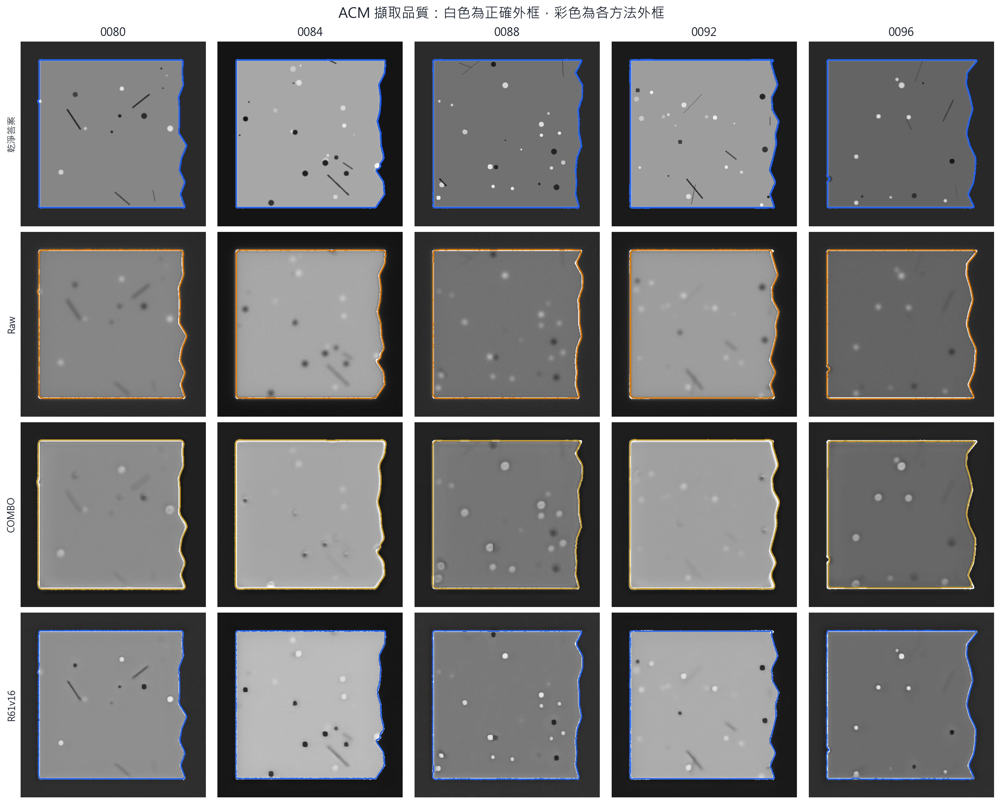
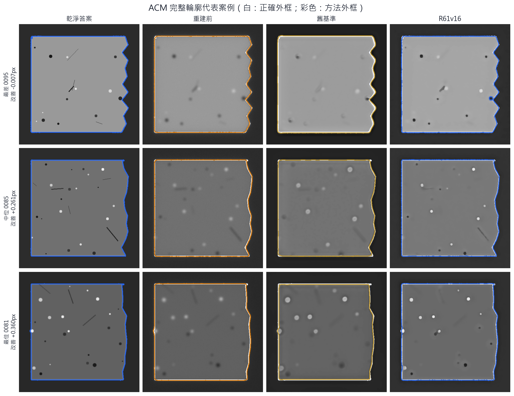
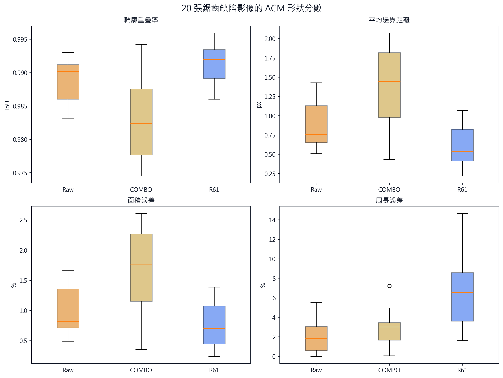
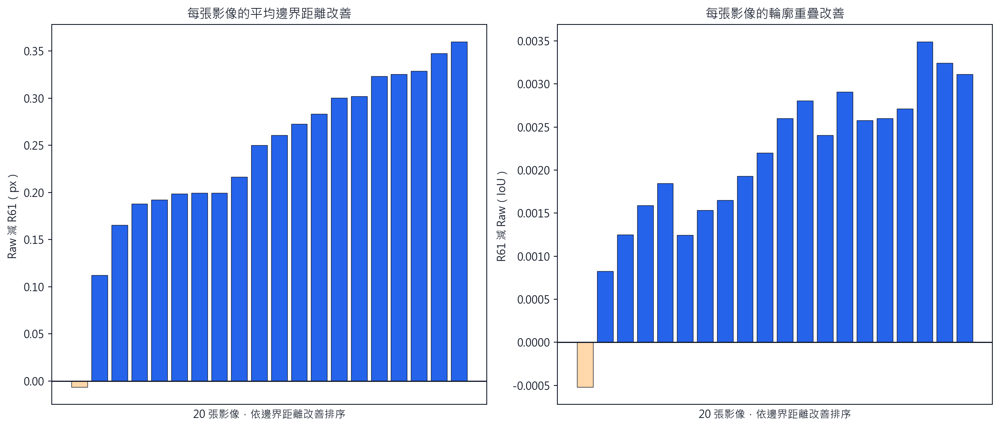
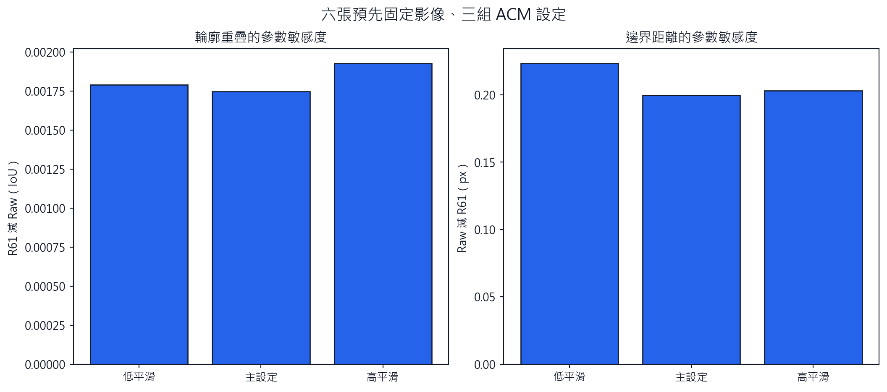
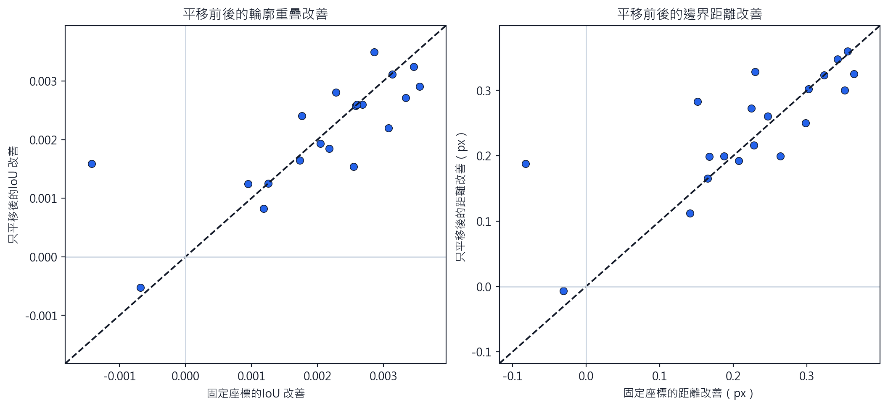
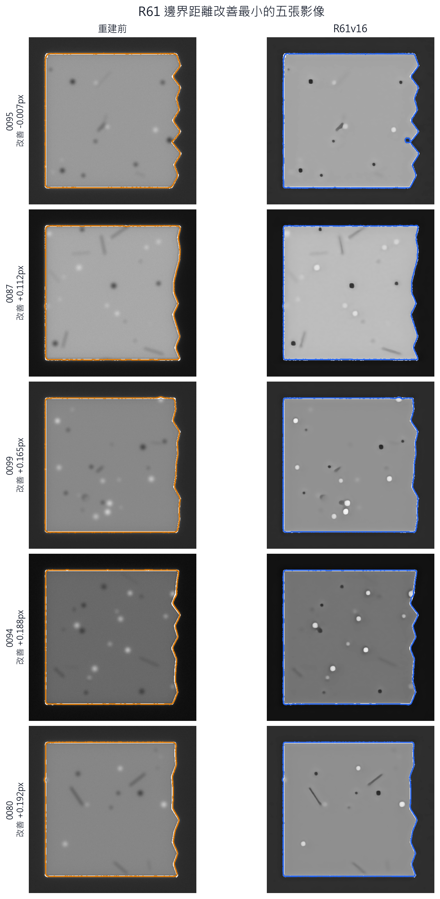

# R72：R61 合成顯微缺陷的 ACM 完整輪廓驗證

## 結論先行

**判定：粗外框有條件通過，但細部形狀未通過。** 這次改用與先前 SEM 驗證同類的 Chan–Vese ACM，直接比較完整、不規則的封閉外框；一般邊緣偵測不再作為主要形狀判定。

- 只平移、不縮放也不旋轉後，輪廓重疊率由 Raw 的 **0.9902** 提升到 R61 的 **0.9920**。配對中位改善 **+0.0023**，20 張中 **19/20** 張改善；95% 重抽樣範圍 **0.0016–0.0027**。
- 平均邊界距離由 **0.757px** 降到 **0.541px**。配對中位改善 **+0.255px**，同樣是 **19/20** 張改善；95% 範圍 **0.199–0.301px**，校正後 p=2.29e-05。
- 面積誤差由 **0.823%** 降到 **0.703%**，**20/20** 張改善。
- 但周長誤差由 **1.85%** 增加到 **6.55%**；圓整程度誤差由 **0.033** 增加到 **0.081**。這表示 R61 把主要外框位置變準，卻沒有忠實保留所有細小鋸齒。

因此，ACM 結果與先前 SEM 結果方向一致：**R61 的粗外框更準，但細部邊緣被平滑。**

## 這次為什麼才算形狀比較

每張影像先用 ACM 得到一張只有內外之分的形狀遮罩，後續分數只看這些遮罩的重疊、邊界距離、面積、周長與圓整程度，不再比較灰階亮度。亮度與對比只參與「從影像找出外框」這一步，而且每張圖在找輪廓前都各自做相同的對比正規化。

所有方法都從同一個固定大矩形開始收縮到物體邊界。這個起點沒有使用每張乾淨答案的輪廓，因此不會替 R61 預先描好形狀。亮度均值與輪廓重疊改善的等級相關為 **-0.43**；這只作為檢查，不能解讀成亮度對 ACM 完全沒有影響。

## 代表性完整輪廓

下圖不是只挑最好看的影像，而是依 R61 的邊界距離改善選出最差、中位與最佳案例。白線是正確外框，彩色線是 Raw、COMBO 或 R61 的 ACM 外框。

## 粗外框改善，細小鋸齒退步

R61 的重疊率、平均邊界距離與面積誤差整體優於 Raw，也明顯優於舊 COMBO；COMBO 的平均邊界距離中位數為 **1.445px**，R61 為 **0.541px**。但 R61 的周長與圓整程度誤差增加，代表外框更貼近正確位置，不等於每個微小凹凸都被真實恢復。

## 不是靠平移或單一 ACM 設定得到的結果

主要結果只允許平移，和 R69/R70 的形狀比較規則一致。更嚴格地完全不平移時，平均邊界距離仍由 Raw 的 **0.766px** 降到 R61 的 **0.615px**，20 張中 **18/20** 張改善。

三組預先固定的 ACM 平滑設定，在六張固定影像上全部保留正向的輪廓重疊與邊界距離中位改善（3/3 組通過）。

## 最弱案例沒有被平均值藏起來

20 張中有一張在主要粗外框分數上退步。下圖列出改善最小的五張，包含該失敗案例。

## 測試範圍與限制

- 主要樣本是 R71 測試集中 20 張未參與 R61 訓練的 `edge_defects` 影像；每張都是獨立產生，且有一個明確、封閉、刻意不規則的主物體。
- 格網、隨機紋理和多物件混合影像沒有唯一封閉外框，硬用單一 ACM 輪廓會比較不同東西，因此沒有放進這個主要形狀結論。
- 乾淨答案、Raw、COMBO 與 R61 都使用 MATLAB Chan–Vese ACM。主要設定為 200 次、平滑 1.0；沒有縮放、旋轉或套圓。
- 這是合成真值下的完整形狀壓力測試，不是新的真實 SEM 樣品，也不能單獨證明所有位置與所有曝光都會成功。

## 下一步

1. R61 可以保留為目前最新基準，但論文應寫成「主要外框改善、細部鋸齒未完全保留」，不能寫成所有形狀都忠實恢復。
2. 下一批真實 SEM／光學配對資料應沿用相同 ACM 指標，並把周長與局部凹凸列為獨立失敗檢查。
3. 若要擴充合成測試，應另外建立有明確物件身分的多物件真值，而不是把單一輪廓強套到格網或隨機紋理。

## 仍待回答的問題

- 合成影像中被平滑掉的鋸齒，在真實 HS100MG 或 SEM 外框上是否也會出現？
- 能否在維持目前粗外框改善的同時，降低周長與局部凹凸誤差？
