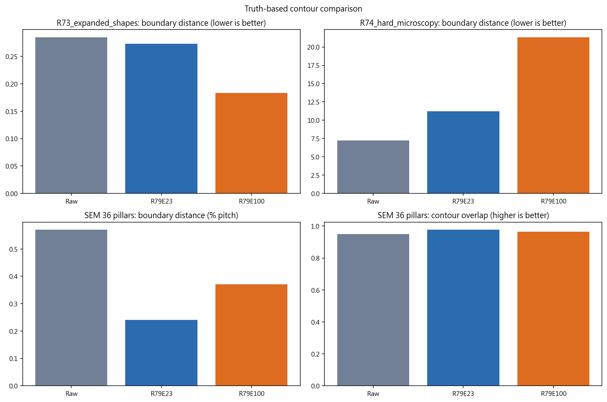
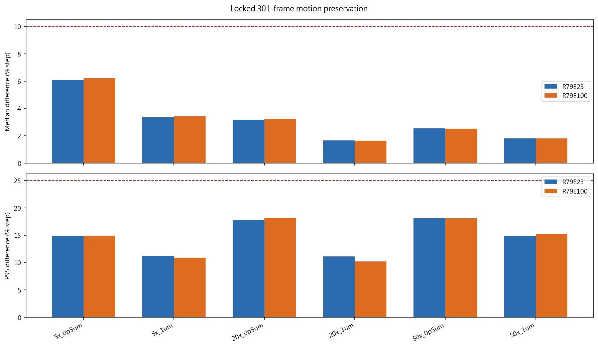
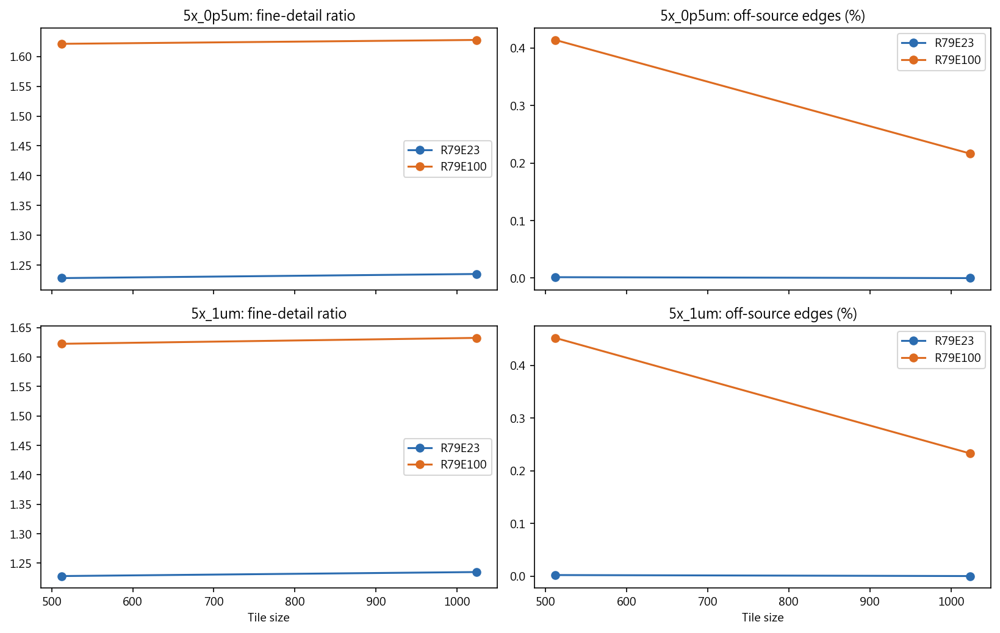
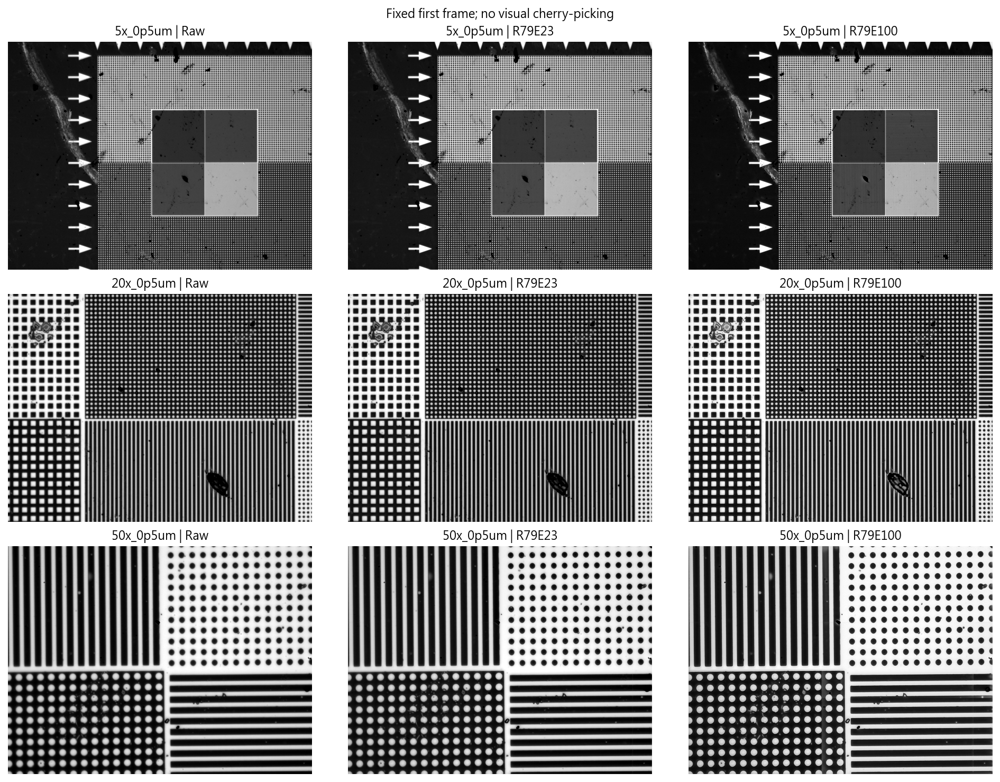
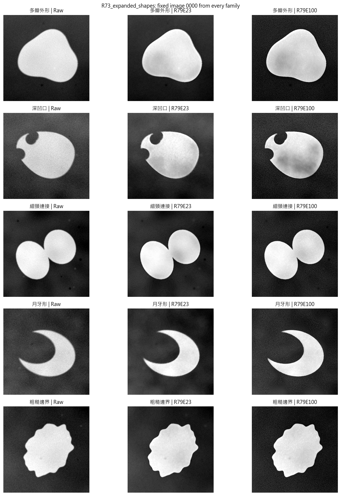
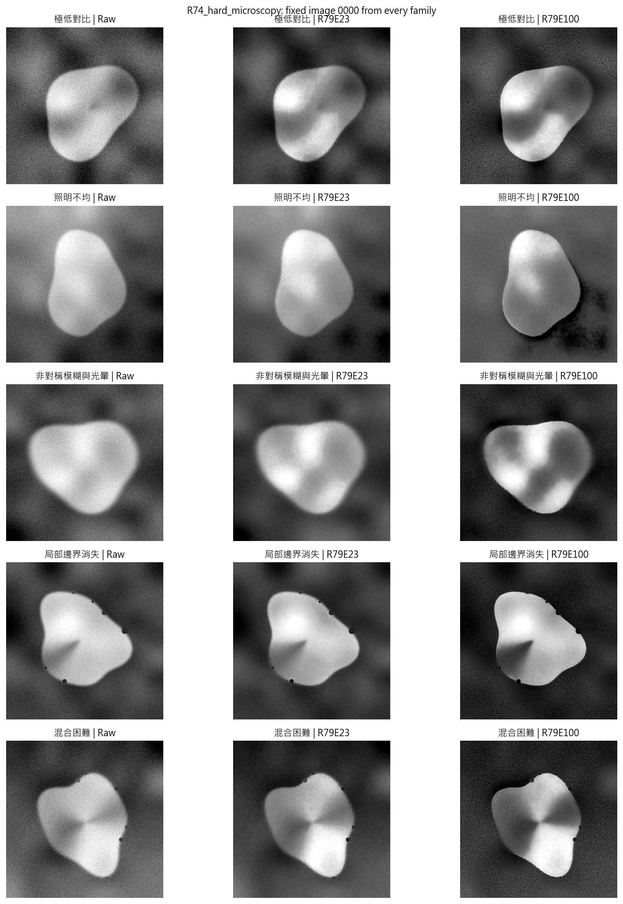
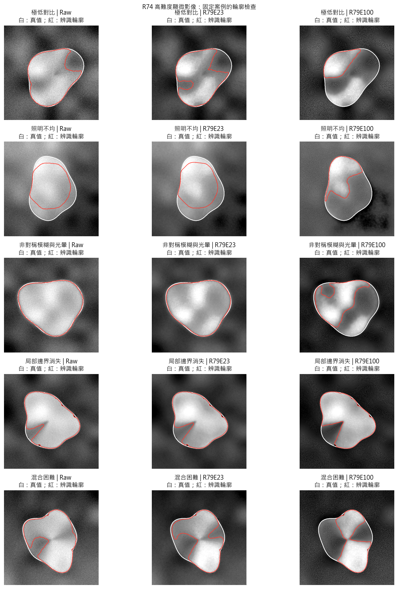
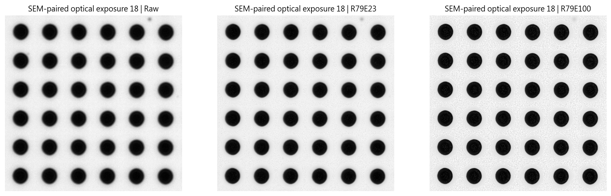
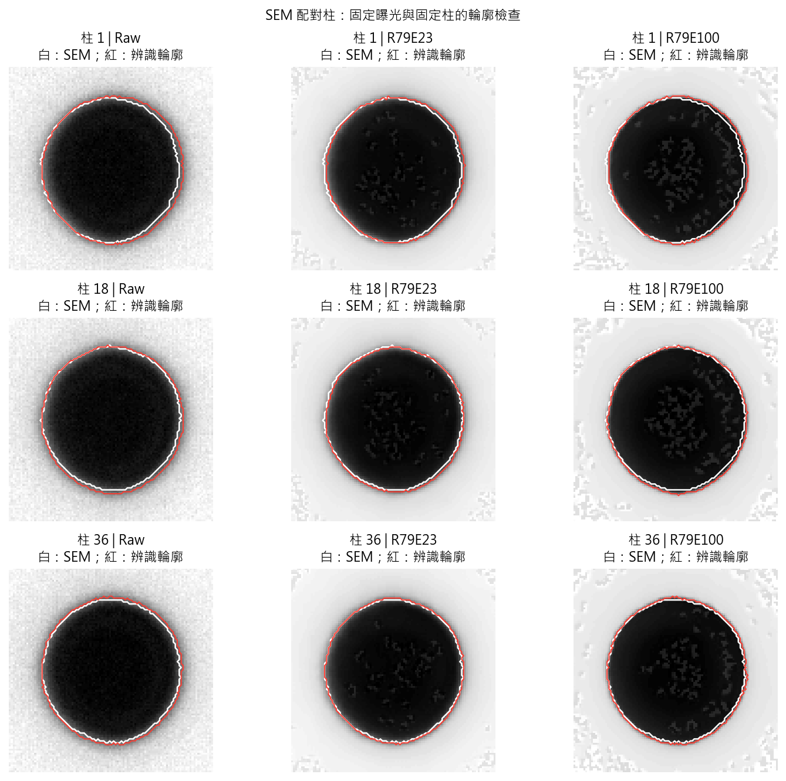

# R80：R79 第 23 輪與第 100 輪擴大驗證

## 結論先行

依照事先鎖定的規則，目前較適合當 R79 主候選的是 R79E23。

這次完整比較 512 張未參與訓練的內部形狀、301 張真實顯微連續影像、200 張外部合成顯微形狀，以及 36 顆有 SEM 真實輪廓的柱。兩個權重使用完全相同的影像、分塊與輪廓設定。

- 真實影像安全檢查：第 23 輪通過 6/6 組；第 100 輪通過 6/6 組。
- SEM 輪廓判定：R79E23；第 23 輪的邊界距離中位數為 0.2405% 柱距，第 100 輪為 0.3705% 柱距。
- 高難度合成顯微輪廓判定：R79E23。
- 內部保留形狀判定：R79E100；第 23 輪整體 MAE 為 0.01236，第 100 輪為 0.01063。

## 301 張真實顯微影像

| 影像組 | 權重 | 可用比例 | 中位位移差 | P95 位移差 | 結果 |
|---|---|---:|---:|---:|---|
| 20x_0p5um | R79E100 | 100.0% | 3.23% | 18.15% | 通過 |
| 20x_0p5um | R79E23 | 100.0% | 3.18% | 17.78% | 通過 |
| 20x_1um | R79E100 | 100.0% | 1.64% | 10.19% | 通過 |
| 20x_1um | R79E23 | 100.0% | 1.66% | 11.13% | 通過 |
| 50x_0p5um | R79E100 | 100.0% | 2.53% | 18.08% | 通過 |
| 50x_0p5um | R79E23 | 100.0% | 2.55% | 18.08% | 通過 |
| 50x_1um | R79E100 | 99.9% | 1.82% | 15.25% | 通過 |
| 50x_1um | R79E23 | 100.0% | 1.81% | 14.84% | 通過 |
| 5x_0p5um | R79E100 | 100.0% | 6.23% | 14.91% | 通過 |
| 5x_0p5um | R79E23 | 100.0% | 6.10% | 14.83% | 通過 |
| 5x_1um | R79E100 | 100.0% | 3.43% | 10.90% | 通過 |
| 5x_1um | R79E23 | 100.0% | 3.37% | 11.17% | 通過 |

5×影像另外以 512 與 1024 兩種分塊完整重跑 100 張。這裡用來確認細節保留或假邊緣不是單一分塊設定造成。

## 外部合成影像的 ACM 完整輪廓

| 測試組 | 方法 | 輪廓重疊 | 平均邊界距離 | 周長誤差 |
|---|---|---:|---:|---:|
| R73_expanded_shapes | R79E100 | 0.9964 | 0.1831 px | 2.956% |
| R73_expanded_shapes | R79E23 | 0.9941 | 0.2733 px | 1.826% |
| R73_expanded_shapes | Raw | 0.9943 | 0.2847 px | 1.453% |
| R74_hard_microscopy | R79E100 | 0.6390 | 21.3116 px | 13.018% |
| R74_hard_microscopy | R79E23 | 0.8345 | 11.2185 px | 8.181% |
| R74_hard_microscopy | Raw | 0.8814 | 7.2418 px | 7.732% |

這 200 張有精確形狀答案，ACM 只允許平移對準，不允許縮放或旋轉。R73 與 R74 的失敗模式曾影響 R79 資料設計，因此本段是擴大開發驗證，不是全新盲測。

要特別注意：在 R74 的 100 張低對比、光線不均、光暈與邊界消失影像中，兩個 R79 權重都比原圖差；第 23 輪只是受損較少。這表示 R79 還不能宣稱任何顯微場景都適用。

## SEM 真實輪廓

| 方法 | 獨立柱數 | 輪廓重疊 | 平均邊界距離（柱距 %） | 面積誤差 | 周長誤差 |
|---|---:|---:|---:|---:|---:|
| R79E100 | 36 | 0.9650 | 0.3705 | 3.378% | 2.745% |
| R79E23 | 36 | 0.9764 | 0.2405 | 1.678% | 1.333% |
| Raw | 36 | 0.9490 | 0.5697 | 5.336% | 2.865% |

36 顆柱才是獨立樣本；12 個曝光是同一批柱的重複觀察。每顆柱先跨曝光取中位數，再統整 36 顆，避免把曝光重複當成更多樣本。

## 判定界線

最後建議：**R79E23**。SEM 真實輪廓與高難度顯微影像測試都指向同一個權重，而且兩個權重都通過真實影像安全檢查。

這份結果可以用來決定 R79 內部採用第 23 輪還是第 100 輪，但不能保證任何未來樣品、材質或顯微鏡都一定適用，也不會自動改寫專案正式基準。

完整逐張數值、輸入核對、輪廓表與執行狀態都保存在同一個 R80 資料夾，來源資料與 R79 權重沒有被修改。
