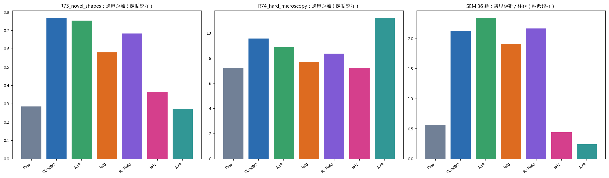
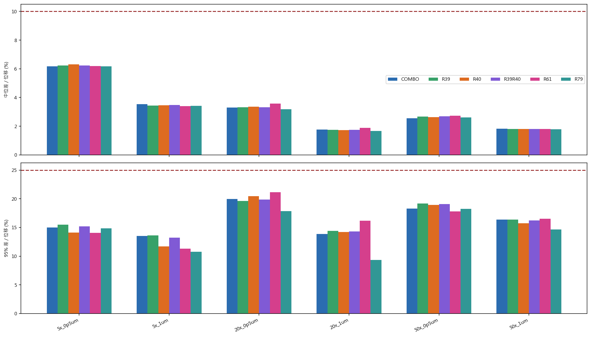
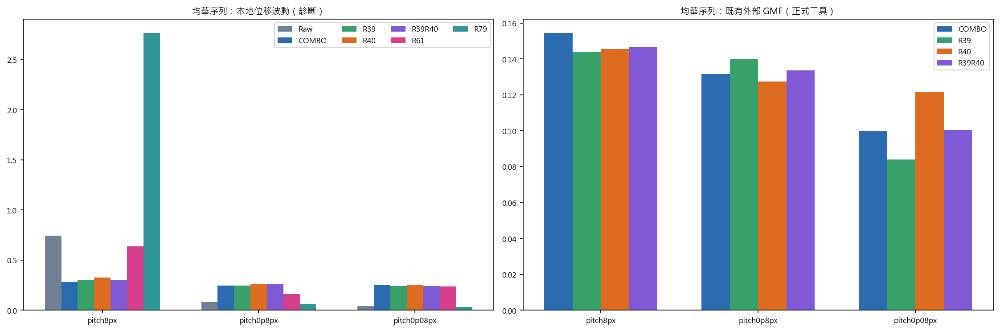
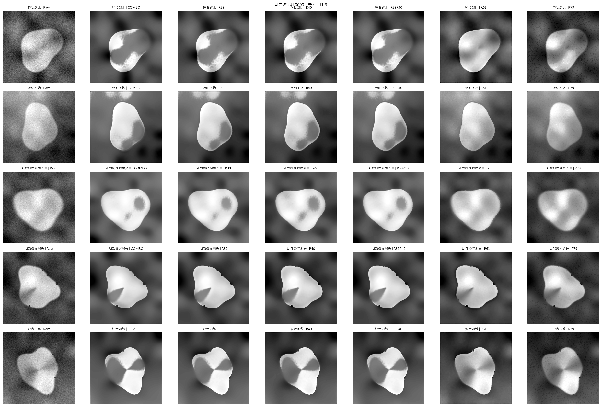
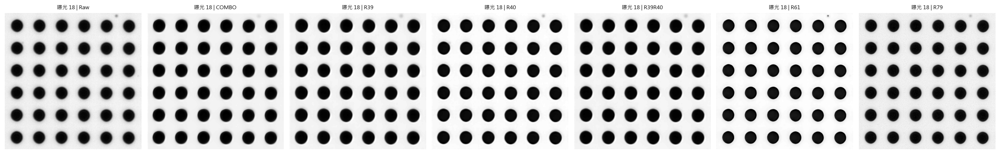
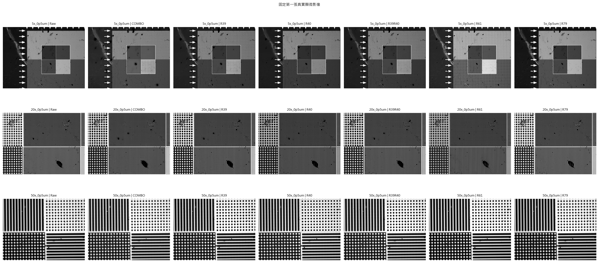

# R82 R39 / R40 跨場景泛化與位移驗證

## 先講結論

在本輪鎖定的四個主要場景裡，第一名分別是：SEM R79、新形狀 R79、高難度顯微 R61、真實位移保持 R79。沒有一個模型包辦全部第一；而且沒有任何模型同時通過三組形狀真值的嚴格門檻。

只看 R39 系列三個選項，排除既有定位否決後，最均衡的是 R39R40；R40 雖然形狀成績最好，但 0.08 px 外部定位仍退步 21.52%，不能單獨升級。R39R40 的三尺度外部定位沒有明顯退步，適合作為這一系列的保守備用，但它的 SEM 與新形狀仍落後 Raw，不能取代 R61 或 R79。

若現在一定要選一個跨場景主力，仍以 R61 最均衡：真實位移六組全過、SEM 通過嚴格門檻，並在高難度顯微形狀中排名第一。R79 在 SEM、新形狀與真實位移最好，但高難度顯微形狀明顯最差，均華本地診斷也出現警訊，且尚無外部 GMF，因此目前只能列為強力候選，不能取代 R61。

本輪不修改正式 COMBO，也不把任何模型宣稱成所有未來場景都保證成功。

## 驗證範圍

- 真實顯微位移：301 張，包含 5×、20×、50× 共六組。
- 均華位移序列：200 張固定影像；本地結果只作診斷，既有外部 GMF 另列。
- 合成輪廓：100 張新形狀加 100 張高難度顯微影像，全部逐張配對精確形狀真值。
- SEM：36 顆真實 pillar、每顆 12 次光學曝光。
- 模型：COMBO、R39、R40、R39R40 平衡版、R61、R79；Raw 只作共同參考。

## 總表

| 模型 | 真實位移通過 | SEM 邊界距離 (%柱距) | R73 邊界距離 (px) | R74 邊界距離 (px) | R73 / R74 擷取失敗 | SEM 嚴格輪廓門檻 | R73 / R74 嚴格門檻 |
|---|---:|---:|---:|---:|---:|---:|---:|
| COMBO | 6/6 | 2.1304 | 0.7693 | 9.5625 | 2 / 0 | 未通過 | 未通過 / 未通過 |
| R39 | 6/6 | 2.3509 | 0.7541 | 8.8608 | 0 / 0 | 未通過 | 未通過 / 未通過 |
| R40 | 6/6 | 1.9117 | 0.5797 | 7.7173 | 0 / 0 | 未通過 | 未通過 / 未通過 |
| R39R40 | 6/6 | 2.1711 | 0.6829 | 8.3730 | 0 / 0 | 未通過 | 未通過 / 未通過 |
| R61 | 6/6 | 0.4413 | 0.3629 | 7.2234 | 0 / 0 | 通過 | 未通過 / 未通過 |
| R79 | 6/6 | 0.2405 | 0.2733 | 11.2185 | 0 / 0 | 通過 | 未通過 / 未通過 |

Raw 共同參考的邊界距離為：SEM 0.5697% 柱距、R73 0.2847 px、R74 7.2418 px。R39、R40、R39R40 在這三組形狀真值上都沒有超過 Raw；只有 R61、R79 在 SEM 通過嚴格門檻。

## 真實顯微位移

這一項沿用原本鎖定的 24 個有效區域與 Raw 配對，不重新挑位置。表中的差值越低越好。

| 模型 | 通過組數 | 最差中位差 (%位移) | 最差 95% 差 (%位移) | 最差步距波動 (um) | 安全判定 |
|---|---:|---:|---:|---:|---:|
| COMBO | 6/6 | 6.17 | 19.98 | 0.13776 | 通過 |
| R39 | 6/6 | 6.23 | 19.64 | 0.13804 | 通過 |
| R40 | 6/6 | 6.31 | 20.44 | 0.13821 | 通過 |
| R39R40 | 6/6 | 6.23 | 19.86 | 0.13822 | 通過 |
| R61 | 6/6 | 6.18 | 21.14 | 0.13847 | 通過 |
| R79 | 6/6 | 6.16 | 18.22 | 0.13832 | 通過 |

## 均華三尺度

本地定位可以比較六個模型，但它不是以前需金鑰的外部 GMF。外部 GMF 只有 COMBO、R39、R40、R39R40 有實測，因此不把 R61、R79 的空缺補成估計值。

| 尺度 | COMBO | R39 | R40 | R39R40 |
|---|---:|---:|---:|---:|
| pitch8px | 0.154515 | 0.143794 | 0.145379 | 0.146505 |
| pitch0p8px | 0.131560 | 0.140008 | 0.127411 | 0.133546 |
| pitch0p08px | 0.099891 | 0.083941 | 0.121382 | 0.100400 |

## 輪廓與 SEM

輪廓比較只看形狀。所有模型用同一個 ACM 設定，允許平移對齊，但不縮放、不旋轉，也不利用真值去初始化。

## 證據限制

- R79 的設計曾參考 R73、R74 的失敗型態，所以這兩組對 R79 是開發測試；R79 的乾淨確認主要看真實位移與 SEM。
- 均華本地結果只用來補看趨勢，不能取代外部 GMF。
- SEM 是 36 顆中心 pillar、同一批樣品與同一套光學條件，不能代表所有材料與設備。
- 沒有把不同測試的數字硬平均成一個看似精確的總分；場景衝突會保留。

資料與計算可信度：**高（資料配對與計算）；中等（推廣到未測設備與樣品）**。
