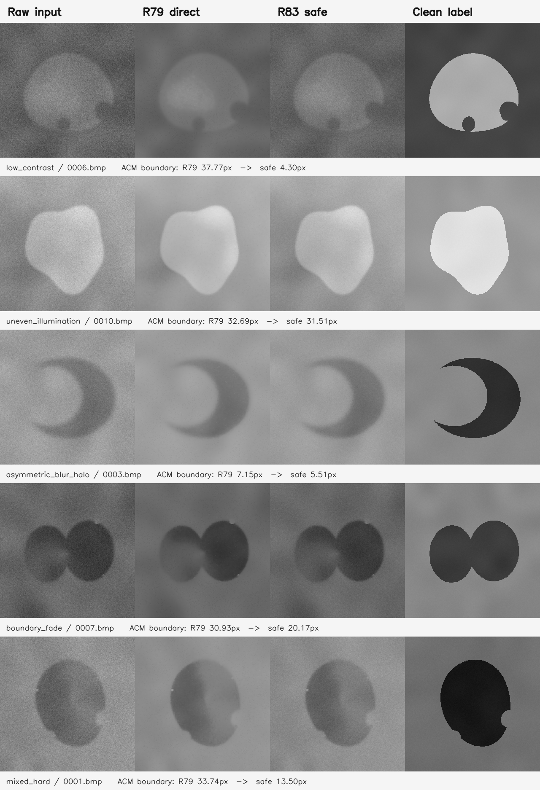

# R83 最終結果

完成日期：2026-08-09

## 結論先行

R83 沒有產生可全面取代 R79 的新模型。最後應繼續把 R79 第 23 輪當作預設模型；專案正式基準也維持不變。

這次真正留下的補強，是一個可選的「保守輸出」：它仍使用完全相同的 R79 權重，只在輸入品質較差時減少模型對原圖的改動。它在整張影像模式下明顯改善最困難的顯微輪廓，同時通過保留合成影像、保留 SEM 與六組真實位移測試；但因大圖切片一致性未通過，所以只能作為受限制的選項，不能升為通用版本。

## 訓練路線結果

訓練資料共 5,120 組，全部由基礎幾何程式生成，沒有混入真實 SEM、HS100MG、舊訓練影像或其他模型生成的標記。標記皆先以 8 倍解析度繪製再縮小。

先做了兩種四輪保護性試跑：

| 候選 | R73 輪廓誤差 | R74 輪廓誤差 | SEM 開發組誤差 | 是否超過 R79 |
|---|---:|---:|---:|---|
| 原 R79 | 0.2733 px | 11.2185 px | 0.2469% pitch | 基準 |
| 只調整新增尾端 | 0.2730 px | 11.2531 px | 0.2465% pitch | 否 |
| 調整新增尾端與最後輸出 | 0.2706 px | 11.2224 px | 0.2517% pitch | 否 |

兩個候選都沒有在 R74 超過 R79，因此依照事前規則停止正式訓練，不挑選任何新權重。

較早曾有一次訓練看起來略有改善，但檢查後發現它同時把 R79 原本的 PSF 強度逐步降到零，並不是單純靠新資料學得更好。該次訓練及所有相關輸出都已標為無效，不納入任何結論。修正後的乾淨試跑才是上表結果。

## 保守輸出的完整確認

最後凍結的權重與 R79 第 23 輪完全相同；安全模式只減少低品質輸入上的重建幅度。所有選擇規則在保留資料揭曉前已固定。

| 驗證 | 原 R79 | 保守輸出 | 變化 | 結果 |
|---|---:|---:|---:|---|
| 384 組保留合成影像，中位灰階誤差 | 3.4074 | 3.1935 | 改善 6.28% | 通過 |
| 160 組保留合成輪廓 | 0.3144 px | 0.3280 px | 增加 4.34% | 通過預設 5% 限制 |
| R73 新形狀輪廓 | 0.2733 px | 0.2744 px | 增加 0.40% | 通過 |
| R74 困難顯微輪廓 | 11.2185 px | 8.5908 px | 改善 23.42% | 通過 |
| 24 顆保留 SEM 輪廓 | 0.2467% pitch | 0.2526% pitch | 增加 2.41% | 通過預設 10% 限制 |
| 真實位移 | 6/6 | 6/6 | 無退化 | 通過 |

保守輸出不是每一項都更好：它用少量一般輪廓與 SEM 精度，換取重度低可見邊界下更少的過度重建。不過這些退化都落在事前允許範圍內。

下圖每一類各放一個說明案例；案例用來幫助理解影像差異，最終判定仍來自上面的全部樣本。

## 為何仍不升級

事前規定大圖整張推論與 512 像素切片推論必須非常接近。實際最差結果如下：

| 模式 | 平均灰階差 | 99% 灰階差 | 最大灰階差 | 門檻 |
|---|---:|---:|---:|---|
| 原 R79 等價模式 | 3.8481 | 13 | 55 | 0.10 / 1 / 3 |
| 保守輸出 | 3.8006 | 12 | 53 | 0.10 / 1 / 3 |

拆解測試顯示，關掉 PSF 後差異仍存在，甚至略為增加。主因是 R79 內部會依照當前整塊影像重新調整特徵分布；切片大小一改，整張結果也會跟著改。這是繼承自 R79 的架構限制，不是簡單的拼接接縫錯誤。

因此總判定維持：

- 日常與需要穩定版本時，使用原 R79。
- 在影像可整張處理，且確實遇到重度低對比、模糊、光暈或局部邊界消失時，可以額外試用保守輸出。
- 不把保守輸出用在未明確驗證的切片式大圖流程。
- 下一個真正可能全面升級的模型，必須從架構上移除對切片範圍的依賴，再以新保留資料重新確認；單靠繼續微調 R79 訓練資料不夠。

## 可追溯成果

- 最終判定：`results/final_confirmation/final_decision.json`
- 完整形狀與影像摘要：`results/final_confirmation/tables/final_contour_image_summary.csv`
- 六組真實位移摘要：`results/final_confirmation/tables/real_motion_summary_with_r79.csv`
- 切片一致性結果：`results/final_confirmation/tables/tile_consistency.csv`
- 切片原因拆解：`results/tile_context_diagnosis/tile_context_ablation_summary.csv`
- 最後權重與選擇紀錄：`weights/selected/selection_manifest.json`
