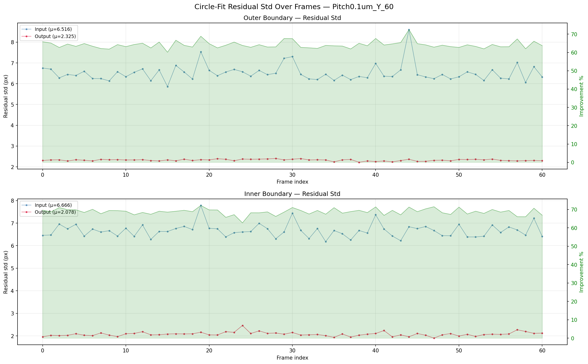
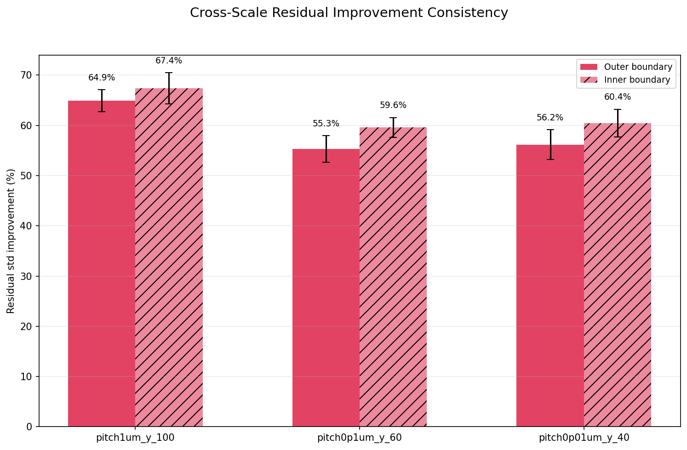
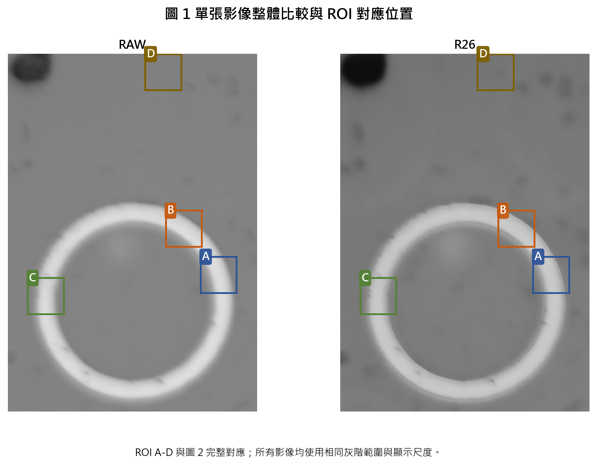
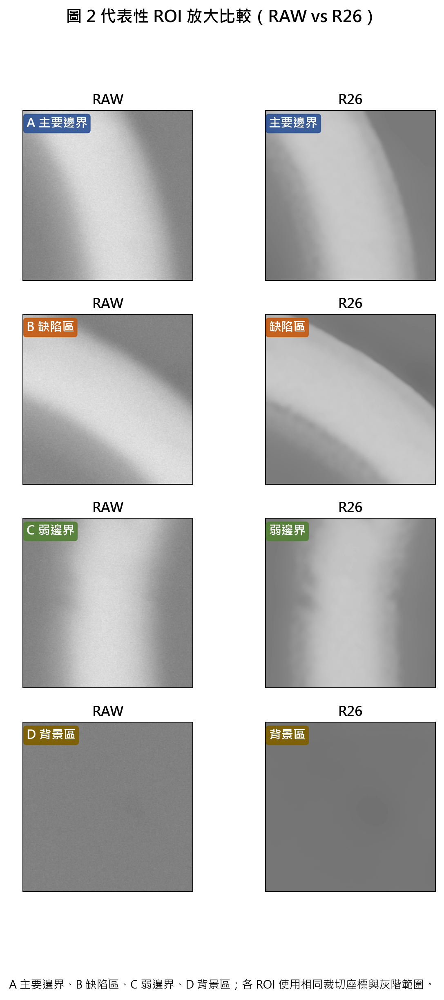

# 實驗重建影像 Gallery / Experiment Recon Gallery

Last updated: 2026-04-14

這份文件收集每一輪實驗的**最具代表性重建圖與指標圖**，供 demo / report 時快速查閱。

## How to use / 怎麼用

- GitHub 會自動 inline 渲染下方圖片，點進 PR / commit / 這份 markdown 就能直接看
- 每一輪只列 **2-3 張最具代表性** 的圖；完整輸出見各實驗的 `results/` 或 `artifacts/`
- 相對路徑以本檔所在目錄（`Experiments/`）為起點
- 找不到的實驗代表：本輪沒有產生有意義的視覺輸出，或仍在進行中

---

## 正式 Baseline + Approved Alternates

### COMBO — `r38v2_8px_gate_p95`（formal production baseline，2026-04-08）

最均衡的外部 GMF / 視覺 / residual 組合。0.8px -22%、steepness +89%、residual_std 歷史最佳。

_COMBO 三尺度 `step std` 與 R30 / R33 / R38v2 並列比較（0.8px 主戰場拿下最均衡）_

_COMBO 在 0.8px（`pitch0p1um_y_60`）主戰場的逐幀 step stability_

_COMBO residual_std 歷史最佳（0.8px inner 2.044，-29% vs R30）_

> 完整報告：`R38v2SeqFixed/reports/COMBO_RESULTS.md` · 系列報告：`R33RobustLoss/reports/R33_R38v2_COMPLETE_EXPERIMENT_SERIES.md`

---

### R33 — `r33_robust_p95`（GMF extreme alternate）

Winsorize spatial loss p95 → 0.8px -29%（三尺度全面改善），但視覺銳度 -22%。適合純 GMF 定位場景。

_R33 三尺度 step std（0.8px = 0.119，是所有候選最低）_

_R33 residual 改善（vs R30 baseline）_

> 完整報告：`R33RobustLoss/reports/R33_EXPERIMENT_SUMMARY.md`

---

### R38v2 — `r38v2_8px_gate`（visual priority alternate）

Seq training（8px-only + signal gate + warmup 15）→ 0.8px -20% + steepness +89%。適合需要人眼判讀場景。

_R38v2 三尺度 step std（視覺優先：0.8px 改善同時保住 steepness）_

_R38v2 在 0.8px 主戰場的 step stability_

> 完整報告：`R38v2SeqFixed/reports/R38v2_RESULTS.md`

---

## Former Baseline（reference）

### R30 — `r30_b1_dironly`（歷史前任 baseline）

B1 dironly 機制首次在主戰場超越 R26。現已被 COMBO 取代，保留作歷史參考。

_R30 三尺度 step std（0.8px = 0.168，COMBO promote 前的正式 baseline）_

> canonical 證據：`docs/evidence/baseline/ROUND30_EXTERNAL_COMPARE.md`

---

## Open Side Track

### R26NewPSFCheck（PSF 政策切換驗證，pending external GMF）

新 Whole-FOV PSF（2026-03-26 完成）作為目前物理上較合理的標準，取代舊 empirical PSF。

_PSF 新舊比對：新 PSF 的差異主要是對齊語意，不是模糊核變寬_

_Raw input → R26 新 PSF 重建後的全域比對_

_同上的 ROI 放大（環形邊界局部）_

> Status：`R26NewPSFCheck/reports/STATUS_20260326.md` · PSF audit：`R26NewPSFCheck/psf_audit/PSF_FORMAL_AUDIT_20260326.md`

---

## Closed / Falsified

### R32 — `r32_real_eq_finetune`（domain rebalancing，external FAIL）

Internal winner 但 external 0.8px 惡化 +97.7%。Sandbox 已關閉；保留作為「internal pass ≠ external pass」的反例。

_R32 process probe 的 GMF proxy metrics（訓練期即看到惡化訊號）_

> 外部比較：`R32Sandbox/reports/ROUND32_EXTERNAL_COMPARE.md`

---

### R33c — contrast fix（W_STAT 0.30，falsified）

嘗試修復 R33 視覺銳度退步的 side attempt。W_STAT 提高反而讓 contrast 更差。

_R33c 三尺度 step std（未能恢復視覺 + 指標一起退步）_

---

### R38 — seq all-stages（falsified）

R38v2 的前身：所有 stages 都用 seq loss，沒有 8px gate 也沒有 signal gate。
0.8px delta 太小，被噪聲梯度干擾。三重修復（warmup + gate + 8px-only）→ R38v2 才成功。

_R38 三尺度 step std（8px 好但 0.8px 弱 → 不均衡）_

> 結果報告：`R38SeqConsistency/reports/R38_RESULTS.md`

---

### R34 / R35 / R37（sandbox only，falsified）

三輪嘗試恢復 R33 視覺銳度全部失敗：
- R34 freq-split：lo/hi 梯度在 patch 上高度相關，分頻無效
- R35 alpha-boost 0.25：均勻放大含噪 HF
- R37 PSF 頻率依賴 reg：HF 低 reg 放大 Wiener 噪聲

這三輪只在 `sandbox/r34` / `r35` / `r37` 分支，未建立 `Experiments/` 目錄，沒有產生可展示的視覺輸出。

---

## Adding a new round / 新增實驗後的補充

完成新實驗並產生視覺輸出時，請：

1. 在適當分類下新增一個 `###` section（active / side track / closed）
2. 放 **最多 3 張** 最具代表性的圖（不是所有 epoch 或所有 pitch）
3. 用**相對路徑**從 `Experiments/` 為起點（讓 GitHub 能 inline 渲染）
4. 每張圖一句話 caption 說明「這張在示範什麼」
5. 結尾放完整報告的連結

**這份文件不是 mandatory**（不列在 `CLAUDE.md` 的 5 項強制更新清單中），但**強烈建議**每輪有視覺結果時更新。理由：demo / 會議 / PR review 時，沒有這份 gallery 就得現場翻 `results/` 子樹，找不到就容易變成「講不清楚」。
