# 實驗重建影像 Gallery / Experiment Recon Gallery

_Last updated: 2026-04-17_

這份文件收集**每一輪實驗所有 tracked 的重建影像、指標圖表、分析圖**，供 demo / report 時快速查閱。
所有連結皆為 git 追蹤檔案的相對路徑，GitHub 上會自動渲染圖片。

## 🎨 色彩圖例 / Color Legend

| 色圓 | 狀態 | 含義 |
|------|------|------|
| 🟢 | active | 正式 baseline 或 approved alternate — 目前可安全引用 |
| 🟡 | open side track | 研究中的 side track，尚未完成外部驗證 |
| 🔵 | historical | 前任 baseline 或歷史基準線（保留作參考，已被取代）|
| 🔴 | closed / falsified | 已經否定或 external FAIL，不可再引用為 active line |

## 📑 快速導覽 / Table of Contents

| 色 | Round | 角色 | 關鍵數字（external 0.8px step std）|
|----|-------|------|-----------------------------------|
| 🟢 | [**COMBO**](#-combo) | formal production baseline (2026-04-08) | **`0.132`** · steepness +89% · residual 歷史最佳 |
| 🟢 | [**R38v2**](#-r38v2) | visual priority alternate | `0.134` · steepness +89% |
| 🟢 | [**R33**](#-r33) | GMF extreme alternate | **`0.119`** · 三尺度全面最低 |
| 🔴 | [R33 ablations](#-r33-ablations) | lap_only / soft_p95 / hard_p90 — closed | — |
| 🔵 | [**R30**](#-r30) | historical former baseline (pre-COMBO) | `0.168` · B1 dironly |
| 🔵 | [**R26 sm035**](#-r26-sm035) | 歷史 step_mag=0.35 基準線 | `0.191` |
| 🟡 | [**R26NewPSFCheck**](#-r26newpsfcheck) | open side track — PSF 政策切換 | pending external GMF |
| 🔴 | [R33c](#-r33c) | 對比度修復失敗 | 視覺 + 指標雙退步 |
| 🔴 | [R38 seq-all-stages](#-r38-seq-all-stages) | seq 全 stages 噪聲干擾 | 8px 好但 0.8px 弱 |
| 🔴 | [R32](#-r32) | domain rebalancing external FAIL | `0.332` (+97.7%) |
| 🔴 | [R34 / R35 / R37](#-r34--r35--r37) | sandbox-only 銳度修復 — 全部失敗 | — |
| 📚 | [Legacy visuals](#-legacy-visuals) | R18/R22/R25 0.8px 比較（封存） | — |

---

## 🟢 COMBO

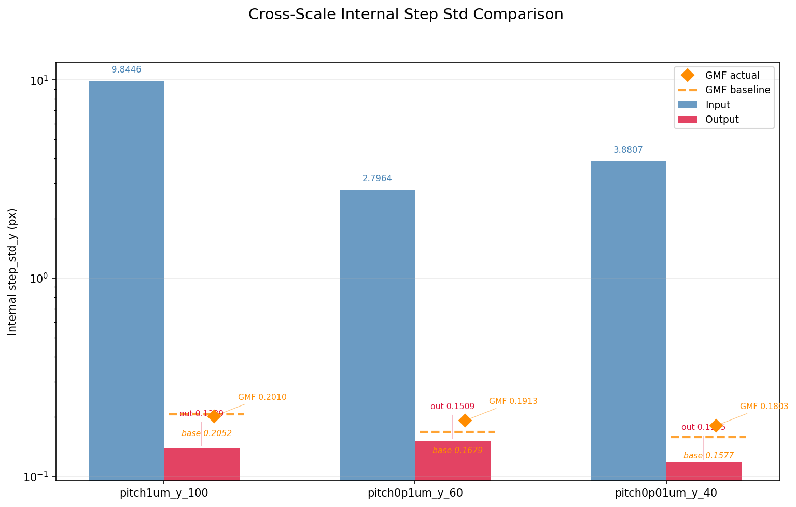

> [!TIP]
> **`r38v2_8px_gate_p95`** · formal baseline (2026-04-08) · 0.8px **`0.132`** · steepness **+89%** · residual 2.044 (歷史最佳)

<table>
<tr>
  <td align="center">0.08 px (子像素)</td>
  <td align="center"><b>0.8 px (主戰場)</b></td>
  <td align="center">8 px (guard)</td>
</tr>
<tr>
  <td></td>
  <td></td>
  <td></td>
</tr>
<tr>
  <td align="center"><a href="R38v2SeqFixed/results/combo_recon/reconstruct_progress_best_tradeoff_in_Cropped_Output_20260408_003525/pitch0p01um_y_40_odd/">41 recon frames →</a></td>
  <td align="center"><a href="R38v2SeqFixed/results/combo_recon/reconstruct_progress_best_tradeoff_in_Cropped_Output_20260408_003525/pitch0p1um_y_60_odd/">61 recon frames →</a></td>
  <td align="center"><a href="R38v2SeqFixed/results/combo_recon/reconstruct_progress_best_tradeoff_in_Cropped_Output_20260408_003525/pitch1um_y_100_odd/">101 recon frames →</a></td>
</tr>
</table>

📋 所有 24 張 720-angle 指標 + 量化修復 recon + 其他方法論版本

**Cross-scale 總結：**
- [08 step std](R38v2SeqFixed/results/720angle_analysis/COMBO/cross_dataset/08_cross_scale_step_std.png) · [09 residual improvement](R38v2SeqFixed/results/720angle_analysis/COMBO/cross_dataset/09_cross_scale_residual_improvement.png) · [10 k2 stability](R38v2SeqFixed/results/720angle_analysis/COMBO/cross_dataset/10_cross_scale_k2_stability.png)

**Per-pitch 7 張指標：**
- `pitch0p01um_y_40`: [01](R38v2SeqFixed/results/720angle_analysis/COMBO/pitch0p01um_y_40/01_center_trajectory.png) · [02](R38v2SeqFixed/results/720angle_analysis/COMBO/pitch0p01um_y_40/02_step_stability.png) · [03](R38v2SeqFixed/results/720angle_analysis/COMBO/pitch0p01um_y_40/03_residual_std_timeseries.png) · [04](R38v2SeqFixed/results/720angle_analysis/COMBO/pitch0p01um_y_40/04_k2_amplitude_timeseries.png) · [05](R38v2SeqFixed/results/720angle_analysis/COMBO/pitch0p01um_y_40/05_hotspot_persistence.png) · [06](R38v2SeqFixed/results/720angle_analysis/COMBO/pitch0p01um_y_40/06_edge_width_consistency.png) · [07](R38v2SeqFixed/results/720angle_analysis/COMBO/pitch0p01um_y_40/07_center_offset_drift.png)
- `pitch0p1um_y_60`: [01](R38v2SeqFixed/results/720angle_analysis/COMBO/pitch0p1um_y_60/01_center_trajectory.png) · [02](R38v2SeqFixed/results/720angle_analysis/COMBO/pitch0p1um_y_60/02_step_stability.png) · [03](R38v2SeqFixed/results/720angle_analysis/COMBO/pitch0p1um_y_60/03_residual_std_timeseries.png) · [04](R38v2SeqFixed/results/720angle_analysis/COMBO/pitch0p1um_y_60/04_k2_amplitude_timeseries.png) · [05](R38v2SeqFixed/results/720angle_analysis/COMBO/pitch0p1um_y_60/05_hotspot_persistence.png) · [06](R38v2SeqFixed/results/720angle_analysis/COMBO/pitch0p1um_y_60/06_edge_width_consistency.png) · [07](R38v2SeqFixed/results/720angle_analysis/COMBO/pitch0p1um_y_60/07_center_offset_drift.png)
- `pitch1um_y_100`: [01](R38v2SeqFixed/results/720angle_analysis/COMBO/pitch1um_y_100/01_center_trajectory.png) · [02](R38v2SeqFixed/results/720angle_analysis/COMBO/pitch1um_y_100/02_step_stability.png) · [03](R38v2SeqFixed/results/720angle_analysis/COMBO/pitch1um_y_100/03_residual_std_timeseries.png) · [04](R38v2SeqFixed/results/720angle_analysis/COMBO/pitch1um_y_100/04_k2_amplitude_timeseries.png) · [05](R38v2SeqFixed/results/720angle_analysis/COMBO/pitch1um_y_100/05_hotspot_persistence.png) · [06](R38v2SeqFixed/results/720angle_analysis/COMBO/pitch1um_y_100/06_edge_width_consistency.png) · [07](R38v2SeqFixed/results/720angle_analysis/COMBO/pitch1um_y_100/07_center_offset_drift.png)

**量化修復（np.rint）後的 recon 與其他方法論版本：**
- [`8px_gate_recon_quantfix/`](R38v2SeqFixed/results/8px_gate_recon_quantfix/) · [`720angle_irls_analysis/COMBO/`](R38v2SeqFixed/results/720angle_irls_analysis/COMBO/) · [`720angle_soft_l1/COMBO/`](R38v2SeqFixed/results/720angle_soft_l1/COMBO/) · [`combo_sequence_analysis/`](R38v2SeqFixed/results/combo_sequence_analysis/)

📄 [COMBO_RESULTS](R38v2SeqFixed/reports/COMBO_RESULTS.md) · [Complete series](R33RobustLoss/reports/R33_R38v2_COMPLETE_EXPERIMENT_SERIES.md)

---

## 🟢 R38v2

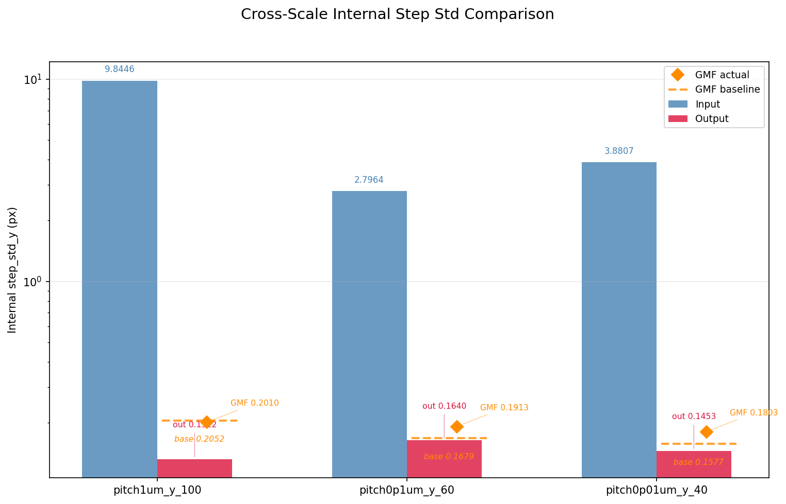

> [!TIP]
> **`r38v2_8px_gate`** · visual priority alternate · 0.8px **`0.134`** · steepness **+89%** · seq training (8px-only + signal gate + warmup 15，未加 Winsorize)

<table>
<tr>
  <td align="center">0.08 px</td>
  <td align="center"><b>0.8 px (主戰場)</b></td>
  <td align="center">8 px</td>
</tr>
<tr>
  <td></td>
  <td>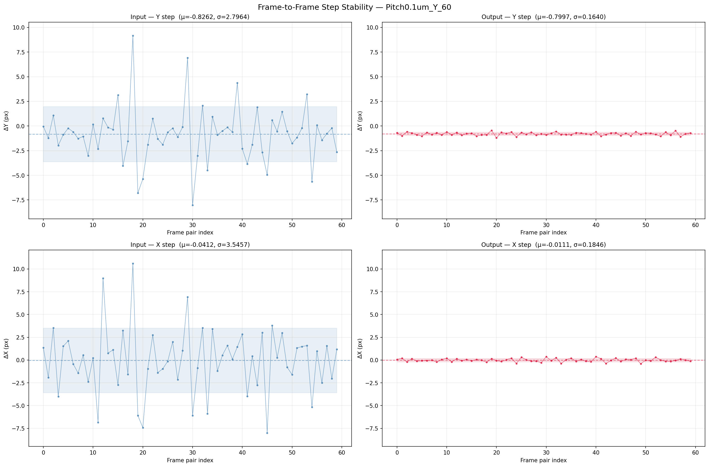</td>
  <td>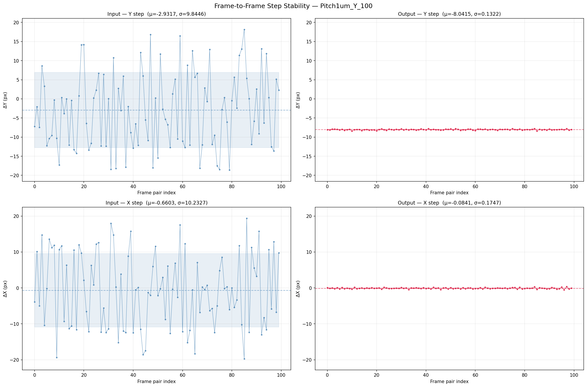</td>
</tr>
<tr>
  <td align="center"><a href="R38v2SeqFixed/results/8px_gate_recon/reconstruct_progress_best_tradeoff_in_Cropped_Output_20260406_235957/pitch0p01um_y_40_odd/">41 recon frames →</a></td>
  <td align="center"><a href="R38v2SeqFixed/results/8px_gate_recon/reconstruct_progress_best_tradeoff_in_Cropped_Output_20260406_235957/pitch0p1um_y_60_odd/">61 recon frames →</a></td>
  <td align="center"><a href="R38v2SeqFixed/results/8px_gate_recon/reconstruct_progress_best_tradeoff_in_Cropped_Output_20260406_235957/pitch1um_y_100_odd/">101 recon frames →</a></td>
</tr>
</table>

📋 所有 24 張 720-angle 指標 + 量化修復 recon + 其他方法論版本

**Cross-scale：** [08 step std](R38v2SeqFixed/results/720angle_analysis/R38v2/cross_dataset/08_cross_scale_step_std.png) · [09 residual](R38v2SeqFixed/results/720angle_analysis/R38v2/cross_dataset/09_cross_scale_residual_improvement.png) · [10 k2](R38v2SeqFixed/results/720angle_analysis/R38v2/cross_dataset/10_cross_scale_k2_stability.png)

**Per-pitch：**
- `pitch0p01um_y_40`: [01](R38v2SeqFixed/results/720angle_analysis/R38v2/pitch0p01um_y_40/01_center_trajectory.png) · [02](R38v2SeqFixed/results/720angle_analysis/R38v2/pitch0p01um_y_40/02_step_stability.png) · [03](R38v2SeqFixed/results/720angle_analysis/R38v2/pitch0p01um_y_40/03_residual_std_timeseries.png) · [04](R38v2SeqFixed/results/720angle_analysis/R38v2/pitch0p01um_y_40/04_k2_amplitude_timeseries.png) · [05](R38v2SeqFixed/results/720angle_analysis/R38v2/pitch0p01um_y_40/05_hotspot_persistence.png) · [06](R38v2SeqFixed/results/720angle_analysis/R38v2/pitch0p01um_y_40/06_edge_width_consistency.png) · [07](R38v2SeqFixed/results/720angle_analysis/R38v2/pitch0p01um_y_40/07_center_offset_drift.png)
- `pitch0p1um_y_60`: [01](R38v2SeqFixed/results/720angle_analysis/R38v2/pitch0p1um_y_60/01_center_trajectory.png) · [02](R38v2SeqFixed/results/720angle_analysis/R38v2/pitch0p1um_y_60/02_step_stability.png) · [03](R38v2SeqFixed/results/720angle_analysis/R38v2/pitch0p1um_y_60/03_residual_std_timeseries.png) · [04](R38v2SeqFixed/results/720angle_analysis/R38v2/pitch0p1um_y_60/04_k2_amplitude_timeseries.png) · [05](R38v2SeqFixed/results/720angle_analysis/R38v2/pitch0p1um_y_60/05_hotspot_persistence.png) · [06](R38v2SeqFixed/results/720angle_analysis/R38v2/pitch0p1um_y_60/06_edge_width_consistency.png) · [07](R38v2SeqFixed/results/720angle_analysis/R38v2/pitch0p1um_y_60/07_center_offset_drift.png)
- `pitch1um_y_100`: [01](R38v2SeqFixed/results/720angle_analysis/R38v2/pitch1um_y_100/01_center_trajectory.png) · [02](R38v2SeqFixed/results/720angle_analysis/R38v2/pitch1um_y_100/02_step_stability.png) · [03](R38v2SeqFixed/results/720angle_analysis/R38v2/pitch1um_y_100/03_residual_std_timeseries.png) · [04](R38v2SeqFixed/results/720angle_analysis/R38v2/pitch1um_y_100/04_k2_amplitude_timeseries.png) · [05](R38v2SeqFixed/results/720angle_analysis/R38v2/pitch1um_y_100/05_hotspot_persistence.png) · [06](R38v2SeqFixed/results/720angle_analysis/R38v2/pitch1um_y_100/06_edge_width_consistency.png) · [07](R38v2SeqFixed/results/720angle_analysis/R38v2/pitch1um_y_100/07_center_offset_drift.png)

**其他方法論版本：** [`720angle_irls_analysis/R38v2/`](R38v2SeqFixed/results/720angle_irls_analysis/R38v2/) · [`720angle_soft_l1/R38v2/`](R38v2SeqFixed/results/720angle_soft_l1/R38v2/) · [`sequence_analysis/`](R38v2SeqFixed/results/sequence_analysis/) · [`8px_gate_recon_quantfix/`](R38v2SeqFixed/results/8px_gate_recon_quantfix/)

📄 [R38v2_RESULTS](R38v2SeqFixed/reports/R38v2_RESULTS.md)

---

## 🟢 R33

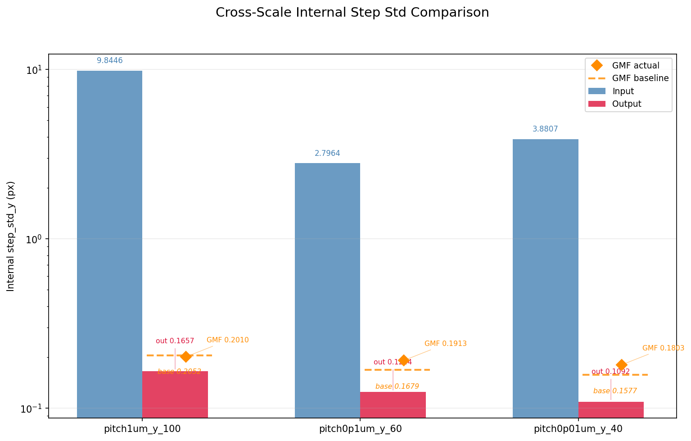

> [!TIP]
> **`r33_robust_p95`** · GMF extreme alternate · 0.8px **`0.119`** (三尺度全面最低) · 視覺銳度 -22% · Winsorize spatial loss p95

<table>
<tr>
  <td align="center">0.08 px</td>
  <td align="center"><b>0.8 px (主戰場)</b></td>
  <td align="center">8 px</td>
</tr>
<tr>
  <td></td>
  <td>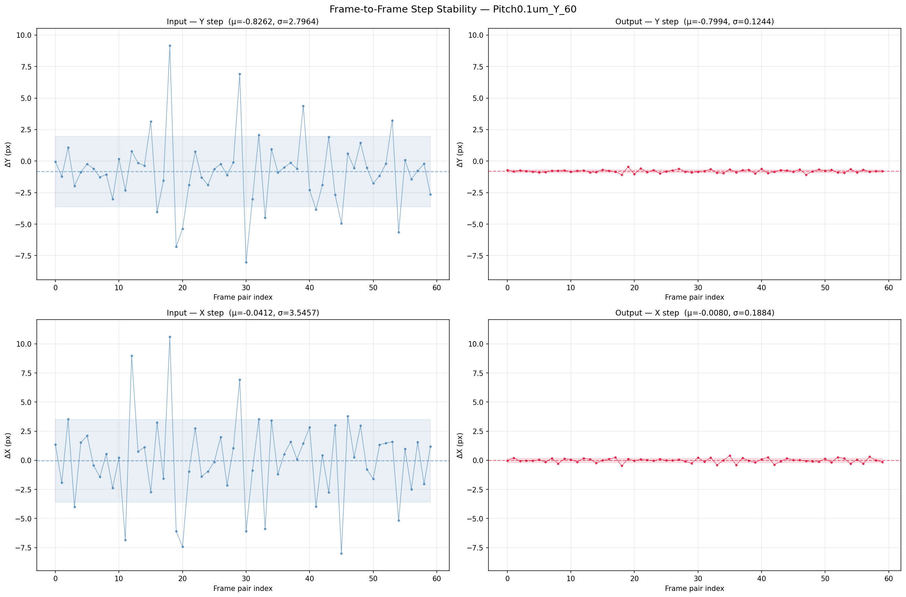</td>
  <td>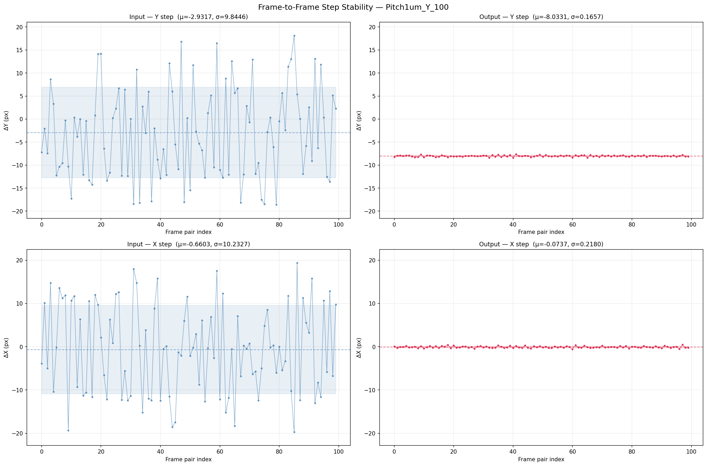</td>
</tr>
<tr>
  <td align="center"><a href="R33RobustLoss/results/p95_recon/reconstruct_progress_best_tradeoff_in_Cropped_Output_20260405_091941/pitch0p01um_y_40_odd/">41 recon frames →</a></td>
  <td align="center"><a href="R33RobustLoss/results/p95_recon/reconstruct_progress_best_tradeoff_in_Cropped_Output_20260405_091941/pitch0p1um_y_60_odd/">61 recon frames →</a></td>
  <td align="center"><a href="R33RobustLoss/results/p95_recon/reconstruct_progress_best_tradeoff_in_Cropped_Output_20260405_091941/pitch1um_y_100_odd/">101 recon frames →</a></td>
</tr>
</table>

📋 所有 24 張 720-angle 指標 + 獨立 sequence analysis + 量化修復 recon

**Cross-scale：** [08 step std](R38v2SeqFixed/results/720angle_analysis/R33/cross_dataset/08_cross_scale_step_std.png) · [09 residual](R38v2SeqFixed/results/720angle_analysis/R33/cross_dataset/09_cross_scale_residual_improvement.png) · [10 k2](R38v2SeqFixed/results/720angle_analysis/R33/cross_dataset/10_cross_scale_k2_stability.png)

**Per-pitch：**
- `pitch0p01um_y_40`: [01](R38v2SeqFixed/results/720angle_analysis/R33/pitch0p01um_y_40/01_center_trajectory.png) · [02](R38v2SeqFixed/results/720angle_analysis/R33/pitch0p01um_y_40/02_step_stability.png) · [03](R38v2SeqFixed/results/720angle_analysis/R33/pitch0p01um_y_40/03_residual_std_timeseries.png) · [04](R38v2SeqFixed/results/720angle_analysis/R33/pitch0p01um_y_40/04_k2_amplitude_timeseries.png) · [05](R38v2SeqFixed/results/720angle_analysis/R33/pitch0p01um_y_40/05_hotspot_persistence.png) · [06](R38v2SeqFixed/results/720angle_analysis/R33/pitch0p01um_y_40/06_edge_width_consistency.png) · [07](R38v2SeqFixed/results/720angle_analysis/R33/pitch0p01um_y_40/07_center_offset_drift.png)
- `pitch0p1um_y_60`: [01](R38v2SeqFixed/results/720angle_analysis/R33/pitch0p1um_y_60/01_center_trajectory.png) · [02](R38v2SeqFixed/results/720angle_analysis/R33/pitch0p1um_y_60/02_step_stability.png) · [03](R38v2SeqFixed/results/720angle_analysis/R33/pitch0p1um_y_60/03_residual_std_timeseries.png) · [04](R38v2SeqFixed/results/720angle_analysis/R33/pitch0p1um_y_60/04_k2_amplitude_timeseries.png) · [05](R38v2SeqFixed/results/720angle_analysis/R33/pitch0p1um_y_60/05_hotspot_persistence.png) · [06](R38v2SeqFixed/results/720angle_analysis/R33/pitch0p1um_y_60/06_edge_width_consistency.png) · [07](R38v2SeqFixed/results/720angle_analysis/R33/pitch0p1um_y_60/07_center_offset_drift.png)
- `pitch1um_y_100`: [01](R38v2SeqFixed/results/720angle_analysis/R33/pitch1um_y_100/01_center_trajectory.png) · [02](R38v2SeqFixed/results/720angle_analysis/R33/pitch1um_y_100/02_step_stability.png) · [03](R38v2SeqFixed/results/720angle_analysis/R33/pitch1um_y_100/03_residual_std_timeseries.png) · [04](R38v2SeqFixed/results/720angle_analysis/R33/pitch1um_y_100/04_k2_amplitude_timeseries.png) · [05](R38v2SeqFixed/results/720angle_analysis/R33/pitch1um_y_100/05_hotspot_persistence.png) · [06](R38v2SeqFixed/results/720angle_analysis/R33/pitch1um_y_100/06_edge_width_consistency.png) · [07](R38v2SeqFixed/results/720angle_analysis/R33/pitch1um_y_100/07_center_offset_drift.png)

**R33 候選獨立 sequence_analysis（24 張）：** [`p95_sequence_analysis/`](R33RobustLoss/results/p95_sequence_analysis/) · **量化修復：** [`p95_recon_quantfix/`](R33RobustLoss/results/p95_recon_quantfix/)

📄 [R33_SUMMARY](R33RobustLoss/reports/R33_EXPERIMENT_SUMMARY.md) · [Complete series](R33RobustLoss/reports/R33_R38v2_COMPLETE_EXPERIMENT_SERIES.md) · [GMF methodology](R33RobustLoss/reports/GMF_STEP_STD_METHODOLOGY.md) · [Quantization fix](R33RobustLoss/reports/QUANTIZATION_FIX_ANALYSIS.md) · [Internal/External divergence](R33RobustLoss/reports/INTERNAL_EXTERNAL_DIVERGENCE_ANALYSIS.md)

---

## 🔴 R33 ablations

> [!NOTE]
> R33 系列的三個否定分支，保留作為「為什麼 p95 才成立」的對照。

| 候選 | verdict | recon 目錄 | sequence analysis |
|------|---------|-----------|-------------------|
| `hard_p90`（internal only） | 未送外部 GMF | [`reconstruct_progress_best_tradeoff_in_Cropped_Output_20260405_073906/`](R33RobustLoss/results/reconstruct_progress_best_tradeoff_in_Cropped_Output_20260405_073906/) | [`sequence_analysis/`](R33RobustLoss/results/sequence_analysis/) |
| `lap_only`（Laplacian 單獨） | W_GRADMAG 不能拿掉 | [`lap_only_recon/`](R33RobustLoss/results/lap_only_recon/) | [`lap_only_sequence_analysis/`](R33RobustLoss/results/lap_only_sequence_analysis/) |
| `soft_p95`（Charbonnier 軟 p95） | 比 hard 更差 | [`soft_p95_recon/`](R33RobustLoss/results/soft_p95_recon/) | [`soft_p95_sequence_analysis/`](R33RobustLoss/results/soft_p95_sequence_analysis/) |

每個 sequence_analysis 皆含 cross_dataset（3 張）+ 3 pitches × 7 張 = 24 張 PNG。

---

## 🔵 R30

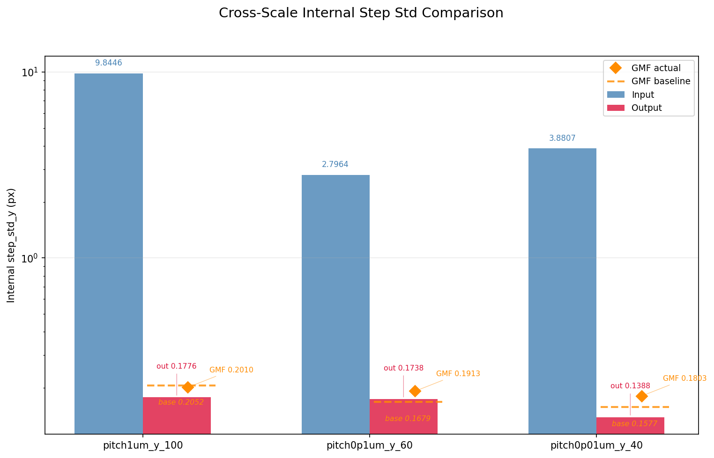

> [!NOTE]
> **`r30_b1_dironly`** · historical former baseline (pre-COMBO) · 0.8px **`0.168`** · B1 dironly 首次在主戰場超越 R26
>
> R30 的 recon BMP 在 legacy batch 內且未 tracked；指標圖來自 R38v2SeqFixed 的 720-angle 跨候選比較。

<table>
<tr>
  <td align="center">0.08 px</td>
  <td align="center"><b>0.8 px</b></td>
  <td align="center">8 px</td>
</tr>
<tr>
  <td>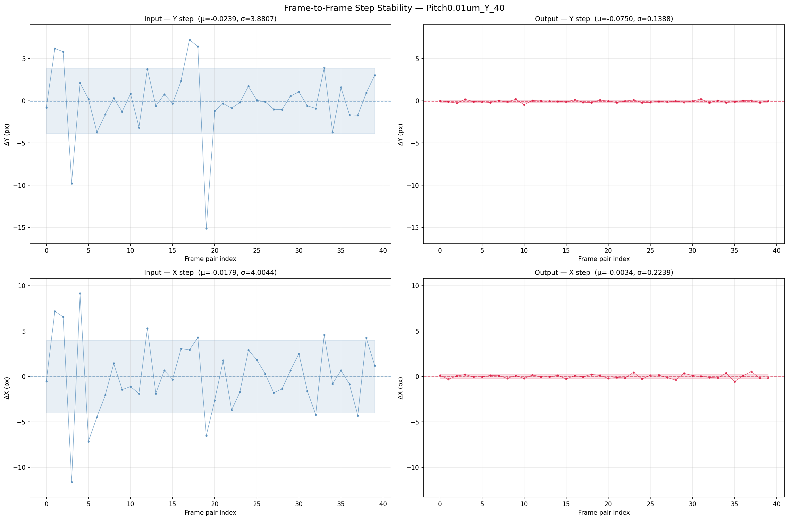</td>
  <td></td>
  <td></td>
</tr>
</table>

📋 所有 24 張 720-angle 指標 + 其他方法論版本

**Cross-scale：** [08 step std](R38v2SeqFixed/results/720angle_analysis/R30/cross_dataset/08_cross_scale_step_std.png) · [09 residual](R38v2SeqFixed/results/720angle_analysis/R30/cross_dataset/09_cross_scale_residual_improvement.png) · [10 k2](R38v2SeqFixed/results/720angle_analysis/R30/cross_dataset/10_cross_scale_k2_stability.png)

**Per-pitch：**
- `pitch0p01um_y_40`: [01](R38v2SeqFixed/results/720angle_analysis/R30/pitch0p01um_y_40/01_center_trajectory.png) · [02](R38v2SeqFixed/results/720angle_analysis/R30/pitch0p01um_y_40/02_step_stability.png) · [03](R38v2SeqFixed/results/720angle_analysis/R30/pitch0p01um_y_40/03_residual_std_timeseries.png) · [04](R38v2SeqFixed/results/720angle_analysis/R30/pitch0p01um_y_40/04_k2_amplitude_timeseries.png) · [05](R38v2SeqFixed/results/720angle_analysis/R30/pitch0p01um_y_40/05_hotspot_persistence.png) · [06](R38v2SeqFixed/results/720angle_analysis/R30/pitch0p01um_y_40/06_edge_width_consistency.png) · [07](R38v2SeqFixed/results/720angle_analysis/R30/pitch0p01um_y_40/07_center_offset_drift.png)
- `pitch0p1um_y_60`: [01](R38v2SeqFixed/results/720angle_analysis/R30/pitch0p1um_y_60/01_center_trajectory.png) · [02](R38v2SeqFixed/results/720angle_analysis/R30/pitch0p1um_y_60/02_step_stability.png) · [03](R38v2SeqFixed/results/720angle_analysis/R30/pitch0p1um_y_60/03_residual_std_timeseries.png) · [04](R38v2SeqFixed/results/720angle_analysis/R30/pitch0p1um_y_60/04_k2_amplitude_timeseries.png) · [05](R38v2SeqFixed/results/720angle_analysis/R30/pitch0p1um_y_60/05_hotspot_persistence.png) · [06](R38v2SeqFixed/results/720angle_analysis/R30/pitch0p1um_y_60/06_edge_width_consistency.png) · [07](R38v2SeqFixed/results/720angle_analysis/R30/pitch0p1um_y_60/07_center_offset_drift.png)
- `pitch1um_y_100`: [01](R38v2SeqFixed/results/720angle_analysis/R30/pitch1um_y_100/01_center_trajectory.png) · [02](R38v2SeqFixed/results/720angle_analysis/R30/pitch1um_y_100/02_step_stability.png) · [03](R38v2SeqFixed/results/720angle_analysis/R30/pitch1um_y_100/03_residual_std_timeseries.png) · [04](R38v2SeqFixed/results/720angle_analysis/R30/pitch1um_y_100/04_k2_amplitude_timeseries.png) · [05](R38v2SeqFixed/results/720angle_analysis/R30/pitch1um_y_100/05_hotspot_persistence.png) · [06](R38v2SeqFixed/results/720angle_analysis/R30/pitch1um_y_100/06_edge_width_consistency.png) · [07](R38v2SeqFixed/results/720angle_analysis/R30/pitch1um_y_100/07_center_offset_drift.png)

**其他方法論版本：** [`720angle_irls_analysis/R30/`](R38v2SeqFixed/results/720angle_irls_analysis/R30/) · [`720angle_soft_l1/R30/`](R38v2SeqFixed/results/720angle_soft_l1/R30/)

📄 [External compare](../docs/evidence/baseline/ROUND30_EXTERNAL_COMPARE.md) · [Architecture breakthrough decision](../docs/evidence/baseline/ROUND30_ARCH_BREAKTHROUGH_DECISION_20260318_003739.md)

---

## 🔵 R26 sm035

> [!NOTE]
> **`r26_sm035`** · 歷史 step_mag=0.35 基準線 (R14–R29 線的 externally verified optimum)
>
> 已被 R30 取代。AnalysisLab 保留完整 single_image + sequence 分析作為研究參考
>
> external 0.8px **`0.191`**

📄 Entry: [AnalysisLab/r26/README](../AnalysisLab/r26/README.md)

### 📊 測試重建影像（single-image demo）

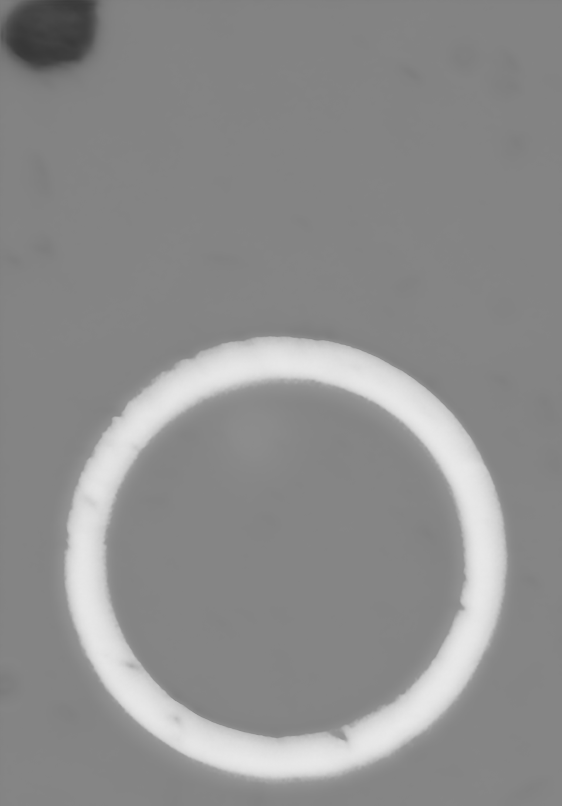

- Input：[`VisionTop_20251029182653732.bmp`](../AnalysisLab/r26/single_image/inputs/VisionTop_20251029182653732.bmp) · [preview](../AnalysisLab/r26/single_image/inputs/input_preview.png)
- Output (r26_sm035 best_tradeoff)：[`VisionTop_*.bmp`](../AnalysisLab/r26/single_image/recon/reconstruct_progress_r26_sm035_best_tradeoff_in_Demo_Input_20260327_122202/VisionTop_20251029182653732.bmp) · [preview](../AnalysisLab/r26/single_image/recon/output_preview.png)

### 📈 指標圖表（single_image analysis，8 張）

完整報告：[`AnalysisLab/r26/single_image/reports/R26_SingleImage_Analysis_Report.md`](../AnalysisLab/r26/single_image/reports/R26_SingleImage_Analysis_Report.md)

- [01 edge profiles](../AnalysisLab/r26/single_image/results/01_edge_profiles.png)
- [02 circle fit](../AnalysisLab/r26/single_image/results/02_circle_fit.png)
- [03 angular consistency](../AnalysisLab/r26/single_image/results/03_angular_consistency.png)
- [04 frequency spectrum](../AnalysisLab/r26/single_image/results/04_frequency_spectrum.png)
- [05 overview and artifacts](../AnalysisLab/r26/single_image/results/05_overview_and_artifacts.png)
- [06 edge width angular](../AnalysisLab/r26/single_image/results/06_edge_width_angular.png)
- [07 residual harmonics](../AnalysisLab/r26/single_image/results/07_residual_harmonics.png)
- [08 residual hotspot](../AnalysisLab/r26/single_image/results/08_residual_hotspot.png)

### 📈 指標圖表（sequence analysis）

完整報告：[`AnalysisLab/r26/sequence/reports/R26_Sequence_Analysis_Report.md`](../AnalysisLab/r26/sequence/reports/R26_Sequence_Analysis_Report.md)

- Cross-scale：[08 step std](../AnalysisLab/r26/sequence/results/cross_dataset/08_cross_scale_step_std.png) · [09 residual](../AnalysisLab/r26/sequence/results/cross_dataset/09_cross_scale_residual_improvement.png) · [10 k2](../AnalysisLab/r26/sequence/results/cross_dataset/10_cross_scale_k2_stability.png)

Per-pitch（21 張）

- `pitch0p01um_y_40`: [01](../AnalysisLab/r26/sequence/results/pitch0p01um_y_40/01_center_trajectory.png) · [02](../AnalysisLab/r26/sequence/results/pitch0p01um_y_40/02_step_stability.png) · [03](../AnalysisLab/r26/sequence/results/pitch0p01um_y_40/03_residual_std_timeseries.png) · [04](../AnalysisLab/r26/sequence/results/pitch0p01um_y_40/04_k2_amplitude_timeseries.png) · [05](../AnalysisLab/r26/sequence/results/pitch0p01um_y_40/05_hotspot_persistence.png) · [06](../AnalysisLab/r26/sequence/results/pitch0p01um_y_40/06_edge_width_consistency.png) · [07](../AnalysisLab/r26/sequence/results/pitch0p01um_y_40/07_center_offset_drift.png)
- `pitch0p1um_y_60`: [01](../AnalysisLab/r26/sequence/results/pitch0p1um_y_60/01_center_trajectory.png) · [02](../AnalysisLab/r26/sequence/results/pitch0p1um_y_60/02_step_stability.png) · [03](../AnalysisLab/r26/sequence/results/pitch0p1um_y_60/03_residual_std_timeseries.png) · [04](../AnalysisLab/r26/sequence/results/pitch0p1um_y_60/04_k2_amplitude_timeseries.png) · [05](../AnalysisLab/r26/sequence/results/pitch0p1um_y_60/05_hotspot_persistence.png) · [06](../AnalysisLab/r26/sequence/results/pitch0p1um_y_60/06_edge_width_consistency.png) · [07](../AnalysisLab/r26/sequence/results/pitch0p1um_y_60/07_center_offset_drift.png)
- `pitch1um_y_100`: [01](../AnalysisLab/r26/sequence/results/pitch1um_y_100/01_center_trajectory.png) · [02](../AnalysisLab/r26/sequence/results/pitch1um_y_100/02_step_stability.png) · [03](../AnalysisLab/r26/sequence/results/pitch1um_y_100/03_residual_std_timeseries.png) · [04](../AnalysisLab/r26/sequence/results/pitch1um_y_100/04_k2_amplitude_timeseries.png) · [05](../AnalysisLab/r26/sequence/results/pitch1um_y_100/05_hotspot_persistence.png) · [06](../AnalysisLab/r26/sequence/results/pitch1um_y_100/06_edge_width_consistency.png) · [07](../AnalysisLab/r26/sequence/results/pitch1um_y_100/07_center_offset_drift.png)

### 🔍 分析圖（performance benchmark）

- [01 inference latency comparison](../AnalysisLab/r26/performance/results/cross_device/01_inference_latency_comparison.png)
- [02 inference throughput comparison](../AnalysisLab/r26/performance/results/cross_device/02_inference_throughput_comparison.png)
- [03 training throughput comparison](../AnalysisLab/r26/performance/results/cross_device/03_training_throughput_comparison.png)
- [04 gpu memory comparison](../AnalysisLab/r26/performance/results/cross_device/04_gpu_memory_comparison.png)

---

## 🟡 R26NewPSFCheck

> [!IMPORTANT]
> **Open side track** · pending external GMF · **不是** active mainline
>
> 新 Whole-FOV PSF (2026-03-26 完成) 取代舊 empirical PSF，作為目前物理上較合理的標準

📄 Reports: [STATUS](R26NewPSFCheck/reports/STATUS_20260326.md) · [PSF audit](R26NewPSFCheck/psf_audit/PSF_FORMAL_AUDIT_20260326.md) · [Promote compare](R26NewPSFCheck/formal_newpsf_candidate/reports/NEW_PSF_FORMAL_R26_COMPARE.md)

### 📊 測試重建影像（ablation 2×2）

舊 vs 新 checkpoint × 舊 vs 新 PSF 四象限對照。每張都是同一張 `VisionTop_20251029182653732.bmp` 輸入。

| | **Old PSF** | **New PSF** |
|---|---|---|
| **Old checkpoint (r26_sm035)** | [`old_ckpt_oldpsf/`](R26NewPSFCheck/ablation_single_sample/reconstruct_progress_r26_sm035_best_tradeoff_in_input_20260324_233331/old_ckpt_oldpsf/VisionTop_20251029182653732.bmp) | [`old_ckpt_newpsf/`](R26NewPSFCheck/ablation_single_sample/reconstruct_progress_r26_sm035_best_tradeoff_in_input_20260324_233331/old_ckpt_newpsf/VisionTop_20251029182653732.bmp) |
| **New checkpoint (新 PSF 重訓)** | [`new_ckpt_oldpsf/`](R26NewPSFCheck/ablation_single_sample/reconstruct_progress_best_tradeoff_in_input_20260326_115148/new_ckpt_oldpsf/VisionTop_20251029182653732.bmp) | [`new_ckpt_newpsf/`](R26NewPSFCheck/ablation_single_sample/reconstruct_progress_best_tradeoff_in_input_20260326_115148/new_ckpt_newpsf/VisionTop_20251029182653732.bmp) |

原始 input：[`ablation_single_sample/input/VisionTop_20251029182653732.bmp`](R26NewPSFCheck/ablation_single_sample/input/VisionTop_20251029182653732.bmp)

### 📊 測試重建影像（pure PSF control，epoch 進度）

Same-recipe 對照：old recipe + new PSF → epoch 10/20/40 沒有重現先前「新 PSF 重訓崩壞」的模式。

- Old PSF：[epoch 10](R26NewPSFCheck/pure_psf_control/reconstructions/old_psf/epoch_010.bmp) · [epoch 20](R26NewPSFCheck/pure_psf_control/reconstructions/old_psf/epoch_020.bmp) · [epoch 40](R26NewPSFCheck/pure_psf_control/reconstructions/old_psf/epoch_040.bmp)
- New PSF：[epoch 10](R26NewPSFCheck/pure_psf_control/reconstructions/new_psf/epoch_010.bmp) · [epoch 20](R26NewPSFCheck/pure_psf_control/reconstructions/new_psf/epoch_020.bmp) · [epoch 40](R26NewPSFCheck/pure_psf_control/reconstructions/new_psf/epoch_040.bmp)

### 🔍 分析圖

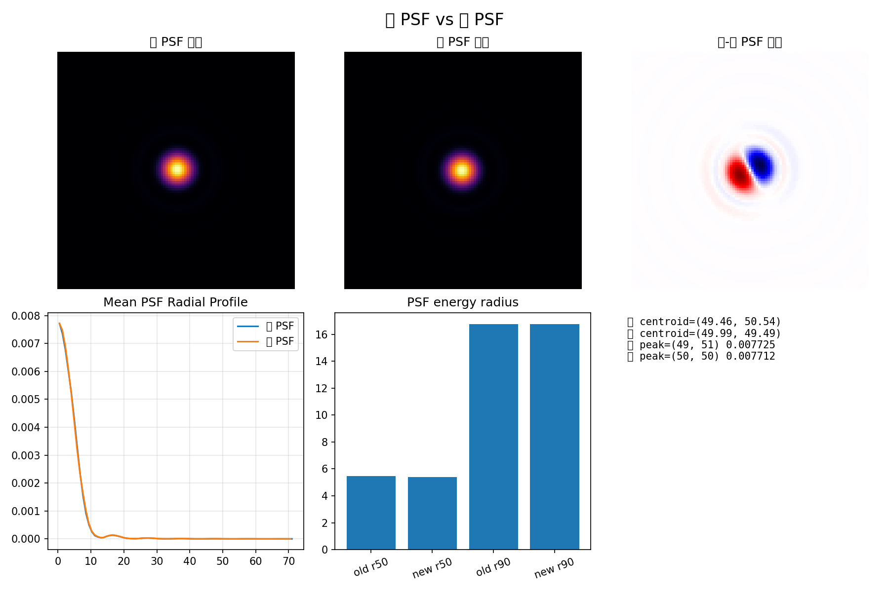

- [PSF old vs new investigation](R26NewPSFCheck/reports/psf_old_vs_new_investigation_20260326.png) · [ASCII 版](R26NewPSFCheck/reports/psf_old_vs_new_investigation_ascii_20260326.png)
- [Old vs new recon investigation](R26NewPSFCheck/reports/old_vs_new_recon_investigation_20260326.png) · [ASCII 版](R26NewPSFCheck/reports/old_vs_new_recon_investigation_ascii_20260326.png)
- [Root cause centering — selector audit key epochs](R26NewPSFCheck/root_cause_centering/figures/selector_audit_key_epochs_20260326.png)

---

## 🔴 R33c

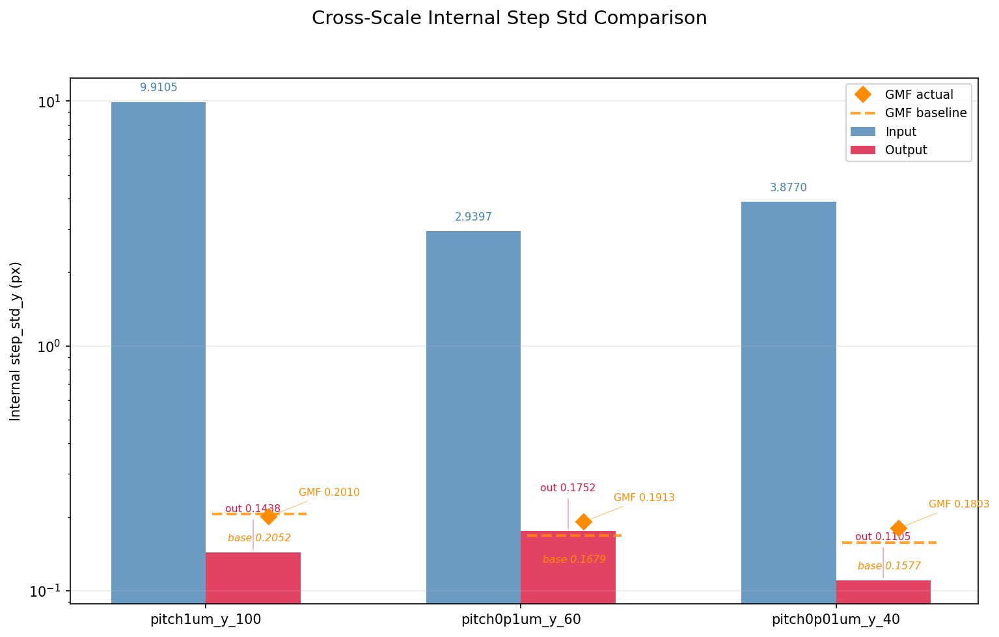

> [!CAUTION]
> **`R33ContrastFix / stat03`** · **Closed · falsified** · W_STAT 提高 (0.30) 反而讓 contrast 更差 — 視覺與指標同時退步

📋 完整指標 + recon 目錄

**Recon（每 pitch）：** [`pitch0p01um_y_40_odd/`](R33ContrastFix/results/stat03_recon/reconstruct_progress_best_tradeoff_in_Cropped_Output_20260406_222404/pitch0p01um_y_40_odd/) · [`pitch0p1um_y_60_odd/`](R33ContrastFix/results/stat03_recon/reconstruct_progress_best_tradeoff_in_Cropped_Output_20260406_222404/pitch0p1um_y_60_odd/) · [`pitch1um_y_100_odd/`](R33ContrastFix/results/stat03_recon/reconstruct_progress_best_tradeoff_in_Cropped_Output_20260406_222404/pitch1um_y_100_odd/)

**Cross-scale：** [08 step std](R33ContrastFix/results/sequence_analysis/cross_dataset/08_cross_scale_step_std.png) · [09 residual](R33ContrastFix/results/sequence_analysis/cross_dataset/09_cross_scale_residual_improvement.png) · [10 k2](R33ContrastFix/results/sequence_analysis/cross_dataset/10_cross_scale_k2_stability.png)

**Per-pitch：**
- `pitch0p01um_y_40`: [01](R33ContrastFix/results/sequence_analysis/pitch0p01um_y_40/01_center_trajectory.png) · [02](R33ContrastFix/results/sequence_analysis/pitch0p01um_y_40/02_step_stability.png) · [03](R33ContrastFix/results/sequence_analysis/pitch0p01um_y_40/03_residual_std_timeseries.png) · [04](R33ContrastFix/results/sequence_analysis/pitch0p01um_y_40/04_k2_amplitude_timeseries.png) · [05](R33ContrastFix/results/sequence_analysis/pitch0p01um_y_40/05_hotspot_persistence.png) · [06](R33ContrastFix/results/sequence_analysis/pitch0p01um_y_40/06_edge_width_consistency.png) · [07](R33ContrastFix/results/sequence_analysis/pitch0p01um_y_40/07_center_offset_drift.png)
- `pitch0p1um_y_60`: [01](R33ContrastFix/results/sequence_analysis/pitch0p1um_y_60/01_center_trajectory.png) · [02](R33ContrastFix/results/sequence_analysis/pitch0p1um_y_60/02_step_stability.png) · [03](R33ContrastFix/results/sequence_analysis/pitch0p1um_y_60/03_residual_std_timeseries.png) · [04](R33ContrastFix/results/sequence_analysis/pitch0p1um_y_60/04_k2_amplitude_timeseries.png) · [05](R33ContrastFix/results/sequence_analysis/pitch0p1um_y_60/05_hotspot_persistence.png) · [06](R33ContrastFix/results/sequence_analysis/pitch0p1um_y_60/06_edge_width_consistency.png) · [07](R33ContrastFix/results/sequence_analysis/pitch0p1um_y_60/07_center_offset_drift.png)
- `pitch1um_y_100`: [01](R33ContrastFix/results/sequence_analysis/pitch1um_y_100/01_center_trajectory.png) · [02](R33ContrastFix/results/sequence_analysis/pitch1um_y_100/02_step_stability.png) · [03](R33ContrastFix/results/sequence_analysis/pitch1um_y_100/03_residual_std_timeseries.png) · [04](R33ContrastFix/results/sequence_analysis/pitch1um_y_100/04_k2_amplitude_timeseries.png) · [05](R33ContrastFix/results/sequence_analysis/pitch1um_y_100/05_hotspot_persistence.png) · [06](R33ContrastFix/results/sequence_analysis/pitch1um_y_100/06_edge_width_consistency.png) · [07](R33ContrastFix/results/sequence_analysis/pitch1um_y_100/07_center_offset_drift.png)

📄 [R33ContrastFix/results](R33ContrastFix/results/)

---

## 🔴 R38 seq-all-stages

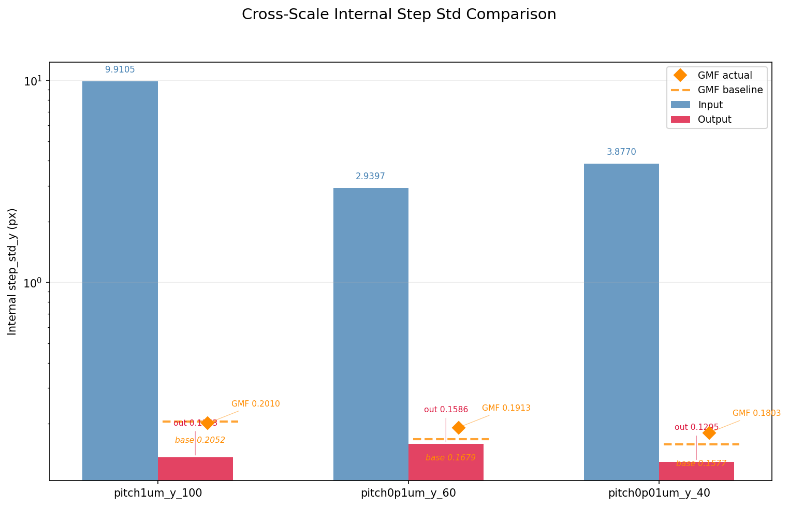

> [!CAUTION]
> **`R38SeqConsistency / seq_only`** · **Closed · falsified** · R38v2 的前身：0.8px delta 太小被噪聲梯度干擾 — 三重修復 (warmup + gate + 8px-only) → R38v2 才成功

📋 完整指標 + recon 目錄

**Recon（每 pitch）：** [`pitch0p01um_y_40_odd/`](R38SeqConsistency/results/seq_only_recon/reconstruct_progress_best_tradeoff_in_Cropped_Output_20260406_122842/pitch0p01um_y_40_odd/) · [`pitch0p1um_y_60_odd/`](R38SeqConsistency/results/seq_only_recon/reconstruct_progress_best_tradeoff_in_Cropped_Output_20260406_122842/pitch0p1um_y_60_odd/) · [`pitch1um_y_100_odd/`](R38SeqConsistency/results/seq_only_recon/reconstruct_progress_best_tradeoff_in_Cropped_Output_20260406_122842/pitch1um_y_100_odd/)

**Cross-scale：** [08 step std](R38SeqConsistency/results/sequence_analysis/cross_dataset/08_cross_scale_step_std.png) · [09 residual](R38SeqConsistency/results/sequence_analysis/cross_dataset/09_cross_scale_residual_improvement.png) · [10 k2](R38SeqConsistency/results/sequence_analysis/cross_dataset/10_cross_scale_k2_stability.png)

**Per-pitch：**
- `pitch0p01um_y_40`: [01](R38SeqConsistency/results/sequence_analysis/pitch0p01um_y_40/01_center_trajectory.png) · [02](R38SeqConsistency/results/sequence_analysis/pitch0p01um_y_40/02_step_stability.png) · [03](R38SeqConsistency/results/sequence_analysis/pitch0p01um_y_40/03_residual_std_timeseries.png) · [04](R38SeqConsistency/results/sequence_analysis/pitch0p01um_y_40/04_k2_amplitude_timeseries.png) · [05](R38SeqConsistency/results/sequence_analysis/pitch0p01um_y_40/05_hotspot_persistence.png) · [06](R38SeqConsistency/results/sequence_analysis/pitch0p01um_y_40/06_edge_width_consistency.png) · [07](R38SeqConsistency/results/sequence_analysis/pitch0p01um_y_40/07_center_offset_drift.png)
- `pitch0p1um_y_60`: [01](R38SeqConsistency/results/sequence_analysis/pitch0p1um_y_60/01_center_trajectory.png) · [02](R38SeqConsistency/results/sequence_analysis/pitch0p1um_y_60/02_step_stability.png) · [03](R38SeqConsistency/results/sequence_analysis/pitch0p1um_y_60/03_residual_std_timeseries.png) · [04](R38SeqConsistency/results/sequence_analysis/pitch0p1um_y_60/04_k2_amplitude_timeseries.png) · [05](R38SeqConsistency/results/sequence_analysis/pitch0p1um_y_60/05_hotspot_persistence.png) · [06](R38SeqConsistency/results/sequence_analysis/pitch0p1um_y_60/06_edge_width_consistency.png) · [07](R38SeqConsistency/results/sequence_analysis/pitch0p1um_y_60/07_center_offset_drift.png)
- `pitch1um_y_100`: [01](R38SeqConsistency/results/sequence_analysis/pitch1um_y_100/01_center_trajectory.png) · [02](R38SeqConsistency/results/sequence_analysis/pitch1um_y_100/02_step_stability.png) · [03](R38SeqConsistency/results/sequence_analysis/pitch1um_y_100/03_residual_std_timeseries.png) · [04](R38SeqConsistency/results/sequence_analysis/pitch1um_y_100/04_k2_amplitude_timeseries.png) · [05](R38SeqConsistency/results/sequence_analysis/pitch1um_y_100/05_hotspot_persistence.png) · [06](R38SeqConsistency/results/sequence_analysis/pitch1um_y_100/06_edge_width_consistency.png) · [07](R38SeqConsistency/results/sequence_analysis/pitch1um_y_100/07_center_offset_drift.png)

📄 [R38_RESULTS](R38SeqConsistency/reports/R38_RESULTS.md)

---

## 🔴 R32

> [!CAUTION]
> **`r32_real_eq_finetune`** · **External FAIL · Closed sandbox**
>
> Internal winner 但 external 0.8px 惡化 **+97.7%** (`0.332`)
>
> 「internal pass ≠ external pass」的反例

📄 Reports: [External compare](R32Sandbox/reports/ROUND32_EXTERNAL_COMPARE.md) · [Decision memo](R32Sandbox/reports/ROUND32_DOMAIN_CAPACITY_DECISION_20260319_183614.md) · [Runtime status](R32Sandbox/runtime/R32_STATUS.md)

**視覺輸出**：`R32Sandbox/artifacts/` 下有 process probe 的 loss curve 與 GMF proxy metrics PNG，但這些 artifacts 目錄**被 gitignore 排除**，不在 tracked 範圍。本地執行可看：`R32Sandbox/artifacts/training_progress_process_probe_r32_real_eq_finetune_*`。

---

## 🔴 R34 / R35 / R37

> [!CAUTION]
> 三輪嘗試恢復 R33 視覺銳度的 side attempt · **全部 falsified** · 只存在於 sandbox 分支 · **無 tracked 視覺輸出**

三輪的否定結論：

- **R34 freq-split**（`sandbox/r34`）：loss 層 Gaussian 分頻，lo/hi 梯度在 patch 上高度相關，無效
- **R35 alpha-boost 0.25**（`sandbox/r35`）：physics alpha 提升，均勻放大含噪 HF
- **R37 PSF 頻率依賴 reg**（`sandbox/r37`）：HF 低 reg 放大 Wiener 噪聲

這三輪只在各自 sandbox 分支，**未建立 `Experiments/` 目錄**，沒有產生可展示的 tracked 視覺輸出。

---

## 📚 Legacy visuals

> [!NOTE]
> R18/R22/R25 時代的 0.8px 主戰場對比表（2026-04-08 封存於 `docs/archive/legacy_visuals/`）。

- [`comparison_0p8px_case_01.png`](../docs/archive/legacy_visuals/comparison_0p8px_case_01.png)
- [`comparison_0p8px_case_02.png`](../docs/archive/legacy_visuals/comparison_0p8px_case_02.png)

這些是當時跨候選視覺比較，保留作為歷史引用錨點。完整 legacy 歷史與每一輪的敘事脈絡見 [`docs/history/PROJECT_FULL_HISTORY_AND_STRATEGY_20260312.md`](../docs/history/PROJECT_FULL_HISTORY_AND_STRATEGY_20260312.md)。

---

## Adding new entries

新完成一輪實驗後，請依以下格式在**對應分類區段**底下新增 `## <Round>` section：

1. 一句話描述角色 / 結論
2. 連結正式報告
3. **測試重建影像**：代表樣本內嵌 + per-pitch 目錄表
4. **指標圖表**：cross-scale 內嵌 + per-pitch 折疊清單（用 `
`）
5. **分析圖**（可選）：ad-hoc 的 PSF/centering/contrast 相關圖
6. 在最上面的 TOC 加一行

所有路徑用**相對於本檔目錄（`Experiments/`）的相對路徑**；跨到其他 tracked 目錄（`AnalysisLab/`、`docs/archive/`）時用 `../` 前綴。

**這份文件不是 mandatory 更新項**（不列入 `CLAUDE.md` 的 5 項強制清單），但**強烈建議**在每輪有視覺輸出時更新——demo / 會議 / PR review 時會非常省時。
