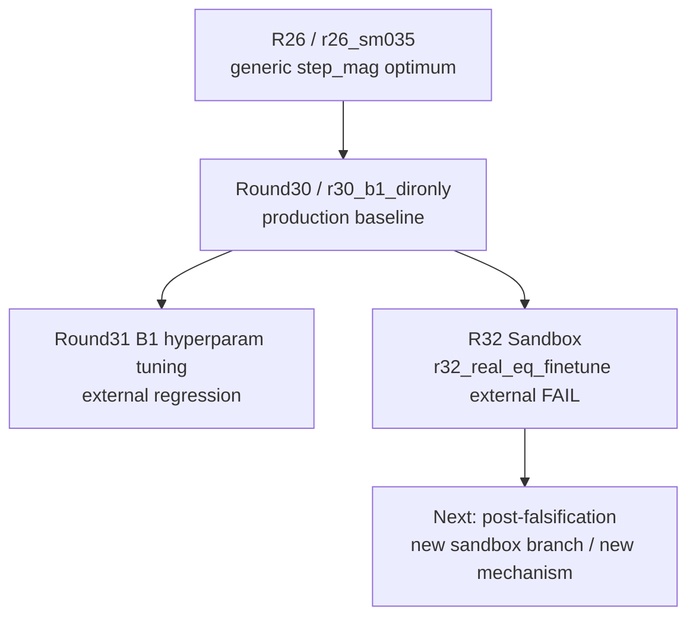

# GMM_2_Final

## Canonical Reading Order / 正式閱讀順序

新接手時，只看這四份：  
When taking over the project, start with these four files:

1. `PROJECT_SESSION_CONTINUITY.md`
2. `PROJECT_CURRENT_STATE.md`
3. `PROJECT_ARCHITECTURE_AND_DECISION_MAP.md`
4. `docs/history/PROJECT_FULL_HISTORY_AND_STRATEGY_20260312.md`（只有需要完整歷史時再看 / only when you need the full historical narrative）

想快速接手：看 `PROJECT_SESSION_CONTINUITY.md`  
For the fastest handoff, read `PROJECT_SESSION_CONTINUITY.md`.

想知道現在真相：看 `PROJECT_CURRENT_STATE.md`  
For current truth, read `PROJECT_CURRENT_STATE.md`.

想知道穩定規則：看 `PROJECT_ARCHITECTURE_AND_DECISION_MAP.md`  
For stable rules, read `PROJECT_ARCHITECTURE_AND_DECISION_MAP.md`.

想補完整歷史：最後看 `docs/history/PROJECT_FULL_HISTORY_AND_STRATEGY_20260312.md`  
For the full historical context, read `docs/history/PROJECT_FULL_HISTORY_AND_STRATEGY_20260312.md` last.

## One-Screen Snapshot / 一頁快照

- 目前 production baseline：`Round30 / r30_b1_dironly`
  The current production baseline is `Round30 / r30_b1_dironly`.
- `Round32` 已切到 `Experiments/R32Sandbox/`
  `Round32` lives in `Experiments/R32Sandbox/`.
- `Round32` internal winner `r32_real_eq_finetune` 已完成 external compare，結論是 **FAIL**
  The `Round32` internal winner `r32_real_eq_finetune` completed external compare and the verdict is **FAIL**.
- 若要續做 `R32`，下一步必須是新的 sandbox branch / 新機制，不是延用這個 winner
  If `R32` continues, the next step must be a new sandbox branch or new mechanism, not a repair of the falsified winner.

## Project Goal / 專案目標

這不是一般影像增強專案。  
This is not a generic image-enhancement project.

真正目標是：  
The actual goal is:

- 對 annulus 邊界做可定位的幾何重建
  to reconstruct annulus boundaries in a geometrically localizable way
- 讓固定 external GMF 在不同位移尺度下都能穩定定位
  to keep a fixed external GMF stable across multiple displacement scales

工程上真正優化的不是「看起來更銳利」，而是 **whole-annulus geometry 是否更對 external GMF 友善**。  
In practice, the real optimization target is not “making the image look sharper”, but **making the whole-annulus geometry more GMF-friendly**.

## Root Surface

root 現在只保留**入口層**與**治理層**。  
The repository root is intentionally kept small and holds only the entry layer and governance layer.

```text
D:\GMM_2_Final\
├── README.md
├── PROJECT_SESSION_CONTINUITY.md
├── PROJECT_CURRENT_STATE.md
├── PROJECT_ARCHITECTURE_AND_DECISION_MAP.md
├── ESTIMATOR_POLICY.json
├── REPO_GOVERNANCE.md
├── CONTRIBUTING.md
├── AGENTS.md
├── CLAUDE.md
├── Model\
├── Tools\
├── PSF_Fitting\
├── Experiments\
└── docs\
```

## Docs Navigation

```text
docs\
├── README.md
├── analysis\
│   └── RESEARCH_PATHS.md
├── evidence\
│   ├── README.md
│   ├── baseline\
│   ├── historical_baselines\
│   ├── falsified\
│   ├── side_directions\
│   ├── analysis\
│   └── runtime\
├── history\
│   └── PROJECT_FULL_HISTORY_AND_STRATEGY_20260312.md
├── index\
│   └── PROJECT_DOCUMENT_INDEX.md
└── runtime\
    └── legacy\
        ├── README.md
        └── root_status\
```

用途分工如下：  
The docs tree is divided as follows:

- `docs/analysis/`：研究路徑圖、決策路徑總覽、GitHub 可視化入口
  `docs/analysis/`: research-path and visualization material
- `docs/evidence/`：精選實驗證據層；追蹤小型、高價值、可核對的正式證據副本
  `docs/evidence/`: curated formal evidence copies
- `docs/history/`：完整歷史敘事與研究反省
  `docs/history/`: the long historical narrative
- `docs/index/`：文件責任邊界與導航索引
  `docs/index/`: navigation and responsibility mapping
- `docs/runtime/legacy/`：已追蹤的 legacy root status 快照；不是當前 canonical runtime surface
  `docs/runtime/legacy/`: tracked legacy runtime snapshots, not current canonical runtime truth

## Research Path Overview

完整圖請看 `docs/analysis/RESEARCH_PATHS.md`。  
See `docs/analysis/RESEARCH_PATHS.md` for the fuller research-path map.

下面這張圖只保留從歷史 `R26` 基準路徑走到 `Round30` baseline，再到 `Round31` / `Round32` 否定線的最短路徑。  
The diagram below keeps only the shortest route from the historical `R26` baseline path to the `Round30` baseline and then to the `Round31` / `Round32` falsified lines.



## Sync Policy

這個 GitHub 倉庫是**研究程式碼與正式文件的治理面**，不是磁碟內容的完整鏡像。  
This GitHub repository is the governance-facing surface for research code and formal documentation, not a full mirror of the working directory.

應該同步到 GitHub 的內容：

- 重大 branch 建立與治理調整
  Major branch creation and governance changes.
- 新策略嘗試的正式文檔化
  Formal documentation of new strategy attempts.
- baseline / verdict / active direction 的變更
  Baseline, verdict, or active-direction changes.
- 重要實驗分析、決策 memo、研究路徑圖
  Important experiment analyses, decision memos, and research-path material.
- `docs/evidence/` 內的小型正式證據層
  The small formal evidence layer under `docs/evidence/`.
- root canonical docs、policy、以及 `docs/` 內的導航/歷史/legacy curated copies
  Root canonical docs, policy files, and the navigation / history / legacy curated copies under `docs/`.

不應該同步到 GitHub 的內容：

- 日常 runtime 狀態流
  Day-to-day runtime status noise.
- bulk logs、checkpoint、weights、artifacts、reconstructions、raw GMF dumps
  Bulk logs, checkpoints, weights, artifacts, reconstructions, and raw GMF dumps.
- 訓練資料、部署包、portable runtime、local backups
  Training data, deployment bundles, portable runtimes, and local backups.

會被保留的例外如下：  
The following remain as intentional exceptions:

- 小型、刻意保留、可核對的 canonical sample fixtures 可以進版控
  Small, deliberately retained, auditable canonical sample fixtures may stay in Git.
- 例如 `Model/Test_Image/VisionTop_20251029182653732.bmp`
  For example, `Model/Test_Image/VisionTop_20251029182653732.bmp`.
- 這類檔案的用途是提供穩定、可引用的最小輸入樣本，不是保存 bulk experiment payload
  Their role is to provide stable, referenceable sample inputs, not to preserve bulk experiment payloads.

## Current Workflow Boundaries

- root shared 主線不再繼續吸收 `R32` 專用 loader / audit / launcher / monitor
  the root shared mainline no longer absorbs `R32`-specific loader / audit / launcher / monitor logic
- `R32` 專用執行面以 `Experiments\R32Sandbox\` 為 canonical surface
  the dedicated `R32` execution surface is `Experiments\R32Sandbox\`
- 已追蹤的 root `000_LONGRUN_*_STATUS.*` 快照現已移到 `docs/runtime/legacy/root_status/`
  tracked root `000_LONGRUN_*_STATUS.*` snapshots now live under `docs/runtime/legacy/root_status/`
- 若舊腳本在 root 再生成 `000_LONGRUN_*`，那些檔案一律視為**本地 runtime 輸出**，不再是 Git-tracked canonical docs
  if older scripts regenerate `000_LONGRUN_*` at the root, treat them as local runtime outputs only

## Branch Strategy

這個 repo 使用混合式 branch 策略：  
This repository uses a mixed branch strategy:

- `main`
  - 當前整理後的 shared mainline
- `baseline/*`
  - 保留的 reference namespace，用來放已核准的 baseline 里程碑
- `reconstructed/*`
  - 建立在 curated import 之上的 evidence-backed reconstructed governance/reference branches
- `research/*`
  - 新研究與策略嘗試的主要分支類型
- `sandbox/*`
  - 已隔離的實驗面，例如 `R32Sandbox`

重建規則如下：  
The reconstruction rules are:

- 若 branch 是 reconstructed，必須明確標示 reconstructed
  Reconstructed branches must explicitly identify themselves as reconstructed.
- reconstructed branch 預設是 governance/reference branch，不等於已復原的 historical tree
  A reconstructed branch is a governance/reference branch by default, not a restored historical tree.
- 若 branch 是 semantic / research，也必須明確標示它不是原始歷史快照
  Semantic or research branches must clearly state that they are not original historical snapshots.
- 本 repo 不會假造不存在的原始 git 歷史
  This repository does not fabricate git history that never existed.
- 新的研究工作預設應使用 `research/*` 或 `sandbox/*`
  New research work should normally use `research/*` or `sandbox/*`.
- `baseline/*` 不是日常開發用的普通合作 branch family，而是受保護的 reference namespace
  `baseline/*` is a protected reference namespace, not a normal day-to-day collaboration branch family.

詳見 `REPO_GOVERNANCE.md` 與 `docs/index/PROJECT_DOCUMENT_INDEX.md`。
See `REPO_GOVERNANCE.md` and `docs/index/PROJECT_DOCUMENT_INDEX.md` for the fuller governance map.

GitHub-side ruleset / project 定義同步放在 `.github/governance/`。
GitHub 研究控制台目前位於 `https://github.com/users/rio10255254/projects/1`。
控制台目前已補成按日期排列的核心研究時間線，可直接用來看歷史演進。
新增實驗時的單頁流程請看 `docs/index/NEW_EXPERIMENT_SOP.md`。
重要實驗證據的 curated tracked copies 請看 `docs/evidence/README.md`。
如果要一眼看懂「哪份證據支撐哪個結論」，請看 `docs/evidence/EVIDENCE_MAP.md`。
如果要直接看代表性影像對照，請看 `docs/evidence/visuals/README.md`。

GitHub-side ruleset and project definitions are tracked in `.github/governance/`.
The GitHub research control plane lives at `https://github.com/users/rio10255254/projects/1`.
The control plane is now a date-driven core timeline for the research history.
For the step-by-step experiment workflow, see `docs/index/NEW_EXPERIMENT_SOP.md`.
For curated tracked evidence copies, see `docs/evidence/README.md`.
For a one-look evidence chain, see `docs/evidence/EVIDENCE_MAP.md`.
For representative visual comparisons, see `docs/evidence/visuals/README.md`.
