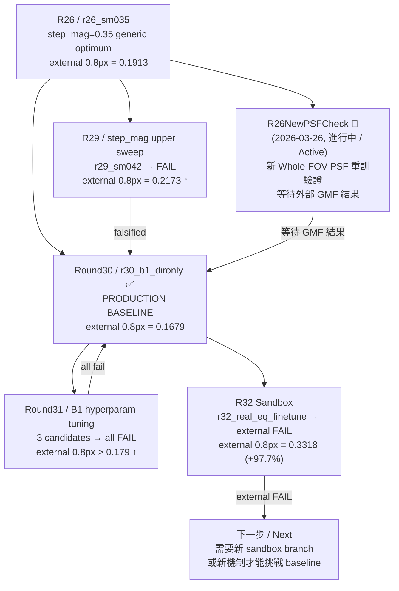

# GMM_2_Final

這份文件是整個專案的**入口總覽**。如果你是第一次接觸這個專案，從這裡開始讀。
This is the top-level overview for the project. If you are new, start here.

---

## 目錄 / Table of Contents

1. [專案是在做什麼 / What This Project Does](#專案是在做什麼--what-this-project-does)
2. [核心名詞速查 / Key Terminology](#核心名詞速查--key-terminology)
3. [目前狀態快照 / Current Status Snapshot](#目前狀態快照--current-status-snapshot)
4. [完整文件閱讀順序 / Canonical Reading Order](#完整文件閱讀順序--canonical-reading-order)
5. [目錄結構 / Directory Structure](#目錄結構--directory-structure)
6. [系統整體流程 / System Pipeline Overview](#系統整體流程--system-pipeline-overview)
7. [研究歷程圖 / Research Path Overview](#研究歷程圖--research-path-overview)
8. [升級 baseline 的條件 / Baseline Promotion Rules](#升級-baseline-的條件--baseline-promotion-rules)
9. [分支策略 / Branch Strategy](#分支策略--branch-strategy)
10. [文件同步政策 / Sync Policy](#文件同步政策--sync-policy)
11. [文件導覽 / Docs Navigation](#文件導覽--docs-navigation)

---

## 專案是在做什麼 / What This Project Does

### 白話版說明

這個專案的目標是：讓顯微鏡拍攝的環形結構（annulus）影像，在做幾何定位時能更加精準。

更具體地說——
顯微鏡拍出來的影像因為光學模糊（PSF 效應），邊界形狀會失真。我們訓練一個 AI 超解析模型（`GeoEdgeAlignSR`），讓它把這層模糊還原，並讓還原後的影像「更有利於下游幾何匹配工具（GMF）定位環形邊界」。

**重要：這不是普通的影像銳化專案。** 視覺上「看起來更清晰」不等於「幾何定位更準」。我們最終衡量的是：在 GMF 外部評分工具打分時，annulus 邊界的定位標準差（step std）能否降低。

### Technical Version

The goal is to improve the geometric localization accuracy of annulus boundary images captured by a microscope, by training a physics-informed deep learning super-resolution model.

The optimization target is not generic visual sharpness.
It is: **whole-annulus GMF geometry** — how well the reconstructed image supports the downstream geometric matching function (GMF) in localizing the annulus boundary at multiple displacement scales.

Key performance metrics (all from the external GMF evaluator):

| Scale | What It Tests | Primary Status |
|-------|--------------|----------------|
| `8px` macro | Large-scale tracking stability guard | Must not regress |
| `0.8px` mid | **Main battlefield** — medium-scale precision | Hard improvement target |
| `0.08px` tiny | Sub-pixel precision | Useful but not decisive alone |

---

## 核心名詞速查 / Key Terminology

| 名詞 | 白話解釋 / Plain Explanation |
|------|------------------------------|
| **PSF（點擴散函數）** | 顯微鏡光學模糊的數學描述。PSF 越準確，模型去模糊越有依據。<br>Mathematical description of the microscope's optical blur. Accurate PSF = better deblurring. |
| **GMF（幾何匹配函數）** | 外部幾何定位評分工具。GMF 分越好（step std 越小），代表模型輸出對邊界定位越有幫助。<br>External geometric evaluator. Lower step std = better boundary localization. |
| **external compare** | 用訓練好的模型重建真實影像後，送 GMF 打分，與 baseline 比較的最終驗收流程。<br>The final acceptance test: reconstruct real images, run GMF, compare with baseline. |
| **internal audit** | 在合成資料上做的初篩稽核（pairmix_algblend、edge_band_refine 探針）。通過 internal audit 是必要條件，但不等於外部成功。<br>A synthetic-data screening step. Necessary but not sufficient. |
| **baseline / r30_b1_dironly** | 目前唯一正式的 production baseline，是 Round30 訓練出的「只保留方向性特徵（dironly）的 B1 架構版本」。<br>The current formal production baseline from Round 30. |
| **checkpoint（.pth.tar）** | 模型訓練途中儲存的參數快照。`best_tradeoff.pth.tar` 是整體指標最均衡的那份。<br>A saved snapshot of model weights. `best_tradeoff.pth.tar` is the primary checkpoint used. |
| **sandbox** | 隔離的實驗目錄，讓新的研究方向不影響主線穩定工作流程。<br>An isolated experiment directory, keeping research changes away from the stable mainline. |
| **step std** | 連續幀之間位移差的標準差。越小 = 定位越穩定。<br>Standard deviation of displacement differences between frames. Smaller = more stable localization. |
| **Whole-FOV PSF** | 對全視野（FOV）100 個格點位置各自擬合出的 PSF 集合。<br>A 10×10 grid of fitted PSFs covering the full field of view. |

---

## 目前狀態快照 / Current Status Snapshot

> 以下數字為截至 2026-04-08 的最新狀態。詳細資料請看 `PROJECT_CURRENT_STATE.md`。
> Numbers below are current as of 2026-04-08. For full detail, see `PROJECT_CURRENT_STATE.md`.

### 正式 Baseline / Production Baseline

**`Round30 / r30_b1_dironly`** — 正式 production baseline（兩個升級候選待定）

| 指標 / Metric | R30 baseline | R33 p95（極致型） | R38v2（視覺優先） | COMBO（最均衡） |
|--------------|-------------|------------------|-----------------|---------------|
| external `0.8px` step std | **`0.168`** | **`0.119`** (-29%) | `0.134` (-20%) | **`0.132`** (-22%) |
| external `8px` step std | `0.205` | `0.153` | **`0.144`** (-30%) | `0.155` (-25%) |
| external `0.08px` step std | `0.158` | **`0.086`** (-45%) | `0.106` (-33%) | **`0.100`** (-37%) |
| Edge steepness (vs R30) | baseline | -22% | **+89%** | **+89%** |
| Contrast std | 34.6 | 26.5 (-24%) | 30.9 (-11%) | **32.4** (-7%) |
| Residual_std (0.8px inner) | 2.89 | 2.68 | 3.19 | **2.04** (-29%) |

### 研究歷程最新結論 / Latest Research Verdicts

| Round | 結論 / Verdict |
|-------|---------------|
| **R30** | ✅ **現 production baseline**；B1 dironly 機制首次在主戰場超越 R26 |
| **R31** | ❌ B1 hyperparam 微調三個候選均外部退步 |
| **R32** | ❌ domain rebalancing 外部 `0.8px` 退步 +97.7% |
| **R33** | ✅ **GMF 極致型候選**：Winsorize spatial loss → 0.8px -30%，但視覺銳度 -22% |
| R34/R35/R37 | ❌ 三輪嘗試恢復銳度全部失敗（freq-split / alpha-boost / freq-reg） |
| **R38v2** | ✅ **均衡型候選**：Seq training (8px-only + signal gate + warmup) → 0.8px -20% + steepness +89% |

### 三個生產候選 / Three Production Candidates

**R33 p95**（GMF 極致型）：0.8px **-29%**，但視覺銳度退步 22%。適合純 GMF 定位場景。

**R38v2 8px_gate**（視覺優先型）：0.8px -20%，steepness **+89%**。適合需要人眼判讀的場景。

**COMBO r38v2_8px_gate_p95**（最均衡型）：0.8px **-22%**，steepness **+89%**，residual_std **歷史最佳**（-29% vs R30）。同時兼顧 GMF 精度和視覺品質。

完整實驗系列報告：`Experiments/R33RobustLoss/reports/R33_R38v2_COMPLETE_EXPERIMENT_SERIES.md`

### 下一個決策邊界 / Next Decision Boundary

三個候選都已通過 `external 0.8px < 0.167862` 的硬邊界。
量化修復已完成。下一步是選擇生產候選並執行架構重構。

---

## 完整文件閱讀順序 / Canonical Reading Order

接手時依這個順序讀，可以在最短時間內建立完整上下文：
Read in this order when taking over the project:

| 步驟 | 文件 | 目的 |
|------|------|------|
| 1 | `PROJECT_SESSION_CONTINUITY.md` | 跨入口 handoff，三分鐘掌握目前狀況 / Cross-interface handoff in 3 minutes |
| 2 | `PROJECT_CURRENT_STATE.md` | 目前數字與結論的完整真相 / Full current numbers and verdicts |
| 3 | `PROJECT_ARCHITECTURE_AND_DECISION_MAP.md` | 穩定架構規則、決策邊界 / Stable rules and decision boundaries |
| 4 | `docs/history/PROJECT_FULL_HISTORY_AND_STRATEGY_20260312.md` | 只有需要完整歷史時再看 / Only if you need the full historical narrative |

快速索引：

- 想快速接手 → `PROJECT_SESSION_CONTINUITY.md`
- 想知道現在數字 → `PROJECT_CURRENT_STATE.md`
- 想知道穩定規則 → `PROJECT_ARCHITECTURE_AND_DECISION_MAP.md`
- 機器可讀 baseline policy → `ESTIMATOR_POLICY.json`
- 補完整歷史 → `docs/history/PROJECT_FULL_HISTORY_AND_STRATEGY_20260312.md`

---

## 目錄結構 / Directory Structure

```text
D:\GMM_2_Final\
│
├── README.md                          ← 你現在在看這份（入口總覽）
├── PROJECT_SESSION_CONTINUITY.md      ← 跨入口 handoff 文件
├── PROJECT_CURRENT_STATE.md           ← 目前狀態與最新數字
├── PROJECT_ARCHITECTURE_AND_DECISION_MAP.md  ← 穩定架構與決策規則
├── ESTIMATOR_POLICY.json              ← 機器可讀 baseline policy
├── REPO_GOVERNANCE.md                 ← Git/GitHub 治理規則
├── CONTRIBUTING.md                    ← 貢獻指南
├── AGENTS.md                          ← AI agent 協作規則
├── CLAUDE.md                          ← Claude Code 設定
│
├── Model/                             ← AI 模型核心（訓練 + 推論）
│   ├── README.md                      ← Model 模組完整說明
│   ├── GeoEdgeAlignSR_v1_ModelA_v5_NoCoord.py     ← 模型定義
│   ├── GeoEdgeAlignSR_v1_Train_*.py               ← 訓練入口
│   ├── GeoEdgeAlignSR_v1_Infer_*.py               ← 推論入口
│   ├── GeoEdgeAlignSR_v1_AutoTuneTrain.py         ← 超參數自動掃描
│   ├── GeoEdgeAlignSR_v1_ExternalGMF*.py          ← 外部 GMF 比較腳本群
│   ├── GeoEdgeAlignSR_v1_ProcessProbeAudit.py     ← 內部探針稽核
│   ├── GeoEdgeAlignSR_v1_Utils.py                 ← 工具函式庫
│   └── Test_Image/                                ← 單張快速測試圖
│
├── PSF_Fitting/                       ← PSF 擬合流程（MATLAB）
│   ├── README.md                      ← PSF 模組完整說明
│   ├── HDR_fitting_2D.m               ← 單張影像 PSF 擬合
│   ├── HDR_fitting_2D_WholeFOV.m      ← 全 FOV 批次 PSF 擬合（推薦正式入口）
│   ├── HDR_fitting_2D_WholeFOV_impl.m ← 正式版核心實作
│   ├── visualize_fitted_psf_grid.m    ← PSF grid 視覺化輔助
│   ├── SimulatePSF/                   ← 理論 PSF 模擬（Gibson-Lanni 模型）
│   ├── Crop_circle_FreqFiltered/      ← 全 FOV 批次擬合輸入影像與輸出
│   │   └── Fits/                      ← ★ 正式 PSF 輸出（PSF_fitted_2D_FOVstack.mat）
│   ├── SingleImage_Input/             ← 單張版擬合輸入
│   ├── Deconvolution/                 ← Wiener 反捲積驗證
│   ├── PSF_Report_Helper/             ← 報告輔助工具
│   ├── PSF_Fitting_ValidationLab/     ← Whole-FOV 修正驗證歷史
│   ├── tests/                         ← MATLAB/Python 測試集中區
│   └── legacy/                        ← 舊版主程式封存
│
├── Tools/                             ← 執行輔助腳本（PowerShell）
│
├── AnalysisLab/                       ← 常駐分析資料入口（版本優先；single_image / sequence）
│   ├── README.md
│   └── r26/
│
├── Experiments/                       ← 獨立實驗 sandbox 區
│   ├── R32Sandbox/                    ← Round32 隔離沙盒（external FAIL，已關閉）
│   │   ├── README.md
│   │   ├── Model/                     ← R32 專用訓練/稽核腳本
│   │   ├── Tools/                     ← R32 專用啟動腳本
│   │   ├── runtime/                   ← 即時執行狀態（R32_STATUS.md/.json）
│   │   ├── artifacts/                 ← 訓練輸出（.gitignore 追蹤）
│   │   ├── reports/                   ← 稽核報告與決策備忘
│   │   └── external_compare/          ← 外部比較中間產物
│   │
│   └── R26NewPSFCheck/                ← Round26 新 PSF 驗證沙盒（2026-03-26，進行中）
│       ├── README.md
│       └── ...
│
├── Training_Data/                     ← 訓練資料（不追蹤）
│   ├── tra_src_ring/                  ← 輸入影像（量測圖）
│   └── tra_lbl_ring/                  ← Ground Truth 影像
│
├── Traing_Progress/                   ← 訓練輸出（不追蹤；注意拼字）
│   └── organized_20260316/            ← 整理後的 round 選取記錄
│
├── docs/                              ← 研究文件與證據庫
│   ├── README.md
│   ├── analysis/                      ← 研究路徑圖、決策總覽
│   ├── evidence/                      ← 精選正式證據副本
│   ├── history/                       ← 完整歷史敘事
│   ├── index/                         ← 文件責任邊界與導航索引
│   ├── policy/                        ← 正式政策文件（PSF policy 等）
│   │   ├── PSF_POLICY_TRANSITION_R26.md  ← R26 PSF 政策切換說明（2026-03-27）
│   │   └── PSF_STANDARD_POLICY.json      ← 機器可讀 PSF policy
│   └── runtime/legacy/                ← 已追蹤的 legacy root status 快照
│
└── _deployment_package/               ← R26 正式交付封包（不追蹤）
```

> **注意**：`Traing_Progress/` 資料夾名稱故意保留拼字錯誤（少一個 i），這是歷史遺留，所有程式都依賴這個路徑，請勿更名。
> **Note**: The `Traing_Progress/` folder name has a known typo (missing one `i`). This is intentional for historical compatibility — all scripts depend on this exact name.

---

## 系統整體流程 / System Pipeline Overview

整個系統由三個主要模組組成，環環相扣：
The system has three interlocking modules:

```
┌──────────────────────────────────────────────────────────────────────────────┐
│  STEP 0：PSF 擬合 / PSF Fitting（MATLAB）                                     │
│                                                                              │
│  顯微鏡影像 ──▶ [BADS 最佳化 + Zernike 像差模型] ──▶ PSF_fitted_2D_FOVstack.mat │
│                                                                              │
│  入口：PSF_Fitting/HDR_fitting_2D_WholeFOV.m                                 │
│  輸出：PSF_Fitting/Crop_circle_FreqFiltered/Fits/PSF_fitted_2D_FOVstack.mat  │
└─────────────────────────────────┬────────────────────────────────────────────┘
                                  │ 讀取 PSF / reads PSF
                                  ▼
┌──────────────────────────────────────────────────────────────────────────────┐
│  STEP 1：模型訓練 / Model Training（Python + PyTorch）                         │
│                                                                              │
│  訓練影像 + PSF ──▶ [GeoEdgeAlignSR U-Net + Wiener 物理層] ──▶ checkpoint     │
│                                                                              │
│  模型特色：                                                                   │
│    • PSFDeconvPhysics：在 U-Net 前做 Wiener 反捲積（物理先驗）               │
│    • WeakPSFDeconvBlock：Decoder 端軟混合多 PSF 去模糊注入                   │
│    • ShiftSafeUpsample：Anti-aliasing 上採樣，抑制 checkerboard             │
│    • OpticalBandpassFilter：訓練期限制超物理頻率（推論時自動關閉）           │
│                                                                              │
│  入口：Model/GeoEdgeAlignSR_v1_Train_v5_NoCoord_return_v2_SimpleTest.py     │
│  輸出：Traing_Progress/training_progress_{...}/weights/best_tradeoff.pth.tar │
└─────────────────────────────────┬────────────────────────────────────────────┘
                                  │
                    ┌─────────────┴─────────────┐
                    │                           │
                    ▼                           ▼
┌─────────────────────────┐     ┌────────────────────────────────────────────┐
│  STEP 2A：Internal Audit │     │  STEP 2B：External GMF Compare            │
│  （內部探針稽核）          │     │  （外部真實資料驗收）                        │
│                          │     │                                            │
│  合成資料探針：           │     │  1. 用 checkpoint 重建 NTU 真實影像        │
│  • 0.8px pairmix probe  │     │  2. 送 GMF 工具計算 step std               │
│  • 8px guard probe      │     │  3. 與 baseline 比較 3 個 pitch 尺度       │
│                          │     │                                            │
│  通過 = 有資格進外部驗收  │     │  **唯一最終裁判** — 不可被 internal 取代   │
│  未通過 = 直接淘汰       │     │  通過 → 升級 baseline                      │
│                          │     │  失敗 → 保留現 baseline，不得升級          │
└─────────────────────────┘     └────────────────────────────────────────────┘
```

### 訓練 Loss 組成（模型不只學視覺銳利度）

| Loss 項目 | 權重 | 說明 |
|----------|------|------|
| 像素重建（L1/MSE） | 1.0 | 基礎重建品質 |
| 梯度幅值（Sobel） | 0.8 | 邊緣對比保真 |
| 邊緣方向一致性 | 0.3 | 防止邊緣方向漂移 |
| 平移等變幾何（EQ） | 0.5 | 讓模型對 sub-pixel 平移保持幾何一致 |
| 統計/頻帶一致性 | 0.10+0.10 | 整體統計特性穩定 |
| 高頻 Laplacian | 0.15 | 細節恢復 |

---

## 研究歷程圖 / Research Path Overview

完整圖請看 `docs/analysis/RESEARCH_PATHS.md`。
See `docs/analysis/RESEARCH_PATHS.md` for the fuller research-path map.

以下是從 R26 基準線到目前狀態的最短路徑：
Below is the shortest path from the R26 baseline to the current state:



### 已確認有效的方向 / Confirmed Effective

- `pairmix_algblend`（`0.8px` 主戰場 estimator）→ R25/26/30 外部驗證支持
- `B1 dironly` 機制 → Round30 外部驗證支持
- `center_err` 作為 Tier-2 screening 指標（不能取代外部驗收）

### 已確認失敗的方向 / Confirmed Falsified

- `step_mag < 0.35` downsweep
- `step_mag > 0.35` upper sweep（R29）
- TTA C2（`r26_tta_cross5`）
- A1 / A5 / S1 side-directions
- Round31 B1 hyperparam 微調（全部外部退步）
- Round32 real_eq finetune（外部主戰場 +97.7%）

---

## 升級 Baseline 的條件 / Baseline Promotion Rules

只有**同時**滿足以下四個條件，才能把新候選升級為 production baseline：
All four conditions must be met simultaneously to promote a new candidate:

1. **Internal calibrated gate 通過**
   `pairmix_algblend` 探針 `mid_center ratio > 0.25` 且 `mid_step < 0.45`；
   `edge_band_refine` 探針 `macro_step < 0.2995` 且 `macro_seq_sign > 0.7559`

2. **External `0.8px step std < 0.167862`**（當前硬邊界）
   在主戰場明確不差於現 baseline

3. **`8px` macro guard 不明顯退步**
   大尺度穩定性不能為了換主戰場而犧牲

4. **若 side-scale 有 trade-off，必須有明確工程理由**
   `0.08px` 改善不能補償主戰場退步

### 何時值得開新 Round / When to Start a New Round

**值得開的情況**：
- 有一個與現有失敗分支不同的新機制假說
- 在已成功主線上做可驗證、成本合理的微調
- 比較對象明確包含現 baseline

**不應再開的情況**：
- 重掃已否定的 `step_mag` 範圍
- 重開 Round23/24 型 fine-tune abs/anchor branch
- 只靠 internal gate 預設 external 會變好

---

## 分支策略 / Branch Strategy

```
main
 └── 當前整理後的 shared mainline

baseline/*
 └── 已核准的 baseline 里程碑（受保護的 reference namespace，不是日常開發分支）

reconstructed/*
 └── 建立在 curated import 之上的 evidence-backed governance/reference branches

research/*
 └── 新研究與策略嘗試的主要分支類型

sandbox/*
 └── 已隔離的實驗面（例如 R32Sandbox）

codex/*
 └── AI agent 工作分支
```

**重建規則**：
- reconstructed branch 必須明確標示為 reconstructed（不是原始歷史快照）
- 本 repo 不偽造不存在的原始 git 歷史
- 新研究工作預設使用 `research/*` 或 `sandbox/*`

詳見 `REPO_GOVERNANCE.md` 與 `docs/index/PROJECT_DOCUMENT_INDEX.md`。
See `REPO_GOVERNANCE.md` and `docs/index/PROJECT_DOCUMENT_INDEX.md` for the fuller governance map.

GitHub 研究控制台：`https://github.com/users/rio10255254/projects/1`
新實驗單頁 SOP：`docs/index/NEW_EXPERIMENT_SOP.md`
證據鏈：`docs/evidence/EVIDENCE_MAP.md`

---

## 文件同步政策 / Sync Policy

這個 GitHub 倉庫是**研究程式碼與正式文件的治理面**，不是磁碟內容的完整鏡像。
This repository is the governance surface for research code and formal documentation — not a full disk mirror.

### 應該同步 / Should Sync

- 原始碼（`Model/`、`Tools/`、`PSF_Fitting/`、`Experiments/*/Model/`）
- root canonical docs 與 policy 檔（`PROJECT_*.md`、`ESTIMATOR_POLICY.json`、`REPO_GOVERNANCE.md`）
- 重大 branch 建立與治理調整
- baseline / verdict / active direction 變更
- `docs/` 內的導航、歷史、分析、證據層、curated legacy copies
- 小型、可核對的 canonical sample fixtures（如 `Model/Test_Image/VisionTop_*.bmp`）

### 不應同步 / Should Not Sync

- `Traing_Progress/`（訓練輸出）
- `Training_Data/`（訓練資料）
- `_deployment_package/`（交付封包）
- `weights/`、`artifacts/`、`logs/`、`reconstructions/`、`gmf_results/` 等 bulk 子目錄
- root 再生成的 `000_LONGRUN_*` runtime outputs

---

## 文件導覽 / Docs Navigation

```text
docs\
├── README.md
├── analysis\
│   └── RESEARCH_PATHS.md              ← 完整研究路徑圖
├── evidence\
│   ├── README.md
│   ├── EVIDENCE_MAP.md                ← 哪份證據支撐哪個結論
│   ├── baseline\                      ← baseline 正式證據
│   ├── historical_baselines\
│   ├── falsified\                     ← 被否定的方向證據
│   ├── side_directions\
│   ├── analysis\
│   └── runtime\
├── history\
│   └── PROJECT_FULL_HISTORY_AND_STRATEGY_20260312.md
├── index\
│   ├── PROJECT_DOCUMENT_INDEX.md      ← 文件責任邊界與導航
│   └── NEW_EXPERIMENT_SOP.md          ← 新實驗標準流程
└── runtime\legacy\
    └── root_status\                   ← 已追蹤的 legacy root 狀態快照
```

| 路徑 | 用途 |
|------|------|
| `docs/analysis/` | 研究路徑圖、GitHub 可視化入口 |
| `docs/evidence/` | 小型正式證據層，可核對、可引用 |
| `docs/history/` | 完整歷史敘事，不需要每次都看 |
| `docs/index/` | 文件責任邊界與新實驗 SOP |
| `docs/policy/` | 正式政策文件（PSF 政策切換等） |
| `docs/runtime/legacy/` | 已追蹤的 legacy root status 快照，不是 canonical runtime truth |

---

## 工作流程規則 / Operating Rules

新接手的 assistant / agent 請遵守：
When a new assistant or agent takes over, follow these rules:

1. **先讀 `PROJECT_SESSION_CONTINUITY.md` 與 `PROJECT_CURRENT_STATE.md`**
   以 repo 正式文件為準，不以 `.codex` 或 `.claude` 內部 session 檔為準。

2. **不要把 live process 狀態手抄回 root prose**
   sandbox runtime 真相在 `Experiments\R32Sandbox\runtime\R32_STATUS.md`。

3. **legacy root status 快照在 `docs/runtime/legacy/root_status/`**
   若 root 再出現 `000_LONGRUN_*`，視為本地 runtime 輸出，不是 canonical docs。

4. **baseline / verdict 有變時，優先更新 `PROJECT_CURRENT_STATE.md` 與 `PROJECT_SESSION_CONTINUITY.md`**

5. **已 external FAIL 的候選不能再被描述成 current promising line**
   `r32_real_eq_finetune` 已是 externally falsified experimental branch。

6. **機器可讀 baseline truth 唯一來源是 `ESTIMATOR_POLICY.json`**
