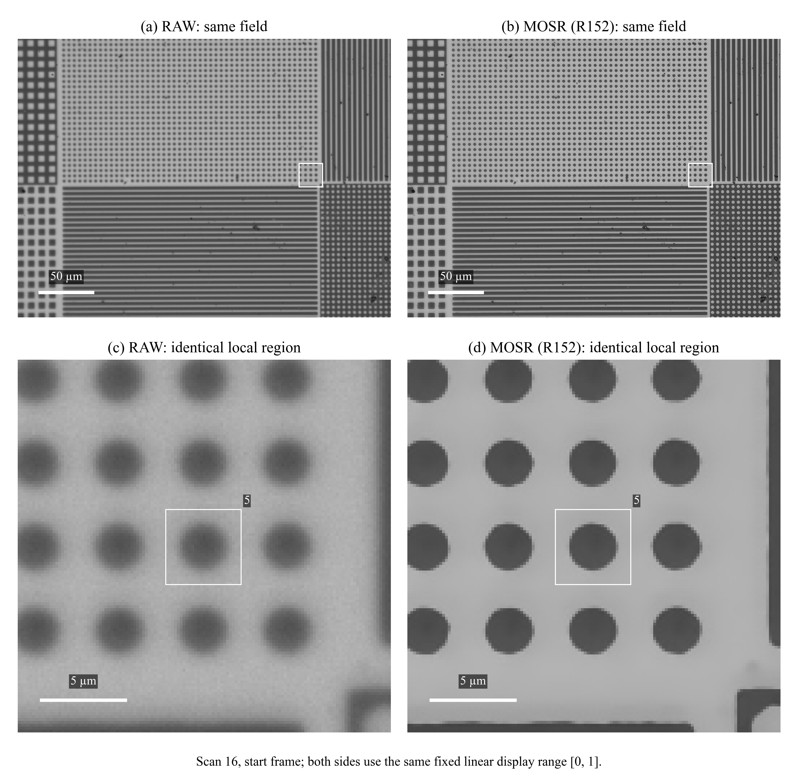
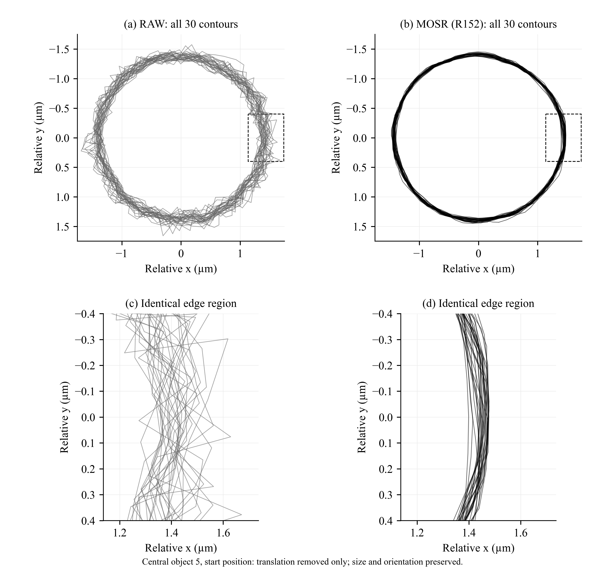

# MOSR：讓顯微鏡量位移量得更穩

顯微鏡拍出來的邊緣永遠是一圈糊。量測軟體要靠邊緣找出「圓在哪裡」，邊緣一糊，每次量出來的位置就會差一點點。平台每次只移動 1 µm、要分辨的差異是奈米等級的時候，這一點點就成了誤差的主要來源。

這個研究訓練一個神經網路，把顯微影像的模糊邊緣還原回來。**目的不是讓圖變好看，而是讓位移、尺寸、輪廓每次量出來都更一致。** 論文裡這個模型叫 **MOSR**（專案內部編號 R152）。



*同一張實拍照片。左：相機原圖（RAW）；右：MOSR 還原後。下排把同一塊區域放大，圓柱邊緣從一圈糊變成清楚的邊界。兩邊用同樣的亮度範圍顯示。*

## 怎麼做的

1. **先量出這台顯微鏡怎麼糊。** 拍一個極小的點，它在照片上會變成一小團糊，這團糊的形狀叫 PSF（點擴散函數）。視野裡不同位置糊法不一樣，所以量了很多個位置（`PSF_Fitting/`）。
2. **自己出練習題。** 用程式畫出邊緣清楚的圖，再照量到的 PSF 把它弄糊、加上雜訊，做成大量「糊圖 → 清楚圖」的配對。
3. **訓練模型。** 讓神經網路學會從糊圖還原清楚的圖。
4. **拿真的照片考試。** 把真實照片還原後，交給一支獨立的量測程式找圓心和輪廓，再跟兩個參考答案比：位移平台自己回報的位置（PI），以及電子顯微鏡（SEM）量到的實際尺寸。

```text
量出 PSF ─┬─► 把清楚的合成圖弄糊 → 練習題 → 訓練模型
          └─► 也放進模型裡當物理知識
真實照片 → 模型還原 → 獨立量測程式找圓心、輪廓 → 跟平台位置（PI）、電子顯微鏡尺寸（SEM）比
```

## 結果

論文用 930 張實拍照片考試：同一片樣品重複拍 30 趟，每趟 31 個位置，每步移動約 1 µm。比較的對象是沒有經過任何處理的相機原圖（RAW）。



*同一顆圓柱、30 次拍攝量出的 30 條輪廓。左：用原圖量，輪廓散成一大圈；右：用 MOSR 還原後量，30 條幾乎疊在一起。下排是同一段邊緣放大。*

| 量什麼（單位 nm，越小越穩） | 白話意思 | RAW | MOSR |
|---|---|---:|---:|
| 單趟 30 步合併波動（主要指標） | 平台每步移一樣的距離，量出來的步距有多不一致 | 8.781 | **4.273**（−51.3%，30 趟全部變好） |
| 相鄰步對平台的平均差 | 量到的每一步，跟平台自己回報的步距差多少 | 6.969 | **3.598**（−48.4%） |
| 直徑重拍波動 | 同一顆圓柱拍 30 次，量到的直徑差多少 | 32.750 | **13.252** |
| 輪廓重拍波動 | 同一顆圓柱拍 30 次，量到的輪廓差多少 | 63.758 | **18.600** |
| 跟電子顯微鏡直徑的平均差 | 量到的直徑跟 SEM 量的真實尺寸差多少 | 169.883 | 204.281（**變差**） |

**要一起記住的限制：**

- **更穩不等於更準。** 每次量得更一致，但量到的直徑跟電子顯微鏡的答案反而差更多。
- 長距離的位移沒有明顯改善。
- MOSR 裡「多個 PSF 融合」那一塊實際作用很小，效果主要來自它的底座模型 R148v2。
- 電子顯微鏡的量測和這片樣品，曾經用在光學校正上，所以不算完全獨立的驗證。
- 全部是同一片樣品、同一個時段拍的。

位移是九顆圓柱位移的算術平均，這是口試委員建議後的算法。R152 最早的紀錄用中位數（RAW 10.200 → 4.865，−52.3%），論文不再沿用，兩種算法的數字不能放在一起比（[比較說明](Experiments/R153_MeanExternalBenchmark/reports/MEAN_MEDIAN_RESULTS.md)）。另外還跟八種現成的影像還原方法比過（Wiener、EDSR、NAFNet、RDN、RCAN、Restormer、USRNet、SwinIR），MOSR 在三個主要指標的數值都最低；但各方法的訓練量不一樣，這不代表其他方法已經練到最好。完整數字和限制在 [PROJECT_STATE.md](PROJECT_STATE.md)，論文交接在 [R153 報告](Experiments/R153_MeanExternalBenchmark/reports/FINAL_BENCHMARK_THESIS_HANDOFF/REPORT.md)。

## 兩個「目前的模型」

這個專案同時服務兩件事，所以有兩個答案，兩者不衝突：

| 用途 | 目前的模型 | 用什麼考 |
|---|---|---|
| **合作廠商的量測部署** | **COMBO**（2026-04-08 起的正式基準；在它之前，歷史前任 baseline 是 R30） | 環形影像交給廠商固定、不能修改的定位工具（GmmVisionTool 的 GMF），看三種位移大小下的穩定度。交付成 ONNX 模型包，放在 `Deliverables/Company_Packages/`；之後的 ONNX 交付用均華 202 張實拍驗證過（`Deliverables/Validations/MOSR_ONNX_JunHua/`） |
| **論文** | **MOSR（R152）**，對照 RAW | 上面那 930 張實拍 |

R152 沒有取代 COMBO 在廠商端的正式身分。兩個模型的正式紀錄寫在 [ESTIMATOR_POLICY.json](ESTIMATOR_POLICY.json)。

## 東西在哪

| 資料夾 | 裡面是什麼 |
|---|---|
| [Experiments](Experiments/README.md) | 每一輪實驗一個資料夾（R26 到 R153），各自有程式、設定、報告、結果。另外 `Legacy/` 是早期的訓練與選模，`Training_Runs/` 是每次訓練留下的紀錄 |
| [Model](Model/README.md) | 第一代共用模型：訓練、還原（推論）、自動調參的程式 |
| [PSF_Fitting](PSF_Fitting/README.md) | 量出顯微鏡怎麼糊的光學校正（MATLAB） |
| [Shared_Sources](Shared_Sources/README.md) | 換不回來的原始資料：相機原拍、平台紀錄、電子顯微鏡量測 |
| [LabSystem_MOSR](LabSystem_MOSR/README.md) | 換到實驗室自己那台顯微鏡之後的整條研究線 |
| [Thesis_MOSR_Evidence](Thesis_MOSR_Evidence/README.md) | 論文用到的證據與跨模型比較 |
| [Analyses](Analyses/README.md) | 不屬於單一輪、好幾輪共用的實拍分析 |
| [Deliverables](Deliverables/README.md) | 拿出去就能用的包：廠商部署包、論文交接、獨立模型、資料重新生成器 |
| [Training_Data](Training_Data/README.md) | 第一代訓練資料的生成程式（影像本身不放 git） |
| [Archive](Archive/README.md) | 不再日常使用、但留著當時樣子的舊資料夾 |
| [Tools](Tools/README.md)、[docs](docs/README.md) | 工具程式與說明文件 |

2026-10-28 整理過一次資料夾，原本散在最上層的二十幾個資料夾收進上面這些位置。舊報告和舊紀錄裡還會看到當時的路徑（例如 `Traing_Progress`），新舊對照在[整理紀錄](docs/operations/TREE_RESTRUCTURE_20261028.md)。

## 想做什麼，就讀哪裡

| 我想… | 讀這份 |
|---|---|
| 知道現在用哪個模型、結果、還缺什麼 | [PROJECT_STATE.md](PROJECT_STATE.md) |
| 理解系統怎麼設計、怎麼判斷一個模型好不好 | [PROJECT_ARCHITECTURE.md](PROJECT_ARCHITECTURE.md) |
| 看研究怎麼一路走到現在、某一輪做了什麼 | [逐輪閱讀](docs/reproducibility/EXPERIMENTS.md)、[研究沿革](docs/reproducibility/lineage/README.md) |
| 看不懂縮寫（PSF、GMF、PI、SEM、RAW…） | [名詞表](docs/README.md#名詞表) |
| 找某個檔案、原始照片或模型 | [專案地圖](docs/navigation/PROJECT_MAP.md)、[模型指南](docs/reproducibility/MODEL_GUIDE.md) |
| 改論文 | [R153 論文交接](Experiments/R153_MeanExternalBenchmark/reports/FINAL_BENCHMARK_THESIS_HANDOFF/REPORT.md) |
| 開新實驗或維護這個 repo | [維護說明](docs/operations/README.md) |

## 從 GitHub 接手

原本那台電腦之後會交給別人，從此這個 GitHub 頁面（程式加上 Releases 裡的附件）就是這個專案唯一完整的家。接手時三步：

1. **取得程式**：照[入門指南](docs/reproducibility/GETTING_STARTED.md)的 `git clone` 指令。程式會從自己所在的位置找專案根目錄，放在哪個資料夾都能跑。
2. **準備 Python 環境**：照你要跑的那一輪或那個交付包自己的 `requirements.txt` 安裝。全專案沒有一份共用的環境檔，因為不同輪次用的套件版本不同。光學校正要 MATLAB，廠商那支 GMF 量測工具要另外取得。
3. **只取需要的大檔案**：原始照片、模型、資料放在 Releases 的附件裡，不用整套下載。先跑 `python Tools/cloud_locator.py build` 抓下各附件的清單，再用 `python Tools/cloud_locator.py where <專案內路徑>` 查某個檔案在哪個附件，最後用 `gh release download` 取回。該拿哪些看[按用途取得](docs/reproducibility/ASSET_GUIDE.md)。

## 保存狀態

照片、模型、資料都放在 Releases 附件裡，用到再下載。已知的缺口：

- R63 少一個原本選中的模型。
- 主專案的 R36 找不到。
- 有些程式還寫著原電腦上 H 槽的位置。

完整清單在 [PROJECT_STATE.md](PROJECT_STATE.md) 和[缺件說明](docs/reproducibility/KNOWN_GAPS.md)。

## English summary

MOSR is a master's thesis project on restoring blurred optical-microscope images so that nanometre-scale measurements of displacement, size and contour become more repeatable. The model learns from synthetic image pairs blurred with the microscope's measured point-spread functions, then is tested on 930 real images (30 scans × 31 positions, about 1 µm per step). Compared with the raw camera images, the main step-repeatability measure drops from 8.781 nm to 4.273 nm (−51.3%), and diameter and contour repeatability improve as well. More repeatable is not more accurate, though: the mean difference from SEM diameters grows from 169.883 nm to 204.281 nm. The documentation is in Traditional Chinese. [PROJECT_STATE.md](PROJECT_STATE.md) holds the current figures and limits, and the Releases hold the raw images, models and data.

> 這一頁在 2026-10-31 用更直白的方式重寫過，[改寫前的版本](https://github.com/rio10255254/GMM_2_Final/blob/957fe6285840762ef2491d7d3b26a1539caf4e46/README.md)保留在 git 歷史裡；更早 2026-10-24 改寫前的原文在 [docs/history/BEFORE_PLAIN_REWRITE_20261024/](docs/history/BEFORE_PLAIN_REWRITE_20261024/README.md)。較早的執行狀態檔在 `docs/archive/legacy_runtime_status/`。
