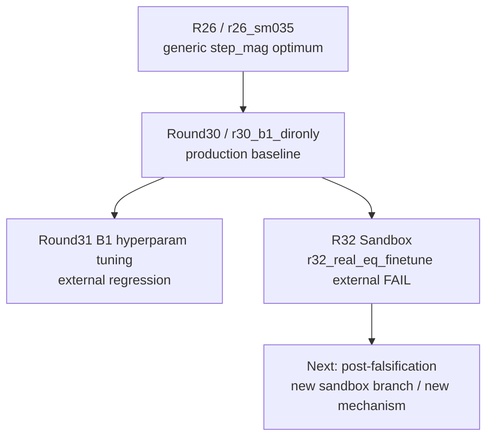

# GMM_2_Final

## Canonical Reading Order

新接手時，只看這四份：

1. `PROJECT_SESSION_CONTINUITY.md`
2. `PROJECT_CURRENT_STATE.md`
3. `PROJECT_ARCHITECTURE_AND_DECISION_MAP.md`
4. `docs/history/PROJECT_FULL_HISTORY_AND_STRATEGY_20260312.md`（只有需要完整歷史時再看）

定位規則：

- 想快速接手：看 `PROJECT_SESSION_CONTINUITY.md`
- 想知道現在真相：看 `PROJECT_CURRENT_STATE.md`
- 想知道穩定規則：看 `PROJECT_ARCHITECTURE_AND_DECISION_MAP.md`
- 想補完整歷史：最後看 `docs/history/PROJECT_FULL_HISTORY_AND_STRATEGY_20260312.md`

## One-Screen Snapshot

- production baseline 仍是 `Round30 / r30_b1_dironly`
- `Round32` 已切到 `Experiments/R32Sandbox/`
- `Round32` internal winner `r32_real_eq_finetune` 已完成 external compare，結論是 **FAIL**
- 若要續做 `R32`，下一步必須是新的 sandbox branch / 新機制，不是延用這個 winner

## Project Goal

這不是一般影像增強專案。

真正目標是：

- 對 annulus 邊界做可定位的幾何重建
- 讓固定 external GMF 在不同位移尺度下都能穩定定位

工程上真正優化的不是「看起來更銳利」，而是 **whole-annulus geometry 是否更對 external GMF 友善**。

## Root Surface

root 現在只保留**入口層**與**治理層**：

```text
D:\GMM_2_Final\
├── README.md
├── PROJECT_SESSION_CONTINUITY.md
├── PROJECT_CURRENT_STATE.md
├── PROJECT_ARCHITECTURE_AND_DECISION_MAP.md
├── ESTIMATOR_POLICY.json
├── REPO_GOVERNANCE.md
├── CONTRIBUTING.md
├── AGENTS.md
├── CLAUDE.md
├── Model\
├── Tools\
├── PSF_Fitting\
├── Experiments\
└── docs\
```

## Docs Navigation

```text
docs\
├── README.md
├── analysis\
│   └── RESEARCH_PATHS.md
├── history\
│   └── PROJECT_FULL_HISTORY_AND_STRATEGY_20260312.md
├── index\
│   └── PROJECT_DOCUMENT_INDEX.md
└── runtime\
    └── legacy\
        ├── README.md
        └── root_status\
```

用途分工：

- `docs/analysis/`
  研究路徑圖、決策路徑總覽、GitHub 可視化入口
- `docs/history/`
  完整歷史敘事與研究反省
- `docs/index/`
  文件責任邊界與導航索引
- `docs/runtime/legacy/`
  已追蹤的 legacy root status 快照；不是當前 canonical runtime surface

## Research Path Overview

完整圖請看 `docs/analysis/RESEARCH_PATHS.md`。



## Sync Policy

這個 GitHub 倉庫是**研究程式碼與正式文件的治理面**，不是磁碟內容的完整鏡像。

應該同步到 GitHub 的內容：

- 重大 branch 建立與治理調整
- 新策略嘗試的正式文檔化
- baseline / verdict / active direction 的變更
- 重要實驗分析、決策 memo、研究路徑圖
- root canonical docs、policy、以及 `docs/` 內的導航/歷史/legacy curated copies

不應該同步到 GitHub 的內容：

- 日常 runtime 狀態流
- bulk logs、checkpoint、weights、artifacts、reconstructions、raw GMF dumps
- 訓練資料、部署包、portable runtime、local backups

會被保留的例外：

- 小型、刻意保留、可核對的 canonical sample fixtures 可以進版控
- 例如 `Model/Test_Image/VisionTop_20251029182653732.bmp`
- 這類檔案的用途是提供穩定、可引用的最小輸入樣本，不是保存 bulk experiment payload

## Current Workflow Boundaries

- root shared 主線不再繼續吸收 `R32` 專用 loader / audit / launcher / monitor
- `R32` 專用執行面以 `Experiments\R32Sandbox\` 為 canonical surface
- 已追蹤的 root `000_LONGRUN_*_STATUS.*` 快照現已移到 `docs/runtime/legacy/root_status/`
- 若舊腳本在 root 再生成 `000_LONGRUN_*`，那些檔案一律視為**本地 runtime 輸出**，不再是 Git-tracked canonical docs

## Branch Strategy

這個 repo 使用混合式 branch 策略：

- `main`
  - 當前整理後的 shared mainline
- `baseline/*`
  - 保留的 reference namespace，用來放已核准的 baseline 里程碑
- `reconstructed/*`
  - 建立在 curated import 之上的 evidence-backed reconstructed governance/reference branches
- `research/*`
  - 新研究與策略嘗試的主要分支類型
- `sandbox/*`
  - 已隔離的實驗面，例如 `R32Sandbox`

重建規則：

- 若 branch 是 reconstructed，必須明確標示 reconstructed
- reconstructed branch 預設是 governance/reference branch，不等於已復原的 historical tree
- 若 branch 是 semantic / research，也必須明確標示它不是原始歷史快照
- 本 repo 不會假造不存在的原始 git 歷史
- 新的研究工作預設應使用 `research/*` 或 `sandbox/*`
- `baseline/*` 不是日常開發用的普通合作 branch family，而是受保護的 reference namespace

詳見 `REPO_GOVERNANCE.md` 與 `docs/index/PROJECT_DOCUMENT_INDEX.md`。

GitHub-side ruleset / project 定義同步放在 `.github/governance/`。
GitHub 研究控制台目前位於 `https://github.com/users/rio10255254/projects/1`。
控制台目前已補成按日期排列的核心研究時間線，可直接用來看歷史演進。
新增實驗時的單頁流程請看 `docs/index/NEW_EXPERIMENT_SOP.md`。
