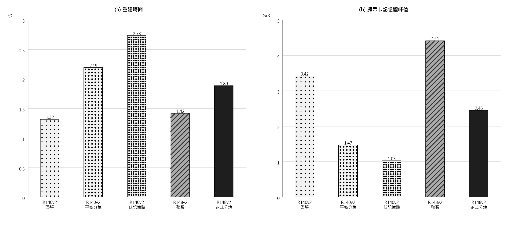

# R140v2 與 R148v2 重建效率及分塊驗證

日期：2026-09-28

## 結論

- 若顯示卡記憶體足夠，R140v2 整張重建最快：中位 1.32 秒，模型本身峰值 3.42 GiB。
- R148v2 的正式 512/24 分塊是最可靠的節省記憶體方案：中位 1.89 秒、峰值 2.46 GiB，三張實拍與整張輸出的最壞平均差只有 1.61e-06 灰階。
- R140v2 可用 992/128 分塊把峰值降到 1.47 GiB，但時間增加至 2.19 秒。三張實拍未見接縫加重；由於其內部處理會受整張尺寸影響，只能稱為實測近似一致。
- 若記憶體更緊，R140v2 的 720/128 分塊可降到 1.03 GiB，中位 2.73 秒。

## 同條件結果

| 方案 | 中位時間（秒） | P90（秒） | 模型峰值（GiB） | 暫存保留峰值（GiB） | 與整張輸出差異 |
|---|---:|---:|---:|---:|---|
| R140v2 整張 | 1.32 | 1.42 | 3.42 | 4.94 | 基準 |
| R140v2 平衡分塊 | 2.19 | 2.28 | 1.47 | 3.28 | 平均最壞 7.15e-05 灰階；最大 0.051 灰階 |
| R140v2 低記憶體 | 2.73 | 2.89 | 1.03 | 2.62 | 平均最壞 8.02e-05 灰階；最大 0.066 灰階 |
| R148v2 整張 | 1.42 | 1.44 | 4.41 | 10.60 | 基準 |
| R148v2 正式分塊 | 1.89 | 1.97 | 2.46 | 5.26 | 平均最壞 1.61e-06 灰階；最大 0.000 灰階 |

## 相對差異

- 整張對整張：R140v2 比 R148v2 快 7.2%，模型峰值少 22.5%。
- R148v2 正式分塊相對自身整張：時間增加 33.0%，模型峰值降低 44.3%。
- R140v2 992/128 相對自身整張：時間增加 66.4%，模型峰值降低 56.9%。
- 兩者都分塊時，R148v2 512/24 比 R140v2 992/128 快 13.9%；R140v2 則少用 40.0% 模型記憶體。

## 分塊策略驗證

### R148v2

先以整張影像計算光學提示與全域脈絡，再只把三段原尺寸修正切成 512 像素核心；每塊周圍多讀 24 像素，最後只保留核心。實測 256、512、768、1024 四種核心大小，記憶體都停在約 2.46 GiB，表示主要下限來自仍需整張計算的前半部。512/24 最快，也與模型原設定一致。

### R140v2

整個四輪模型連同周圍影像一起分塊，每塊只留下中央核心。核心與周圍範圍都對齊八像素，避免縮放階段錯位。掃描結果顯示 992/128 是速度與記憶體的平衡點，720/128 適合更低記憶體。三張影像的接縫區差異沒有高於一般區域；但這版含整體頻率處理，分塊不具理論上的完全等價。

## 實驗條件與限制

- 同一張 NVIDIA RTX A6000、FP32、相同 1544×2064 實拍尺寸、固定最終權重。
- 使用最早、中段與最後三張實拍；整張模式共計時 10 次，主要分塊模式各計時 9 至 10 次，計時前均先預跑。
- 顯示卡記憶體採每個測試程序本身的實際張量峰值；暫存保留峰值另列，方便估計部署餘裕。
- 測試期間 R61 訓練仍在同張顯示卡上執行，使用率約 64% 至 68%。因此相對排序與記憶體結論可用，絕對秒數仍應在訓練結束後再跑一次作正式論文數值。
- 先前 930 張紀錄的 R140v2 1.454 秒與 R148v2 3.075 秒來自不同執行時段，不能直接當成純模型速度差。本次同條件整張比較為 1.32 秒與 1.42 秒。

## 建議

1. 現有 RTX A6000 或至少約 5 GiB 可用記憶體：R140v2 直接整張重建。
2. R148v2 正式部署：保留 512/24 分塊，輸出可靠且記憶體較低。
3. R140v2 若必須分塊：一般使用 992/128；記憶體優先使用 720/128。論文中應寫成三張實拍驗證近似一致，不寫成與整張完全相同。
