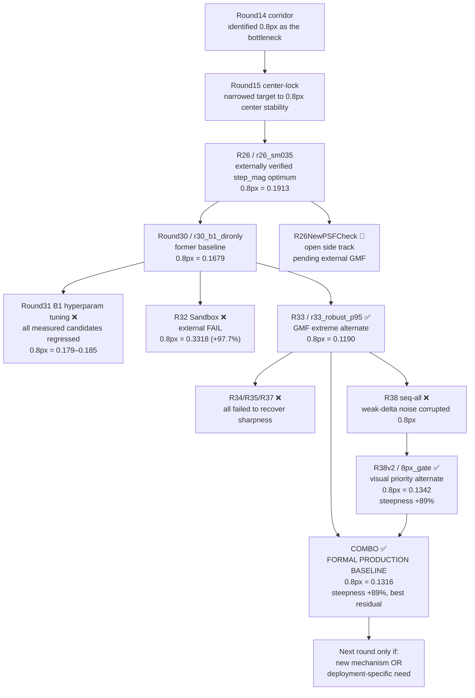
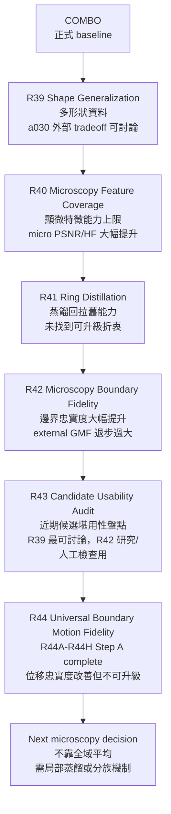

# 研究路徑 / Research Paths

這份文件提供 GitHub 可直接渲染的研究路徑圖，讓人不用翻完整歷史，也能快速理解 formal baseline、approved alternates、已被否定的分支、以及現在真正值得開新 round 的條件。
This file provides a GitHub-renderable research-path map so readers can understand the formal baseline, approved alternates, falsified branches, and the real threshold for opening a new round without reading the full history first.

## Current Path / 目前主路徑

## Post-COMBO 顯微泛化研究線

這條線從 R39 開始，不再把「環形」當成唯一研究目標。真正目標是讓模型碰到各種顯微結構時，都能忠實重建邊界位置；環形外部 GMF 仍是正式量測守門，但它只是代理測試。

## Milestone Numbers / 里程碑數字

| Round | 候選 | External `0.8px` step std | 角色 / Verdict |
|-------|------|--------------------------|----------------|
| R26（generic 基準） | `r26_sm035` | `0.191336` | step_mag 線 externally verified optimum |
| R29（upper sweep） | `r29_sm042` | `0.217310` | 否定 `step_mag > 0.35` |
| **R30** | `r30_b1_dironly` | `0.167862` | former production baseline |
| R31 | 三個 measured 候選 | `0.179` ~ `0.185` | 外部退步，closed follow-up |
| R32 sandbox | `r32_real_eq_finetune` | `0.331821` | external FAIL，sandbox closed |
| **R33** | `r33_robust_p95` | `0.119049` | approved GMF extreme alternate |
| R34/R35/R37 | freq-split / alpha / freq-reg | — | 全部失敗，無法恢復銳度 |
| R38 | `seq_only` | — (internal only) | 全 stages noise 干擾，falsified |
| **R38v2** | `r38v2_8px_gate` | `0.134205` | approved visual-priority alternate |
| **COMBO** | `r38v2_8px_gate_p95` | `0.131560` | **formal production baseline** |
| R39 | `r39_combo_strong_avg_a030` | `0.140008` | 近期最接近替代討論；形狀泛化改善，0.8px 在 alternate band 內 |
| R40 | `r40_combo_best_avg_a045` | `0.133314` | 顯微特徵能力提升，但 external 8px +22.80%，research-only |
| R41 | `r41_*` | 未送外部 | 顯微能力強，但沒有通過本地三尺度折衷，research-only |
| R42 | `r42_r41_best` | `0.255665` | 邊界重建大幅改善，但 external 三尺度退步過大，research-only |
| R43 | analysis-only | — | 近期候選堪用性盤點；沒有新候選全面取代 COMBO |
| R44 | `r44_motion_from_r42_best` / R44C-R44H diagnostics | 未送外部 | R44A-R44H Step A 完成；R44B from R42 仍是最佳通用位移候選（整體位移 `0.3813 px`、格線位移 `2.2457 px`）。R44H 家族平均可把大區塊/混合形狀錯誤推到 `0.2955`，但位移退到 `0.5298 px` 以上，不能作後續起點；research-only |
| R26NewPSFCheck | 新 PSF 重訓候選 | 待定 | open side track，pending GMF |

## Interpretation / 路徑解讀

- `R26 / r26_sm035`
  generic `step_mag` 路線的 externally verified optimum。這條線已封閉，但仍是歷史基準鏈的重要節點。

- `Round30 / r30_b1_dironly`
  前任正式 baseline。它是第一個在 external `0.8px` 主戰場超越 R26 的線，但現在已被 COMBO 取代。

- `Round31`
  `B1 dironly` 主線上的 follow-up 微調。measured candidates 全部 external regression，已關閉。

- `R32 Sandbox`
  internal winner `r32_real_eq_finetune` external FAIL，sandbox 已關閉。

- `R33 / r33_robust_p95`
  Winsorize spatial loss 帶來最強 GMF 改善，但視覺銳度退步，因此保留為 `GMF extreme` alternate，而不是 formal baseline。

- `R38v2 / r38v2_8px_gate`
  seq 8px-only + signal gate + warmup 15 成功保住視覺 steepness，因此保留為 `visual priority` alternate。

- `COMBO / r38v2_8px_gate_p95`
  Winsorize + seq 8px gate + warmup 的組合。不是單一指標最極端，但在 `0.8px`、`8px`、steepness、residual_std 上最均衡，因此於 2026-04-08 升級為 formal production baseline。

- `R26NewPSFCheck`
  與 mainline promotion 解耦的 PSF 驗證 side track。它仍有研究價值，但不是目前 active baseline challenger。

- `R39-R44 microscopy generalization`
  這條線證明模型可以學到更多形狀、顯微紋理與邊界特徵，但也證明「單張重建更清楚」不等於「連續位移時位置穩定」。目前 R39 a030 是唯一接近正式替代討論的近期候選；R40/R41/R42 是能力材料，R44 已確認已知位移資料能改善整體位移與格線位移。R44C 否定了「只降低 motion」與「把大區塊/混合場景排除 motion」兩個簡單策略；R44D 確認短期不該快速開 R45；R44E 又確認只針對大區塊/混合場景做短訓練修補仍不夠；R44F 確認問題不是單純指標誤判；R44G 補上邊界厚度、碎裂、角點/直邊保持指標，確認現成候選能力分散；R44H Step A 又確認 R44B 家族全域平均雖能改善形狀，卻會犧牲位移。下一步若要訓練，必須是局部蒸餾或分族邊界形狀機制，而不是小幅權重微調或全域平均。

## How To Use This Map / 如何使用這張圖

- 在 GitHub 首頁快速看方向：先看 `README.md` 裡的縮略圖。
  For a quick direction check on GitHub, start with the smaller map in `README.md`.
- 如果要看比較完整的研究脈絡：看這份文件。  
  For a fuller research-path explanation, read this file.
- 如果要看完整歷史原文：看 `docs/history/PROJECT_FULL_HISTORY_AND_STRATEGY_20260312.md`。  
  For the full historical source text, read `docs/history/PROJECT_FULL_HISTORY_AND_STRATEGY_20260312.md`.
