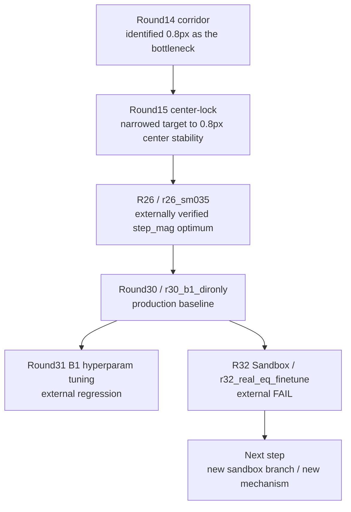

# 研究路徑 / Research Paths

這份文件提供 GitHub 可直接渲染的研究路徑圖，讓人不用翻完整歷史，也能快速理解目前 baseline、已被否定的分支、以及下一個合理方向。  
This file provides a GitHub-renderable research-path map so readers can understand the current baseline, the falsified branches, and the next sensible direction without reading the entire history first.

## Current Path / 目前主路徑

## Interpretation / 路徑解讀

- `R26 / r26_sm035`
  generic `step_mag` 路線的 externally verified optimum。  
  The externally verified optimum of the generic `step_mag` line.
- `Round30 / r30_b1_dironly`
  目前正式的 production baseline。  
  The current official production baseline.
- `Round31`
  沿 `B1 dironly` 主線做的微調，但 external 結果退步。  
  A tuning line on top of `B1 dironly` that regressed externally.
- `R32 Sandbox`
  internal winner 通過 internal gate，但 external compare FAIL。  
  The internal winner passed internal gates but failed external compare.
- `Next step`
  不能再延用 `r32_real_eq_finetune`，若要續做必須另立新的 sandbox branch / 新機制。  
  `r32_real_eq_finetune` cannot remain the current promising line; any continuation must create a new sandbox branch or mechanism.

## How To Use This Map / 如何使用這張圖

- 在 GitHub 首頁快速看方向：先看 `README.md` 裡的簡圖。  
  For a quick direction check on GitHub, start with the small map in `README.md`.
- 如果要看比較完整的研究脈絡：看這份文件。  
  For a fuller research-path explanation, read this file.
- 如果要看完整歷史原文：看 `docs/history/PROJECT_FULL_HISTORY_AND_STRATEGY_20260312.md`。  
  For the full historical source text, read `docs/history/PROJECT_FULL_HISTORY_AND_STRATEGY_20260312.md`.
