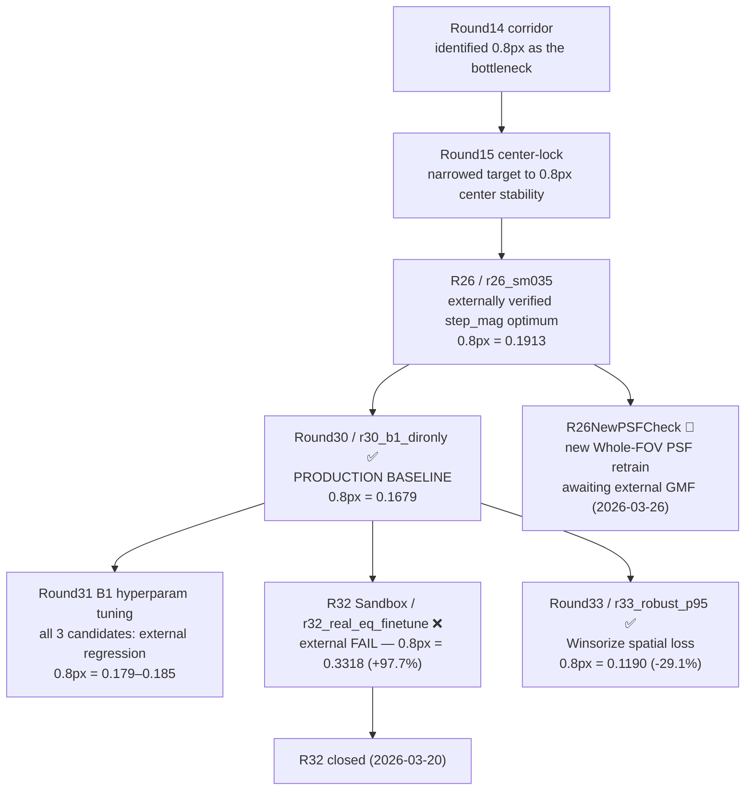

# 研究路徑 / Research Paths

這份文件提供 GitHub 可直接渲染的研究路徑圖，讓人不用翻完整歷史，也能快速理解目前 baseline、已被否定的分支、以及下一個合理方向。  
This file provides a GitHub-renderable research-path map so readers can understand the current baseline, the falsified branches, and the next sensible direction without reading the entire history first.

## Current Path / 目前主路徑

## Milestone Numbers / 里程碑數字

| Round | 候選 | External 0.8px step std | 結論 |
|-------|------|------------------------|------|
| R26（generic 基準） | `r26_sm035` | `0.191336` | step_mag 最佳值 = 0.35，舊基準 |
| R29（upper sweep） | `r29_sm042` | `0.217310` | 否定 step_mag > 0.35 方向 |
| **R30（目前 baseline）** | `r30_b1_dironly` | **`0.167862`** | 首個外部驗證超越 R26；B1 dironly 有效 |
| R31（B1 hyperparam） | 三個候選 | `0.179` ~ `0.185` | 全部外部退步，baseline 不變 |
| R32 sandbox | `r32_real_eq_finetune` | `0.331821` | 外部惡化 +97.7%，FAIL，沙盒關閉 |
| **R33（Robust Loss）** | **`r33_robust_p95`** | **`0.119049`** | **三尺度全通過；首個全面超越 R30 的候選** |
| R26NewPSFCheck | 新 PSF 重訓候選 | 待定（等待 GMF 回填） | 進行中（2026-03-26 啟動） |

## Interpretation / 路徑解讀

- `R26 / r26_sm035`
  generic `step_mag` 路線的 externally verified optimum，外部 0.8px = 0.191336。
  The externally verified optimum of the generic `step_mag` line.

- `Round30 / r30_b1_dironly`
  目前正式的 production baseline，外部 0.8px = 0.167862，是首個超越 R26 基準線的外部驗證結果。
  The current official production baseline. First line to beat R26 on the external battlefield.

- `Round31`
  沿 `B1 dironly` 主線做的超參數微調，但三個候選在外部 0.8px 全部退步。
  Hyperparameter tuning on the B1 dironly line; all three candidates regressed on external 0.8px.

- `R32 Sandbox`（已關閉）
  internal winner（`r32_real_eq_finetune`）通過所有內部合成探針，但 external compare 在主戰場 0.8px 惡化 +97.7%，確認 FAIL。2026-03-20 關閉沙盒。
  The internal winner passed all synthetic probes but failed external compare badly (+97.7% on 0.8px). Sandbox closed 2026-03-20.

- `Round33 / r33_robust_p95`（外部通過，2026-04-05）
  在 R30 B1 dironly recipe 上加入 Winsorize 空間損失（95th percentile 截尾），降權不可修復缺陷像素的梯度。
  外部 GMF 結果：0.8px **0.119049**（-29.1%）、8px 0.153343（-25.3%）、0.08px 0.086274（-45.3%）。三尺度全面改善。
  R33 is the first candidate since R30 to improve on all three external scales. Mechanism: Winsorize gradient_magnitude_loss and laplacian_hf_loss at 95th percentile.

- `R26NewPSFCheck`（進行中）
  2026-03-26 啟動。以新 Whole-FOV PSF 從頭重訓 R26 模型，等待外部 GMF 結果回填。同時也完成了 PSF 正式流程審核。
  Started 2026-03-26. Retrains the R26 model with the new Whole-FOV PSF; awaiting external GMF scores. PSF formal-flow audit also completed.

- PSF 政策（2026-03-27）
  R26 研究線的 PSF 正式標準切換為新 Whole-FOV PSF（current standard），舊版轉為 legacy empirical baseline。詳見 `docs/policy/PSF_POLICY_TRANSITION_R26.md`。
  R26 PSF standard switched to the new Whole-FOV PSF (current standard); the old PSF becomes the legacy empirical baseline. See `docs/policy/PSF_POLICY_TRANSITION_R26.md`.

## How To Use This Map / 如何使用這張圖

- 在 GitHub 首頁快速看方向：先看 `README.md` 裡的簡圖。  
  For a quick direction check on GitHub, start with the small map in `README.md`.
- 如果要看比較完整的研究脈絡：看這份文件。  
  For a fuller research-path explanation, read this file.
- 如果要看完整歷史原文：看 `docs/history/PROJECT_FULL_HISTORY_AND_STRATEGY_20260312.md`。  
  For the full historical source text, read `docs/history/PROJECT_FULL_HISTORY_AND_STRATEGY_20260312.md`.
