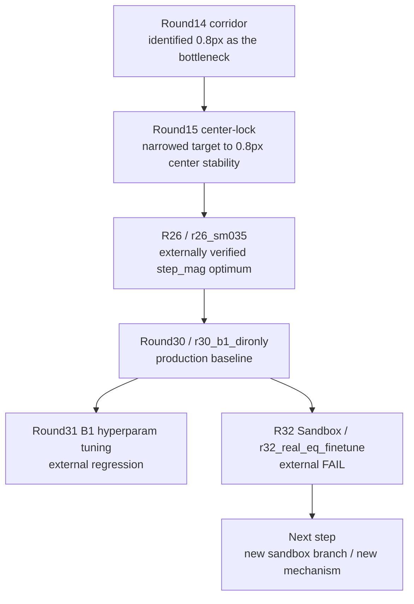

# Research Paths

這份文件提供 GitHub 可直接渲染的研究路徑圖，目的是讓人不用翻完整歷史，就能看懂目前 baseline、被否定分支、以及下一個合理方向。

## Current Path

## Interpretation

- `R26 / r26_sm035`
  - generic `step_mag` 線的 externally verified optimum
- `Round30 / r30_b1_dironly`
  - 目前正式 production baseline
- `Round31`
  - 沿 `B1 dironly` 主線做微調，但 external regression
- `R32 Sandbox`
  - internal winner 通過 internal gate，但 external compare FAIL
- `Next step`
  - 不能延用 `r32_real_eq_finetune`
  - 必須另立新的 sandbox branch / 新機制

## How To Use This Map

- 在 GitHub 首頁看快速方向：先看 `README.md` 的簡圖
- 要看比較完整的研究脈絡：看這份文件
- 要看完整歷史原文：看 `docs/history/PROJECT_FULL_HISTORY_AND_STRATEGY_20260312.md`
