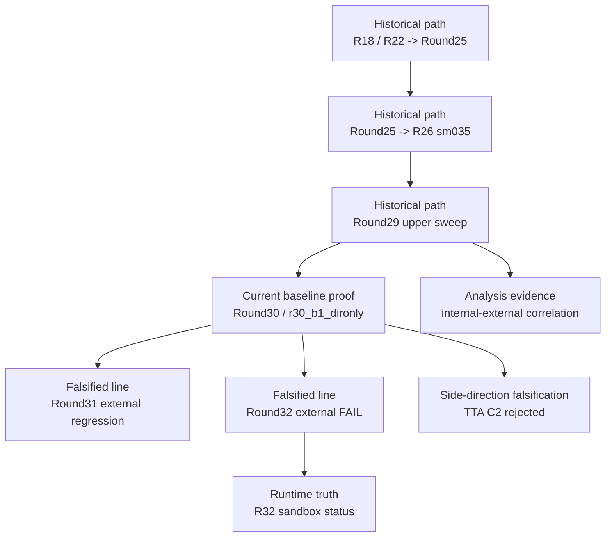

# Evidence Map

This document explains how the curated evidence layer supports the repository's
main conclusions.

Use it when you need to answer:

- which evidence proves the current baseline
- which evidence proves a line was falsified
- which evidence explains the historical path into the current baseline
- which evidence supports analysis and screening conclusions

## Evidence Chain

## Current Baseline Proof

| Evidence | Supports | Why it matters |
|---|---|---|
| `baseline/ROUND30_ARCH_BREAKTHROUGH_DECISION_20260318_003739.md/json` | `baseline/r30-b1-dironly` | Captures the formal internal decision that selected the Round30 breakthrough line. |
| `baseline/ROUND30_EXTERNAL_COMPARE.md` | `baseline/r30-b1-dironly` | Captures the external promotion proof that made `r30_b1_dironly` the current production baseline. |

## Historical Baseline Path

| Evidence | Supports | Why it matters |
|---|---|---|
| `historical_baselines/EXTERNAL_COMPARE_R18_R22_R25_SUMMARY.md/json` | `R18/R22 -> Round25` | Shows the first major externally validated baseline progression into the Round25 line. |
| `historical_baselines/EXTERNAL_COMPARE_R18_R22_R25_R26_SUMMARY.md/json` | `Round25 -> R26 sm035` | Shows the next formal step that established the R26 line. |
| `historical_baselines/ROUND29_STEP_MAG_UPPER_DECISION_20260317_124715.md/json` | `Round29 upper sweep` | Explains the formal decision logic for the last generic `step_mag` sweep. |
| `historical_baselines/EXTERNAL_COMPARE_R18_R22_R25_R26_R27_R28_R29_SUMMARY.md/json` | `R26 sm035` as optimum | Preserves the strongest compact proof that R26 remained the externally verified optimum of the generic `step_mag` line. |

## Falsified Lines

| Evidence | Supports | Verdict |
|---|---|---|
| `falsified/ROUND31_B1_HYPERPARAM_DECISION_20260318_113938.md/json` | `research/round31-b1-hparam` | Internal follow-up line defined, then rejected by external compare. |
| `falsified/ROUND31_EXTERNAL_COMPARE.md/json` | `research/round31-b1-hparam` | Formal external regression proof for the Round31 B1 tuning line. |
| `falsified/ROUND32_DOMAIN_CAPACITY_DECISION_20260319_183614.md/json` | `sandbox/r32` internal winner | Explains how the Round32 winner was selected before the final external gate. |
| `falsified/ROUND32_EXTERNAL_COMPARE.md/json` | `sandbox/r32` | Formal proof that the Round32 internal winner failed the external compare and cannot be promoted. |

## Side-Direction Falsifications

| Evidence | Supports | Verdict |
|---|---|---|
| `side_directions/TTA_VS_BASELINE_CROSS5_COMPARISON.md/json` | `TTA C2` side direction | Preserves the formal rejection of TTA as an upgrade path. |

## Analysis / Screening Evidence

| Evidence | Supports | Why it matters |
|---|---|---|
| `analysis/INTERNAL_EXTERNAL_CORRELATION.md/json` | `center_err` as Tier2 screening signal | Preserves the cross-run analysis that justifies `center_err` as a screening metric, while keeping external GMF as the final gate. |

## Runtime Truth

| Evidence | Supports | Why it matters |
|---|---|---|
| `runtime/R32_STATUS.md/json` | `Experiments/R32Sandbox/runtime/R32_STATUS.*` | Keeps a small, tracked copy of the canonical sandbox runtime truth for the post-falsification state. |

## How To Read This With GitHub

- Use the GitHub Project control plane to understand the **timeline**:
  `GMM Research Control Plane`
- Use this file to understand the **evidence chain** behind each verdict.
- Use `docs/evidence/README.md` to browse the curated files themselves.

In short:

- `GitHub Project` answers **when** a major milestone happened.
- `EVIDENCE_MAP.md` answers **which files prove it**.
