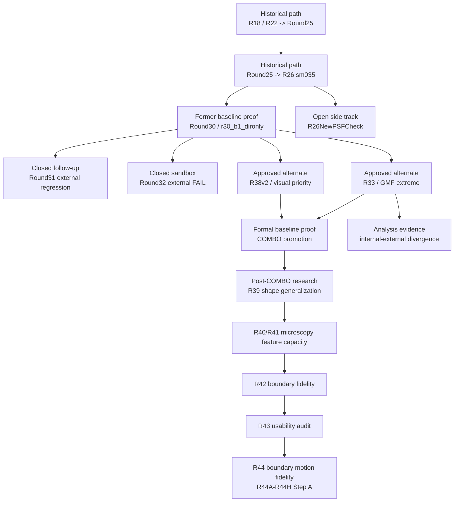

# 證據鏈地圖 / Evidence Map

這份文件用來說明：**策展後的 evidence layer 如何支撐 repo 的正式 baseline、approved alternates、side tracks、與已關閉主線**。
This document explains **how the curated evidence layer supports the formal baseline, approved alternates, side tracks, and closed lines** in this repository.

當你需要回答以下問題時，先看這份文件：  
Use this file when you need to answer:

- 哪些證據證明目前 formal baseline 成立
  which evidence proves the formal baseline
- 哪些證據證明 alternate 與 side track 的角色
  which evidence proves alternate or side-track status
- 哪些證據證明某條線已被否定或關閉
  which evidence proves a line was falsified or closed
- 哪些證據說明目前 baseline 是如何形成的  
  which evidence explains how the current baseline was formed

## 證據鏈 / Evidence Chain

## 目前 Formal Baseline 的證據 / Current Formal Baseline Proof

| 證據 / Evidence | 支撐對象 / Supports | 為何重要 / Why it matters |
|---|---|---|
| `Experiments/R38v2SeqFixed/reports/COMBO_RESULTS.md` | `formal_baseline/COMBO` | 正式 baseline 報告：外部 GMF、視覺品質、residual_std 都在這裡。 / Formal baseline report with external GMF, visual profile, and residual quality. |
| `Experiments/R38v2SeqFixed/results/external_gmf_combo/` | `formal_baseline/COMBO` external proof | COMBO 三尺度外部 GMF 原始評分。 / Raw external GMF scores for COMBO. |
| `Experiments/R33RobustLoss/reports/R33_R38v2_COMPLETE_EXPERIMENT_SERIES.md` | COMBO promotion context | 說明 COMBO 如何在 R33/R38v2 兩條成功線之間收斂成最均衡結果。 / Explains how COMBO emerged as the most balanced candidate from the R33 and R38v2 lines. |

## Approved Alternates / 已核准特化候選

| 證據 / Evidence | 支撐對象 / Supports | 為何重要 / Why it matters |
|---|---|---|
| `Experiments/R33RobustLoss/reports/R33_EXPERIMENT_SUMMARY.md` | `alternate/R33` | R33 完整實驗記錄與三尺度 external GMF PASS。 / Full R33 experiment record and all-scale external GMF pass. |
| `Experiments/R33RobustLoss/results/external_gmf/` | `alternate/R33` raw proof | R33 三尺度 GMF 原始評分。 / Raw R33 GMF scores. |
| `Experiments/R38v2SeqFixed/reports/R38v2_RESULTS.md` | `alternate/R38v2` | R38v2 的外部 GMF + 視覺品質回復證據。 / R38v2 external GMF plus visual recovery evidence. |
| `Experiments/R38v2SeqFixed/results/external_gmf/` | `alternate/R38v2` raw proof | R38v2 三尺度 GMF 原始評分。 / Raw R38v2 GMF scores. |

## Former Baseline / 前任 baseline

| 證據 / Evidence | 支撐對象 / Supports | 為何重要 / Why it matters |
|---|---|---|
| `baseline/ROUND30_ARCH_BREAKTHROUGH_DECISION_20260318_003739.md/json` | `former_baseline/R30` | Round30 內部決策證據。 / Internal decision evidence for Round30. |
| `baseline/ROUND30_EXTERNAL_COMPARE.md` | `former_baseline/R30` | Round30 外部 compare 升級證據；現在用來說明它如何成為 COMBO 前任 baseline。 / External promotion proof for Round30, now preserved as former-baseline evidence. |

## Open Side Track / 開放 side track

| 證據 / Evidence | 支撐對象 / Supports | 為何重要 / Why it matters |
|---|---|---|
| `Experiments/R26NewPSFCheck/reports/STATUS_20260326.md` | `side_track/R26NewPSFCheck` | 說明這條線仍在等待 external GMF。 / Shows this track is still awaiting external GMF. |
| `Experiments/R26NewPSFCheck/formal_newpsf_candidate/reports/NEW_PSF_FORMAL_R26_COMPARE.md` | `side_track/R26NewPSFCheck` | 證明 PSF same-recipe promote 已完成。 / Proves the PSF same-recipe promote work is complete. |
| `Experiments/R26NewPSFCheck/psf_audit/PSF_FORMAL_AUDIT_20260326.md` | `side_track/R26NewPSFCheck` | 說明 PSF 流程本身沒有執行層面異常。 / Shows the PSF flow itself did not fail operationally. |

## Post-COMBO 顯微泛化研究證據

| 證據 / Evidence | 支撐對象 / Supports | 為何重要 / Why it matters |
|---|---|---|
| `Experiments/R39_ShapeGeneralization/reports/R39_RESULTS.md` | `side_track/R39_shape_generalization` | 記錄 R39 多形狀資料線與 `r39_combo_strong_avg_a030` 的外部 tradeoff；這是近期最接近正式替代討論的候選。 |
| `Experiments/R39_ShapeGeneralization/results/external_gmf_a030/` | `R39 a030 external proof` | R39 a030 三尺度外部 GMF 原始證據。 |
| `Experiments/R40_MicroscopyFeatureCoverage/reports/R40_RESULTS.md` | `side_track/R40_micro_capacity` | 證明顯微特徵能力能被資料推高，也記錄最佳折衷外部 8px 退步 +22.80%。 |
| `Experiments/R40_MicroscopyFeatureCoverage/results/external_gmf/` | `R40 external proof` | R40 最佳折衷外部 GMF 原始證據。 |
| `Experiments/R41_RingDistillation/reports/R41_RESULTS.md` | `side_track/R41_distillation` | 記錄用蒸餾回拉舊能力的嘗試；顯微能力保留，但沒有找到可升級折衷。 |
| `Experiments/R42_MicroscopyBoundaryFidelity/reports/R42_RESULTS.md` | `side_track/R42_boundary_fidelity` | 記錄 R42 邊界忠實度資料、訓練、低比例掃描與守門 KD 診斷。 |
| `Experiments/R42_MicroscopyBoundaryFidelity/reports/R42_EXTERNAL_COMPARE.md` | `R42 external verdict` | R42 後補外部 GMF 的 canonical 報告；確認三個送測候選都只能 research-only。 |
| `Experiments/R42_MicroscopyBoundaryFidelity/results/external_gmf/` | `R42 external raw proof` | R42 三個候選九份外部 GMF 原始分數與彙整 JSON。 |
| `Experiments/R43_CandidateUsabilityAudit/reports/R43A_USABILITY_AUDIT.md` | `R43 usability decision` | 把 COMBO、R39、R40、R41、R42 放在同一張堪用性表中，結論是 R39 最可討論，R42 研究/人工檢查用。 |
| `Experiments/R43_CandidateUsabilityAudit/results/visual_review/` | `R43 visual proof` | 三張肉眼檢查圖，支撐 R42 邊界更清楚但不適合正式量測的判斷。 |
| `Experiments/R44_UniversalBoundaryMotionFidelity/reports/R44_RESULTS.md` | `R44 motion fidelity result` | R44 canonical 報告；記錄 R44A 診斷、R44B 三候選訓練、位移測試、本地環形代理紀錄與研究結論。 |
| `Experiments/R44_UniversalBoundaryMotionFidelity/results/summary/r44_motion_summary_all.csv` | `R44 motion scorecard` | R44A/R44B 所有模型的通用位移、格線、細線、大區塊與混合場景分項表。 |
| `Experiments/R44_UniversalBoundaryMotionFidelity/results/visual_samples/r44_motion_r42_vs_r44_contact_sheet.png` | `R44 visual proof` | R42 起點與 R44B 主候選在七類已知位移顯微結構上的代表圖。 |
| `Experiments/R44_UniversalBoundaryMotionFidelity/reports/R44C_PROBE_PLAN.md` | `R44C probe design` | 記錄 R44C 三個短探針的目的、完成標準與判定方式。 |
| `Experiments/R44_UniversalBoundaryMotionFidelity/results/summary/r44c_probe_summary.csv` | `R44C probe scorecard` | R42、R44B 與三個 R44C 探針的位移、格線、大區塊、混合場景與缺陷對照表。 |
| `Experiments/R44_UniversalBoundaryMotionFidelity/results/visual_samples/r44c_probe_r42_r44b_r44c_sheet.png` | `R44C visual proof` | R42、R44B 與 R44C 最佳探針在七類已知位移顯微結構上的代表圖；支撐 R44C 只有小幅平衡、沒有突破的判讀。 |
| `Experiments/R44_UniversalBoundaryMotionFidelity/reports/R44D_FAMILY_DIAGNOSTIC.md` | `R44D family diagnostic` | 不訓練新模型，拆解 R44A/R44B/R44C 逐 pair 結果；確認短期不開 R45，下一步留在 R44 內部做大區塊/混合場景專項探針。 |
| `Experiments/R44_UniversalBoundaryMotionFidelity/results/diagnostics/r44d_family_scorecard.csv` | `R44D family scorecard` | 所有模型按結構類型拆分的位移與邊界指標；支撐分族上限 `12.77%` 空間。 |
| `Experiments/R44_UniversalBoundaryMotionFidelity/results/diagnostics/r44d_metric_discrimination.csv` | `R44D metric validity` | 確認目前 `grid_phase_motion_error_px` 對所有模型幾乎相同，不能作模型排名。 |
| `Experiments/R44_UniversalBoundaryMotionFidelity/results/diagnostics/r44d_boundary_heatmap.png` | `R44D boundary heatmap` | 分族邊界距離視覺化，顯示大區塊與混合場景仍是弱點。 |
| `Experiments/R44_UniversalBoundaryMotionFidelity/reports/R44E_TARGETED_PROBE.md` | `R44E targeted probe` | 記錄大區塊/混合場景三個短訓練探針；確認短訓練修補沒有產生新堪用候選。 |
| `Experiments/R44_UniversalBoundaryMotionFidelity/results/summary/r44e_probe_summary.csv` | `R44E probe scorecard` | R42、R44B、R44C 與 R44E 三探針的位移、大區塊、混合場景對照表。 |
| `Experiments/R44_UniversalBoundaryMotionFidelity/results/visual_samples/r44e_region_mixed_probe_sheet.png` | `R44E visual proof` | 大區塊與混合場景代表圖；支撐 R44E 沒有肉眼可見突破的判讀。 |
| `Experiments/R44_UniversalBoundaryMotionFidelity/reports/R44F_ERROR_DIAGNOSTIC.md` | `R44F error diagnostic` | 不訓練新模型，對大區塊/混合場景做錯誤解剖；確認問題不是單純指標誤判，而是邊界形狀、厚度、碎裂、直邊/角點保持問題。 |
| `Experiments/R44_UniversalBoundaryMotionFidelity/results/diagnostics/r44f_metric_stress.csv` | `R44F metric stress` | 人工 1px/2px/5px 偏移、邊界變厚/變薄/缺角壓力測試；證明指標能抓到偏移，也會懲罰厚邊與缺角。 |
| `Experiments/R44_UniversalBoundaryMotionFidelity/results/diagnostics/r44f_selected_cases.csv` | `R44F selected cases` | R42/R44B/R44E 在大區塊與混合場景上的代表錯誤案例表。 |
| `Experiments/R44_UniversalBoundaryMotionFidelity/results/visual_samples/r44f_error_dissection_sheet.png` | `R44F visual proof` | 綠色答案邊界、紅色模型邊界、黃色重疊區的錯誤解剖圖。 |
| `Experiments/R44_UniversalBoundaryMotionFidelity/reports/R44G_BOUNDARY_SHAPE_METRICS.md` | `R44G boundary-shape diagnostic` | 不訓練新模型，量化厚度、破碎、直邊與角點保留；確認大區塊/混合場景形狀能力分散，沒有單一現成候選全面勝出。 |
| `Experiments/R44_UniversalBoundaryMotionFidelity/results/diagnostics/r44g_boundary_shape_scorecard.csv` | `R44G boundary-shape scorecard` | 所有模型按結構類型拆分的邊界形狀分項表。 |
| `Experiments/R44_UniversalBoundaryMotionFidelity/results/visual_samples/r44g_boundary_shape_heatmap.png` | `R44G boundary-shape heatmap` | 七類顯微結構與所有候選的形狀錯誤熱圖；支撐分族處理必要性。 |
| `Experiments/R44_UniversalBoundaryMotionFidelity/reports/R44H_STEPA_FAMILY_AVERAGE.md` | `R44H Step A family average` | 不訓練新模型；確認 R44C static heavy 可暫作混合場景局部老師，並確認 R44B 家族平均會改善形狀但犧牲位移。 |
| `Experiments/R44_UniversalBoundaryMotionFidelity/results/r44h_family_average/r44h_stepa_summary.csv` | `R44H Step A scorecard` | 四個 R44B 家族平均候選的形狀、位移與本地環形代理總表。 |
| `Experiments/R44_UniversalBoundaryMotionFidelity/results/diagnostics/r44h_boundary_shape_target_rank.csv` | `R44H target shape ranking` | 大區塊與混合場景合併後的 R44B/R44C/R44H 排名；支撐「平均能拉形狀但不能保位移」的判讀。 |
| `Experiments/R44_UniversalBoundaryMotionFidelity/MANIFEST.md` | `R44 handoff` | R44 handoff manifest；說明腳本、資料包、候選、主要產物與目前研究狀態。 |

## Closed Lines / 已關閉主線

| 證據 / Evidence | 支撐對象 / Supports | 結論 / Verdict |
|---|---|---|
| `falsified/ROUND31_B1_HYPERPARAM_DECISION_20260318_113938.md/json` | `closed/round31` | 定義 Round31 follow-up line。 / Defines the Round31 follow-up line. |
| `falsified/ROUND31_EXTERNAL_COMPARE.md/json` | `closed/round31` | Round31 measured candidates external regression 的正式證據。 / Formal proof that Round31 regressed externally. |
| `falsified/ROUND32_DOMAIN_CAPACITY_DECISION_20260319_183614.md/json` | `closed/round32` | Round32 internal winner selection。 / Round32 internal winner selection evidence. |
| `falsified/ROUND32_EXTERNAL_COMPARE.md/json` | `closed/round32` | Round32 external FAIL 的正式證據。 / Formal proof that Round32 failed the external gate. |
| `side_directions/TTA_VS_BASELINE_CROSS5_COMPARISON.md/json` | `closed/TTA C2` | TTA C2 被否定為升級方向。 / TTA C2 was rejected as an upgrade path. |

## 分析與 Screening 證據 / Analysis and Screening Evidence

| 證據 / Evidence | 支撐對象 / Supports | 為何重要 / Why it matters |
|---|---|---|
| `analysis/INTERNAL_EXTERNAL_CORRELATION.md/json` | `center_err` as Tier-2 screening | 說明為何 `center_err` 是較好的 screening signal，但不能替代 final gate。 / Explains why `center_err` is useful for screening but cannot replace the final gate. |
| `Experiments/R33RobustLoss/reports/INTERNAL_EXTERNAL_DIVERGENCE_ANALYSIS.md` | internal gate advisory-only conclusion | 說明為何 internal step_std 在低 residual regime 不再適合作為硬門檻。 / Explains why internal step_std becomes advisory-only in the low-residual regime. |
| `Experiments/R33RobustLoss/reports/QUANTIZATION_FIX_ANALYSIS.md` | quantization sensitivity evidence | 說明 rounding quantization 對不同模型有不同影響。 / Documents model-dependent sensitivity to quantization rounding. |

## Runtime Truth / Runtime Truth

| 證據 / Evidence | 支撐對象 / Supports | 為何重要 / Why it matters |
|---|---|---|
| `runtime/R32_STATUS.md/json` | `Experiments/R32Sandbox/runtime/R32_STATUS.*` | 保留 post-falsification sandbox runtime truth 的 tracked copy。 / Keeps a tracked copy of the post-falsification runtime truth for R32. |

## 如何配合 GitHub 一起閱讀 / How To Read This With GitHub

在 GitHub 上，請這樣分工理解：  
Use these layers together on GitHub:

- 用這份文件看每個 baseline / alternate / side track / closed line 背後的 **evidence chain**
  Use this file to understand the **evidence chain** behind each baseline, alternate, side track, or closed line
- 用 `docs/evidence/README.md` 直接瀏覽 curated evidence files  
  Use `docs/evidence/README.md` to browse the curated files themselves
- 用 `PROJECT_STATE.md` 理解目前的正式角色分配
  Use `PROJECT_STATE.md` to understand the current formal role assignments

總結來說：  
In short:

- `PROJECT_STATE.md` 回答 **現在正式決策是什麼**
  `PROJECT_STATE.md` answers **what the current formal decision is**
- `EVIDENCE_MAP.md` 回答 **哪份證據證明了它**  
  `EVIDENCE_MAP.md` answers **which files prove it**
