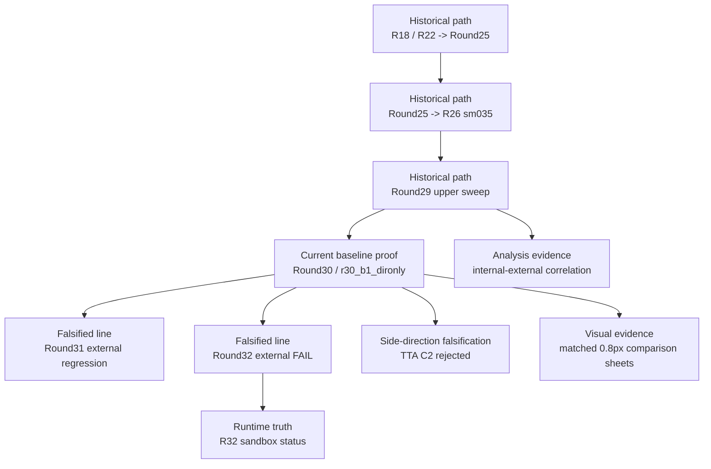

# 證據鏈地圖 / Evidence Map

這份文件用來說明：**策展後的 evidence layer 如何支撐 repo 的主要結論**。  
This document explains **how the curated evidence layer supports the repository's main conclusions**.

當你需要回答以下問題時，先看這份文件：  
Use this file when you need to answer:

- 哪些證據證明目前 baseline 成立  
  which evidence proves the current baseline
- 哪些證據證明某條線被否定  
  which evidence proves a line was falsified
- 哪些證據說明目前 baseline 是如何形成的  
  which evidence explains the historical path into the current baseline
- 哪些證據支撐分析與 screening 結論  
  which evidence supports analysis and screening conclusions

## 證據鏈 / Evidence Chain

## 目前 Baseline 的證據 / Current Baseline Proof

| 證據 / Evidence | 支撐對象 / Supports | 為何重要 / Why it matters |
|---|---|---|
| `baseline/ROUND30_ARCH_BREAKTHROUGH_DECISION_20260318_003739.md/json` | `baseline/r30-b1-dironly` | 記錄 Round30 breakthrough 線被正式選為主線的 internal decision。 / Captures the formal internal decision that selected the Round30 breakthrough line. |
| `baseline/ROUND30_EXTERNAL_COMPARE.md` | `baseline/r30-b1-dironly` | 記錄 `r30_b1_dironly` 如何通過 external compare 並升級成目前 production baseline。 / Captures the external promotion proof that made `r30_b1_dironly` the current production baseline. |

## R33 Baseline 升級候選證據 / R33 Baseline Upgrade Candidate Proof

| 證據 / Evidence | 支撐對象 / Supports | 為何重要 / Why it matters |
|---|---|---|
| `Experiments/R33RobustLoss/reports/R33_EXPERIMENT_SUMMARY.md` | `sandbox/r33` | R33 完整實驗記錄：假說、訓練、內部分析、外部 GMF 三尺度全通過。 / Complete R33 experiment record: hypothesis, training, analysis, external GMF pass on all three scales. |
| `Experiments/R33RobustLoss/results/external_gmf/` | `sandbox/r33` external proof | 外部 GMF 原始評分檔（三尺度）。 / Raw external GMF score files for all three scales. |

## R38v2 均衡型候選證據 / R38v2 Balanced Candidate Proof

| 證據 / Evidence | 支撐對象 / Supports | 為何重要 / Why it matters |
|---|---|---|
| `Experiments/R38v2SeqFixed/reports/R38v2_RESULTS.md` | `sandbox/r38v2` | R38v2 完整實驗記錄：三重修復設計、外部 GMF 結果、視覺品質恢復證據。 |
| `Experiments/R38v2SeqFixed/results/external_gmf/` | `sandbox/r38v2` external proof | R38v2 外部 GMF 原始評分檔（三尺度）。 |
| `Experiments/R33RobustLoss/reports/R33_R38v2_COMPLETE_EXPERIMENT_SERIES.md` | R33-R38v2 系列 | 12 候選 7 輪完整實驗歷程：失敗分析、根因、關鍵洞察。 |

## 歷史基準演進路徑 / Historical Baseline Path

| 證據 / Evidence | 支撐對象 / Supports | 為何重要 / Why it matters |
|---|---|---|
| `historical_baselines/EXTERNAL_COMPARE_R18_R22_R25_SUMMARY.md/json` | `R18/R22 -> Round25` | 顯示從早期 `R18/R22` 參考線走到 `Round25` 的第一個重大外部驗證轉折。 / Shows the first major externally validated baseline progression into the Round25 line. |
| `historical_baselines/EXTERNAL_COMPARE_R18_R22_R25_R26_SUMMARY.md/json` | `Round25 -> R26 sm035` | 顯示下一個正式轉折如何建立 `R26` 線。 / Shows the next formal step that established the `R26` line. |
| `historical_baselines/ROUND29_STEP_MAG_UPPER_DECISION_20260317_124715.md/json` | `Round29 upper sweep` | 解釋最後一次 generic `step_mag` upper sweep 的正式決策邏輯。 / Explains the formal decision logic for the last generic `step_mag` sweep. |
| `historical_baselines/EXTERNAL_COMPARE_R18_R22_R25_R26_R27_R28_R29_SUMMARY.md/json` | `R26 sm035` as optimum | 保留 `R26 sm035` 仍是 generic `step_mag` 線 externally verified optimum 的最強精簡證據。 / Preserves the strongest compact proof that `R26 sm035` remained the externally verified optimum of the generic `step_mag` line. |

## 被否定的主線 / Falsified Lines

| 證據 / Evidence | 支撐對象 / Supports | 結論 / Verdict |
|---|---|---|
| `falsified/ROUND31_B1_HYPERPARAM_DECISION_20260318_113938.md/json` | `research/round31-b1-hparam` | 記錄 Round31 follow-up line 如何被定義，之後又被 external compare 否定。 / Internal follow-up line defined, then rejected by external compare. |
| `falsified/ROUND31_EXTERNAL_COMPARE.md/json` | `research/round31-b1-hparam` | Round31 B1 tuning 線 external regression 的正式證據。 / Formal external regression proof for the Round31 B1 tuning line. |
| `falsified/ROUND32_DOMAIN_CAPACITY_DECISION_20260319_183614.md/json` | `sandbox/r32` internal winner | 說明 Round32 在 final external gate 前如何選出 internal winner。 / Explains how the Round32 winner was selected before the final external gate. |
| `falsified/ROUND32_EXTERNAL_COMPARE.md/json` | `sandbox/r32` | 證明 Round32 internal winner external FAIL，因此不能升級。 / Formal proof that the Round32 internal winner failed the external compare and cannot be promoted. |

## 被否定的 Side Direction / Side-Direction Falsifications

| 證據 / Evidence | 支撐對象 / Supports | 結論 / Verdict |
|---|---|---|
| `side_directions/TTA_VS_BASELINE_CROSS5_COMPARISON.md/json` | `TTA C2` side direction | 正式保留 `TTA C2` 被否定為升級方向的證據。 / Preserves the formal rejection of TTA as an upgrade path. |

## 分析與 Screening 證據 / Analysis and Screening Evidence

| 證據 / Evidence | 支撐對象 / Supports | 為何重要 / Why it matters |
|---|---|---|
| `analysis/INTERNAL_EXTERNAL_CORRELATION.md/json` | `center_err` as Tier2 screening signal | 保留跨 run 分析，說明為什麼 `center_err` 可作為 Tier2 screening，但 external GMF 仍是 final gate。 / Preserves the cross-run analysis that justifies `center_err` as a screening metric, while keeping external GMF as the final gate. |

## Runtime Truth / Runtime Truth

| 證據 / Evidence | 支撐對象 / Supports | 為何重要 / Why it matters |
|---|---|---|
| `runtime/R32_STATUS.md/json` | `Experiments/R32Sandbox/runtime/R32_STATUS.*` | 保留 post-falsification 階段 canonical sandbox runtime truth 的小型 tracked copy。 / Keeps a small, tracked copy of the canonical sandbox runtime truth for the post-falsification state. |

## 視覺證據 / Visual Evidence

| 證據 / Evidence | 支撐對象 / Supports | 為何重要 / Why it matters |
|---|---|---|
| `visuals/comparison_0p8px_case_01.png` | `R26`, `Round30 baseline`, `Round31 regression`, `Round32 fail` | 在同一個共享 `0.8px` battlefield case 上，公平比較四條最重要的線。 / A fair side-by-side comparison of one shared `0.8px` battlefield case across the four most important lines. |
| `visuals/comparison_0p8px_case_02.png` | the same four lines on a second shared case | 以第二個 matched case 補強視覺判斷，避免只靠單張圖。 / Provides a second matched case so the visual verdict is not hanging on a single image. |

## 如何配合 GitHub 一起閱讀 / How To Read This With GitHub

在 GitHub 上，請這樣分工理解：  
Use these layers together on GitHub:

- 用 GitHub Project control plane 看 **timeline**：`GMM Research Control Plane`  
  Use the GitHub Project control plane to understand the **timeline**: `GMM Research Control Plane`
- 用這份文件看每個 verdict 背後的 **evidence chain**  
  Use this file to understand the **evidence chain** behind each verdict
- 用 `docs/evidence/README.md` 直接瀏覽 curated evidence files  
  Use `docs/evidence/README.md` to browse the curated files themselves
- 想快速看視覺差異時，看 `docs/evidence/visuals/README.md`  
  Use `docs/evidence/visuals/README.md` when you want a quick visual comparison instead of a report or JSON file

總結來說：  
In short:

- `GitHub Project` 回答 **什麼時候發生了什麼**  
  `GitHub Project` answers **when** a major milestone happened
- `EVIDENCE_MAP.md` 回答 **哪份證據證明了它**  
  `EVIDENCE_MAP.md` answers **which files prove it**
