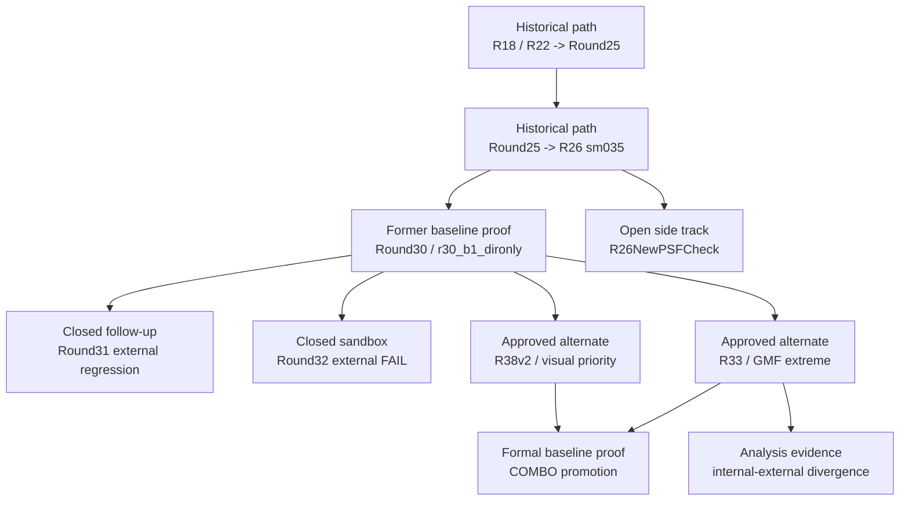

# 證據鏈地圖 / Evidence Map

這份文件用來說明：**策展後的 evidence layer 如何支撐 repo 的正式 baseline、approved alternates、side tracks、與已關閉主線**。
This document explains **how the curated evidence layer supports the formal baseline, approved alternates, side tracks, and closed lines** in this repository.

當你需要回答以下問題時，先看這份文件：  
Use this file when you need to answer:

- 哪些證據證明目前 formal baseline 成立
  which evidence proves the formal baseline
- 哪些證據證明 alternate 與 side track 的角色
  which evidence proves alternate or side-track status
- 哪些證據證明某條線已被否定或關閉
  which evidence proves a line was falsified or closed
- 哪些證據說明目前 baseline 是如何形成的  
  which evidence explains how the current baseline was formed

## 證據鏈 / Evidence Chain

## 目前 Formal Baseline 的證據 / Current Formal Baseline Proof

| 證據 / Evidence | 支撐對象 / Supports | 為何重要 / Why it matters |
|---|---|---|
| `Experiments/R38v2SeqFixed/reports/COMBO_RESULTS.md` | `formal_baseline/COMBO` | 正式 baseline 報告：外部 GMF、視覺品質、residual_std 都在這裡。 / Formal baseline report with external GMF, visual profile, and residual quality. |
| `Experiments/R38v2SeqFixed/results/external_gmf_combo/` | `formal_baseline/COMBO` external proof | COMBO 三尺度外部 GMF 原始評分。 / Raw external GMF scores for COMBO. |
| `Experiments/R33RobustLoss/reports/R33_R38v2_COMPLETE_EXPERIMENT_SERIES.md` | COMBO promotion context | 說明 COMBO 如何在 R33/R38v2 兩條成功線之間收斂成最均衡結果。 / Explains how COMBO emerged as the most balanced candidate from the R33 and R38v2 lines. |

## Approved Alternates / 已核准特化候選

| 證據 / Evidence | 支撐對象 / Supports | 為何重要 / Why it matters |
|---|---|---|
| `Experiments/R33RobustLoss/reports/R33_EXPERIMENT_SUMMARY.md` | `alternate/R33` | R33 完整實驗記錄與三尺度 external GMF PASS。 / Full R33 experiment record and all-scale external GMF pass. |
| `Experiments/R33RobustLoss/results/external_gmf/` | `alternate/R33` raw proof | R33 三尺度 GMF 原始評分。 / Raw R33 GMF scores. |
| `Experiments/R38v2SeqFixed/reports/R38v2_RESULTS.md` | `alternate/R38v2` | R38v2 的外部 GMF + 視覺品質回復證據。 / R38v2 external GMF plus visual recovery evidence. |
| `Experiments/R38v2SeqFixed/results/external_gmf/` | `alternate/R38v2` raw proof | R38v2 三尺度 GMF 原始評分。 / Raw R38v2 GMF scores. |

## Former Baseline / 前任 baseline

| 證據 / Evidence | 支撐對象 / Supports | 為何重要 / Why it matters |
|---|---|---|
| `baseline/ROUND30_ARCH_BREAKTHROUGH_DECISION_20260318_003739.md/json` | `former_baseline/R30` | Round30 內部決策證據。 / Internal decision evidence for Round30. |
| `baseline/ROUND30_EXTERNAL_COMPARE.md` | `former_baseline/R30` | Round30 外部 compare 升級證據；現在用來說明它如何成為 COMBO 前任 baseline。 / External promotion proof for Round30, now preserved as former-baseline evidence. |

## Open Side Track / 開放 side track

| 證據 / Evidence | 支撐對象 / Supports | 為何重要 / Why it matters |
|---|---|---|
| `Experiments/R26NewPSFCheck/reports/STATUS_20260326.md` | `side_track/R26NewPSFCheck` | 說明這條線仍在等待 external GMF。 / Shows this track is still awaiting external GMF. |
| `Experiments/R26NewPSFCheck/formal_newpsf_candidate/reports/NEW_PSF_FORMAL_R26_COMPARE.md` | `side_track/R26NewPSFCheck` | 證明 PSF same-recipe promote 已完成。 / Proves the PSF same-recipe promote work is complete. |
| `Experiments/R26NewPSFCheck/psf_audit/PSF_FORMAL_AUDIT_20260326.md` | `side_track/R26NewPSFCheck` | 說明 PSF 流程本身沒有執行層面異常。 / Shows the PSF flow itself did not fail operationally. |

## Closed Lines / 已關閉主線

| 證據 / Evidence | 支撐對象 / Supports | 結論 / Verdict |
|---|---|---|
| `falsified/ROUND31_B1_HYPERPARAM_DECISION_20260318_113938.md/json` | `closed/round31` | 定義 Round31 follow-up line。 / Defines the Round31 follow-up line. |
| `falsified/ROUND31_EXTERNAL_COMPARE.md/json` | `closed/round31` | Round31 measured candidates external regression 的正式證據。 / Formal proof that Round31 regressed externally. |
| `falsified/ROUND32_DOMAIN_CAPACITY_DECISION_20260319_183614.md/json` | `closed/round32` | Round32 internal winner selection。 / Round32 internal winner selection evidence. |
| `falsified/ROUND32_EXTERNAL_COMPARE.md/json` | `closed/round32` | Round32 external FAIL 的正式證據。 / Formal proof that Round32 failed the external gate. |
| `side_directions/TTA_VS_BASELINE_CROSS5_COMPARISON.md/json` | `closed/TTA C2` | TTA C2 被否定為升級方向。 / TTA C2 was rejected as an upgrade path. |

## 分析與 Screening 證據 / Analysis and Screening Evidence

| 證據 / Evidence | 支撐對象 / Supports | 為何重要 / Why it matters |
|---|---|---|
| `analysis/INTERNAL_EXTERNAL_CORRELATION.md/json` | `center_err` as Tier-2 screening | 說明為何 `center_err` 是較好的 screening signal，但不能替代 final gate。 / Explains why `center_err` is useful for screening but cannot replace the final gate. |
| `Experiments/R33RobustLoss/reports/INTERNAL_EXTERNAL_DIVERGENCE_ANALYSIS.md` | internal gate advisory-only conclusion | 說明為何 internal step_std 在低 residual regime 不再適合作為硬門檻。 / Explains why internal step_std becomes advisory-only in the low-residual regime. |
| `Experiments/R33RobustLoss/reports/QUANTIZATION_FIX_ANALYSIS.md` | quantization sensitivity evidence | 說明 rounding quantization 對不同模型有不同影響。 / Documents model-dependent sensitivity to quantization rounding. |

## Runtime Truth / Runtime Truth

| 證據 / Evidence | 支撐對象 / Supports | 為何重要 / Why it matters |
|---|---|---|
| `runtime/R32_STATUS.md/json` | `Experiments/R32Sandbox/runtime/R32_STATUS.*` | 保留 post-falsification sandbox runtime truth 的 tracked copy。 / Keeps a tracked copy of the post-falsification runtime truth for R32. |

## 如何配合 GitHub 一起閱讀 / How To Read This With GitHub

在 GitHub 上，請這樣分工理解：  
Use these layers together on GitHub:

- 用這份文件看每個 baseline / alternate / side track / closed line 背後的 **evidence chain**
  Use this file to understand the **evidence chain** behind each baseline, alternate, side track, or closed line
- 用 `docs/evidence/README.md` 直接瀏覽 curated evidence files  
  Use `docs/evidence/README.md` to browse the curated files themselves
- 用 `PROJECT_CURRENT_STATE.md` 理解目前的正式角色分配
  Use `PROJECT_CURRENT_STATE.md` to understand the current formal role assignments

總結來說：  
In short:

- `PROJECT_CURRENT_STATE.md` 回答 **現在正式決策是什麼**
  `PROJECT_CURRENT_STATE.md` answers **what the current formal decision is**
- `EVIDENCE_MAP.md` 回答 **哪份證據證明了它**  
  `EVIDENCE_MAP.md` answers **which files prove it**
