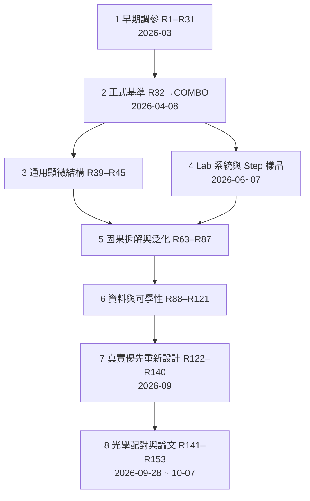

# 研究歷程與逐輪入口

[專案首頁](../../README.md) · [逐號對照 R1–R153](lineage/ROUND_NUMBER_MAP.md) · [沿革細節](lineage/README.md) · [目前保存狀態](STATUS.md)

橫跨約七個月、150 多輪（R1–R153）加 Lab 系統的 26 個研究。**不必全讀。** 下面把它壓成八個階段：當時想解決什麼、發生什麼、為什麼進下一階段；每階段列出該讀的閱讀分區。

> 「不採用」不等於做錯：本專案把失敗當證據保留。177 個閱讀範圍 = 122 個主專案 + 26 個 Lab + 29 個早期分組，**不等於 177 次訓練**。同一個 R 號可能是不同系統（主 R39 ≠ Lab R39）。

## 先看：四種實驗系統（考試換了，數字就不能互比）

研究過程中，資料來源、評分工具和目標換過幾次。下面的八個階段都屬於其中一種系統；時間上有重疊。

| 系統 | 大約期間 | 資料與評分 | 代表成果 |
|---|---|---|---|
| A 公司端環形 + 外部 GMF | 2026-03～05 | 環形影像；固定的外部 GmmVisionTool GMF，看 1／0.1／0.01 µm（8／0.8／0.08 px）三尺度 step_std | COMBO（正式基準）、R33、R38v2、R39R40；ONNX 公司端交付 |
| B 實拍樣品擴充與交付 | 約 2026-06～08 | Step、100MG、20×／5×、均華 202 張等實拍；相位配準與外部 GMF 回傳 | 主 R61 STEP 線、ONNX 交付與均華驗證（`Deliverables/Validations/`） |
| C 實驗室顯微系統（LabSystem） | 2026-06～07（V42 沿用到 9 月） | 實驗室自量 25 位置 PSF、自生資料、棋盤與 SEM | Lab R39–R62、V41／V42（R152 之前的論文模型） |
| D 9 月 3 日 PI 930 張重拍 | 2026-09～10 | 30 趟 × 31 位置實拍，PI 回授與 SEM | R122 之後的真實優先路線、R152（論文採用）、R153 十方法比較 |

## 八個階段

### 1　早期調參（R1–R31，2026-03）
- **問題**：同一模型（GeoEdgeAlignSR）怎麼訓練才能讓環形邊界定位最穩？
- **做法**：自動調參，每輪幾組候選，用內部分數挑，再用外部 GMF 檢查三個尺度（0.08／0.8／8 px）。
- **發現**：內部分數、三尺度、外部 GMF 的結論不一定一致；繼續訓練常把較好的早期模型訓練壞（Round6 長跑）；於是把「方法組初排」和「固定模型重新審查」分開（Round12–15）。
- **結果**：Round30 的 `r30_b1_dironly` 成為前任基準。
- 讀：[早期輪次](lineage/EARLY_ROUNDS.md)、[早期分區](routes/early.md)

### 2　正式基準形成（R32 → COMBO，至 2026-04-08）

| 輪次 | 想法 | 結果 |
|---|---|---|
| R32 | 用真實影像微調 | external FAIL，0.8px 差 97.7%，沙盒關閉 |
| R33 | 限制極端像素的拉扯（Winsorize p95） | 定位大幅變準，邊緣變軟 |
| R34／35／37 | 空間分頻、增強光學、頻率正則 | 都沒解決「準 vs 銳利」 |
| R38 | 連續影格一起訓練 | 弱訊號雜訊弄壞 0.8px |
| R38v2 | 尺度限制、訊號門檻、暖身 | 銳利且定位不錯 |
| **COMBO** | R33 + R38v2 | 0.8px 比 R30 好 21.6%、邊緣陡度 +89%、三尺度全過 → **正式基準** |

讀：[完整系列](../../Experiments/R33RobustLoss/reports/R33_R38v2_COMPLETE_EXPERIMENT_SERIES.md)、[COMBO 結果](../../Experiments/R38v2SeqFixed/reports/COMBO_RESULTS.md)、[基準分區](routes/baseline.md)、[R34/35/37 歷史分支](lineage/HISTORICAL_BRANCHES.md)

### 3　通用顯微結構（R39–R45，約 2026-04～05）
- **問題**：COMBO 只在環形上驗證，遇到線條、格線、缺口、刮痕等還行嗎？
- **發現**：顯微能力與環形定位互相拉扯。R40–R42 把顯微能力推高，但環形 GMF 退步太多（R42 的 0.8px 退步 94%）僅留研究；**R39+R40 權重平均（`R39R40_avg_a025`）** 三尺度都守在 COMBO 的 3% 內並改善形狀泛化，2026-05-11 升為核准替代；R44、R45 的蒸餾與小型修正分支無法同時保位移與形狀，結案。
- 讀：[主 R39–62 分區](routes/main39_62.md)、[R43 堪用性盤點](../../Experiments/R43_CandidateUsabilityAudit/README.md)

### 4　Lab 系統與 Step 樣品（約 2026-06～07）
- **問題**：論文要用的是實驗室自己的顯微系統，條件不同。
- **做法**：另起 `LabSystem_MOSR`：自量 25 位置 PSF、自生資料、承接 COMBO 網路權重但重建光學層。
- **過程**：實拍棋盤角點被模型弄壞 → R46–R56 連續修角點、模糊來源、答案風格 → R57–R60 改用 SEM 尺寸當答案 → R61 擴大通用邊界與位移保護 → R62 針對目標樣品 → V41／V42（V42 成為 R152 之前的論文模型）。
- **提醒**：許多 SEM 答案來自同一批樣品，「SEM 分數變好」不是獨立準確度。
- 讀：[Lab 全線](lineage/LAB_SYSTEM.md)、[Lab 分區](routes/lab.md)、[V42 歷史](lab_comparisons/V42_HISTORY.md)

### 5　因果拆解與泛化（R63–R87）
- **問題**：到底哪個部件造成效果？換樣品、換切塊處理還行嗎？
- **重點**：R63 拆開幾何、位移、安全上採樣的貢獻；R79 第 23 輪 EMA 權重成為強顯微候選（未取代 COMBO）；R84–R86 發現任何切塊都會改變結果，三種結構修復消除切塊差異卻各自傷害 SEM 或邊界 → 不升級，改為單次完整影像重建；R87 切塊穩定但在新形狀產生假孔洞。
- 讀：[R63–R87 分區](routes/main63_87.md)

### 6　資料與可學性（R88–R121）
- **問題**：學不好是資料問題嗎？從零訓練能學到什麼？
- **重點**：R88–R93 逐步修資料與約束，**R92、R93 是兩套不同的共用基礎**（R94–98 用 R93，R99/100/102–104 用 R92）；多輪是「停止的失敗案例」（R88 停在第 87 輪、R90 停在第 55 輪）；R105–R106 多觀測重建未過，主線回單張；R107–R118 一連串機制探針；R119 宣稱完成的事被**撤回**，R120 修復；R121 邊界錨點實驗為負。
- 讀：[R88–R104](routes/main88_104.md)、[R105–R121](routes/main105_121.md)

### 7　真實優先重新設計（R122–R140，2026-09）
- **轉折**：2026-09-08 起驗證順序反轉：每個短候選直接用真實顯微影像、SEM、真實位移序列檢驗，不再先贏合成。
- **內容**：R122 原理檢查 → R123 真實優先設計 → R124–R127 原型與量測保留 → R128–R130 與 V42 乾淨比較 → R131–R134 反覆修復、邊界策略、尺寸機制 → R135 七模型統一比較 → R136 PI 重拍 → R139–R140 穩定 U-Net 反覆模型。
- 讀：[R122–R140 分區](routes/main122_140.md)、[R123 設計契約](../../Experiments/R123_RealFirstModelDesign/reports/R123_DATA_AND_VALIDATION.md)

### 8　光學配對與論文（R141–R153，2026-09-28 ～ 10-07）

| 輪次 | 發生什麼 |
|---|---|
| R141–R147 | 25／100 顆 PSF、逐張選 PSF、與訓練資料配對；多數短步或輪廓退步 |
| R148 | 全留原尺寸版，正式只跑 62 次且無保存點，不續跑 |
| **R148v2** | 一次多尺度 U-Net 脈絡 + 三段受控原尺寸邊界修正，8192 次更新完成 |
| R149–R151 | 局部邊界、平均 PSF、可學習 PSF 融合；多為負結果或只留原型 |
| **R152** | 凍結 R148v2，加受限 25-PSF 融合支路，再 8192 次更新 → **論文採用** |
| **R153** | 十種方法在同一批 930 張上完整比較並測效率；U-Net、MambaIRv2 因官方後端受阻未完成 |

讀：[R141+ 分區](routes/main141_plus.md)、[R153 論文交接](../../Experiments/R153_MeanExternalBenchmark/reports/FINAL_BENCHMARK_THESIS_HANDOFF/REPORT.md)

### 補充：2026-10 的保存工作
2026-10-16 之後 repo 的 commit 大多在「完整保存並可重現」：原拍、模型、資料上傳為發布附件、核對雜湊、標記缺件、清理本機。這些是保存紀錄，不是科學結論，日常可略過；現況看 [PROJECT_STATE](../../PROJECT_STATE.md)。

## 閱讀分區（各輪卡片入口）

| 分區 | 入口數 | 這區看什麼 |
|---|---:|---|
| [早期批次與歷史支線](routes/early.md) | 29 | 早期調參、選模、外部比較；日期批次不等於連續 R 編號 |
| [主線起點至 R38](routes/baseline.md) | 6 | 光學檢查、R32 失敗、R33 至 COMBO |
| [主 R39–62](routes/main39_62.md) | 9 | 形狀、顯微與量測；同號 Lab 另見 Lab 分區 |
| [LabSystem](routes/lab.md) | 26 | Lab 各輪與 V41／V42；Lab R61 內部 r36 不是主專案 R36 |
| [主 R63–87](routes/main63_87.md) | 27 | 區分新訓練、舊數據重讀、圖表整理、免訓練修補 |
| [主 R88–104](routes/main88_104.md) | 20 | R92 與 R93 是不同共用來源；停止、塌縮、不利結果保留 |
| [主 R105–121](routes/main105_121.md) | 25 | 短測、知道答案的上限、正式訓練分開；R119 撤回與 R120 修復一起讀 |
| [主 R122–140](routes/main122_140.md) | 21 | 對齊資料、SEM、量測定義，再讀完整比較 |
| [主 R141 起](routes/main141_plus.md) | 14 | 部署設計、短測與正式完成分開；論文交接在 R153 |

卡片只是閱讀順序，不表示相鄰兩輪繼承同一模型或資料；**原正式報告優先於卡片摘要**。生成程式查 [GENERATION_GUIDE](GENERATION_GUIDE.md)，文獻查 [LITERATURE_GUIDE](LITERATURE_GUIDE.md)，下載查 [ASSET_GUIDE](ASSET_GUIDE.md)，每輪內部檔案分工查 [DEEP_STRUCTURE](../navigation/DEEP_STRUCTURE.md)。

> 本頁 2026-10-24 改寫前的原文逐位元組保留在 [docs__reproducibility__EXPERIMENTS.md](../history/BEFORE_PLAIN_REWRITE_20261024/docs__reproducibility__EXPERIMENTS.md)。
