# R94、R95、R97、R98 重要原圖與失敗脈絡

所有影像皆為當年現存檔案的原位元組副本；完整影像仍在每輪附件。實拍差異圖只是與原圖的變化，不能解讀成對乾淨真值的誤差。

## R94

停止原因是當時保護程式估算剩餘 -0.48 GiB，不能把這個估算寫成實測顯卡剩餘量。R95 前置診斷另發現需求目標的微小常數底值、過度關閉的控制、早期平均權重及快取重複計算等問題；訓練失敗與方法機制分別記錄。早期預檢／空的正式啟動目錄及失敗也完整保存。

固定四個實拍預覽視野；原圖／本輪輸出／絕對差異放大8倍。不是SEM誤差。

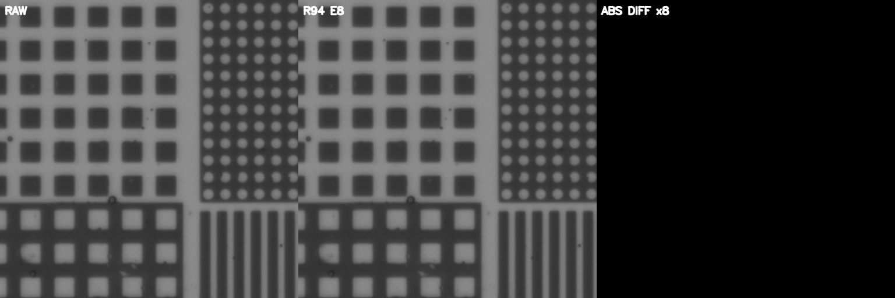

原件：`Experiments/R94_EvidenceConditionalScratch/results/real_live_validation/epoch_008/20x_mixed_raw_raw_r94_diff.png`。

固定四個實拍預覽視野；原圖／本輪輸出／絕對差異放大8倍。不是SEM誤差。

原件：`Experiments/R94_EvidenceConditionalScratch/results/real_live_validation/epoch_008/50x_array_raw_raw_r94_diff.png`。

固定四個實拍預覽視野；原圖／本輪輸出／絕對差異放大8倍。不是SEM誤差。

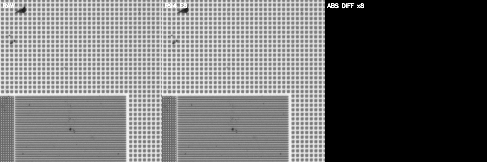

原件：`Experiments/R94_EvidenceConditionalScratch/results/real_live_validation/epoch_008/5x_dense_raw_raw_r94_diff.png`。

固定四個實拍預覽視野；原圖／本輪輸出／絕對差異放大8倍。不是SEM誤差。

原件：`Experiments/R94_EvidenceConditionalScratch/results/real_live_validation/epoch_008/pillar_center9_50x_raw_raw_r94_diff.png`。

合成觀測／輸出／程序答案；圖中RAW也是模擬觀測。保留清楚輸入及位移案例，不只挑漂亮細節。

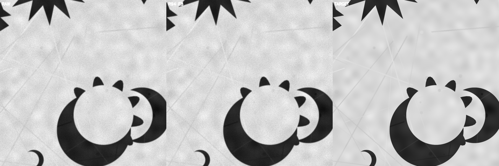

原件：`Experiments/R94_EvidenceConditionalScratch/results/synthetic_live_validation/epoch_008/validation_00_recoverable_detail.png`。

合成觀測／輸出／程序答案；圖中RAW也是模擬觀測。保留清楚輸入及位移案例，不只挑漂亮細節。

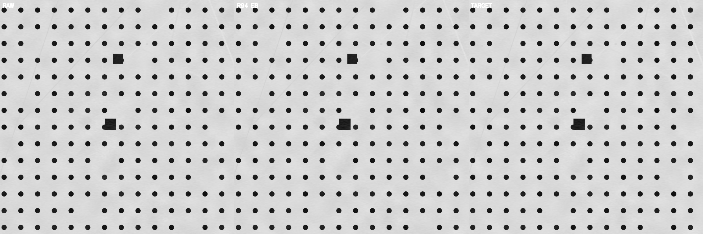

原件：`Experiments/R94_EvidenceConditionalScratch/results/synthetic_live_validation/epoch_008/validation_02_clear_detail_guard.png`。

合成觀測／輸出／程序答案；圖中RAW也是模擬觀測。保留清楚輸入及位移案例，不只挑漂亮細節。

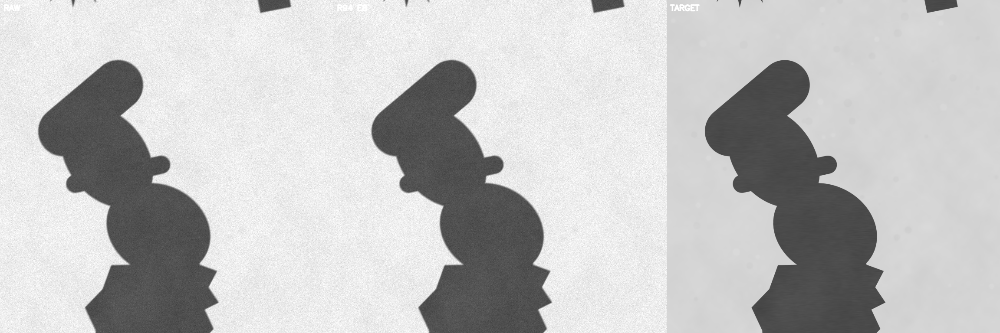

原件：`Experiments/R94_EvidenceConditionalScratch/results/synthetic_live_validation/epoch_008/validation_05_signed_subpixel_motion.png`。

## R95

第一次因保護停止於未提交的第 10 輪，回到模型第 8 輪，且 optimizer_state_restored=false：模型與平均權重接續，但訓練更新狀態重新建立。後續由第 11、32 輪接續才有完整更新狀態。不能稱為三次完全連續或四次獨立訓練。第 40 輪診斷仍顯示清楚案例的誤改、邊界控制壓低與極弱紋理分支；48 輪已完成不等於這些機制全面解決。

固定四個實拍預覽視野；原圖／本輪輸出／絕對差異放大8倍。不是SEM誤差。

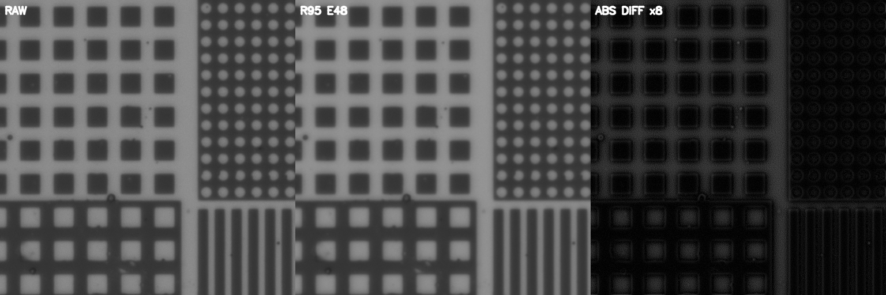

原件：`Experiments/R95_CounterfactualGateRepairScratch/results/real_live_validation/epoch_048/20x_mixed_raw_raw_r95_diff.png`。

固定四個實拍預覽視野；原圖／本輪輸出／絕對差異放大8倍。不是SEM誤差。

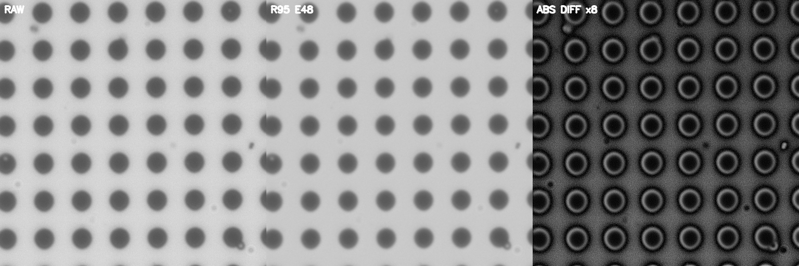

原件：`Experiments/R95_CounterfactualGateRepairScratch/results/real_live_validation/epoch_048/50x_array_raw_raw_r95_diff.png`。

固定四個實拍預覽視野；原圖／本輪輸出／絕對差異放大8倍。不是SEM誤差。

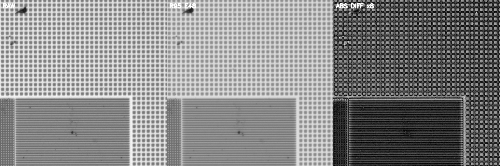

原件：`Experiments/R95_CounterfactualGateRepairScratch/results/real_live_validation/epoch_048/5x_dense_raw_raw_r95_diff.png`。

固定四個實拍預覽視野；原圖／本輪輸出／絕對差異放大8倍。不是SEM誤差。

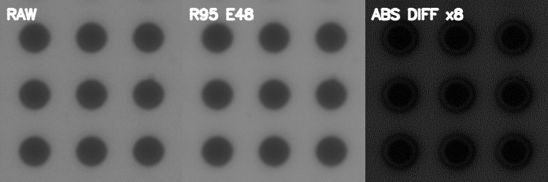

原件：`Experiments/R95_CounterfactualGateRepairScratch/results/real_live_validation/epoch_048/pillar_center9_50x_raw_raw_r95_diff.png`。

合成觀測／輸出／程序答案；圖中RAW也是模擬觀測。保留清楚輸入及位移案例，不只挑漂亮細節。

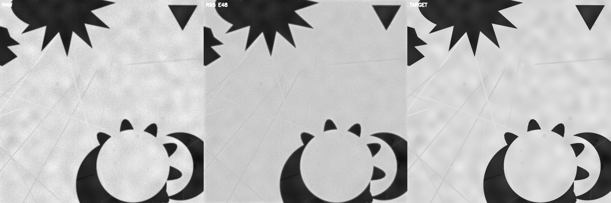

原件：`Experiments/R95_CounterfactualGateRepairScratch/results/synthetic_live_validation/epoch_048/validation_00_recoverable_detail.png`。

合成觀測／輸出／程序答案；圖中RAW也是模擬觀測。保留清楚輸入及位移案例，不只挑漂亮細節。

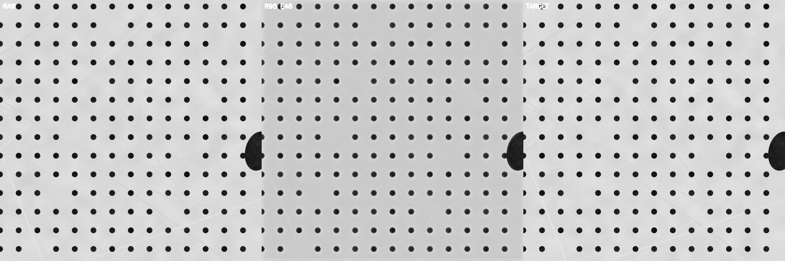

原件：`Experiments/R95_CounterfactualGateRepairScratch/results/synthetic_live_validation/epoch_048/validation_02_clear_detail_guard.png`。

合成觀測／輸出／程序答案；圖中RAW也是模擬觀測。保留清楚輸入及位移案例，不只挑漂亮細節。

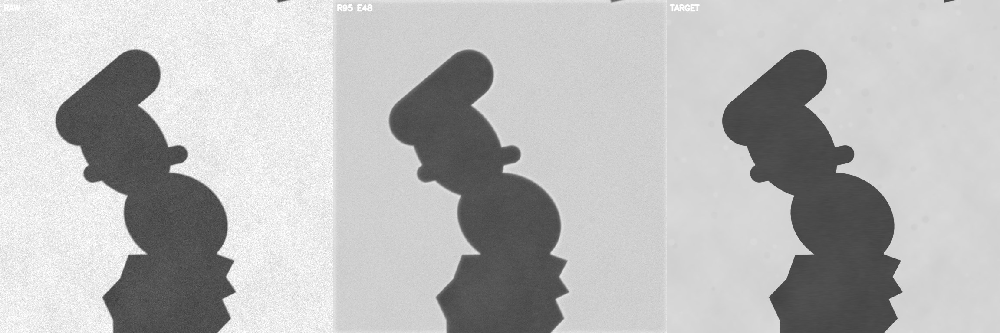

原件：`Experiments/R95_CounterfactualGateRepairScratch/results/synthetic_live_validation/epoch_048/validation_05_signed_subpixel_motion.png`。

## R97

正式訓練前另有過高顯卡批量造成的 Windows 顯示驅動逾時與重新開機，不能混同於正式第 1 輪的檔案存取問題。保存事故、保守批量測試、有限值梯度修補與恢復驗證。301 張實拍可見邊緣／細節增加，但不構成乾淨真值；週期測試沒有錯一格也不代表真實位移絕對準確。

固定四個實拍預覽視野；原圖／本輪輸出／絕對差異放大8倍。不是SEM誤差。

原件：`Experiments/R97_DirectCausalPhaseScratch/results/live_validation/epoch_048/20x_mixed_raw.png`。

固定四個實拍預覽視野；原圖／本輪輸出／絕對差異放大8倍。不是SEM誤差。

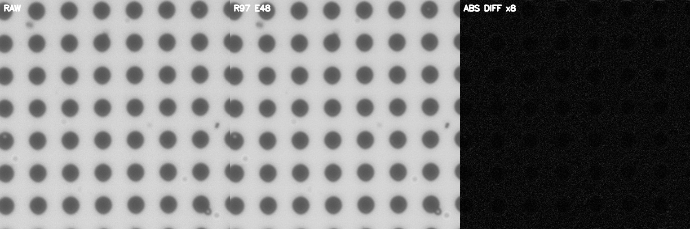

原件：`Experiments/R97_DirectCausalPhaseScratch/results/live_validation/epoch_048/50x_array_raw.png`。

固定四個實拍預覽視野；原圖／本輪輸出／絕對差異放大8倍。不是SEM誤差。

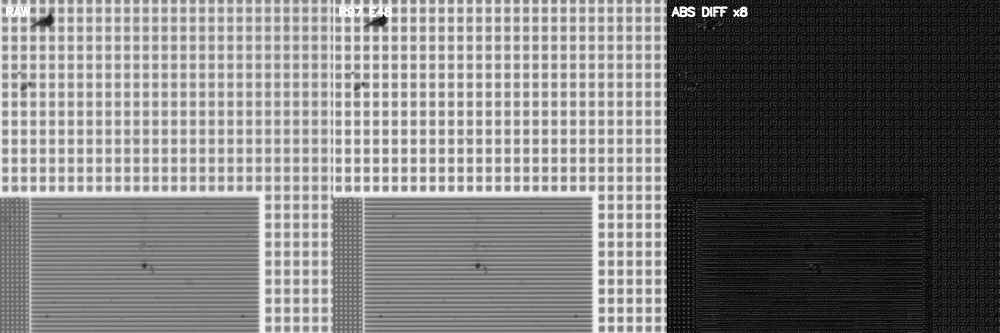

原件：`Experiments/R97_DirectCausalPhaseScratch/results/live_validation/epoch_048/5x_dense_raw.png`。

固定四個實拍預覽視野；原圖／本輪輸出／絕對差異放大8倍。不是SEM誤差。

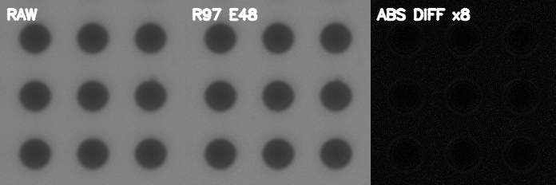

原件：`Experiments/R97_DirectCausalPhaseScratch/results/live_validation/epoch_048/pillar_center9_50x_raw.png`。

原驗證歷程，保留未共同改善的軸。

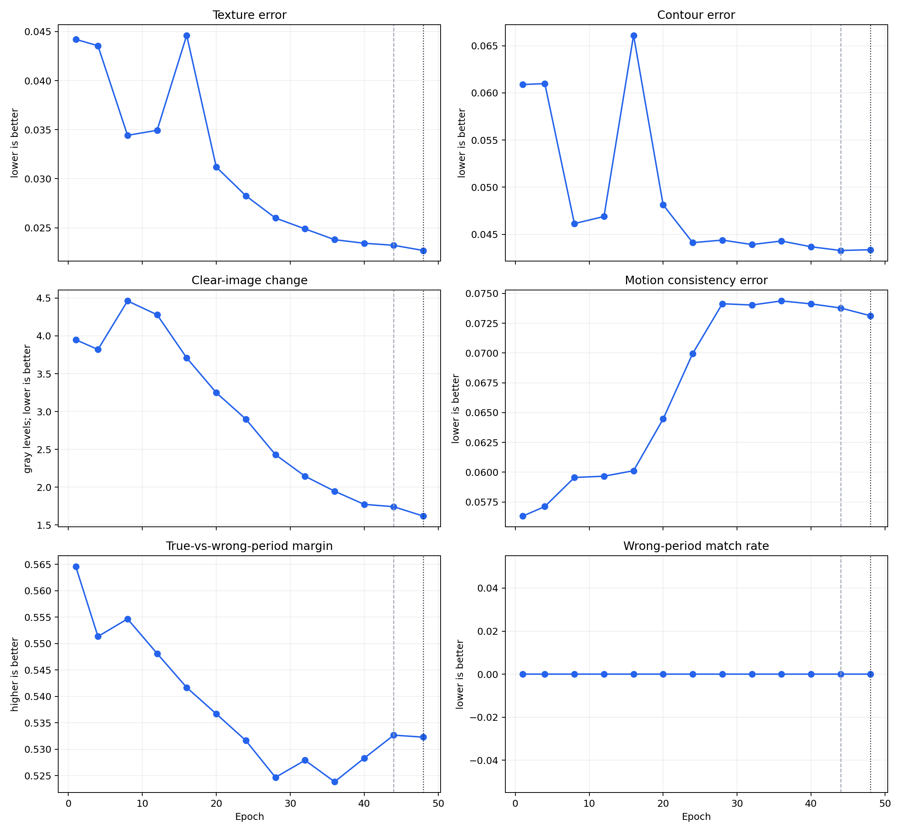

原件：`Experiments/R97_DirectCausalPhaseScratch/results/posttraining_validation/training_dynamics/validation_trajectory.png`。

原細節區域集合，顯示保守紋理及局部變化。

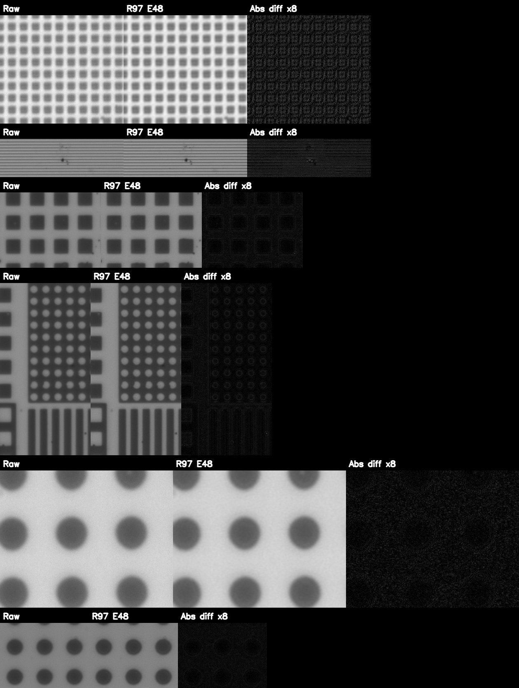

原件：`Experiments/R97_DirectCausalPhaseScratch/results/posttraining_validation/model_internal/figures/detail_roi_contact_sheet.png`。

原六方法SEM配對比較，包含不利輪廓及形狀結果。

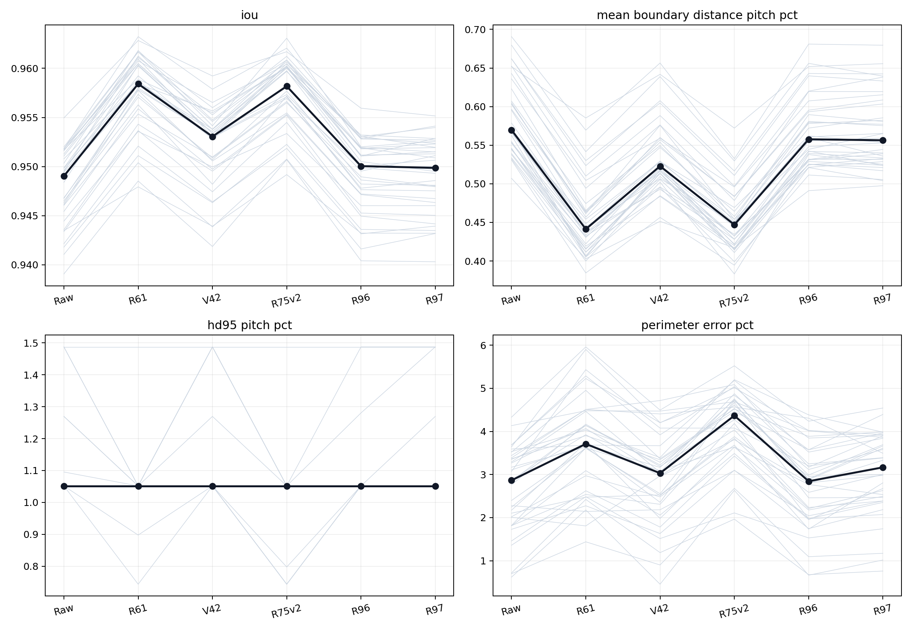

原件：`Experiments/R97_DirectCausalPhaseScratch/results/posttraining_validation/sem_contour/figures/six_method_paired_comparison.png`。

同36顆的SEM輪廓疊圖；重複曝光不是獨立樣本。

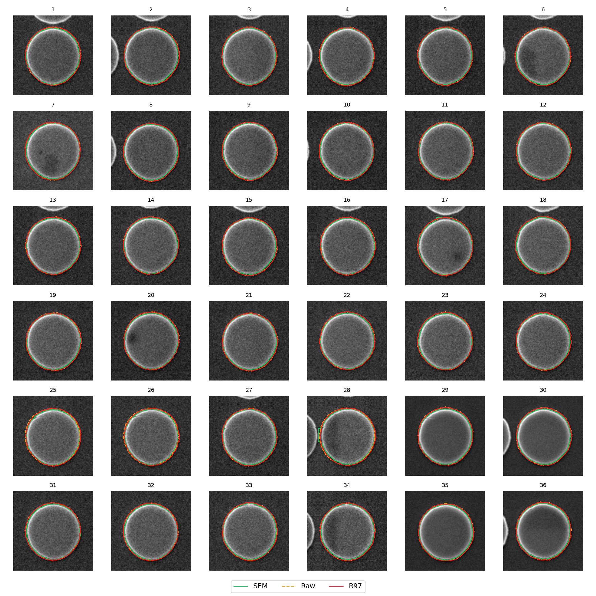

原件：`Experiments/R97_DirectCausalPhaseScratch/results/posttraining_validation/sem_contour/figures/center36_contour_overlay_exposure18.png`。

## R98

舊結果報告仍寫「預檢中」，但完整 48 輪原表、最終模型和 SEM 表已存在。本次補正報告並保留舊文。現存證據不足以把全部 R97 後訓練檢查宣稱已在 R98 跑過，缺少的 R98 實拍整套、位移與分支摘要如實列出。兩輪各自記錄的內部紋理／位移量較小，但輪廓與清楚輸入改動較大；驗證裁切種子不同，不能當成相同輸入下的優劣證明。

固定四個實拍預覽視野；原圖／本輪輸出／絕對差異放大8倍。不是SEM誤差。

原件：`Experiments/R98_AggressiveTextureScratch/results/live_validation/epoch_048/20x_mixed_raw.png`。

固定四個實拍預覽視野；原圖／本輪輸出／絕對差異放大8倍。不是SEM誤差。

原件：`Experiments/R98_AggressiveTextureScratch/results/live_validation/epoch_048/50x_array_raw.png`。

固定四個實拍預覽視野；原圖／本輪輸出／絕對差異放大8倍。不是SEM誤差。

原件：`Experiments/R98_AggressiveTextureScratch/results/live_validation/epoch_048/5x_dense_raw.png`。

固定四個實拍預覽視野；原圖／本輪輸出／絕對差異放大8倍。不是SEM誤差。

原件：`Experiments/R98_AggressiveTextureScratch/results/live_validation/epoch_048/pillar_center9_50x_raw.png`。
