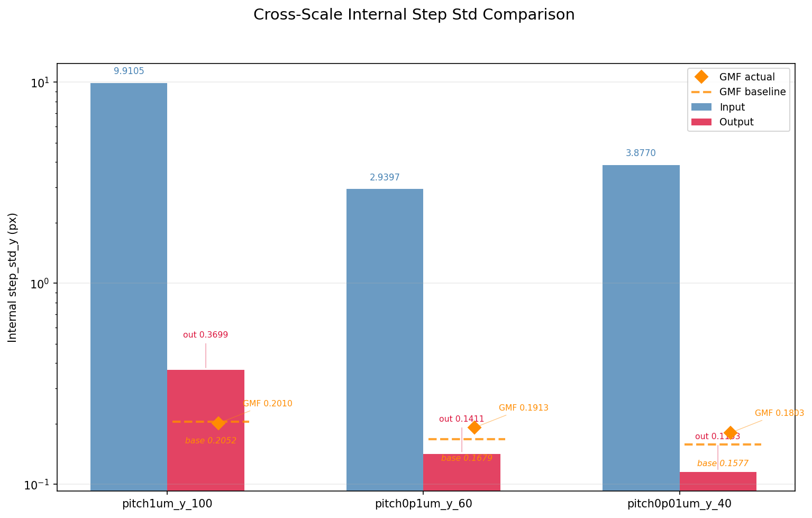
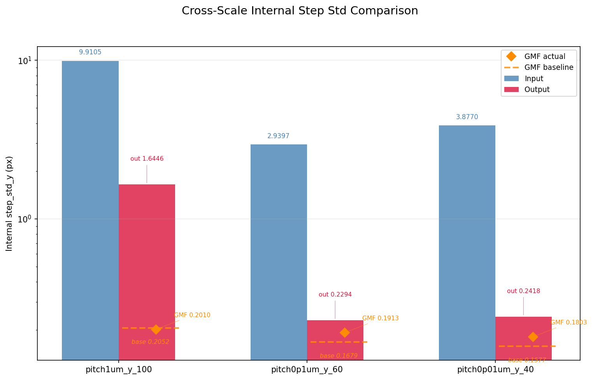
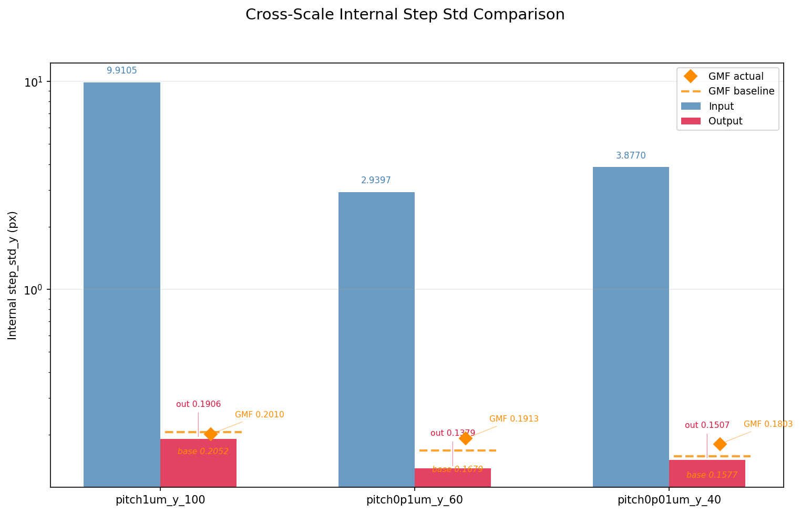

# R34、R35、R37：在GitHub歷史分支，不能只看現在的資料夾

2026-10-22。這三輪的原報告、程式及結果並未因目前主資料夾缺少同名目錄而遺失；它們在各自固定歷史版本。本次提出原小檔供直接閱讀，不複製三整套重建影像。

## R34

在R33的極端梯度限制上，試圖用空間高低頻分開損失，恢復銳利度而維持步長。原設定sigma1.5、低／高頻權重各0.5；原選擇第38輪。結果沒有勝過R33，8px內部步長退步，銳利度未恢復。

[完整固定來源](https://github.com/rio10255254/GMM_2_Final/tree/5ab5b175b6f2a18457875d1ea8f34c94f11412ba/Experiments/R34FreqSplit)／[原報告](branch_sources/R34/reports/R34_RESULTS.md)／[原啟動參數](branch_sources/R34/scripts/launch_r34.py)／[三尺度完整原JSON](branch_sources/R34/results/sequence_analysis/cross_dataset/cross_dataset_comparison.json)。要讀當時程式須使用固定版本的Model與分析程式，不能直接把這份舊launcher套到現在核心。

[原殘差比較](branch_sources/R34/results/sequence_analysis/cross_dataset/09_cross_scale_residual_improvement.png)與[0.8px逐步穩定圖](branch_sources/R34/results/sequence_analysis/pitch0p1um_y_60/02_step_stability.png)另外保留。

## R35

將光學反卷積初始強度提高到0.25，沿用p95與暖身10輪；原選擇第38輪。結果各項退步，8px內部步長標準差約1.645px。原解釋是較強高頻放大也增強噪聲，訓練沒有因此恢復較好的邊界。

[完整固定來源](https://github.com/rio10255254/GMM_2_Final/tree/1005e7bdc51291ef783f55a6911d84c7e98b0383/Experiments/R35AlphaBoost)／[原報告](branch_sources/R35/reports/R35_RESULTS.md)／[原啟動參數](branch_sources/R35/scripts/launch_r35.py)／[三尺度完整原JSON](branch_sources/R35/results/sequence_analysis/cross_dataset/cross_dataset_comparison.json)。

[原殘差比較](branch_sources/R35/results/sequence_analysis/cross_dataset/09_cross_scale_residual_improvement.png)與[0.8px逐步穩定圖](branch_sources/R35/results/sequence_analysis/pitch0p1um_y_60/02_step_stability.png)另外保留。

## R37

因R35均勻提高光學強度失敗，改成頻率相依正則：sigma0.15、低頻倍率2.0、高頻下限0.3，沿用p95與暖身10輪；原選擇第21輪。結果仍未勝過R33，原報告保留高頻噪聲、較軟邊緣與8px形狀不穩的限制。

[完整固定來源](https://github.com/rio10255254/GMM_2_Final/tree/2773b1a0fdd98fcdcdbf26880f0480f88a5b2f69/Experiments/R37FreqReg)／[原報告](branch_sources/R37/reports/R37_RESULTS.md)／[原啟動參數](branch_sources/R37/scripts/launch_r37.py)／[三尺度完整原JSON](branch_sources/R37/results/sequence_analysis/cross_dataset/cross_dataset_comparison.json)。

[原殘差比較](branch_sources/R37/results/sequence_analysis/cross_dataset/09_cross_scale_residual_improvement.png)與[0.8px逐步穩定圖](branch_sources/R37/results/sequence_analysis/pitch0p1um_y_60/02_step_stability.png)另外保留。

## 三張舊圖容易誤讀的地方

三輪原JSON的`gmf_step_std`均為8px的0.201031、0.8px的0.191336、0.08px的0.180313，對應原R26分析。三個固定版本的`Analyses/AnalysisLab/r26/sequence/configs/dataset_config.py`，`_GMF_ROOT`都指向`external_compare_r18_r22_r25_r26/r26_sm035/gmf_results/raw`；分析程式按這條路徑讀回傳。

因此圖中藍紅柱是各輪的內部量法，**橘色GMF actual點沿用R26，不能當成R34、R35、R37各自獨立的外部回傳**。原圖、原JSON和原報告均不改；本頁補來源讀法，避免把共用參照重複當成三輪新證據。橘色虛線則為舊R30基準。[目前原設定](../../../Analyses/AnalysisLab/r26/sequence/configs/dataset_config.py)／[原讀取程式](../../../Analyses/AnalysisLab/r26/sequence/scripts/run_sequence_analysis.py)／[逐份核對](PLOT_REFERENCE_ORIGIN_AUDIT.json)。

較早報告的一些表格使用內部步長與當時比較欄，不能直接與後來正式外部GMF總表混排。研究判斷仍以原完整系列和正式政策為準；本次沒有重新計算或改判。

## 模型也已保存，不必再傳一遍

三輪`best_tradeoff`及各自平滑best的原檔，均已在`research-results-models-20261016`的正式附件中找到相同內容身分。[原模型位置與既有取得位置](BRANCH_MODEL_PROVIDERS.json)列出每個檔案、大小、校驗身分與所在ZIP。

兩類best均保留，各輪原選模、重建與程式版本必須一起閱讀；本次不因檔名best或latest重選模型，也不將未採用中途模型全部送上GitHub。

## 其他分支

[80個本機分支的逐份對照](BRANCH_REACHABILITY.csv)記錄固定版本及遠端可到達性。有些本機名稱沒有遠端同名，但內容已在遠端另一名稱或後續版本歷史，不能只比名稱就說遺失；反過來，也不能把多個同版本名稱算成多次獨立研究。

[107份本次提出的原小檔](READABLE_ORIGINAL_SOURCES.json)包括三輪報告、程式、完整小型數值、九張圖，另有早期原件、31份完整JSON及23份日誌，共約4.66MB。完整原圖庫仍在固定歷史，D/H原件與原分支保持原樣。
