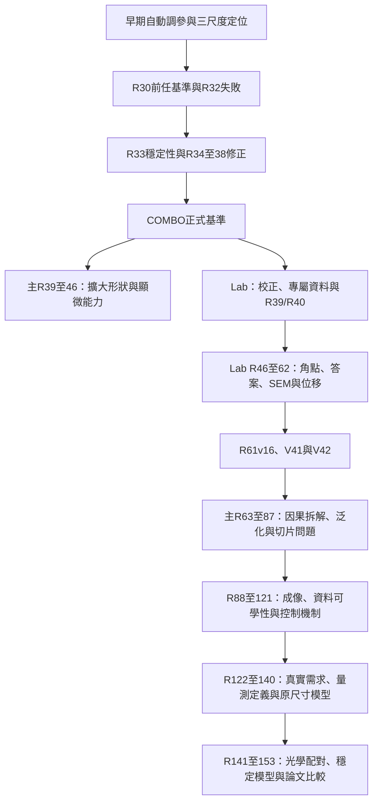

# 從早期輪次到R153，以及LabSystem的研究沿革

2026-10-22。本頁把「檔案已保存」「讀者找得到前後關係」及「能否完整重做當年實驗」分開記錄。不能以177份閱讀入口或205份近期檔案已同步，證明所有歷史輪次都完整。

## 先按問題找

| 想知道甚麼 | 閱讀入口 |
|---|---|
| R1到R153每個號碼對應哪個系統、是否同號多支線 | [逐號對照](ROUND_NUMBER_MAP.md) |
| 最早自動調參、三種步長、sweep與final、Round1至31 | [早期輪次](EARLY_ROUNDS.md)、[31份原JSON逐次對照](EARLY_REPORTS.md) |
| R34／R35／R37去哪了，原程式和失敗結果在哪 | [歷史分支與原件](HISTORICAL_BRANCHES.md) |
| Lab校正、訓練資料、R39／40、R46至62、V41／V42和外部方法 | [LabSystem全線](LAB_SYSTEM.md) |
| 為甚麼第10輪與第120輪不能只留較好的那份 | [原模型診斷數表的讀法](LAB_BEST_CHECKPOINT_READING.md) |
| 每個現有研究範圍的原報告、方法、得失 | [原177個分組入口](../EXPERIMENTS.md)；55份原先籠統的來源說明已補成各輪具體條件 |
| 原設定中寫明用了哪一輪的資料或模型 | [439條原引用](DECLARED_UPSTREAM_REFERENCES.csv)，保留來源欄位與設定位置；宣告引用不自動等於實際繼承或獨立驗證 |
| 80個本機分支的內容是否仍能從GitHub找到 | [逐分支對應](BRANCH_REACHABILITY.csv)／[完整核對資料](BRANCH_REACHABILITY.json) |
| 目前哪些原程式、設定與正式文件已在主版本 | [3,126份來源逐檔核對](SOURCE_AVAILABILITY.json.gz) |
| 本次補充是否真的已從GitHub取回 | [186份小型來源與導讀的實際取回紀錄](VERIFIED_CONTEXT_DELIVERY.json)，保留固定來源、數量、內容核對及未解限制 |

## 不帶輪次的內容也有主人

| 內容 | 現有入口與保存角色 |
|---|---|
| 文獻與原方法 | [文獻及官方固定來源](../LITERATURE_GUIDE.md)，分清原文、專案推論與未收錄全文 |
| 主專案光學擬合、L0／L1、MATLAB與教學版 | [光學來源審查](../../../PSF_Fitting/docs/PSF_GITHUB_PRESERVATION_AUDIT_20261021.md)、[頻譜版本](../optical_calibration/SPECTRA.md)；流程預覽不能冒充正式擬合 |
| 多輪共用生成器與模型程式 | [原生成方法](../GENERATION_GUIDE.md)、[共享模型說明](../../../Model/README.md)；必要固定來源保留一次，各輪設定仍須相配 |
| 原相機、平台、SEM及不能再生的答案 | [來源與影像取捨](../SOURCE_AND_IMAGE_DECISIONS.md)；930張與30份位置紀錄沿同一來源，不以模型重建代替 |
| 早期與共用分析工具 | [原專案地圖](../../navigation/PROJECT_MAP.md)，沿AnalysisLab、Step及各倍率原工作區查；量測器與模型改動分開 |
| 獨立交付與重做小包 | [研究保存入口](../README.md)及各固定版本；生成程式、必要模型及來源要保留，完整舊便攜環境ZIP可留本機 |
| 原論文、交接與編修歷史 | [現在R153交接](../../../Experiments/R153_MeanExternalBenchmark/reports/FINAL_BENCHMARK_THESIS_HANDOFF/REPORT.md)、[原文及修改程式精選](../project_completion/curated/draft_cleanup_20261022/README.md)；舊稿不改成目前採用版 |

上述跨區域位置仍以原專案地圖為唯一整體導航；本頁只負責研究輪次及來源關係，沒有另外搬家或建立一套新工作目錄。

## 本次實際確認了甚麼

本機主實驗區有122個R系列資料夾，Lab實驗區有26個有名稱的研究資料夾，均已有閱讀入口。原另外29個入口是早期日期批次與支線，不能當作29個連續輪次。三個只在歷史分支的實驗R34／R35／R37，本次另補可直接閱讀的原報告、設定、小型完整數表及九張有明確用途的原分析圖；再由31份完整autotune JSON與23份原日誌把R2至R10逐一串回。

919份原正式文件、1,885份主要程式、322份設定，共3,126份，均在本次核對的GitHub主版本，內容與原來源索引相符。80個本機有名稱分支的版本也均能從GitHub現有分支歷史找到。數十個分支名稱指向同一個版本，分支數不能用來計算獨立實驗次數。

這些是內容與查找核對。本次沒有重新訓練、推論、重新生成整套資料或重算全部歷史結果；先前已做過的實際取回與執行保留各自原日期及範圍。

## 三種編號不能互換

- **R編號**用來標研究輪次，同號可能有不同系統或多個子研究。主R39與Lab R39使用不同成像條件；R80也有兩個問題不同的研究。
- **stage編號**是資料生成類型。Lab的stage01至33是2,968組基礎資料的類型，不是Lab另外做過R1至R33共33次訓練。
- **V版本**是程式／模型版本。Lab V41、V42不等於主專案R41、R42。Lab R61v16與主專案R61的使用／驗證入口，也不能算成兩份獨立訓練證據。

## 為甚麼研究會走到這裡

下圖的箭頭表示研究問題及閱讀順序；真正的資料或權重繼承，仍以原設定、原程式及各輪報告為準，不由相鄰編號推定。

### 早期至COMBO

早期從畫面銳利及8px位移出發，後來發現內部評分、三個尺度和外部GMF不一定一致。Round6等長跑顯示繼續訓練常破壞早期較好的模型；Round12至15再分開「方法組初排」與「固定一份模型重新審查」。Round18、22、25至30構成較晚的外部比較鏈，R30成為前任基準。

R32的真實影像微調未改善主尺度。R33以限制極端像素牽引改善定位，但有銳利度代價；R34空間分頻、R35提高光學強度、R37頻率正則均未解決取捨。R38將全部尺度一起做序列訓練仍受弱訊號干擾，R38v2才加入尺度限制、訊號門檻與暖身，COMBO再結合R33。原完整系列、失敗及正式三尺度數據仍在[系列報告](../../../Experiments/R33RobustLoss/reports/R33_R38v2_COMPLETE_EXPERIMENT_SERIES.md)，不能以舊圖中的共用參考點冒充每輪獨立回傳。

### 主R39至46與Lab的分岔

主R39／R40擴大形狀與顯微特徵，端點、加權平均和後續R41至46是不同嘗試。Lab另換成實際實驗室的25位置PSF和Lab資料，繼承網路但重建光學緩衝，從Lab R39／R40開始。它的實拍棋盤改善很小且角點受損，才有Lab R46至56對角點、模糊來源與答案風格的連串修正。

Lab R57至60進一步釐清SEM答案、半量尺寸修正、同影像後修正及實拍裁切亮暗方向。R61再擴大通用邊界與位移保護；其3,400組繼承來源與歷史幾何不能只靠新計算替代。R62、V41與V42延續目標樣品和老師資料，因此同樣本SEM及訓練來源依賴必須與結果一起讀，不能改稱未知樣本的獨立準確度。

### 主R63至87

R63拆解既有幾何／位移設計，R64重讀舊數據，R65／66是圖表與可追查整理，並非都產生新訓練。R67至82逐步擴大真實場景、曝光、合成缺陷、完整輪廓、SEM量法及不同架構比較。R75、R75v2、R79才是不同資料設計的從零模型，早期無有效更新、不同選定輪次及設計已看過的驗證資料都保留。

R83至86追查全圖與切片差異，免訓練修補、共同畫布及局部正規化都帶來代價；R87改成局部模型從零訓練，仍有假孔洞與新形狀退步。這解釋後來為甚麼轉向資料形成及可恢復細節，而不是只加深或銳化網路。

### 主R88至121

R88至93重做邊界、曝光、細節和清楚輸入保護。R94至98共用R93基礎；R99、100、102至104共用R92基礎，資料身分和線上觀測不能互換。[來源與修復](../GENERATION_GUIDE.md)、[R89至93問題沿革](../scratch_lineage/README.md)與[原不利結果](../project_completion/curated/FAILURE_LINEAGE_READING.md)一起保留。

R105A／B／C、R106和R108A至G分別檢查幾何渲染、多觀測、局部動作及邊緣剖面；知道答案時能做到的上限，不能當成模型實際可辨認的能力。R109至118形成受限位移與寬度修正，再逐步檢查訓練及量法。R119原完整因果完成宣稱已撤回：序列沒有按原設計實際接入；R120修復形成與對照，R121的八個有效短測仍未通過。這些限制不能被後來整理覆蓋。

### 主R122至153

R122檢查操作原理及V42來源，R123至127先對齊真實需求、資料亮暗與量測定義，R128才做四個完整研究訓練。R129至140另測光學融合、原尺寸重建、反覆修正、邊界保留、尺寸原因與U-Net；方法設計、短測、停止、正式完成和未採用各自保留。

R135／136統一比較與30趟重拍，讓輪廓、尺寸、短步、長距離與速度分開看；重拍穩定不是絕對準確。R141／142的部署設計也不等於新長訓練，R142缺少指定100顆實測PSF時拒絕執行不能寫成已驗收。R143至147檢查光學配對、方向、SEM中心淡尾與尺度；R144錯方向中止，R145修正後結果另列。

R148只留下62次更新且沒有保存點；R148v2才是完成後成為R152基底的版本。R149短測未過門檻，R150有得有失，R151沒有開始正式長訓練。R152保留位移／重拍收益、尺寸偏差與速度代價；R153以九顆平均位移完成十方法比較及完整原數表，兩個官方後端受阻如實記錄。[現在論文交接](../../../Experiments/R153_MeanExternalBenchmark/reports/FINAL_BENCHMARK_THESIS_HANDOFF/REPORT.md)才是目前入口。

## 現在仍不能說甚麼

R2至R10起初無法由檔名直接看出，已再查原JSON內的profile及舊日誌產物而綁回；R10就在Round9排程的第二、三步。較早val_batch與較晚seq_val分開，不用跨來源分數高低證明模型變好。R36仍未找到足以獨立指定的證據，不宣稱從未做過，也不補造一輪。22份較早程式版本與九項早期R13公式缺件仍未尋回。未寫出的量不補造。

因此可以說本次已逐一對照現存主／Lab資料夾、補上歷史分支與來源讀法；不能說R1至R153每個歷史版本都已完整重現。原MATLAB／專有GMF、來源位置調整、同樣本答案及已知缺件仍有明確邊界。

COMBO正式基準、核准替代與R152／RAW論文身分不因本次整理改變。可再生的大型訓練資料、全部中途模型及整批重建留本機／H，930張共用原拍和30份原始位置紀錄沿同一正式來源；本次不新增大型資料包。
