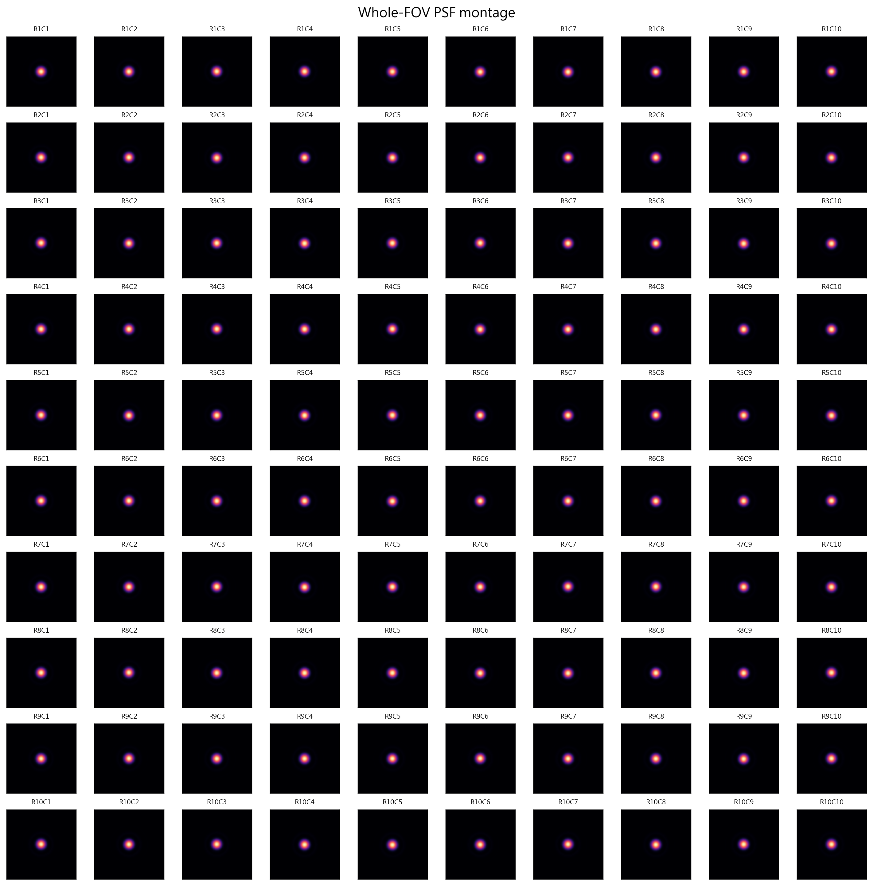

# 光學校正的歷史與快速重算

先讀[來源與方法審查](../../../PSF_Fitting/docs/PSF_GITHUB_PRESERVATION_AUDIT_20261021.md)：它分清正式MATLAB擬合、較早重複擬合研究、後來三次拍攝比較，以及只供流程預覽的Python教學。

本輪也核對原MAT的100個來源位置。原檔用1×100存放，另依原MAT與原CSV互相符合的位置排回10×10，全部原值保留。下圖是2026-10-21產生的來源位置顯示版，沒有重新擬合，不是當年的原始輸出圖。



小型結果重算包預定提供在[光學校正重算版本](https://github.com/rio10255254/GMM_2_Final/releases/tag/research-optical-calibration-replay-20261021)。本頁在實際從GitHub取回執行後才會標記為已驗證發布。完整實拍、SEM、原模型與其他歷史依[全專案入口](../project_completion/README.md)另行核對。

解開包後使用Python3.12，安裝包內列出的固定版本，再執行：

```text
python Tools/replay_psf_saved_results.py --root . --output NEW_PSF_RESULT_FOLDER
```

重算包自帶45份重複擬合結果、原數表、三份清單、100位置結果與原分析程式；不需讀取舊D／H研究資料，也不使用訓練顯卡。重做既存分析，不重新拍攝、最佳化或訓練。
