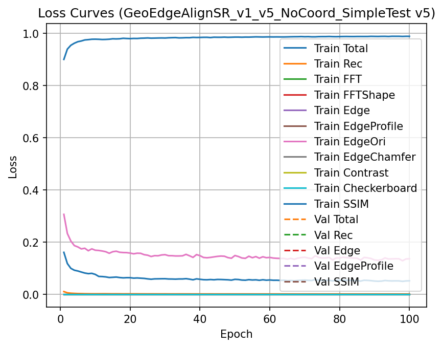
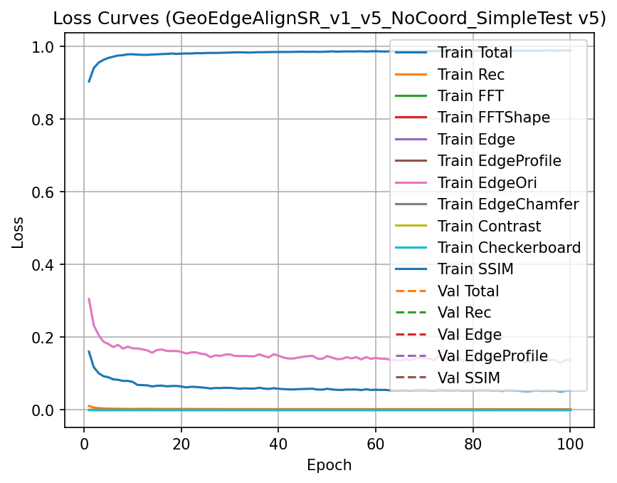
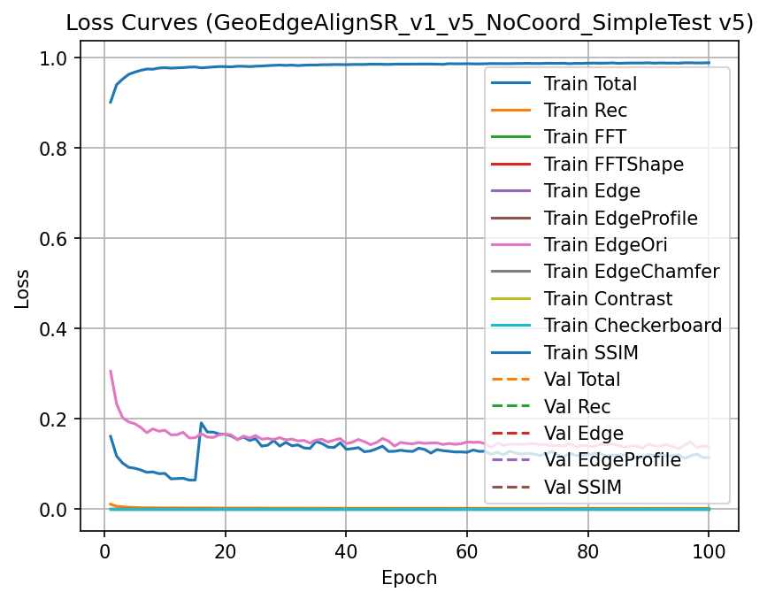
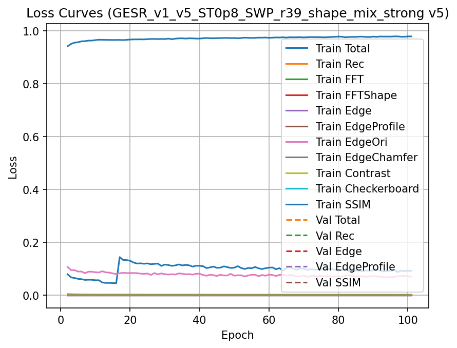

# 早期訓練歷程的原影像

這裡保留四條路線的原監看與訓練曲線，包含未採用的R35。所有檔案都是原位元組複製，沒有重畫、增強或補造舊圖。[逐張來源](GALLERY_PROVENANCE.json)。

四組監看輸入的內容完全相同，可由[固定原輸入](gallery/SHARED_MONITOR_INPUT.bmp)核對。這是一個反覆使用的開發視野，不是新的獨立驗證。

| 路線及原本問題 | 原第20輪監看 | 原第100輪監看 | 解讀 |
|---|---|---|---|
| R33 p95：限制極端梯度的牽引 | [第20輪原BMP](gallery/R33_p95_E020.bmp) | [第100輪原BMP](gallery/R33_p95_E100.bmp) | 位置穩定性與柔化代價一起看，原選用的是第23輪 |
| R35：增加物理層作用強度 | [第20輪原BMP](gallery/R35_alpha025_E020.bmp) | [第100輪原BMP](gallery/R35_alpha025_E100.bmp) | 未採用支線，不能只保留成功模型 |
| COMBO：R33修正加有條件的序列訓練 | [第20輪原BMP](gallery/COMBO_E020.bmp) | [第100輪原BMP](gallery/COMBO_E100.bmp) | 正式基準原選用第21輪，末輪不取代它 |
| R39 strong：從COMBO接續擴展非環形能力 | [第20輪原BMP](gallery/R39_strong_E020.bmp) | [第100輪原BMP](gallery/R39_strong_E100.bmp) | 本輪端點、後續權重平均與正式替代身分分別閱讀 |

監看圖不是每一輪都有，這裡沒有為了配合第21／23輪的選模補造圖。正式模型和外部量測以[目前政策](../../../ESTIMATOR_POLICY.json)、[原系列報告](../../../Experiments/R33RobustLoss/reports/R33_R38v2_COMPLETE_EXPERIMENT_SERIES.md)及[R39正式報告](../../../Experiments/R39_ShapeGeneralization/reports/R39_RESULTS.md)為準。較早報告的待定身分須和之後政策分開。

不同路線的損失項和設定不一樣，以下曲線只用來追查各自訓練過程，不能依曲線高低決定哪個模型較好。

完整460張新補影像仍在[本批完整紀錄](https://github.com/rio10255254/GMM_2_Final/releases/tag/research-training-history-supplement-20261021)，不以本頁選圖取代完整歷程。851個補件位置及六份模型另址執行的範圍見[本次核對](README.md)。
