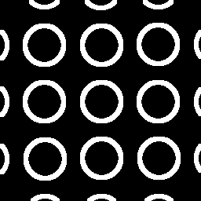
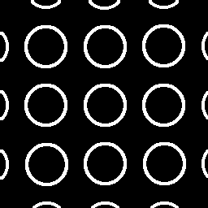

# R61：為什麼原生成程式之外，還要保留早期標記

這是一個訓練資料版本的例子。兩份輪廓圖看起來相近，各有37個像素值不同；它們不是模型重建結果，也不能用來判斷哪個實體輪廓比較準。

## 兩份原檔

| 原程式重新計算 | 當年訓練保存的標記 |
|---|---|
|  |  |
|  |  |

原距離陣列也各留一份，沒有重算或改畫：[重新計算版](distance_recomputed.npy)、[當年保存版](distance_historical.npy)。輸入／答案是當年使用的訓練裁切，不是新的相機原拍：[訓練輸入](training_input_crop.bmp)、[訓練答案](training_target_crop.bmp)。

## 當時怎麼處理

2026-10-04第一次用原程式重建時，114,283份資料有114,268份相同；另外15份差異來自五個檔名的邊界、中心線與距離標記。這裡只選其中一個檔名，不把五份重複情況說成五次獨立物理實驗。

原來源紀錄還指出，同一答案影像的12份相同內容曾對應兩種歷史幾何標記。因此，重新計算不能直接取代當年實際使用的標記版本。

後來固定匯入早期3,400組當時已保存的幾何標記，另外16,896組合成資料仍由原程式產生，原完整核對才得到114,283份全部相同。固定的是當年資料版本，沒有改寫原答案，也沒有宣稱重新計算出的標記在物理上較差。

因此，大型可再生訓練輸出可以清理；生成程式、固定設定及無法僅靠該程式還原的早期來源要留下。[完整重建包](../../../Deliverables/Data_Regenerators/R61_TrainingData_Regenerator_20261004/README_TW.md)與原檢查記錄保持原日期；本輪沒有重新生成整套資料、重跑訓練或新增模型評估。

[逐檔來源及核對碼](PROVENANCE.json)。本頁八份資料全部按原位元組保存，沒有調亮、裁切、改畫或重新壓縮。
