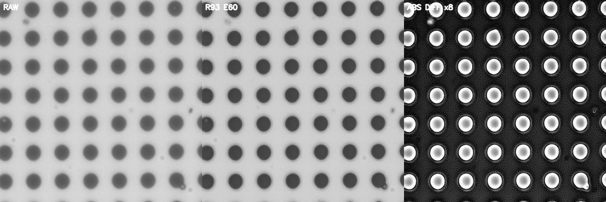
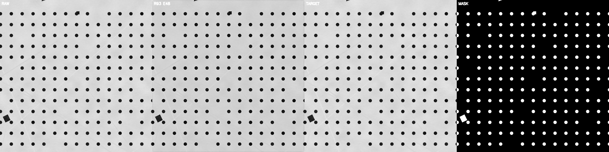

# R93 當時保存的影像與選圖理由

這裡是原檔複製，沒有重畫、調亮或重新壓縮。完整 245 張 results 圖在 [完整紀錄版本](https://github.com/rio10255254/GMM_2_Final/releases/tag/r93-complete-record-20261020)；頁面挑選固定案例與有解釋意義的輪次，成功與副作用都保留。[逐張來源與核對碼](FIGURE_PROVENANCE.json)。

## 實拍監看：相同四個輸入、40／50／60 輪

原實拍監看每十輪保存一次，沒有第 48 輪圖，本次沒有補造歷史影像。48 輪是由內部合成驗證選出的綜合候選，並非看這些實拍圖選到的結果。

| 固定輸入 | 第 40 輪 | 第 50 輪 | 第 60 輪 |
|---|---|---|---|
| 20x 混合圖形 | [原圖](figures/real_epoch_040_20x_mixed_raw_raw_r93_diff.png) | [原圖](figures/real_epoch_050_20x_mixed_raw_raw_r93_diff.png) | [原圖](figures/real_epoch_060_20x_mixed_raw_raw_r93_diff.png) |
| 50x 圓陣列 | [原圖](figures/real_epoch_040_50x_array_raw_raw_r93_diff.png) | [原圖](figures/real_epoch_050_50x_array_raw_raw_r93_diff.png) | [原圖](figures/real_epoch_060_50x_array_raw_raw_r93_diff.png) |
| 5x 密集細節 | [原圖](figures/real_epoch_040_5x_dense_raw_raw_r93_diff.png) | [原圖](figures/real_epoch_050_5x_dense_raw_raw_r93_diff.png) | [原圖](figures/real_epoch_060_5x_dense_raw_raw_r93_diff.png) |
| 50x 中央九柱 | [原圖](figures/real_epoch_040_pillar_center9_50x_raw_raw_r93_diff.png) | [原圖](figures/real_epoch_050_pillar_center9_50x_raw_raw_r93_diff.png) | [原圖](figures/real_epoch_060_pillar_center9_50x_raw_raw_r93_diff.png) |

第 60 輪圓陣列的原圖／重建／差異：

右側差異放大八倍，白圈標示模型改了哪裡；它不是 SEM 誤差圖，不能只靠看起來更銳利便判定輪廓更準。

## 合成驗證：細節、清楚輸入與位移

下列 RAW 是程式模擬的退化輸入，TARGET 和 MASK 也是生成標記；它們不是相機採集原檔。固定選 44、48、52、60 輪，對應原內部分析的細節最佳、綜合候選、清楚輸入／位移最佳，以及最後一輪。

| 固定案例 | 第 44 輪 | 第 48 輪 | 第 52 輪 | 第 60 輪 |
|---|---|---|---|---|
| 可恢復細節 | [原圖](figures/synthetic_epoch_044_validation_00_recoverable_detail.png) | [原圖](figures/synthetic_epoch_048_validation_00_recoverable_detail.png) | [原圖](figures/synthetic_epoch_052_validation_00_recoverable_detail.png) | [原圖](figures/synthetic_epoch_060_validation_00_recoverable_detail.png) |
| 清楚輸入保護 | [原圖](figures/synthetic_epoch_044_validation_02_clear_detail_guard.png) | [原圖](figures/synthetic_epoch_048_validation_02_clear_detail_guard.png) | [原圖](figures/synthetic_epoch_052_validation_02_clear_detail_guard.png) | [原圖](figures/synthetic_epoch_060_validation_02_clear_detail_guard.png) |
| 正負次像素位移 | [原圖](figures/synthetic_epoch_044_validation_05_signed_subpixel_motion.png) | [原圖](figures/synthetic_epoch_048_validation_05_signed_subpixel_motion.png) | [原圖](figures/synthetic_epoch_052_validation_05_signed_subpixel_motion.png) | [原圖](figures/synthetic_epoch_060_validation_05_signed_subpixel_motion.png) |

第 48 輪的清楚輸入保護原比較圖：

這類圖必須與原數字一起保存，因為本輪仍有清楚輸入被改動及後期取捨。圖片可以解釋模型做了什麼，不能取代完整原表，也不能把未達到的實體資格補成達標。
