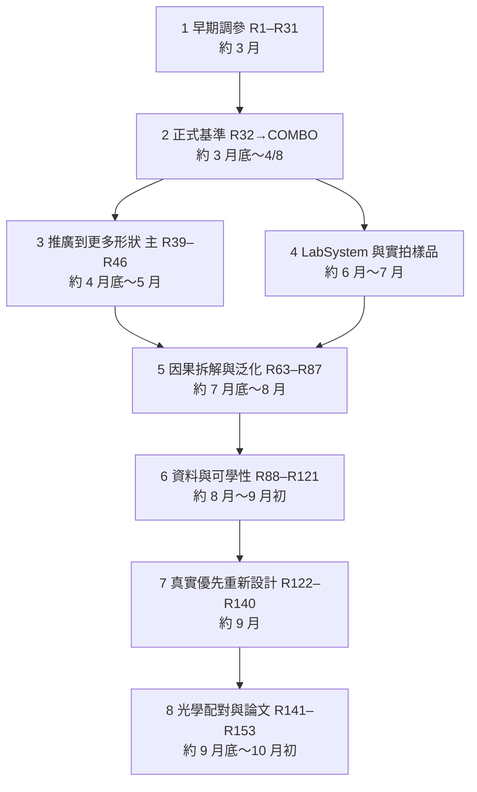

# 研究時間線：R1 到 R153

[專案首頁](../../README.md) · [現在的狀態](../../PROJECT_STATE.md) · [系統設計](../../PROJECT_ARCHITECTURE.md) · [八階段敘事](../reproducibility/EXPERIMENTS.md)

這份是整個研究的總目錄：2026 年 3 月到 10 月，從 R1 一路到 R153，再加上 LabSystem 那條平行支線。每一列只講兩件事：**這輪做了什麼、結果如何**。想看細節就點進去讀那一輪自己的報告。

讀之前先知道三件事：

- **編號不等於訓練次數。** 同一個 R 號可能有好幾個子研究，也可能根本不是新訓練（只是重算舊資料、做圖、做診斷）。
- **同號不同系統。** 主專案 R39 和 Lab R39 是兩件事；Lab 的 V41／V42 也不是主專案的 R41／R42。
- **失敗也是結果。** 大部分輪次最後沒有採用，但它們排除了一個又一個方向，後面的設計都是從這些失敗長出來的。

結果前面的標記：

| 標記 | 意思 |
|---|---|
| **採用** | 成為當時的正式模型或論文採用模型 |
| **核准替代** | 正式登記的替代選項，特定用途可以用 |
| **研究候選** | 有實際價值，被後續研究拿來當起點或對照，但沒有正式採用 |
| **未採用** | 完整做完，結果不夠好或有明顯代價 |
| **中止** | 沒有跑完，或發現問題後主動停下 |
| **撤回** | 當初宣稱的結論後來被推翻，原宣稱與撤回理由都保留 |
| **分析** | 沒有訓練新模型，只做診斷、量法、重算或圖表 |

日期是從各輪檔名裡的時間戳推估的「大約進行期間」，不是精確日期。

---

## 一段話看完整個故事

一開始以為問題是「影像不夠銳利」，後來才發現真正要解決的是：**重建後的影像交給固定的量測工具時，位移和尺寸要量得更穩**。3 月的自動調參確立了前任基準 R30；4 月初 R33 和 R38v2 各自解決一半問題，合起來成為正式基準 COMBO。4、5 月試著把 COMBO 推廣到更多形狀，6、7 月在實驗室自己的顯微系統上另起一條線（LabSystem），產出論文前期用的 V42。7、8 月回到主專案做大量因果拆解和從零訓練，大多是負結果。9 月改成「每個候選都直接拿真實影像、SEM 和真實位移序列來檢驗」，最後在 9 月底到 10 月初做出論文採用的 R152，並用 R153 跟九種外部方法完整比較。

箭頭表示研究問題怎麼接下去，**不表示**模型或資料一定是直接繼承。真正的繼承關係以各輪原設定和報告為準。

## 四種實驗條件（條件換了，數字就不能互比）

| 條件 | 大約期間 | 影像與評分 | 主要輪次 |
|---|---|---|---|
| **A 公司端環形影像 + 外部 GMF** | 3 月～5 月 | 環形影像，交給固定、不能修改的外部 GmmVisionTool GMF，看 8／0.8／0.08 px（1／0.1／0.01 µm）三個位移尺度的步距標準差 | R1–R46、COMBO、R39R40 |
| **B 實拍樣品擴充與交付** | 6 月～8 月 | Step、100MG、20×／5× 等實拍樣品，以及合作廠商均華的 202 張實拍；相位配準與外部 GMF | 主 R61 STEP 線、實拍分析資料夾（見階段 4）、ONNX 交付 |
| **C 實驗室顯微系統（LabSystem）** | 6 月～7 月（V42 用到 9 月） | 實驗室自己量的 25 位置 PSF、自己生成的訓練資料、棋盤與 SEM | Lab R39–R62、V41／V42 |
| **D 均華 20× 物鏡 + PI 平台 930 張重拍** | 9/3 拍攝，9 月～10 月使用 | 在均華用其 20× 物鏡拍的 30 趟 × 31 位置（共 930 張），對照 PI 平台回授與 SEM | R122 之後的真實優先路線、R136、R152、R153 |

B 的均華 202 張和 D 的 930 張都是借用合作廠商均華的光學系統，但樣品、拍法和評分方式不同，數字一樣不能直接比。930 張的原始照片與平台紀錄見 [Shared_Sources/PI_Repeatability_20260903](../../Shared_Sources/PI_Repeatability_20260903/README.md)。

---

## 階段 1　早期調參（R1–R31，約 3 月）

**這階段在問：** 同一個網路（GeoEdgeAlignSR），怎麼訓練才能讓環形邊界的位移量得最穩？

做法是自動調參：每輪產生幾組候選設定，用內部分數挑，再交給外部 GMF 看三個尺度。很快就發現內部分數、三個尺度、外部 GMF 的結論常常不一致；而且把模型訓練得更久，常常會把早期比較好的版本訓練壞。這兩個教訓決定了之後所有輪次的驗收方式。

早期資料按日期批次存放在 [Traing_Progress/](../../Traing_Progress/)（拼字是歷史，刻意不改），一個日期不等於一輪。逐輪原件見[早期輪次](../reproducibility/lineage/EARLY_ROUNDS.md)。

| 輪次 | 做了什麼 → 結果 | 去哪看 |
|---|---|---|
| R1 | 選模改成直接看 8px 步長、極端值與平均偏移 → **研究候選**：產生後來的內部種子，但不是當時的外部正式版 | [R1](../reproducibility/lineage/EARLY_ROUNDS.md#r1) |
| R2–R5 | 種子保護、GMF 保護與銳利度平衡、降低更新強度、保留外部行為等不同調參設定 → **未採用**：都沒有取得新的外部通過 | [R2](../reproducibility/lineage/EARLY_ROUNDS.md#r2)～[R5](../reproducibility/lineage/EARLY_ROUNDS.md#r5) |
| R6 | 多尺度長跑 → **未採用**：最後階段一再破壞前面的好結果，「訓練更久」被證明不可靠 | [R6](../reproducibility/lineage/EARLY_ROUNDS.md#r6) |
| R7–R10 | 改用 uint16 微步與序列資料，針對 0.08、0.8、8px 分別調 → **未採用**：內部零波動不代表實際零誤差，兩種驗證來源不能混排 | [R7](../reproducibility/lineage/EARLY_ROUNDS.md#r7)～[R10](../reproducibility/lineage/EARLY_ROUNDS.md#r10) |
| R11 | 整環定位加缺陷保護 → **未採用**：主尺度改善，其他尺度沒有跟著成功 | [R11](../reproducibility/lineage/EARLY_ROUNDS.md#r11) |
| R12–R15 | 把「方法組初排」和「固定一份模型重新審查」分開 → **分析**：發現初排第一名和最後該採用的模型可能不同 | [R12–R15](../reproducibility/legacy_multiscale/README.md) |
| R16–R18 | 逐步針對邊界估計、步距、中心位置約束 → R18 **當時採用**，之後被 R22 的外部比較取代 | [R16](../reproducibility/experiments/legacy__round16.md)、[R17](../reproducibility/experiments/legacy__round17.md)、[R18](../reproducibility/experiments/legacy__round18.md) |
| R19–R20 | 絕對位置錨定、固定基準流程前測 → **未採用**：假說沒有被支持 | [R19](../reproducibility/experiments/legacy__round19.md)、[R20](../reproducibility/experiments/legacy__round20.md) |
| R21–R22 | 混合估計器、成對混合估計器 → R22 **當時採用**，後續外部系列再比較 | [R21](../reproducibility/experiments/legacy__round21.md)、[R22](../reproducibility/experiments/legacy__round22.md) |
| R23–R24 | R22 之後的歷史候選 → **未採用**：診斷性負結果 | [R23](../reproducibility/experiments/legacy__round23.md)、[R24](../reproducibility/experiments/legacy__round24.md) |
| R25–R29 | 從零訓練與步長權重的外部多尺度比較鏈；R26 另有新 PSF 重訓與交付版本 → **研究候選**：建立後續共用的比較方式 | [R25](../reproducibility/experiments/legacy__round25.md)、[R26](../../Experiments/R26NewPSFCheck/FILE_GUIDE.md)、[R27](../reproducibility/experiments/legacy__round27.md)–[R29](../reproducibility/experiments/legacy__round29.md) |
| **R30** | 方向約束（`r30_b1_dironly`） → **採用**：成為前任正式基準，直到 COMBO | [R30](../reproducibility/experiments/legacy__round30.md) |
| R31 | 再調訓練權重與等化訊號 → **未採用**：外部退步 | [R31](../reproducibility/experiments/legacy__round31.md) |

## 階段 2　正式基準形成（R32 → COMBO，約 3 月底～4/8）

**這階段在問：** R30 之後，怎麼讓定位更準又不把邊緣弄軟？

R33 發現「限制極端像素的拉扯」能大幅改善定位，但邊緣變軟；R34、R35、R37 想從頻率和光學下手補回銳利度，都沒成功；R38 直接用連續影格訓練，卻被弱訊號干擾；R38v2 加上尺度限制和訊號門檻後才穩定。把 R33 和 R38v2 結合，就是 COMBO。

| 輪次 | 做了什麼 → 結果 | 去哪看 |
|---|---|---|
| R32 | 加入真實影像微調 R30 → **未採用**：內部通過，外部 0.8px 退步 97.7% | [R32](../../Experiments/R32Sandbox/FILE_GUIDE.md) |
| R33 ContrastFix | 提高統計項權重想補回灰階與銳利度 → **未採用**：細節沒有恢復 | [R33ContrastFix](../../Experiments/R33ContrastFix/FILE_GUIDE.md) |
| **R33 RobustLoss** | 限制極端像素牽引（Winsorize p95） → **核准替代**（定位極致）：位移最穩，代價是邊緣變軟 | [R33RobustLoss](../../Experiments/R33RobustLoss/FILE_GUIDE.md) |
| R34／R35／R37 | 空間分頻、增強光學反卷積、光學層頻率正則 → **未採用**：都沒解決「準」與「銳利」的取捨（只存在歷史分支） | [歷史分支](../reproducibility/lineage/HISTORICAL_BRANCHES.md) |
| R36 | 主專案的獨立 R36 至今**沒有找到**；Lab R61 內部另有一個 r36，兩者不同 | [兩種 R36](../reproducibility/lineage/R36_IDENTITIES_20261022.md) |
| R38 | 直接學連續影格的一致性 → **未採用**：全尺度序列被弱訊號干擾，弄壞 0.8px | [R38](../../Experiments/R38SeqConsistency/FILE_GUIDE.md) |
| **R38v2** | 只保留訊號夠強的序列，加尺度限制與暖身 → **核准替代**（視覺優先）：銳利且定位不錯 | [R38v2](../../Experiments/R38v2SeqFixed/FILE_GUIDE.md) |
| **COMBO** | 在同一次訓練裡同時使用 R33 的 p95 與 R38v2 的序列訓練（不是兩個模型的權重平均） → **採用**（2026-04-08 起的正式基準）：0.8px 比 R30 好 21.6%，邊緣陡度 +89%，三尺度全過 | [COMBO 閱讀卡](../../Experiments/R38v2SeqFixed/FILE_GUIDE.md)、[R33～R38v2 完整系列](../../Experiments/R33RobustLoss/reports/R33_R38v2_COMPLETE_EXPERIMENT_SERIES.md) |

## 階段 3　推廣到更多形狀（主 R39–R46，約 4 月底～5 月）

**這階段在問：** COMBO 只在環形上驗證過，遇到線條、格線、缺口、角點還行嗎？

結果是顯微能力和環形定位互相拉扯：把顯微能力推高，環形的外部 GMF 就退步。最後找到的折衷是把 R39 和 R40 的權重平均，三個尺度都守在 COMBO 的 3% 以內，同時改善形狀泛化。

| 輪次 | 做了什麼 → 結果 | 去哪看 |
|---|---|---|
| R39 | 保留環形能力，同時擴大到非環形形狀 → **研究候選**：端點版與權重平均版要分開看 | [R39](../../Experiments/R39_ShapeGeneralization/FILE_GUIDE.md) |
| R40 | 加入格線、紋理、區域與缺陷 → **研究候選**：顯微能力明顯提升，但不能全面取代 COMBO | [R40](../../Experiments/R40_MicroscopyFeatureCoverage/FILE_GUIDE.md) |
| **R39R40_avg_a025** | R39 與 R40 權重平均 → **核准替代**（平衡，2026-05-11 升級）：三尺度守在 COMBO 3% 內並改善形狀 | [能力評估](../../Experiments/R39_ShapeGeneralization/results/a030_x_a043_sweep/reports/R39R40_AVG_a025_CAPABILITY_EVAL.md) |
| R41 | 用兩個固定老師同時保環形與顯微（蒸餾） → **未採用**：找不到兩者都過的比例 | [R41](../../Experiments/R41_RingDistillation/FILE_GUIDE.md) |
| R42 | 直接提升通用顯微邊界 → **未採用**：單張邊界清楚，但位移不穩，外部 0.8px 退步 94% | [R42](../../Experiments/R42_MicroscopyBoundaryFidelity/FILE_GUIDE.md) |
| R43 | 把既有候選放進同一張決策表 → **分析** | [R43](../../Experiments/R43_CandidateUsabilityAudit/FILE_GUIDE.md) |
| R44 | 直接約束顯微結構隨已知位移正確移動（A～H 多條支線） → **未採用**：各支線各有問題 | [R44](../../Experiments/R44_UniversalBoundaryMotionFidelity/FILE_GUIDE.md) |
| R45 | 用小修正或分族選擇承接 R44 → **未採用**：知道答案時選得出好結果，實際選擇器做不到 | [R45](../../Experiments/R45_FamilyBoundaryAdapter/FILE_GUIDE.md) |
| R46 | 從 R39R40_avg_a025 起步，強化邊緣與高頻權重微調 15 輪 → **未採用**：形狀與顯微 PSNR 提升 2～3.5 dB，但環形三尺度全部失敗，外部 GMF 8px 退步將近 10 倍；診斷指出高頻損失佔了 92% 以上，環形樣本在損失裡隱形。Lab 另有同名 R46 | [R46 閱讀卡](../../Experiments/R46_CornerAwareFineTune/FILE_GUIDE.md) |

## 階段 4　LabSystem 與實拍樣品（約 6 月～7 月）

**這階段在問：** 論文要用實驗室自己的顯微系統，成像條件完全不同，模型要怎麼轉過去？同時，公司端的實拍樣品（條件 B）也開始大量進來。

這段研究放在 [Thesis_MOSR_Evidence/LabSystem_MOSR/](../../Thesis_MOSR_Evidence/LabSystem_MOSR/)，是從 COMBO 分出去的一支：沿用 COMBO 的網路權重，但改用實驗室自己量的 25 位置 PSF 和自己生成的資料。它的編號 R46～R62 剛好填上主專案 R47～R62 的空號，但**是不同的實驗**。

故事大致是：第一次拿實拍棋盤去測，重建後步長只小幅改善，角點反而被弄壞 → R46～R56 連續修角點、模糊來源、答案風格，一直修不好實拍角點 → R57～R60 改用 SEM 尺寸當答案 → R61 擴大通用邊界與位移保護 → R62 針對目標樣品 → V41、V42（V42 是 R152 之前的論文模型）。這裡很多 SEM 答案來自同一批樣品，所以「SEM 分數變好」**不是**獨立的準確度證據。完整脈絡見 [Lab 全線](../reproducibility/lineage/LAB_SYSTEM.md)。

**Lab 研究前的共用準備：** 25 位置光學校正、stage01～33 共 2,968 組資料基礎（stage 是資料類型，不是 33 次訓練）、從 COMBO 起步的 25 輪短跑、第一次 100 輪正式訓練、第一次實拍 GMF 與角點失敗。見 [Lab 全線的五個共用階段](../reproducibility/lineage/LAB_SYSTEM.md#lab實驗資料夾之外的五個共用階段)。

| 輪次 | 做了什麼 → 結果 | 去哪看 |
|---|---|---|
| Lab R39／R40 | 在 Lab 條件下做多形狀與顯微特徵 → **研究候選**：當後續角點實驗的固定對照 | [Lab R39](../../Thesis_MOSR_Evidence/LabSystem_MOSR/Experiments/R39_ShapeGeneralization/FILE_GUIDE.md)、[Lab R40](../../Thesis_MOSR_Evidence/LabSystem_MOSR/Experiments/R40_MicroscopyFeatureCoverage/FILE_GUIDE.md) |
| Lab R46 | 用角點資料保守修正 → **未採用**：25 輪有效但沒修好實體圓角 | [Lab R46](../../Thesis_MOSR_Evidence/LabSystem_MOSR/Experiments/R46_CornerAwareFineTune/FILE_GUIDE.md) |
| Lab R47 | 加入更真實的邊界與背景 → **未採用**：200 輪仍沒修好，訓練更久不等於有效 | [Lab R47](../../Thesis_MOSR_Evidence/LabSystem_MOSR/Experiments/R47_RealisticBoundaryGeneralization/FILE_GUIDE.md) |
| Lab R48 | 用實體失敗型態與幾何標記 → **未採用**：內部改善，實體反而更差 | [Lab R48](../../Thesis_MOSR_Evidence/LabSystem_MOSR/Experiments/R48_RealCornerTransfer/FILE_GUIDE.md) |
| Lab R49 | 加入可信區域內的實體 CAD 答案 → **未採用**：角點退步，可信區域太小 | [Lab R49](../../Thesis_MOSR_Evidence/LabSystem_MOSR/Experiments/R49_CADAnchorRealGeometry/FILE_GUIDE.md) |
| Lab R50 | 診斷 Lab 光學模糊是否過強 → **分析**：完整 BADS 比實拍更軟 | [Lab R50](../../Thesis_MOSR_Evidence/LabSystem_MOSR/Experiments/R50_PSFControlDiagnosis/FILE_GUIDE.md) |
| Lab R51 | 短測高斯、弱 BADS、混合光學 → **未採用**：典型角點改善，但大偏移比例上升 | [Lab R51](../../Thesis_MOSR_Evidence/LabSystem_MOSR/Experiments/R51_BlurSourceProbe/FILE_GUIDE.md) |
| Lab R52 | 混合光學加角點穩定限制 → **未採用**：100 輪後大偏移仍多 | [Lab R52](../../Thesis_MOSR_Evidence/LabSystem_MOSR/Experiments/R52_CornerStabilityGuard/FILE_GUIDE.md) |
| Lab R53 | 重新平衡六類資料，從零 100 輪 → **未採用**：實體角點仍失敗；記憶體不足等過程問題也是脈絡 | [Lab R53](../../Thesis_MOSR_Evidence/LabSystem_MOSR/Experiments/R53_RealisticDatasetCalibration/FILE_GUIDE.md) |
| Lab R54 | 拆解角點損害來源 → **分析**：可信區域內學得會，轉到實體全圖就失敗 | [Lab R54](../../Thesis_MOSR_Evidence/LabSystem_MOSR/Experiments/R54_GeometryRootCauseProbe/FILE_GUIDE.md) |
| Lab R55 | 修正答案的亮暗風格 → **研究候選**：best 通過 Lab 角點門檻，latest 退步 | [Lab R55](../../Thesis_MOSR_Evidence/LabSystem_MOSR/Experiments/R55_SourceStyleRealisticTraining/FILE_GUIDE.md) |
| Lab R56 | 只修弱答案的核心區域 → **未採用**：尾端更差 | [Lab R56](../../Thesis_MOSR_Evidence/LabSystem_MOSR/Experiments/R56_LabelCoreRepairTraining/FILE_GUIDE.md) |
| Lab R57 | 加入同樣本 SEM 半徑約束尺寸 → **未採用**：100MG 尺寸門檻沒過；SEM 同時當答案和比較，也不能算獨立驗證 | [Lab R57](../../Thesis_MOSR_Evidence/LabSystem_MOSR/Experiments/R57_GeometryConstrainedMOSR/FILE_GUIDE.md) |
| Lab R58 | 用只修一半的 SEM 答案做閉環 → **分析**：刻意的部分修正，不期待完全到 SEM 外框 | [Lab R58](../../Thesis_MOSR_Evidence/LabSystem_MOSR/Experiments/R58_MeasurementClosedLoopMOSR/FILE_GUIDE.md) |
| Lab R59 | 在同一張影像上估尺寸再移動邊界 → **分析**：同樣本後修正，數字變好不代表網路學會 | [Lab R59](../../Thesis_MOSR_Evidence/LabSystem_MOSR/Experiments/R59_CDClosedLoopBoundaryLayer/FILE_GUIDE.md) |
| Lab R60 | 修正實拍裁切答案、亮暗方向與真值權重 → **未採用**：方向與取樣修正後短測改善，但各版都沒過門檻；稽核指出主因是訓練資料沒有正確表示真實邊界，不是模型本身沒用 | [Lab R60](../../Thesis_MOSR_Evidence/LabSystem_MOSR/Experiments/R60_SEMTruthBoundaryTraining/FILE_GUIDE.md) |
| **Lab R61** | 擴大通用邊界、位移與 Step 保護，經 v1～v16 → **研究候選**：v16 成為後續交付與論文線的起點（ONNX 交付用的「R61」就是它） | [Lab R61](../../Thesis_MOSR_Evidence/LabSystem_MOSR/Experiments/R61_BoundaryGeneralizationUniversal/FILE_GUIDE.md)、[主 R61 STEP 驗證](../../Experiments/R61_STEP_Generalization_20260623/FILE_GUIDE.md) |
| Lab R62 | 針對目標樣品增補，加保守的原圖參考輸出 → **研究候選**：相位位移恢復不等於每個局部圓心都更準 | [Lab R62](../../Thesis_MOSR_Evidence/LabSystem_MOSR/Experiments/R62_TargetSampleBoost/FILE_GUIDE.md) |
| V41 | 從 R61v16 起步，用 11,254 組目標樣品與老師配對訓練 → **研究候選** | [V41](../../Thesis_MOSR_Evidence/LabSystem_MOSR/Experiments/V41_Standalone/FILE_GUIDE.md) |
| **V42** | 從 V41 起步，柔化答案邊帶並加品質閘，後來完整 120 輪 → **採用**（R152 之前的論文模型） | [V42](../../Thesis_MOSR_Evidence/LabSystem_MOSR/Experiments/V42_SoftLabelSNR/FILE_GUIDE.md)、[V42 完整歷史](../reproducibility/lab_comparisons/V42_HISTORY.md) |
| Base U-Net、EDSR／NAFNet | 在 Lab 條件下訓練對照方法（約 7/18～7/19） → **分析**：與後來 R153 的十方法比較是不同的比較 | [Base U-Net](../../Thesis_MOSR_Evidence/LabSystem_MOSR/Experiments/BaseUNet_Baseline_20260718/FILE_GUIDE.md)、[EDSR／NAFNet](../../Thesis_MOSR_Evidence/LabSystem_MOSR/Experiments/Modern_Restoration_Benchmarks_20260719/FILE_GUIDE.md) |
| 次像素平移測試 | 用數學平移的輸入測位移保持（約 7/20） → **分析**：插值位移不同於平台重拍，MOSR 沒有全面勝過 EDSR | [平移測試](../../Thesis_MOSR_Evidence/LabSystem_MOSR/Experiments/Subpixel_Translation_Equivariance_20260720/FILE_GUIDE.md) |
| 模型選擇點診斷 | 比較第 10 輪與第 120 輪、推論設定（約 7/24） → **分析** | [最佳點](../../Thesis_MOSR_Evidence/LabSystem_MOSR/Experiments/MOSR_BestCheckpoint_Diagnostic_20260724/FILE_GUIDE.md)、[設定](../../Thesis_MOSR_Evidence/LabSystem_MOSR/Experiments/MOSR_CheckpointConfig_Diagnostic_20260724/FILE_GUIDE.md) |

**同一時期的實拍樣品分析（條件 B）：** 這些不是 R 編號的實驗，是拿當時的模型去量真實樣品。

| 資料夾 | 內容 |
|---|---|
| [Step_analysis_20260623](../../Step_analysis_20260623/) | Step 樣品的位移、尺寸與形狀 |
| [20260702_100MG_displacement_analysis](../../20260702_100MG_displacement_analysis/) | 100MG 樣品的位移 |
| [20260704_20x_5x_analysis](../../20260704_20x_5x_analysis/) | 20× 與 5× 實拍 |
| [Validations/MOSR_ONNX_JunHua](../../Validations/MOSR_ONNX_JunHua/) | 均華 202 張實拍的 ONNX 交付驗證 |

## 階段 5　因果拆解與泛化（R63–R87，約 7 月底～8 月）

**這階段在問：** 效果到底是哪個部件造成的？換樣品、換切塊方式還能用嗎？

R63 拆開幾何、位移、安全上採樣各自的貢獻；R64～R66 是論文圖表與量法的整理；R67～R82 用合成缺陷、SEM 完整輪廓和多倍率實拍，反覆檢查 R61、V42 和從零訓練的 R75／R79 能泛化到哪裡。R84～R86 發現任何切塊處理都會改變結果，三種修法各有代價，最後決定一律單次處理整張影像。

| 輪次 | 做了什麼 → 結果 | 去哪看 |
|---|---|---|
| R63 | 拆開幾何、位移、安全上採樣的貢獻 → **分析**：共同起點續訓，不是從零的因果比較 | [R63](../../Experiments/R63_CausalBoundaryMotionAblation/FILE_GUIDE.md) |
| R64 | 重新解讀等灰階輪廓位移 → **分析**：舊資料重算 | [R64](../../Experiments/R64_IsocontourDisplacementReanalysis_20260724/FILE_GUIDE.md) |
| R65 | 保存 V19 舊量法的論文圖表 → **分析**：歷史圖表版本 | [R65](../../Experiments/R65_V19_OldMethodFigurePackage_20260724/FILE_GUIDE.md) |
| R66 | 補齊論文圖與來源的對應 → **分析** | [R66](../../Experiments/R66_V20_TraceabilityFigures_20260725/FILE_GUIDE.md) |
| R67 | 在既有倍率、形狀、位移下選較穩的模型 → **分析**：只能選出當下領先者，不能宣稱普遍有效 | [R67](../../Experiments/R67_UniversalModelGeneralization/FILE_GUIDE.md) |
| R68 | R61 在多倍率完整視野下的位移保持 → **分析** | [R68](../../Experiments/R68_R61_RealFOVFeatureGeneralization/FILE_GUIDE.md) |
| R69 | R61 完整外形是否更接近逐顆 SEM → **分析**：正常曝光粗外框改善，最暗兩張和細形狀退步 | [R69](../../Experiments/R69_ACMContourSEMValidation/FILE_GUIDE.md) |
| R70 | 用同樣的 SEM 與量法檢查 V42 → **分析**：V42 與 SEM 有訓練來源關係 | [R70](../../Experiments/R70_V42ACMContourSEMValidation/FILE_GUIDE.md) |
| R71–R74 | 用有乾淨答案的合成缺陷、非圓形、困難成像檢查 R61 → **分析**：困難度先鎖定再揭露模型，避免事後挑容易的資料 | [R71](../../Experiments/R71_R61SyntheticMicroscopyDefectGeneralization/FILE_GUIDE.md)、[R72](../../Experiments/R72_R61SyntheticDefectACMContourValidation/FILE_GUIDE.md)、[R73](../../Experiments/R73_R61ExpandedSyntheticACMGeneralization/FILE_GUIDE.md)、[R74](../../Experiments/R74_R61HardMicroscopyACMGeneralization/FILE_GUIDE.md) |
| R75／R75v2 | R61 架構只用純合成資料從頭訓練 → **未採用**：首輪半精度沒有有效更新，修正版完成 100 輪，外框改善但細形狀沒解決 | [R75](../../Experiments/R75_R61ArchitectureScratchGeneralization/FILE_GUIDE.md)、[R75v2](../../Experiments/R75v2_R61ArchitectureScratchGeneralization/FILE_GUIDE.md) |
| R76–R78 | 用 SEM 完整輪廓和多倍率位移檢查 R75／R75v2 → **分析**：5× 小區塊丟細節 | [R76](../../Experiments/R76_R75ACMContourSEMValidation/FILE_GUIDE.md)、[R77](../../Experiments/R77_R75v2ACMContourSEMValidation/FILE_GUIDE.md)、[R78](../../Experiments/R78_R75v2_BroadRealMicroscopeGeneralization/FILE_GUIDE.md) |
| **R79** | 加強密集排列與多尺度，防止過度重建 → **研究候選**：第 23 輪是強顯微候選，但需要固定整張推論 | [R79](../../Experiments/R79_R75v3_DenseMicroscopyScratchGeneralization/FILE_GUIDE.md) |
| R80 | 另一種取邊定義核對 SEM；比較 R79 早期與最後模型 → **分析** | [R80 取邊](../../Experiments/R80_InflectionReferenceCircleSEMValidation/FILE_GUIDE.md)、[R80 早晚](../../Experiments/R80_R79E23vsE100GeneralizationValidation/FILE_GUIDE.md) |
| R81 | 擴大外部架構的受控比較 → **分析** | [R81](../../Experiments/R81_MultiArchitectureReferenceCircleBenchmark/FILE_GUIDE.md) |
| R82 | 把核准替代與研究模型放到共同場景 → **分析**：只保留有外部回傳的模型，不補值 | [R82](../../Experiments/R82_R39R40CrossSceneGeneralizationBenchmark/FILE_GUIDE.md) |
| R83 | 修 R79 的困難成像並測保守輸出 → **未採用**：新權重沒有超越 R79 | [R83](../../Experiments/R83_R79SevereMicroscopyStrengthening/FILE_GUIDE.md) |
| R84–R86 | 三種方法消除 R79 的切塊差異 → **未採用**：各有代價，最後保留原 R79 並固定整張推論 | [R84](../../Experiments/R84_R79TileStableRootRepair/FILE_GUIDE.md)、[R85](../../Experiments/R85_R79SharedCanvasOpticalRepair/FILE_GUIDE.md)、[R86](../../Experiments/R86_R79BlockGroupNormRepair/FILE_GUIDE.md) |
| R87 | 純局部模型從零學重建和切塊一致性 → **未採用**：新形狀退步，還出現假孔洞 | [R87](../../Experiments/R87_TileNativeScratchGeneralization/FILE_GUIDE.md) |

## 階段 6　資料與可學性（R88–R121，約 8 月～9 月初）

**這階段在問：** 學不好是不是資料的問題？從零訓練到底學得到什麼？

這段幾乎都是從零訓練，一輪一輪修資料、修約束、修控制機制，大部分是停下來的失敗案例。有兩個關鍵事實要記得：**R92 和 R93 是兩套不同的共用資料基礎**（R94～R98 用 R93，R99、R100、R102～R104 用 R92），不能混用。R105～R106 試過「多張觀測一起重建」，沒過，主線回到單張。R107～R118 是一連串小型機制探針。R119 原本宣稱的結論後來被撤回，由 R120 修正。

| 輪次 | 做了什麼 → 結果 | 去哪看 |
|---|---|---|
| R88 | 修 R87 的紋理與邊界，加入實際量測約束 → **中止**：停在第 87 輪 | [R88](../../Experiments/R88_MeasurementFaithfulScratch/FILE_GUIDE.md) |
| R89 | 拿掉輸出信心閘，直接學有界重建，從零 100 輪 → **未採用**：合成資料上位移誤差減半，但處理過度激進，清楚影像出現假邊界，真實 SEM 輪廓退步 | [R89](../../Experiments/R89_MeasurementNativeScratch/FILE_GUIDE.md)、[最終驗證](../../Experiments/R89_MeasurementNativeScratch/reports/final_validation/R89_FINAL_VALIDATION_TW.md) |
| R90 | 讓同一物體在四種曝光下保持相同輪廓 → **中止**：停在第 55 輪 | [R90](../../Experiments/R90_ExposureCoherentScratch/FILE_GUIDE.md) |
| R91 | 分開紋理恢復與輪廓／曝光約束 → **研究候選**：訓練完成，但清楚的輸入也會被改動，結構錯誤仍多 | [R91](../../Experiments/R91_DetailDecoupledScratch/FILE_GUIDE.md) |
| R92 | 補足物理邊緣過渡與平衡曝光取樣 → **研究候選**：成為 R99、R100、R102～R104 的共用資料基礎 | [R92](../../Experiments/R92_PhysicalTransitionBalancedScratch/FILE_GUIDE.md) |
| R93 | 拆開可恢復細節與清楚輸入的保護 → **研究候選**：停在第 60 輪，資料被 R94～R98 共用 | [R93](../../Experiments/R93_RecoverableDetailSeparatedScratch/FILE_GUIDE.md) |
| R94 | 按成像順序分工，直接教何時需要修正 → **中止**：計畫 48 輪，第 9 輪存檔前被記憶體保護停下；R95 的前置診斷由此找出控制與訓練動力的問題 | [R94](../../Experiments/R94_EvidenceConditionalScratch/FILE_GUIDE.md) |
| R95 | 修 R94 的修正閘與訓練動力 → **未採用**：48 輪完成，首次恢復重建更新 | [R95](../../Experiments/R95_CounterfactualGateRepairScratch/FILE_GUIDE.md) |
| R96 | 防止聯合訓練抵消各局部分支的目標 → **未採用**：44 輪；另有 R96 正式設計前的舊方案 | [R96](../../Experiments/R96_LocalizedEvidenceProtectedScratch/FILE_GUIDE.md)、[R96 舊設計](../../Experiments/R96_Design_Archive/FILE_GUIDE.md) |
| R97 | 直接預測每個分支實際施加的修正 → **未採用**：48 輪完成 | [R97](../../Experiments/R97_DirectCausalPhaseScratch/FILE_GUIDE.md) |
| R98 | 加強可見多尺度紋理的恢復 → **未採用**：48 輪完成，SEM 結果不利 | [R98](../../Experiments/R98_AggressiveTextureScratch/FILE_GUIDE.md) |
| R99 | 依序分開亮暗、幾何、邊緣與紋理 → **中止**：停在第 41 輪 | [R99](../../Experiments/R99_GeometryTextureCoherentScratch/FILE_GUIDE.md) |
| R100 | 在原有形狀上加輪廓外程序紋理 → **未採用**：40 輪；另有訓練前的設計檢查 | [R100](../../Experiments/R100_CausalOperatorScratch/FILE_GUIDE.md)、[R100 設計檢查](../../Experiments/R100_DesignValidation/FILE_GUIDE.md) |
| R101 | 檢查高頻答案、邊界輸出與多目標學習為何失效 → **分析**：細頻答案多半相位不一致，學習方向互相衝突 | [R101 機制](../../Experiments/R101_HighFrequencyCausalAblation/FILE_GUIDE.md)、[R101 設計](../../Experiments/R101_HighFrequencyDesignValidation/FILE_GUIDE.md) |
| R102 | 用局部主幹同時恢復細節與位置 → **中止**：輸出塌縮成原樣 | [R102](../../Experiments/R102_UniversalDetailScratch/FILE_GUIDE.md) |
| R103 | 修亮暗答案與正規化造成的細節流失 → **未採用**：曝光轉折處失敗 | [R103](../../Experiments/R103_RecoverableDetailScratch/FILE_GUIDE.md) |
| R104 | 把形狀判斷與絕對亮度分開 → **未採用**：幾何頭沒有直接形成最終邊界，交給 R105 驗證 | [R104](../../Experiments/R104_PhotometricInvariantCausalGateScratch/FILE_GUIDE.md) |
| R105 | 用學到的幾何直接畫邊界；多張觀測重建；均華 202 張是否適合多觀測 → **未採用**：寬度改善但中心、形狀變差，沒有開正式 R105 | [R105A](../../Experiments/R105A_GeometryRendererFalsification/FILE_GUIDE.md)、[R105B](../../Experiments/R105B_EvidenceSetReconstructionFalsification/FILE_GUIDE.md)、[R105C](../../Experiments/R105C_JunHuaMultiObservationFeasibility/FILE_GUIDE.md) |
| R106 | 驗證多觀測機制能否轉到均華實拍 → **未採用**：生成與真實短測都沒過，主線回到單張 | [R106A](../../Experiments/R106A_MultiObservationShortValidation/FILE_GUIDE.md) |
| R107 | 固定局部中心、只收窄邊緣是否可行 → **分析** | [R107A](../../Experiments/R107A_SingleImageEdgeGeometryProbe/FILE_GUIDE.md) |
| R108 | 七個小型機制探針：模型互補、光學專家分工、法線位移、受限渲染 → **分析**：R108G 的「位移與寬度分開」成為 R109 的依據 | [R108A](../../Experiments/R108A_LocalActionFalsification/FILE_GUIDE.md)～[R108G](../../Experiments/R108G_MidpointWidthFactorizedProfileMicroprobe/FILE_GUIDE.md) |
| R109 | 先固定偵測，再學受限位移與單調寬度 → **研究候選**：48 輪，內部量法與外部 GMF 判讀不同 | [R109](../../Experiments/R109_StagedMidpointWidthScratch/FILE_GUIDE.md) |
| R110 | 拆開訓練時間、容量與可見性的限制 → **分析** | [R110](../../Experiments/R110_TimeCapacityVisibilityProbes/FILE_GUIDE.md) |
| R111 | R109 能不能替換論文的 V42 → **未採用**：內部量法相近，外部 GMF 較弱 | [R111](../../Experiments/R111_R109V42ThesisReplacementQualification/FILE_GUIDE.md) |
| R112 | 拆解 V42 與 R109 的外部 GMF 差異 → **分析**：內部模板沒有重現外部排序 | [R112](../../Experiments/R112_V42R109GMFMechanismDecomposition/FILE_GUIDE.md) |
| R113 | 拆開渲染能力、學到的控制、訓練軌跡與量法 → **分析** | [R113](../../Experiments/R113_CausalStructureDissection/FILE_GUIDE.md) |
| R114 | 依 R113 修控制塌縮與可恢復細節 → **分析**：證明分支隔離必要且有效，但局部選擇器分辨不出修正是好是壞，沒有產生新的正式模型 | [R114](../../Experiments/R114_ConfidenceGatedRecoverableScratch/FILE_GUIDE.md) |
| R115 | 用獨立的法線證據決定 R109 的動作量 → **中止**：兩版都因採用率不穩而停下，正式 48 輪沒有啟動 | [R115](../../Experiments/R115_R109DecoupledNormalProfileScratch/FILE_GUIDE.md) |
| R116 | 沿輪廓保持位移與寬度一致 → **研究候選**：修正 BF16 錯誤後重新從零，第 42 輪為主要版本 | [R116](../../Experiments/R116_CoherentGeometryAnchorScratch/FILE_GUIDE.md) |
| R117 | 保留必要的法線位移，避免寬度造成額外中心移動，從零訓練 → **未採用**：9/5 設計稽核發現預覽圖其實是 R109 再接 R117，而且暗物體邊界的法線方向有 97.76% 是反的；結論是實作問題，不是模型能力上限 | [R117](../../Experiments/R117_CenterLockedSubpixelScratch/FILE_GUIDE.md)、[設計稽核](../../Experiments/R117_CenterLockedSubpixelScratch/analysis/design_audit_20260905/FINDINGS.md) |
| R118 | 修正 R117 的符號方向、連續寬度與真實二維定位 → **研究候選**：不升級 | [R118](../reproducibility/experiments/main__R118_PhysicalCoordinateRepairScratch.md) |
| R119 | 檢查同物體序列訓練與邊界位置 → **撤回**：原先「P00 到 P12 完整因果完成」的宣稱被撤回，固定序列其實沒有接上 | [R119](../../Experiments/R119_SequenceGeometryValidation/FILE_GUIDE.md) |
| R120 | 修正 R119 的序列形成與公平對照 → **分析** | [R120](../../Experiments/R120_PhysicalSequenceRepair/FILE_GUIDE.md) |
| R121 | 亮暗擴充與局部位置要求的四組對照 → **未採用**：八個有效短測都沒過 | [R121](../../Experiments/R121_BoundaryAnchorFactorial/FILE_GUIDE.md) |

## 階段 7　真實優先重新設計（R122–R140，約 9 月）

**轉折點：** 從 9 月初開始，驗證順序整個反過來，每個候選都**先**拿真實顯微影像、SEM 和 9/3 的 930 張真實位移序列來檢驗，不再先贏合成資料。R123 寫下這套「真實優先」的設計契約，後面所有輪次都照它走。

| 輪次 | 做了什麼 → 結果 | 去哪看 |
|---|---|---|
| R122 | 驗證位置／寬度操作，檢查 V42 的訓練來源 → **分析**：V42 的評估來源有部分重用訓練資料 | [R122](../../Experiments/R122_OperatorPrinciples/FILE_GUIDE.md) |
| R123 | 以真實量測需求制定下一代模型 → **分析**：設計契約，沒有新模型 | [R123](../../Experiments/R123_RealFirstModelDesign/FILE_GUIDE.md)、[設計契約](../../Experiments/R123_RealFirstModelDesign/reports/R123_DATA_AND_VALIDATION.md) |
| R124 | 實作四步二維重建原型 → **分析**：未訓練，只確認能跑 | [R124](../../Experiments/R124_RealFirstPrototype/FILE_GUIDE.md) |
| R125 | 先對齊資料形成與模型，再小規模訓練 → **未採用**：第一版資料失敗，第二版完成但不採用 | [R125](../../Experiments/R125_DataAlignedPilot/FILE_GUIDE.md) |
| R126 | 確認簡單例子學得會，再匹配測試亮暗 → **未採用**：實體參照分歧、位移跳動仍在 | [R126](../../Experiments/R126_LearnabilityPhotometry/FILE_GUIDE.md) |
| R127 | 修正 SEM 比例與取邊、位移有效性判斷 → **分析**：量測軟體修正，沒有新訓練 | [R127](../../Experiments/R127_MeasurementPreservationRepair/FILE_GUIDE.md) |
| R128 | 用獨立生成來源做四個完整訓練 → **研究候選**：跨柱一致性改善，但速度慢約 12 倍，暫不替換 V42 | [R128](../../Experiments/R128_SourceOnlyFullTraining/FILE_GUIDE.md) |
| R129 | 恢復光學融合、抗混疊與原圖參考 → **研究候選**：尺寸代價仍在 | [R129](../../Experiments/R129_OpticalPriorHybrid/FILE_GUIDE.md) |
| R130 | 拿掉光學與放大，改成原尺寸純神經模型；另從頭訓練 V42 做比較 → **研究候選**：較快、尺寸重拍較好，尺寸偏差仍在 | [R130 Clean](../../Experiments/R130_Clean/FILE_GUIDE.md)、[R130 對 V42](../../Experiments/R130_CleanV42Comparison/FILE_GUIDE.md) |
| R131 | 同一個 R129 模型做 0～4 次修正的得失 → **分析** | [R131](../../Experiments/R131_RecurrentStepValidation/FILE_GUIDE.md) |
| R132 | 原圖保留帶是不是太寬 → **分析** | [R132](../../Experiments/R132_BoundaryPolicyStudy/FILE_GUIDE.md) |
| R133 | 尺寸偏大來自光學、學習還是最後輸出 → **分析**：找不到可直接套用的統一修正 | [R133](../../Experiments/R133_SizeMechanismDiagnosis/FILE_GUIDE.md) |
| R134 | 直接修正影像狀態，避免 8bit 存檔誤導 → **研究候選**：精度修正版完成，尚未正式採用 | [R134](../../Experiments/R134_DirectStateRepair/FILE_GUIDE.md) |
| R135 | 統一模型、存檔精度與 SEM／位移量法，固定比較六個模型 → **分析** | [R135](../../Experiments/R135_UnifiedModelComparison/FILE_GUIDE.md) |
| **R136** | 用 930 張 30 趟重拍檢查固定模型的位移與不確定度 → **分析**：建立後續論文比較的基本做法 | [R136](../../Experiments/R136_PIRepeatability/FILE_GUIDE.md) |
| R137 | 用低強度光學線索輔助原尺寸模型 → **未採用**：短步與輪廓小改善，尺寸偏大 | [R137](../../Experiments/R137_WeakPSFFeature/FILE_GUIDE.md) |
| R138 | 讓八個候選光學機制反覆作用 → **未採用**：光學強度後期歸零 | [R138](../../Experiments/R138_V42PSF8/FILE_GUIDE.md) |
| R139 | 恢復 U-Net，把光學放回解碼位置 → **未採用**：訓練早期飽和，退化成原圖 | [R139](../../Experiments/R139_UNetRecurrentPrototype/FILE_GUIDE.md) |
| R140／R140v2 | 修 R139 的不穩定；重新封裝穩定 U-Net → **研究候選**：R140v2 完成 8192 次更新與 930 張驗證 | [R140](../../Experiments/R140_StableUNet/FILE_GUIDE.md)、[R140v2](../../Experiments/R140v2_StableUNet/FILE_GUIDE.md) |

## 階段 8　光學配對與論文（R141–R153，約 9 月底～10 月初）

**這階段在問：** 把真實量到的 PSF 放進訓練資料和模型裡，能不能在 930 張上贏過 RAW？

R141～R147 試了各種 PSF 數量、選法和配對，多數讓短步或輪廓退步。R148v2 用「一次多尺度脈絡加三段原尺寸邊界修正」站穩，R152 在凍結的 R148v2 上加一個受限的 25 PSF 融合支路，成為論文採用的模型（論文中稱 MOSR）。R153 在同一批 930 張上跟九種方法完整比較。

| 輪次 | 做了什麼 → 結果 | 去哪看 |
|---|---|---|
| R141 | 每張從 25 顆 PSF 候選選 4 顆 → **分析**：從 R140v2 衍生的推論包，不是新的完整訓練 | [R141](../../Experiments/R141_PSF25_AdaptiveTop4_Standalone/FILE_GUIDE.md) |
| R142 | 擴為 100 顆，每張選 8 顆 → **中止**：指定的實測 100 顆尚未安裝，推論拒絕執行是正確行為 | [R142](../../Experiments/R142_PSF100_AdaptiveTop8_Standalone/FILE_GUIDE.md) |
| R143 | 用模型同一組 25 PSF 形成訓練配對 → **未採用**：尺寸差較小，位移／重拍退步 | [R143](../../Experiments/R143_PSF25_MatchedPairs/FILE_GUIDE.md) |
| R144 | 改用中心九顆擬合的 25 PSF → **中止**：方向對應錯誤，160 次就停 | [R144](../../Experiments/R144_Center9PSF25_MatchedPairs/FILE_GUIDE.md) |
| R145 | 修正方向後完整測試 → **未採用**：位移／輪廓較 R143 改善，尺寸仍偏 | [R145](../../Experiments/R145_Center9PSF25_CorrectedPairs/FILE_GUIDE.md) |
| R146 | 用真實 SEM 外框擬合的「中心加淡尾」PSF → **未採用**：更能預測照片，不等於量測更好 | [R146](../../Experiments/R146_SEMCoreHaloPSF25_MatchedPairs/FILE_GUIDE.md) |
| R147 | 修正資料與模型內 PSF 的尺度用法 → **未採用**：尺寸重拍改善，短步退步 | [R147](../../Experiments/R147_FullResPSFConsistency/FILE_GUIDE.md) |
| R148 | 決定邊界的主幹全部留在原尺寸 → **中止**：只跑了 62 次而且沒有保存點 | [R148](../../Experiments/R148_MeasurementStableNativePSF/FILE_GUIDE.md) |
| **R148v2** | 一次多尺度脈絡加三段受控原尺寸邊界 → **研究候選**：8192 次與 930 張完成，成為 R152 的基底 | [R148v2](../../Experiments/R148v2_HybridContextNativePSF/FILE_GUIDE.md) |
| R149 | 加入接近實拍尺度的排列與局部邊界要求 → **未採用**：兩版短測都沒達門檻 | [R149](../../Experiments/R149_MatchedGeometryLocalBoundary/FILE_GUIDE.md) |
| R150 | 新排列加訓練與推論共用平均 PSF → **未採用**：短步小改善，直徑重拍、輪廓與 SEM 退步 | [R150](../../Experiments/R150_MatchedGeometryMeanPSF/FILE_GUIDE.md) |
| R151 | 恢復可學習的光學加權融合 → **未採用**：機制能跑，但現有 25 顆分辨不出來，沒有正式訓練 | [R151](../../Experiments/R151_R148v2_AdaptivePSFFusion/FILE_GUIDE.md) |
| **R152** | 凍結 R148v2，加受限的 25 PSF 融合支路，再 8192 次更新 → **採用**（論文，稱 MOSR）：單趟 30 步波動 RAW 10.200 → 4.865 nm，30 趟全部改善；但與 SEM 的尺寸差變大，速度略慢 | [R152 閱讀卡](../../Experiments/R152_R148v2_SafeAdaptivePSF/FILE_GUIDE.md) |
| **R153** | 十種方法在同一批 930 張上完整比較並測效率 → **分析**：U-Net、MambaIRv2 因官方後端受阻未完成 | [R153](../../Experiments/R153_MeanExternalBenchmark/FILE_GUIDE.md)、[論文交接](../../Experiments/R153_MeanExternalBenchmark/reports/FINAL_BENCHMARK_THESIS_HANDOFF/REPORT.md) |

---

## 之後：2026 年 10 月的保存工作

10 月 16 日之後的 commit 大多不是新研究，而是把原拍、模型、完整結果整理成可以從 GitHub 取回、可以重做的狀態。這些紀錄證明資料的身分與完整度，但不是科學結論，日常閱讀可以略過。現況看 [PROJECT_STATE.md](../../PROJECT_STATE.md)。

## 這份時間線的來源

逐輪內容整理自[逐號對照](../reproducibility/lineage/ROUND_NUMBER_MAP.md)、[早期輪次](../reproducibility/lineage/EARLY_ROUNDS.md)、[Lab 全線](../reproducibility/lineage/LAB_SYSTEM.md)、[八階段敘事](../reproducibility/EXPERIMENTS.md)與 [Experiments/INDEX.md](../../Experiments/INDEX.md)，再對照各輪原報告。摘要和原報告有出入時，**以原報告為準**。
